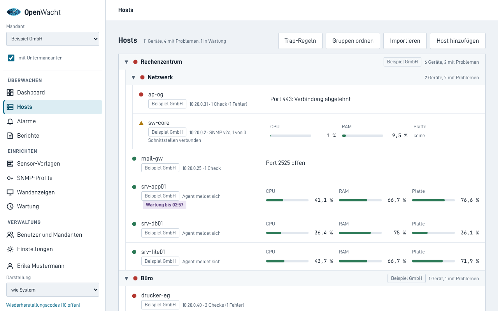
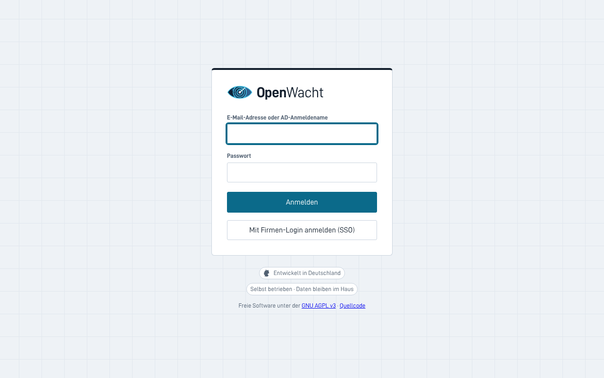
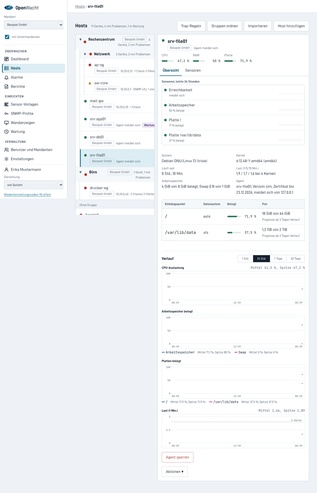
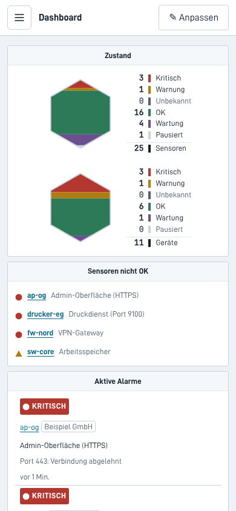
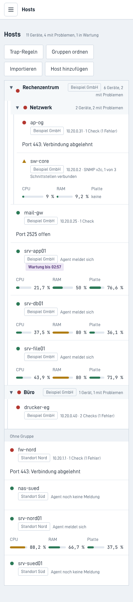

# OpenWacht

Open-Source-Monitoring aus Europa: mandantenfähige Monitoring-Plattform für Server, Netzwerkgeräte und Dienste,
selbst betrieben. Freie Software unter der GNU AGPL v3 (siehe [Lizenz](#lizenz)).



**Stand:** 1.0.0. Handbuch: [`docs/handbuch/`](docs/handbuch/README.md), Änderungen: [`docs/release-notizen.md`](docs/release-notizen.md).
Jeder Build legt neben `SHA256SUMS` eine Software-Stückliste (CycloneDX) ab; für Kunden ohne Internet gibt es ein
Offline-Installationspaket (`deploy/offline/`, Handbuch Kapitel 14).

## Aufbau

| Ordner | Inhalt |
| --- | --- |
| `cmd/zentrale` | Zentrale: API, Web-Oberfläche, aktive Checks, Alarmierung |
| `internal/zentrale` | HTTP-Server: Anmeldung, Sitzungen, Sicherheits-Middleware |
| `internal/auth` | Argon2id, TOTP (RFC 6238), AES-256-GCM |
| `internal/pki` | Agent-CA: Client-Zertifikate, Server-Zertifikat, Fingerabdruck-Pinning |
| `internal/agent` | Agent: Messwerte (Linux: /proc und statfs, Windows: Win32-API), Registrierung, Melden, Erneuern, Dienst-Einrichtung |
| `internal/checks` | aktive Checks (Ping, TCP, HTTP, TLS) und die Netzfreigabe gegen Zugriffe ins Netz der Zentrale |
| `internal/agentproto` | Protokoll Agent ↔ Zentrale: Token, Anfragen, Messwerte mit Prüfung |
| `cmd/agent` | Agent für Linux, Windows und weitere Systeme |
| `internal/` | gemeinsamer Go-Code |
| `web/` | Web-Oberfläche (SPA, React + TypeScript, Vite) |
| `internal/webui/` | bettet die gebaute Oberfläche in die Zentrale ein |
| `internal/db/` | PostgreSQL: Migrationen, Mandantenbaum, Row-Level Security |
| `tools/build` | Build-Werkzeug für alle Zielplattformen, Debian-Paket, Stückliste |
| `tools/sbom` | Stückliste (SBOM, CycloneDX 1.6) aus `go.mod`, `go.sum`, `web/package-lock.json` und der Build-Info der Binaries |
| `tools/signieren` | Agent-Updates offline signieren (nur auf dem Rechner mit dem Update-Schlüssel) |
| `internal/ontap` | NetApp ONTAP über die REST-API, nur lesend; Attrappe `internal/ontap/ontaptest` und `tools/ontapattrappe` für Tests und Bilder |
| `internal/xapi` | XenServer und XCP-ng über XAPI (JSON-RPC, `/rrd_updates`), nur lesend; Attrappe `internal/xapi/xapitest` und `tools/xapiattrappe` für Tests und Bilder |
| `deploy/offline` | Offline-Installationspaket bauen (`paket-bauen.sh`) und beim Kunden installieren (`installieren.sh`) |
| `docs/handbuch` | Handbuch mit Bildschirmfotos |
| `deploy/linux` | systemd-Units (auch im Binary und im Debian-Paket), Hinweise zu PostgreSQL, Caddy (nur noch für ntfy) und ntfy |
| `tools/simagent` | simuliert Agents für Entwicklung und Tests (echtes Protokoll, erfundene Werte; nicht für den Betrieb) |

## Bauen und testen

Voraussetzung: Go laut `go.mod` (lädt die passende Toolchain bei Bedarf selbst) und Node.js (aktuelle LTS) für die Oberfläche.
`tools/build` baut zuerst die Oberfläche (`npm ci`, `npm run build`), dann die Binaries; mit `-ohne-web` nur die Binaries. Die Versionsnummer steht in der Datei `VERSION` (je Version hochzählen); die Oberfläche zeigt sie nach der Anmeldung unten an.

Oberfläche entwickeln: Zentrale lokal auf `127.0.0.1:8443` starten, dann in `web/` `npx vite` (leitet `/api` an die Zentrale weiter).

```sh
go test -race ./...                      # Tests
go run ./tools/build                     # Stufe 1: Linux und Windows, amd64 und arm64
go run ./tools/build -ziele alle         # zusätzlich armv7, macOS, FreeBSD
go run ./tools/build -version 0.1.0      # andere Versionsnummer als in VERSION
```

Die Binaries landen in `dist/`, zusammen mit der Stückliste `openwacht-<version>.cdx.json` und `SHA256SUMS`.

### Datenbanktests

Die Tests zur Mandantentrennung laufen gegen ein echtes PostgreSQL (16 oder neuer).
Sie brauchen einen Superuser, legen eine eigene Datenbank und eigene Rollen an und räumen danach auf:

```sh
OPENWACHT_TEST_DSN="host=127.0.0.1 port=5432 user=postgres password=... dbname=postgres" \
  go test -race ./internal/db/
```

Ohne `OPENWACHT_TEST_DSN` werden sie übersprungen; in der CI sind sie Pflicht (`OPENWACHT_REQUIRE_DB=1`).

### Installation (Betrieb)

In einer Zeile: `apt install ./openwacht-zentrale_<version>_amd64.deb` (Debian 13 mit PostgreSQL). Das Paket
richtet alles ein und gibt einen Link zum Einrichtungsassistenten im Browser aus; siehe `deploy/linux/README.md`.
Ohne Paket: `sudo openwacht-zentrale installieren`.

### Datenbank von Hand einrichten (andere Umgebungen)

Vor der ersten Migration legt ein Datenbank-Admin die Rollen an. Die Zentrale meldet sich nie als Eigentümer an.
Für den Betrieb auf einem eigenen Rechner gibt es eine Variante ganz ohne Passwörter (Peer-Authentifizierung), siehe `deploy/linux/`:

```sql
CREATE ROLE openwacht_app NOLOGIN;                 -- Gruppenrolle, für sie gilt Row-Level Security
CREATE ROLE openwacht_owner LOGIN PASSWORD '...';  -- führt Migrationen aus, besitzt das Schema
CREATE ROLE openwacht_zentrale LOGIN PASSWORD '...' IN ROLE openwacht_app;  -- Login der Zentrale
CREATE DATABASE openwacht OWNER openwacht_owner;
```

Danach:

```sh
export OPENWACHT_DB_EIGENTUEMER="host=... user=openwacht_owner password=... dbname=openwacht"
openwacht-zentrale migrieren
openwacht-zentrale einrichten -mandant IT -email admin@example.org -name "Admin"   # Passwort per Standardeingabe
openwacht-zentrale schluessel > /etc/openwacht/schluessel && chmod 600 /etc/openwacht/schluessel

export OPENWACHT_DB="host=... user=openwacht_zentrale password=... dbname=openwacht"
openwacht-zentrale starten -basis-url https://openwacht.example.org -schluessel /etc/openwacht/schluessel \
  -adresse 127.0.0.1:8443 -proxy 127.0.0.1/32          # hinter einem Reverse Proxy mit TLS
```

Agents verbinden sich über einen eigenen Port mit TLS 1.3 und Client-Zertifikaten (mTLS). Er lässt sich nicht
hinter einen normalen Reverse Proxy legen, weil die Zentrale die Client-Zertifikate selbst prüfen muss:

```sh
openwacht-zentrale starten ... -agent-adresse :8444 -agent-namen openwacht.example.org,172.16.0.40
```

Beim ersten Start legt die Zentrale ihre Agent-CA an (privater Schlüssel mit dem Hauptschlüssel verschlüsselt in
der Datenbank). Registrierungs-Token enthalten den Fingerabdruck dieser CA; Agents vertrauen beim ersten Kontakt nur ihr.

### Aktive Checks

Checks (Ping, TCP-Port, HTTP(S), TLS-Zertifikat) legen Admins und Operatoren je Mandant in der Oberfläche an.
Sie laufen **von der Zentrale aus**. Damit Mandanten darüber nicht das Netz der Zentrale abtasten, darf ein Check
nur Adressen aus den Netzen erreichen, die der Betreiber freigibt:

```sh
openwacht-zentrale starten ... -check-netze 172.16.0.0/12,10.0.0.0/8
```

- Ohne `-check-netze` ist nichts freigegeben; alle Checks melden „nicht freigegeben“.
- Loopback (`127.0.0.0/8`, `::1`) und Link-Local (`169.254.0.0/16` mit den Metadaten-Diensten von Clouds, `fe80::/10`)
  gibt nur ein Eintrag frei, der darin liegt, z. B. `127.0.0.1/32` für ein ntfy auf demselben Rechner.
  `0.0.0.0/0` reicht dafür nicht. Multicast, Broadcast und `0.0.0.0/8` sind nie erlaubt.
- Geprüft wird jede aufgelöste Adresse und noch einmal die tatsächlich verbundene (gegen DNS-Rebinding).
  HTTP-Checks folgen keinen Weiterleitungen und benutzen nie einen Proxy aus der Umgebung.
- **Ping** braucht kein Root: Die Zentrale benutzt ICMP-Datagram-Sockets. Dafür muss ihre Gruppe in
  `net.ipv4.ping_group_range` liegen (bei Debian und Ubuntu Standard, prüfen mit `sysctl net.ipv4.ping_group_range`).
  Sonst meldet der Check „Ping nicht erlaubt“.

Die Freigabe lässt sich auch auf der Seite **Einstellungen** pflegen und je Mandant weiter eingrenzen
(siehe „Einstellungen in der Oberfläche“). Eine Adresse muss dann global **und** in den Netzen des Mandanten und
aller darüber liegenden Mandanten freigegeben sein.

### Einstellungen in der Oberfläche

Netzfreigabe, Alarmziele, Totmannschalter und Schwellen (`-stumm-nach`, Platte, RAM, CPU) pflegt der **Betreiber**
auf der Seite Einstellungen. Betreiber ist nicht jeder Admin, sondern nur ein Benutzer des Hauptmandanten mit
eingerichteter Zwei-Faktor-Anmeldung, dem das Kennzeichen auf der Shell gegeben wurde:

```sh
OPENWACHT_DB_EIGENTUEMER=… openwacht-zentrale betreiber -email admin@example.org   # vergeben
OPENWACHT_DB_EIGENTUEMER=… openwacht-zentrale betreiber                              # anzeigen
OPENWACHT_DB_EIGENTUEMER=… openwacht-zentrale betreiber -email … -entziehen          # entziehen
```

- **Startoptionen gewinnen.** Steht z. B. `-check-netze` in der Unit, gilt dieser Wert und das Feld ist in der
  Oberfläche gesperrt. Beim ersten Start übernimmt die Zentrale gesetzte Startoptionen in die Datenbank (nur Felder
  ohne Wert). Nimmt man die Option danach aus der Unit, gilt der Wert aus der Oberfläche.
- Netzfreigabe, Alarmziele und Totmann-Adresse verlangen beim Speichern einen frischen Code aus der Authenticator-App.
  Die Totmann-Adresse liegt verschlüsselt in der Datenbank und wird nie angezeigt.
- Je Mandant: eigene Netze (grenzen nur ein, Untermandanten erben) und Schwellen. Je Gerät: Schwellen
  (Admins und Operatoren, Aktionsmenü am Gerät). Es gilt Gerät vor Mandant vor Installation.
- Alle Änderungen stehen im Audit-Log. `-adresse`, `-basis-url`, TLS, Schlüssel und `-proxy` bleiben Startoptionen.

### Alarme per ntfy

Alarmkanäle legen Admins je Mandant in der Oberfläche an (ntfy-Server, Topic, optional ein Zugangstoken).
Ein Kanal mit „auch Untermandanten“ meldet zusätzlich die Checks und Hosts des ganzen Teilbaums; Untermandanten sehen ihn nicht.
Welche ntfy-Server ein Kanal benutzen darf, gibt der Betreiber frei (sonst wäre die Adresse ein Ziel aus dem Netz
der Zentrale, das Mandanten selbst wählen):

```sh
openwacht-zentrale starten ... -alarm-ziele http://127.0.0.1:2586,https://ntfy.example.org
```

- Ohne `-alarm-ziele` werden keine Alarme verschickt. `https` ist Pflicht, `http` nur für Loopback.
- Gemeldet wird so: ein Fehler nach 2 Fehlschlägen in Folge und nur bei Zustandswechsel, eine Erinnerung
  nach 12 Stunden, Warnungen sofort und einmalig, eine Entwarnung bei Erholung. Alle 15 Sekunden gehen die
  Ereignisse gesammelt je Kanal raus. Scheitert der Versand, versucht es der nächste Durchlauf erneut.
- Hosts: Ein Agent, der sich `-stumm-nach` lang (Standard `3m`, mindestens zwei Meldeintervalle) nicht meldet, löst
  einen kritischen Alarm aus; meldet er sich wieder, kommt die Entwarnung. Gesperrte Agents alarmieren nie, ein
  noch offenes Problem wird beim Sperren entwarnt. Nach dem Start schweigt die Zentrale über stumme Agents, bis
  `-stumm-nach` vergangen ist: Sie konnten sich ja nicht melden, solange die Zentrale aus war.
- Messwerte: Belegung von Platten (`-platte-warn 90`, `-platte-krit 95`) und Arbeitsspeicher (`-speicher-warn 90`,
  `-speicher-krit 95`) in Prozent, `0` schaltet eine Schwelle ab. Entwarnt wird erst 2 Prozentpunkte unter der
  Schwelle. Netzwerkfreigaben (NFS, SMB, Ceph, GlusterFS) zählen nicht. Die Schwellen gelten für alle Mandanten.
- Für Host-Alarme verlassen Hostname, Einhängepunkt und Belegung in Prozent die Zentrale Richtung ntfy-Server.
- Das Token liegt nur verschlüsselt in der Datenbank (gebunden an Kanal, Mandant und Server) und wird nie wieder
  angezeigt. Wechselt der Server eines Kanals, wird es entfernt.
- Der Versand benutzt keinen Proxy aus der Umgebung und folgt keinen Weiterleitungen. Für `https` gelten die
  Zertifikate des Systems.

Die Zentrale verweigert den Start, wenn sie als Eigentümer, Superuser oder mit BYPASSRLS verbunden ist,
wenn die Schlüsseldatei für andere lesbar ist oder wenn sie ohne TLS auf einer Nicht-Loopback-Adresse lauschen soll.

**Den Hauptschlüssel sichern:** Ohne ihn lassen sich die verschlüsselten 2FA-Geheimnisse nicht mehr lesen;
alle Benutzer müssten 2FA neu einrichten.

### Wandanzeige

Unter `/anzeige` zeigt OpenWacht den Zustand eines Mandanten als Sonnendiagramm, als groben Überblick: innen der Mandant, nach außen
Untermandanten, Gruppen (auch verschachtelt) und Geräte. Einzelne Sensoren erscheinen nicht; ein Gerät trägt den schlimmsten Zustand seiner
Sensoren, jeder Ring den schlimmsten Zustand darunter, jedes Gerät ist gleich breit (Grün OK, Gelb Warnung, Rot Alarm, Hellrot Alarm bestätigt, Grau
unbekannt, Blau Wartung oder pausiert). Gedacht für einen Bildschirm ohne Benutzerkonto:

- Ein Admin legt unter Verwaltung → Wandanzeigen eine Anzeige an (optional mit Untermandanten und nur aus einem Netz) und bekommt einmalig einen
  Link `https://…/anzeige#<Schlüssel>`. Gespeichert ist nur der Hash; Löschen sperrt die Anzeige sofort.
- Der Schlüssel steht im Fragment und erreicht so weder Server- noch Proxy-Logs. Die Seite tauscht ihn gegen ein HttpOnly-Cookie (400 Tage,
  bei jeder Abfrage verlängert) und entfernt ihn aus der Adresszeile.
- Die Anzeige liest wie ein Leser, aber nur Namen und Zustände (Datenbankkontext `app.display_id`, Migration 0015); Meldungen, Messwerte und
  Personennamen bekommt sie nicht, schreiben kann sie nichts.
- Gruppen und ihre Reihenfolge übernimmt die Anzeige aus dem Gruppenbaum (siehe unten); leere Gruppen lässt sie weg.

### Gruppenbaum

Gruppen ordnen die Geräte eines Mandanten für die Hosts-Liste und die Wandanzeige, z. B. `Switche` mit `Lancom` und `Aruba` darunter. Rechte
hängen weiterhin allein am Mandanten.

- Jeder Mandant hat seinen eigenen Baum mit höchstens 4 Ebenen; ein Gerät liegt in höchstens einer Gruppe seines Mandanten.
- Im Reiter Hosts unter „Gruppen ordnen“: Gruppen anlegen, umbenennen, verschieben (Auswahl „Liegt in“ oder mit der Maus ziehen), mit ↑/↓
  sortieren und löschen. Beim Löschen wandern Geräte und Untergruppen eine Ebene höher; es geht nichts verloren.
- Geräte markieren und gesammelt verschieben (bis 300 auf einmal) oder einzeln auf eine Gruppe ziehen; im Formular des Geräts gibt es dafür
  die Auswahl „Gruppe“.
- Pflegen dürfen Admins und Operatoren, lesen alle mit Sicht auf den Mandanten. Zyklen, Tiefe und Mandantengrenzen prüft die Datenbank selbst
  (Migration 0016); sie übernimmt beim Update die bisherigen Pfade am Gerät (gleich geschriebene Ebenen ohne Groß/Klein werden eine Gruppe).

### Agent als Sammler

Ein Agent kann SNMP-Geräte in seinem Netz abfragen, die die Zentrale nicht erreicht (Außenstelle, Fertigung). Er bleibt dabei ein Agent:
Er holt Geräteliste und Zugangsdaten über seine mTLS-Verbindung ab und schickt die Ergebnisse; er öffnet keinen Port und nimmt keine
Traps an.

```sh
# auf dem Rechner des Agents, als root bzw. Administrator: nur diese Netze darf er abfragen
sudo openwacht-agent sammler -netze 10.20.0.0/16
sudo openwacht-agent sammler          # anzeigen
sudo openwacht-agent sammler -aus     # zurücknehmen
```

- Die Freigabe steht nur auf dem Rechner (`sammler.json` im Verzeichnis des Agents). Die Zentrale kann den Sammler weder einschalten noch
  auf andere Adressen lenken; der Agent prüft jede Zieladresse unmittelbar vor dem Verbindungsaufbau gegen seine Netze. Der Dienst liest die
  Datei bei jedem Meldezyklus, ein Neustart ist nicht nötig.
- In der Oberfläche beim Gerät unter SNMP „Abgefragt von“ den Agent wählen. Angeboten werden nur Sammler im Mandanten des Geräts; für
  IP-Adressen außerhalb seiner Netze lehnt die Zentrale ab und gibt dem Agent keine Zugangsdaten. „Verbindung prüfen“ und Traps gibt es nur bei
  Abfrage durch die Zentrale.
- Zugangsdaten hält der Agent nur im Speicher. Die Zentrale schickt sie nur, wenn sich die Liste geändert hat.
- Die Messwerte des Sammlers prüft die Zentrale wie Agent-Daten (Grenzen, bereinigte Texte, plausible Zeit); Raten und Neustarts rechnet sie
  selbst aus ihren gespeicherten Werten.
- Fällt der Sammler aus (meldet sich nicht, holt keine Geräteliste mehr ab oder ist lokal ausgeschaltet), werden seine Geräte grau, und es gibt
  einen Alarm am Sammler (Gegenstand „Sammler“), keine Einzelalarme. Danach zählt „antwortet nicht“ für seine Geräte neu.
- Höchstens 500 Geräte je Sammler, 4 Abfragen gleichzeitig.

### Eigene Sensoren und Sensor-Vorlagen

Am Gerät, Reiter „Sensoren“: „+ Sensor“ frei oder aus einer Vorlage. Die Zentrale misst Ping (mit Paketzahl und Schwellen für Verlust und
Antwortzeit), TCP-Port, HTTP(S), TLS-Zertifikat, DNS-Auflösung (optional eigener Server und erwartete Adressen), HTTP-JSON-Wert (Pfad mit
Schwellen oder erwartetem Wert), TCP-Banner (erste Zeile von SMTP, IMAP, SSH, FTP, auch mit direktem TLS) und Zeitserver (NTP-Abweichung zur
Zentrale, Stratum). Texte aus Antworten werden nur verglichen, nie angezeigt. „SNMP eigene OID“ (Zahl mit Schwellen, Zähler als Rate je
Sekunde oder Vergleich mit einem Text) läuft mit der SNMP-Abfrage des Geräts mit, auch über einen Sammler; Texte vom Gerät speichert die
Zentrale nur als Hash. Der Agent misst „Dienst läuft“ (systemd-Unit bzw. Windows-Dienst), „Prozess läuft“ (nur Programmname und Anzahl),
„Datei- oder Ordneralter“ (optional Mindestgröße) und „Docker-Container läuft“ (Zustand und Health).

Sensoren auf dem Agent sind feste Messarten mit Parametern als Daten, keine Skripte und keine Befehle. Der Agent holt seine Liste bei jedem
Meldezyklus ab und misst nur, was auf dem Rechner freigegeben ist:

```sh
# auf dem Rechner des Agents, als root bzw. Administrator
sudo openwacht-agent sensoren -arten dienst,prozess,datei,docker -ordner /var/backups,/var/lib/vz/dump -docker http://127.0.0.1:2375
sudo openwacht-agent sensoren          # anzeigen
sudo openwacht-agent sensoren -aus     # zurücknehmen
```

- Datei-Sensoren nur unter den freigegebenen Ordnern; der Agent prüft das vor jedem Zugriff und noch einmal nach dem Auflösen von Links.
  Gemeldet werden nur Alter und Größe, bei Ordnern das Alter des jüngsten Eintrags, nie Namen oder Inhalte. `/tmp` sieht der Dienst wegen
  `PrivateTmp` nicht; Dateien muss das Dienstkonto lesen dürfen.
- „Prozess“ unter Linux: `-arten …,prozess` schreibt als root die Ergänzung
  `/etc/systemd/system/openwacht-agent.service.d/sensoren-prozess.conf` (`ProtectProc=default`), sonst sieht der Dienst nur eigene Prozesse;
  danach `systemctl restart openwacht-agent`. Gelesen wird nur `/proc/<pid>/comm`.
- „Dienst“ unter Linux ruft `/usr/bin/systemctl show` mit dem geprüften Namen auf (ohne Shell, nur lesend), unter Windows die
  Dienststeuerung nur mit Leserechten.
- „Docker“ nur über einen lokalen, nur-lesenden Socket-Proxy (z. B. docker-socket-proxy mit `CONTAINERS=1`, nur auf 127.0.0.1); den
  Docker-Socket selbst öffnet der Agent nie, er kommt nicht in die Gruppe `docker`. Gelesen wird nur die Containerliste (Name, Zustand, Health).
- Nicht freigegebene Sensoren meldet der Agent als „unbekannt“ mit dem nötigen Befehl. Agent-Sensoren laufen höchstens jede Minute.

Namen: Der Name ist kein Pflichtfeld. Leer bildet die Zentrale ihn aus Art und Ziel („Ping“, „TCP 53“, „HTTP 443“,
„DNS heise.de“), das Formular zeigt den Vorschlag schon an. Namen sind je Gerät eindeutig; ist der Vorschlag vergeben, kommt eine Nummer
dazu („Ping 2“), ein selbst eingetippter, vergebener Name wird mit einer Meldung abgelehnt. Alarme und ntfy zeigen „Gerät · Sensor“.

Vorlagen (Menü „Sensor-Vorlagen“): eingebaute und eigene je Mandant (pflegen Admins und Operatoren). `{adresse}` steht für die Adresse des
Geräts. Anwenden legt je Gerät eine Kopie unter dem Namen der Vorlage an (gibt es ihn am Gerät schon, wird das Gerät übersprungen), für
einzelne Geräte oder einmalig für alle Geräte einer Gruppe (optional mit Untergruppen); Änderungen an der Vorlage ändern keine Sensoren.

## Zielplattformen des Agents

- **Stufe 1** (bei jedem Release getestet): Debian/Ubuntu, RHEL/Rocky/Alma, Windows 10/11 und Server 2016+, jeweils amd64 und arm64
- **Stufe 2** (gebaut, ohne Gewähr): Linux armv7, macOS, FreeBSD

## Agent auf einem Linux-Rechner einrichten

```sh
# Binary als root ablegen (nur root darf es ändern, sonst lehnt die Einrichtung ab)
sudo install -o root -g root -m 0755 openwacht-agent_linux_amd64 /usr/local/bin/openwacht-agent

# Token und Befehl gibt es in der Oberfläche unter „Agent hinzufügen“
sudo openwacht-agent registrieren -zentrale https://openwacht.example.org:8444 -token owa1.…
sudo systemctl enable --now openwacht-agent
```

`registrieren` legt als root den Systembenutzer `openwacht-agent`, das Verzeichnis `/var/lib/openwacht-agent` (0700)
und die gehärtete Unit `/etc/systemd/system/openwacht-agent.service` an. Der Dienst läuft ohne Root und ohne
Capabilities, darf nur in sein Verzeichnis schreiben und öffnet keinen Port. Prüfen ohne zu senden:
`openwacht-agent pruefen`. Protokoll: `journalctl -u openwacht-agent`.

Der Agent erneuert sein Zertifikat selbst, wenn noch ein Drittel der Laufzeit übrig ist, jedes Mal mit neuem Schlüssel.
Ist er gesperrt, meldet er das im Journal und versucht es nur noch alle 15 Minuten.

## Agent auf einem Windows-Rechner einrichten

In einer PowerShell **als Administrator**, im Ordner mit der heruntergeladenen Datei:

```powershell
# Programm unter Program Files ablegen (nur Administratoren dürfen es ändern, sonst lehnt die Einrichtung ab)
New-Item -ItemType Directory -Force "C:\Program Files\OpenWacht" | Out-Null
Copy-Item .\openwacht-agent_windows_amd64.exe "C:\Program Files\OpenWacht\openwacht-agent.exe"

# Token und Befehl gibt es in der Oberfläche unter „Agent hinzufügen“ → Windows
& "C:\Program Files\OpenWacht\openwacht-agent.exe" registrieren -zentrale https://openwacht.example.org:8444 -token owa1.…
Start-Service openwacht-agent
```

`registrieren` legt als Administrator den Dienst `openwacht-agent` und das Verzeichnis
`C:\ProgramData\OpenWacht-Agent` an:

- **Konto:** virtuelles Dienstkonto `NT SERVICE\openwacht-agent` statt `LocalSystem`, ohne Passwort und ohne Anmeldung.
  Windows entfernt alle Privilegien außer `SeChangeNotifyPrivilege` aus seinem Token.
- **Verzeichnis:** feste Rechteliste, nichts geerbt: nur SYSTEM, Administratoren und das Dienstkonto.
  Ohne diese Liste dürften normale Benutzer unter `ProgramData` lesen. Ein schon vorhandenes Verzeichnis wird nur
  übernommen, wenn es und alles darin SYSTEM, den Administratoren oder dem Dienst gehört.
- **Programm:** Das Programm und alle Ordner darüber dürfen nur SYSTEM, Administratoren und TrustedInstaller ändern.
  Aus `Downloads` oder `ProgramData` heraus lehnt die Einrichtung ab.
- **Start:** automatisch (verzögert), bei Fehlern Neustart nach 10 Sekunden, 1 Minute und 5 Minuten.
- **Protokoll:** Ereignisanzeige → Windows-Protokolle → Anwendung, Quelle `openwacht-agent`.

Prüfen ohne zu senden: `openwacht-agent pruefen`. Windows kennt keine Load Average; die Oberfläche zeigt dort nur die
Zahl der Kerne. Erneute Registrierung mit `-neu`, danach `Restart-Service openwacht-agent`.

Entfernen: `Stop-Service openwacht-agent`, `sc.exe delete openwacht-agent`, danach `C:\ProgramData\OpenWacht-Agent`
und `C:\Program Files\OpenWacht` löschen und den Agent in der Oberfläche sperren.

## Bildschirmfotos

Die Bilder unter `docs/bilder/` und `docs/handbuch/bilder/` erzeugt `npm run bilder` in `web/` (Skript
`web/werkzeuge/bilder.ts`, Voraussetzungen im Kopf der Datei) mit erfundenen Demodaten.

| | |
| --- | --- |
|  |  |
|  |  |

## Lizenz

Copyright (C) 2026 Philipp-Maximilian Heller

OpenWacht ist freie Software: Du kannst sie unter den Bedingungen der GNU Affero General Public License, Version 3,
wie von der Free Software Foundation veröffentlicht, weitergeben und/oder verändern (`SPDX-License-Identifier:
AGPL-3.0-only`). OpenWacht wird in der Hoffnung verteilt, dass es nützlich ist, aber OHNE JEDE GEWÄHRLEISTUNG; sogar
ohne die implizite Gewährleistung der MARKTFÄHIGKEIT oder EIGNUNG FÜR EINEN BESTIMMTEN ZWECK. Den vollständigen
Lizenztext enthält [`LICENSE`](LICENSE).

Wer eine veränderte Fassung anderen über das Netz anbietet, muss ihnen den Quellcode dieser Fassung anbieten (AGPL
§ 13). Die Oberfläche verlinkt dafür unter der Anmeldung und in der Seitenleiste den Quellcode; bei einer eigenen
Fassung diesen Link anpassen (`web/src/Lizenz.tsx`).

Mitgelieferte Schriften (D-DIN, JetBrains Mono) stehen unter der SIL Open Font License 1.1 (`web/public/lizenzen/`),
Bibliotheken Dritter unter ihren eigenen Lizenzen (Stückliste im Build). Beiträge: siehe
[`CONTRIBUTING.md`](CONTRIBUTING.md).
