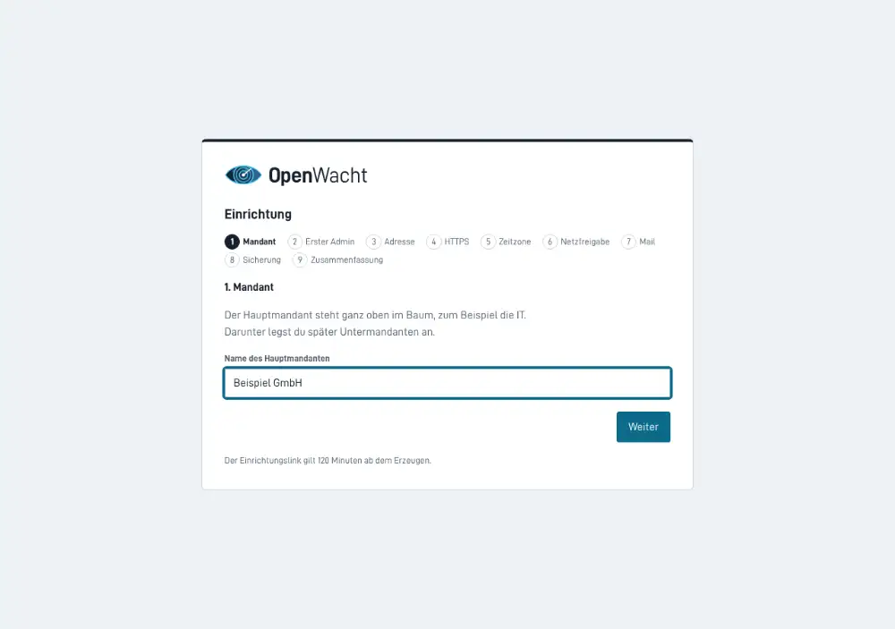
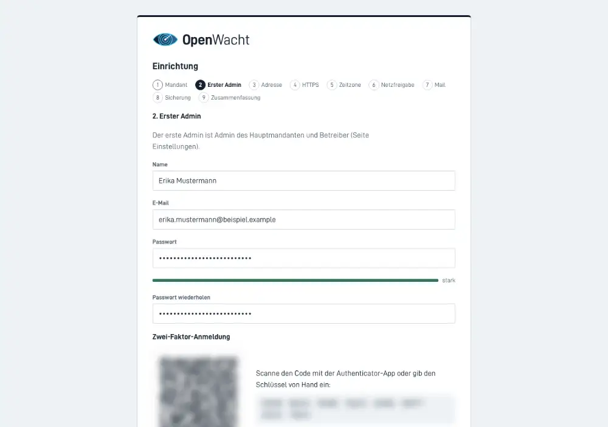
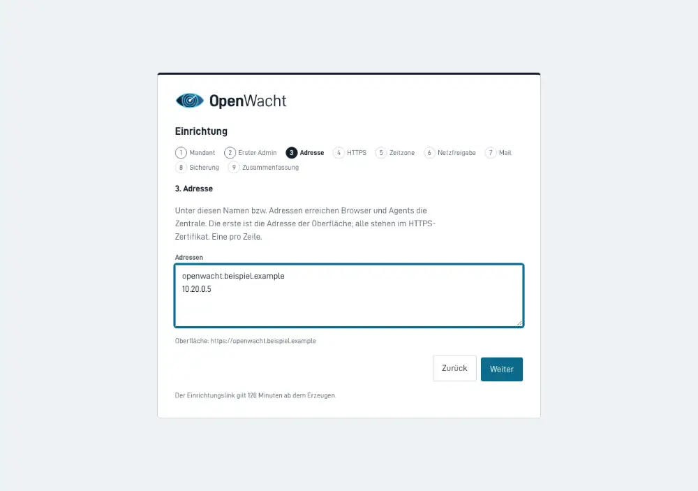
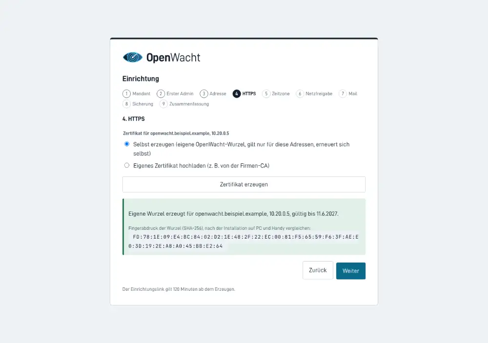
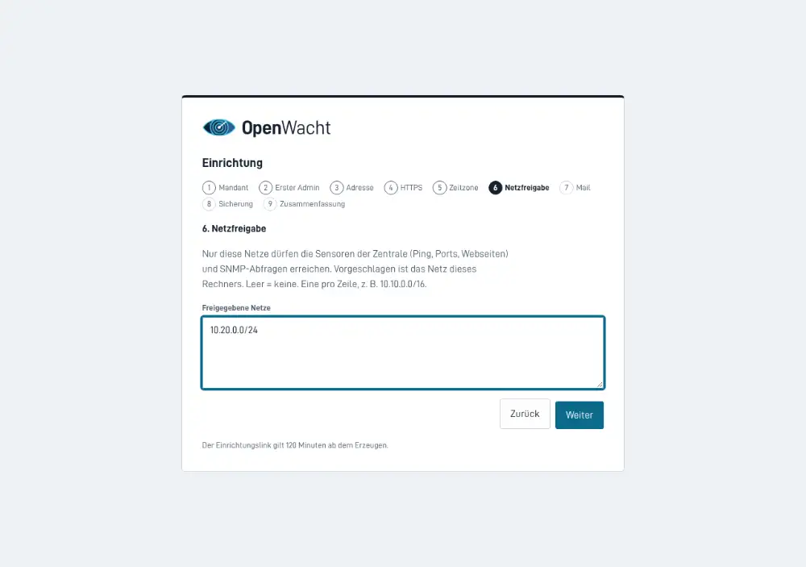
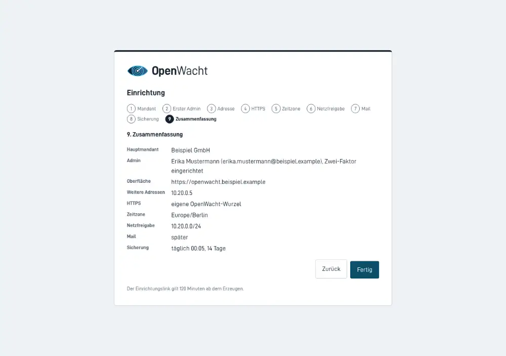
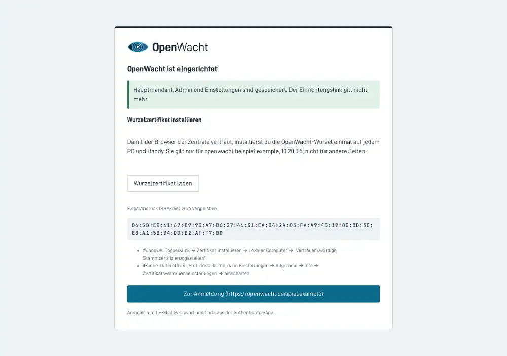
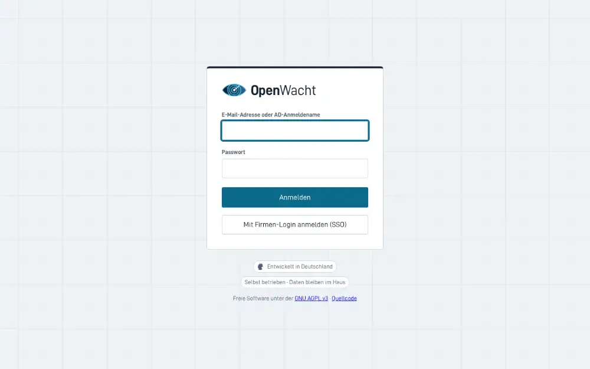
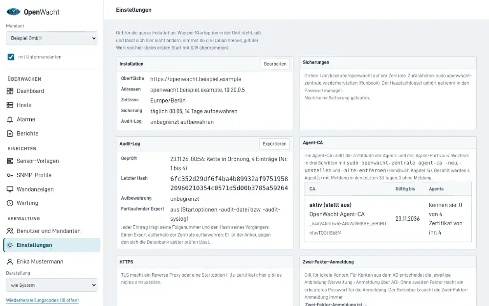
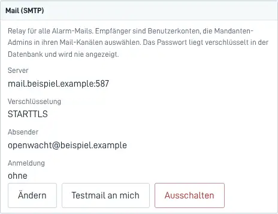

# 2. First setup

Open the setup link from the installation in the browser. Until “Fertig” (done), the central server only has a
temporary, self-signed certificate; the browser warning is expected at this point. You can compare the fingerprint that
`installieren` prints with the one in the browser.

The assistant has nine steps. Everything can be changed later under **Einstellungen** (settings).

| Step | Content |
| --- | --- |
| 1. Tenant | name of the main tenant, for example “Beispiel GmbH” |
| 2. First admin | name, e-mail, password (at least 12 characters), two-factor sign-in with an authenticator app |
| 3. Address | DNS names and IP addresses under which browsers and agents reach the central server; the first is the main address. Enter **the full name** (for example `openwacht.firma.example`) first – if it is missing, the browser will warn later |
| 4. HTTPS | certificate: create your own OpenWacht root or upload one from the company CA |
| 5. Time zone | for e-mails, maintenance windows and backup |
| 6. Network allow-list | networks that checks and SNMP may reach, for example `10.0.0.0/8` |
| 7. Mail | SMTP relay for alert e-mails (optional, can also be done later) |
| 8. Backup | time and retention of the daily backup |
| 9. Summary | everything once more, then “Fertig” |

The first admin is admin of the main tenant and **operator** of the installation (Betreiber). This account always needs
two-factor sign-in.

Suggested are the name under which the assistant was opened, the host name and the computer’s addresses. If no fully
qualified name is among them, the assistant shows a notice. All entries end up in the HTTPS certificate; anything
missing here can be added later under Einstellungen → Installation → “Adresse ändern …” (with your own root, this
creates a new root, which you distribute again).

## HTTPS

“Selbst erzeugen” (create yourself) creates your own **OpenWacht root**. It is technically limited to exactly the
entered names and addresses (name constraints): even whoever takes over the central server cannot forge other websites
with it. The server certificate renews itself 30 days before expiry.

If you have a company CA, upload certificate and key instead.

## Network allow-list

Sensors (ping, ports, HTTP, DNS …), SNMP, Proxmox and vCenter queries as well as AD and SSO only connect to addresses in
these networks. The mail relay is exempt; only the operator sets it. This way nobody can scan the central server’s
network through a sensor. Loopback (`127.0.0.1`) has to be allowed explicitly – only if sensors are to check services on
the central server itself; better not in installations with foreign tenants, because then every sensor reaches the
central server’s local services. Tenants can later further **restrict** the allow-list, never extend it.

## Finishing

After “Fertig”, the central server switches to normal operation without a restart. The setup link is no longer valid.

**Installing the root certificate:** With your own root, install the file “Wurzelzertifikat laden” (download root
certificate) once on every PC and phone that opens the interface. Compare the fingerprint.

- Windows: double-click → Install certificate → Local machine → “Trusted Root Certification Authorities”.
- iPhone: open the file, install the profile, then Settings → General → About → Certificate Trust Settings.
- Distribution via group policy works as well (the file is publicly available under `/openwacht-wurzel.crt`).

## Signing in

E-mail, password and the code from the authenticator app. Accounts connected through AD or SSO sign in with
`name@domain` or via “Mit Firmen-Login anmelden (SSO)” (sign in with company login) ([chapter 10](10-ad-und-sso.md)).

## Settings

Under **Einstellungen** (operator only) you find installation (address, time zone, backup), backups, HTTPS, mandatory
two-factor, network allow-list, alert targets, dead man’s switch, thresholds and mail. Sensitive changes (networks,
alert targets, HTTPS, address, mail, dead man’s switch) are confirmed with a fresh code from the app or, without
two-factor set up, with your own password.

**Mandatory two-factor:** “Pflicht für Admins” (required for admins, default), “Pflicht für alle lokalen Konten”
(required for all local accounts) or “freiwillig” (optional). For AD and SSO accounts the respective connection
decides. “Freiwillig” lowers security: a stolen password is then enough to sign in. Only choose it for purely internal
installations, never for a central server reachable from the internet. The operator always needs two-factor sign-in.

**Sign-in domains:** If a sub-tenant enters a domain (`name@firma.de`) or a NetBIOS name for its AD or SSO connection,
it appears here as “beantragt” (requested). Only after “Freigeben” (approve, with code) does the central server route
sign-ins with this domain to the sub-tenant’s directory; otherwise a tenant could route sign-ins including passwords for
foreign domains to its own server. A domain is approved for one connection only. Connections of the main tenant apply
immediately.

**Mail relay:** server, port, encryption (STARTTLS, TLS; “keine” (none) only on loopback), sender, optionally
authentication and your own CA for an internal relay. “Testmail an mich” (test mail to me) checks the connection.

