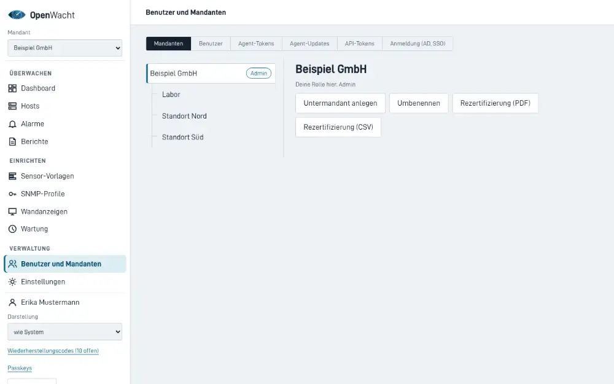
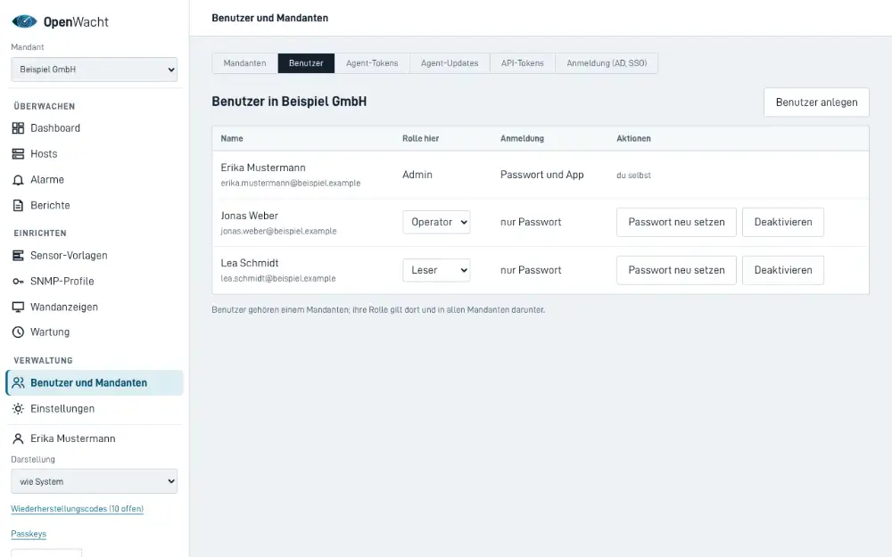

# 3. Tenants and roles

## Tenant tree

At the top is the main tenant (for example “Beispiel GmbH”), below it sub-tenants (for example “Fertigung”,
“Vertrieb”), which can have sub-tenants again. A role always applies to a tenant **and everything below**, never to
siblings or parents: an admin of production only manages production, the main tenant sees everything.



**Benutzer und Mandanten → Mandanten** (Users and tenants → Tenants): “Untermandant anlegen” (create sub-tenant) and
“Umbenennen” (rename). At the top left of the sidebar you choose which tenant you are currently viewing; “mit
Untermandanten” (with sub-tenants) includes their devices and alerts.

## Roles

| Role | may |
| --- | --- |
| Reader (Leser) | view everything in their own subtree |
| Operator | additionally maintain devices, sensors, groups, maintenance, acknowledge alerts, CSV import |
| Admin | additionally users, roles, alert channels, SNMP profiles, AD/SSO, API tokens, sub-tenants |
| Operator of the installation (Betreiber) | settings of the installation (no tenant right; only sees the tenants’ names) |

Nobody can grant rights they do not have themselves. The separation is checked by the application and additionally by
the database (row-level security): even an error in the application shows no foreign data.



**Benutzer und Mandanten → Benutzer** (Users): “Benutzer anlegen” (create user: e-mail, name, initial password), then
set the role per tenant. Accounts from AD or SSO are created automatically at the first sign-in
([chapter 10](10-ad-und-sso.md)).

The operator of the installation is set via the shell (owner of the database):

```bash
sudo -u svc_openwacht_db env OPENWACHT_DB_EIGENTUEMER="host=/run/postgresql user=openwacht_owner dbname=openwacht" \
  openwacht-zentrale betreiber -email erika.mustermann@beispiel.example
```

It must be an active account of the main tenant with two-factor sign-in. Granting and revoking are recorded in the
audit log.

## Recovery codes and lost phone

When setting up two-factor sign-in, OpenWacht shows ten recovery codes (form `xxxxx-xxxxx`). They appear only once;
keep them separately from the phone (printed or in a password manager). If the phone is missing, choose “Gerät
verloren? Wiederherstellungscode verwenden” (device lost? use recovery code) at sign-in. Every code is valid once. New
codes (the old ones expire) are available at the bottom of the sidebar under “Wiederherstellungscodes” with a code from
the app. Only HMAC values are stored; whoever reads the database cannot try the codes.

Without app and without code, the operator resets two-factor sign-in on the central server (check the person’s identity
first). All sessions of the account end; at the next sign-in the account sets up the app again:

```bash
sudo -u svc_openwacht_db env OPENWACHT_DB_EIGENTUEMER="host=/run/postgresql user=openwacht_owner dbname=openwacht" \
  openwacht-zentrale zweifaktor-zuruecksetzen -email erika.mustermann@beispiel.example
```

In the interface nobody can reset another person’s two-factor sign-in: whoever takes over an admin account should not
be able to take over other accounts with it.

## Requesting sub-tenants

Only admins of the main tenant create new tenants. Admins of a sub-tenant **request** a new tenant in their part of the
tree: Verwaltung → Mandanten → choose tenant → “Untermandant beantragen” (request sub-tenant), name and a short reason.
The request appears below the tenant in the list “Anträge auf Untermandanten” (requests for sub-tenants).

- It may be seen by the admins of the tenant under which it is to be created, and everyone above; not by siblings and
  sub-tenants.
- Admins of the main tenant see all open requests, approve them (the tenant is created immediately) or reject them,
  each with an optional note.
- Request, approval and rejection are recorded in the audit log (`mandant.beantragt`, `mandant.antrag_freigegeben`,
  `mandant.antrag_abgelehnt`). At most 20 open requests per tenant.

## Passkeys

A passkey (security key, Windows Hello, Touch ID, phone) replaces the six-digit code at sign-in. To set up: sidebar →
“Passkeys” → enter a name, code from the app, “Passkey hinzufügen” (add passkey), then the browser or device confirms.
At the next sign-in, “Mit Passkey anmelden” (sign in with passkey) appears after the password.

- Passkeys only exist **in addition** to the authenticator app. The app still confirms sensitive changes and is the way
  in when the passkey is missing. If the app is reset (`zweifaktor-zuruecksetzen`), all passkeys expire as well.
- Prerequisite: the interface runs under a **DNS name** with HTTPS (for example `openwacht.example.com`). Browsers do
  not allow passkeys under an IP address.
- At most ten per account. The central server only stores public keys; sign-ins and changes are recorded in the audit
  log (`anmeldung.passkey`, `passkey.angelegt`, `passkey.geloescht`). A counter that runs backwards (indicating a copied
  key) rejects the sign-in.

## Recertification

Admins of a tenant download a list under Verwaltung → Mandanten → “Rezertifizierung (PDF)” or “(CSV)”: per role in the
tenant and below, the account, origin (local, AD, SSO, API token), home tenant, app and passkeys, lock and **last
sign-in**. Accounts that have not signed in for more than 90 days are marked yellow in the PDF. The CSV (semicolon,
UTF-8) can be opened in Excel; cells that begin like a formula are prefixed with `'`. Every download is recorded in the
audit log.

## Accounts with roles in other tenants

An account can have roles on tenants outside its home tenant (for example an account in the warehouse, additionally
operator in IT). Setting the password, locking, unlocking and renaming is then only allowed for an admin who manages
**all** tenants on which the account has roles; otherwise OpenWacht reports “Dieses Konto hat Rollen auf Mandanten, die
du nicht verwaltest” (this account has roles on tenants you do not manage). In the example only an IT admin can do it.
This way an admin of a sub-tenant cannot gain foreign rights through a password reset. If an admin sets the password,
all sessions of the account end and a started, not yet confirmed two-factor setup is discarded.

## Locking and deleting accounts

**Locking** (Benutzer und Mandanten → Benutzer → “Deaktivieren”) ends the sign-in immediately; roles and settings
remain, “Aktivieren” brings the account back.

**Deleting (from 1.0.6):** OpenWacht deletes a locked account automatically **90 days after locking**; the list shows the
date (“wird am … gelöscht”, will be deleted on …). Before that, it can be deleted by hand with “Löschen …” in the row of
the locked account, by an admin who manages the account completely. Your own account and operators of the installation
are not deleted (first revoke the flag on the central server).

Roles, sessions, passkeys, recovery codes, API tokens and personal settings go with the account. Acknowledged alerts
keep the name as text, maintenance windows and requests only lose the reference. The **audit log remains unchanged**
(`benutzer.geloescht` with source “hand” or “frist”): it is a hash chain and only disappears with its retention period
(Einstellungen → Installation, unlimited by default). Accounts from AD are created again by the synchronisation at the
next sign-in if they are still active there; roles from AD groups then return, manually assigned ones do not.

## Failed attempts and lock

After five wrong passwords or codes, OpenWacht locks the **source** (IPv4 address or IPv6 network /64) for this account:
first 1 minute, then 2, 4, 8 … at most 60 minutes. The account itself remains usable: sign-in from other computers
continues, running sessions remain. This way nobody who reaches the sign-in page can lock out admins. From sources from
which the account has not signed in during the last 90 days, the central server waits before each check after five
failed attempts (1, 2, 4 … at most 15 seconds), so that distributed attacks stay slow. Failed attempts when confirming
sensitive changes count as well. The message always stays the same (“Anmeldung fehlgeschlagen”, sign-in failed), even
with a lock.

**Second factor (from 1.0.6):** In addition, the central server counts wrong codes (app or recovery code) for the
**whole account**: after ten wrong codes within 15 minutes, from whatever computers, sign-in with code is locked for
15 minutes. Passkeys keep working. Whoever tries that many codes already knows the password; the lock slows them down,
but can also block the account briefly. `entsperren` lifts it.

**Notifications by e-mail (from 1.0.6):** If mail delivery is set up, OpenWacht writes to the account on

- a sign-in from a computer or network from which it has not signed in during the last 90 days (not at the very first
  sign-in),
- a lock after failed attempts, the lock of the second factor and when two-factor sign-in was reset or the password was
  set on the central server.

The notifications except “new computer” also go to the operator. Per account and kind there is at most one e-mail per
hour. The e-mail names account and time, but no address: the central server only stores sources as HMAC.

The source is only stored as HMAC (the central server can compare, but not read out an address); entries expire after
90 days without activity. To lift a lock early (as owner of the database, with audit entry):

```bash
sudo -u svc_openwacht_db env OPENWACHT_DB_EIGENTUEMER="host=/run/postgresql user=openwacht_owner dbname=openwacht" \
  openwacht-zentrale entsperren -email erika.mustermann@beispiel.example
```

**Forgotten password (from 1.0.6):** A local account gets a new password in the interface from an admin who manages it
(Benutzer und Mandanten → Benutzer → in the account’s row “Passwort neu setzen”, set new password). If there is no such
admin any more, for example because the only admin password is lost, the owner of the database sets it anew on the
central server (hidden at the terminal, twice):

```bash
sudo -u svc_openwacht_db env OPENWACHT_DB_EIGENTUEMER="host=/run/postgresql user=openwacht_owner dbname=openwacht" \
  openwacht-zentrale passwort-setzen -email erika.mustermann@beispiel.example
```

All sessions of the account end, locks after failed attempts are lifted, two-factor sign-in remains (if the phone is
missing too: additionally `zweifaktor-zuruecksetzen`). The audit log shows `passwort.gesetzt` with source `shell`. For
accounts from AD or via SSO the command refuses: their password is changed there.

Behind a reverse proxy the address from `X-Forwarded-For` only counts if the proxy is entered as trusted with `-proxy`;
otherwise all users share the proxy’s address and therefore its lock.
