# 4. Hosts, groups and dependencies

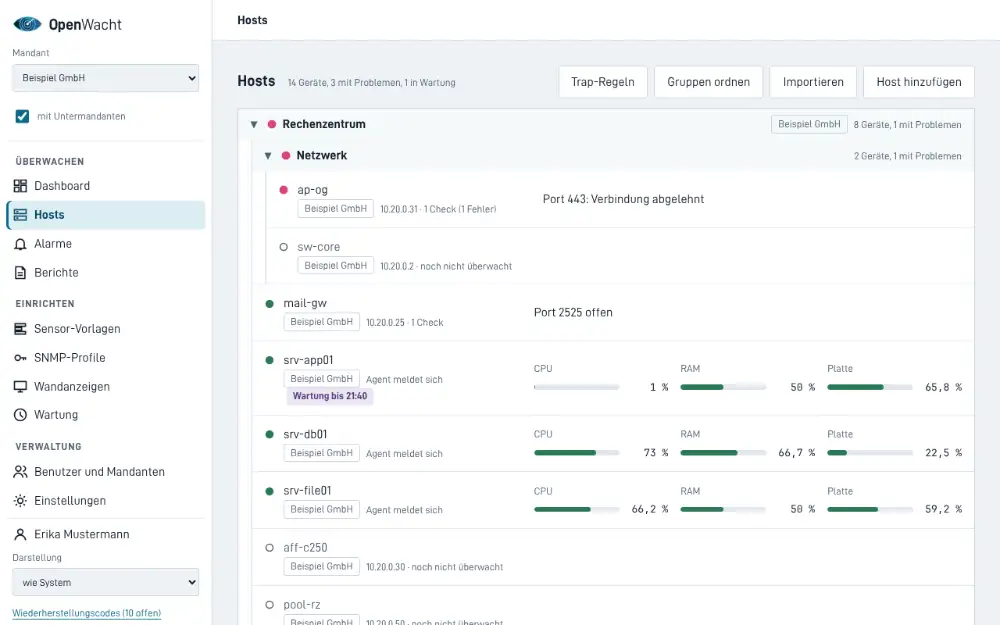

The **Hosts** page shows all devices of the chosen tenant in the group tree, with state (dot), CPU, RAM and disk. A
click opens the device with the tabs “Übersicht” (overview: values, history, graphs) and “Sensoren” (sensors).

**Quick search** (from 1.0.6): **Ctrl+K** (⌘K on the Mac) or “Suchen” at the top right opens a search field over all
devices, sensors, tenants and pages you may see, independent of the chosen tenant. Several words narrow down (“db
platte”). Hits at the start of the name come first, with equal quality the worst states. Arrow keys select, Enter opens:
a device with its overview, a sensor opens the device with the tab “Sensoren”, a tenant switches the tenant.

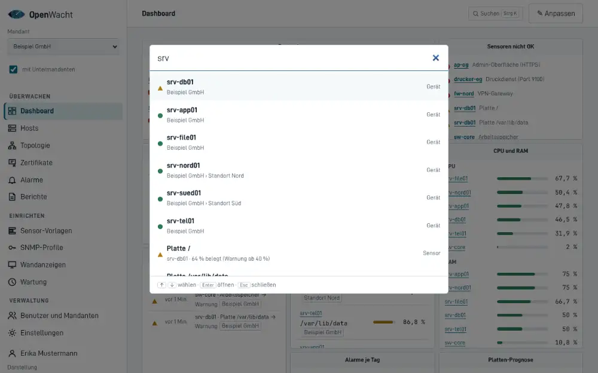

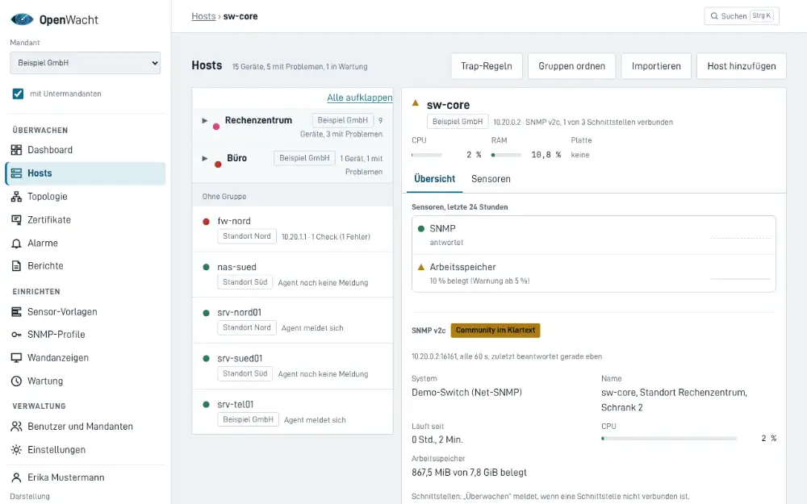

## Adding a host

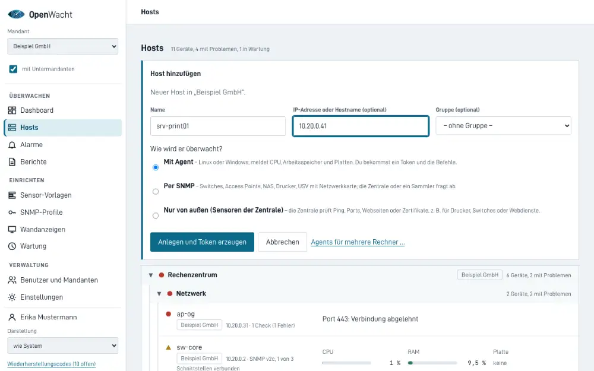

Name, optionally address and group, then the kind of monitoring:

- **With agent:** Linux or Windows; reports CPU, memory, disks and sensors on the computer ([chapter 5](05-agent.md)). A
  one-time token with the ready-made command is created.
- **Via SNMP:** switches, access points, NAS, printers, UPS ([chapter 6](06-snmp.md)).
- **Only from outside (checks):** the central server checks ping, ports, websites, certificates
  ([chapter 7](07-sensoren-und-vorlagen.md)).

Further sources in a device’s action menu (admins only): **Proxmox**, **vCenter**, **NetApp ONTAP**,
**XenServer/XCP-ng** and, for small sites, a **router from AVM** (TR-064). Setup, rights and alerts of each source are
described in [chapter 19](19-anbindungen.md). There is one of these polling sources per device. If an agent also runs
on a Proxmox host, these are two devices (for example `pve-01` with agent and `pve-01 (Proxmox)`).

## Groups

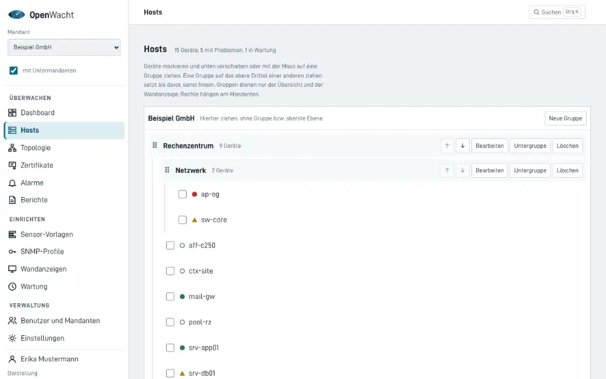

**Gruppen ordnen** (arrange groups): groups per tenant as a tree (up to 4 levels), order by hand, assign devices by
selection or dragging. If a group with content is deleted, devices and subgroups move up one level. Groups organise the
overview and the wall display and are targets for maintenance windows and templates. Under Hosts, groups are
**collapsed** by default (from 1.0.6) and still show the worst state and the number of devices with problems; “Alle
aufklappen” (expand all) opens all. The browser remembers which are open.

## Dependencies

Under “Gerät bearbeiten” (edit device) a device can **depend on a parent device** (for example a printer behind a
switch; same tenant, no cycles). If the parent device is unreachable (ping critical, agent silent or polling source
silent), there are no separate alerts for the devices below; Hosts shows “nicht erreichbar wegen …” (unreachable
because of …). All-clear notifications still go out.

## Moving to another tenant

From 1.0.6, in the device’s menu: **In anderen Mandanten verschieben …** (move to another tenant), choose the new
tenant, “Verschieben”. Only admins who manage **both** tenants may do this (for example an admin of the common parent
tenant).

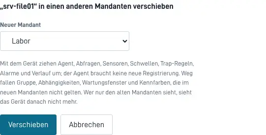

- **Moves along:** agent (without new registration: the certificate only contains the agent’s ID, the central server
  knows the tenant), polling (SNMP, Proxmox, vCenter, FRITZ!Box, NetApp, XenServer; the credentials are re-encrypted for
  the new tenant), sensors, thresholds, the device’s trap rules, exceptions, open and ended alerts, history and
  measurements.
- **Is dropped:** group, dependencies in both directions, maintenance and maintenance windows of the device, identifier
  colours that do not apply in the new tenant, releases for agent updates and unused registration tokens.
- **Rejected** with a notice if the polling runs through another device’s collector or the device’s agent collects for
  other devices, if an SNMP profile does not apply in the new tenant or if a trap rule is linked via “beendet” (ended)
  with a rule without this device. Resolve first, then move.
- Afterwards the **networks of the new tenant** apply: if a target is not in the allowed networks there, the affected
  sensors fail. The audit log of both tenants shows `geraet.verschoben`.

## Topology

**Topologie** in the sidebar shows the dependencies as trees, per tenant: at the top the device others depend on, below
it the dependent devices, with their own children over several levels. Every device carries its state (shape and
colour); the coloured left edge is the line to it in its state, dashed if it rests (parent device unreachable), is
unknown or not yet checked. A click opens the device. Devices without dependencies in either direction only appear as a
number below. The page only shows what you also see under Hosts.

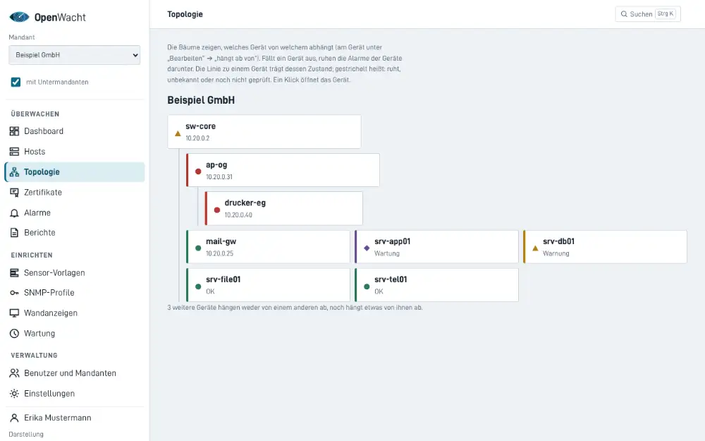

## Certificates

**Zertifikate** in the sidebar lists all “TLS-Zertifikat” (TLS certificate) sensors in the chosen area: address, device,
expiry date, remaining days and issuer (with a problem such as a wrong name, the notice instead), the earliest expiring
at the top. “Bald fällig” (due soon) only shows certificates expiring in the next 14, 30, 60 or 90 days, “Mit Problem”
(with problem) only warning, critical and unknown. A click on the device opens it. Date and issuer come from the
sensor’s last run; new certificates are added through a sensor on the device. The page only shows what you also see
under Hosts.

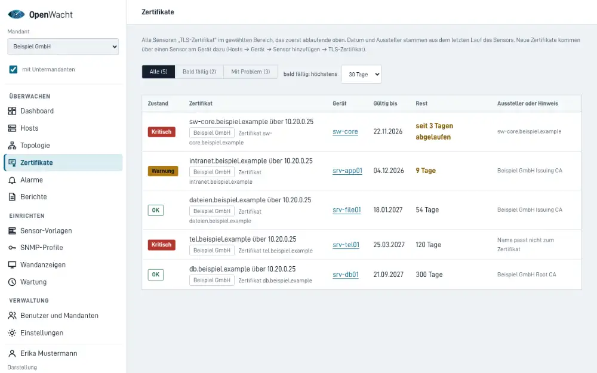

## Appearance

At the bottom left “Darstellung” (appearance): as system, light or dark. The choice applies per browser.

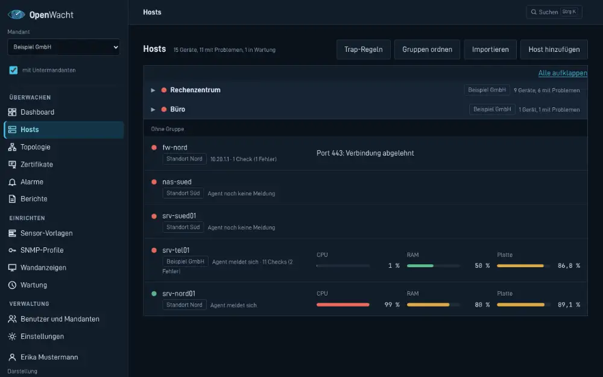

On the phone the sidebar collapses:

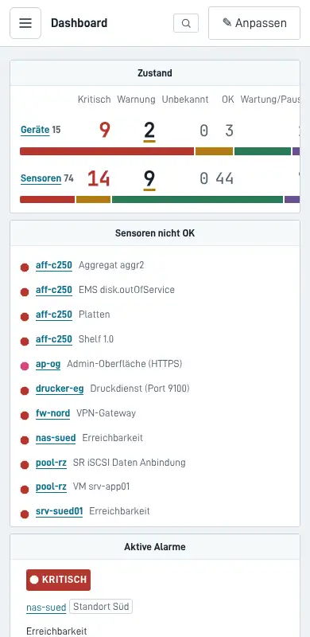

## Dashboard and wall display

The **dashboard** consists of widgets (state, sensors not OK, active alerts, CPU and RAM, fullest disks, alerts per
day, disk forecast, availability, graph, sunburst chart, events). Every user composes it themselves; the layout belongs
to their account and follows them to every device.

From 1.0.7 it can be freely adjusted. “✎ Anpassen” (customise) switches to editing mode:

- **Size:** every widget is 2 to 12 columns wide and 1 to 6 rows high. Drag the corner ◢ at the bottom right, or choose
  width and height via ⚙ (this also works with the keyboard).
- **Order:** drag at ⠿ or ▲▼. The grid fills gaps by itself with the next fitting widgets.
- **⚙ Settings:** own title, size, page, fixed tenant and the content (graph: value, period, device).
- **⧉ duplicate, ✕ remove, “+ Widget hinzufügen” (add widget):** every kind can be used any number of times, for
  example “Zustand” once per site with a fixed tenant. At most 60 widgets.
- **Pages:** up to eight named pages (for example “Leitstand”, “Auslastung”) as tabs above the grid; “+ Seite”,
  “Umbenennen” and “Seite löschen” (add, rename, delete page) are on the right next to the tabs in editing mode.
- **Standard wiederherstellen** (restore default) discards all pages and widgets.

New widgets from 1.0.7:

| Widget | shows |
| --- | --- |
| Certificates | the TLS certificates in the area, the earliest expiring at the top |
| Maintenance | running maintenance and the next maintenance windows |
| Single sensor | a chosen sensor large with state, message and “since” |
| Clock | time and date, for the control room |
| Note | your own text, at most 500 characters, for example the on-call number |

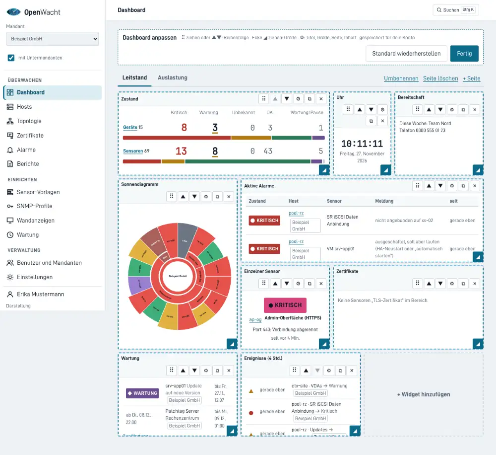

**Window size:** The grid adapts to the space it has. From about 780 px width, 12 columns stand side by side, below that
six (widgets half or full width), on the phone one. The button **“⤢ An Fenster anpassen”** (fit to window) additionally
divides the window height among the rows so that the whole dashboard fits on the screen without scrolling, also in full
screen on a large control-room screen. If the rows become too low (below about 110 px), scrolling remains. The browser
remembers the choice, not the account, because a wall screen needs something different from a notebook.

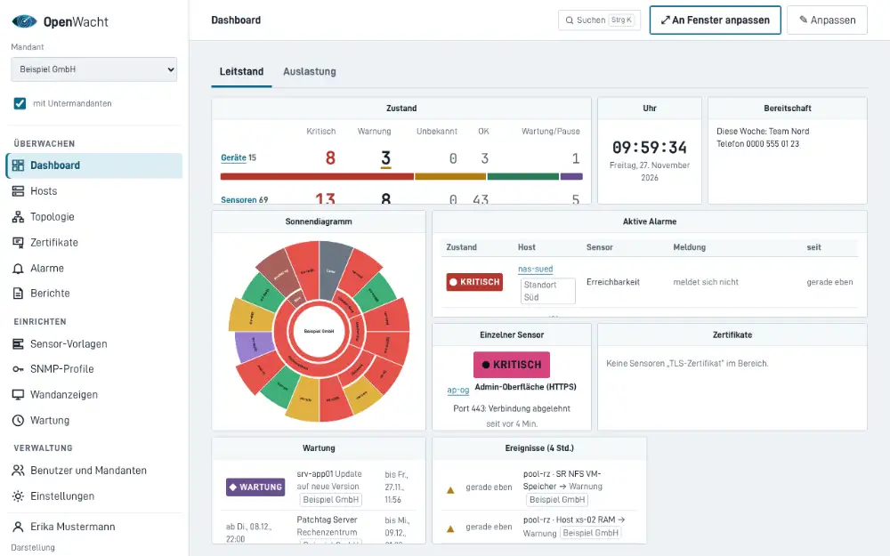

From 1.0.6, “Zustand” (state) shows per line devices and sensors the numbers per state, critical, warning and unknown
large in front. The bar below reflects the distribution; every problem is at least wide enough to remain visible, even
among thousands of OK sensors (then not to scale). A click on “Geräte” opens the hosts, on “Sensoren” the alerts.

The **wall display** (Einrichten → Wandanzeigen) shows a sunburst chart tenant → groups → devices without sign-in via a
secret link (shown only once, with QR code). Deleting blocks the display immediately.

In the list of wall displays (admins of the tenant only):

- **A click on the name** opens a **preview** in a new tab, in your session and without a link. It shows exactly the
  screen’s section (with or without sub-tenants), even if you yourself see more. The display’s network restriction does
  not apply to the preview.
- **Neuer Link** (new link) replaces the link after confirmation: the old link and all screens signed in with it are
  invalid immediately, the new one appears once with QR code. As before, only its hash is stored; this is recorded in
  the audit log.
- **Sound** (1.0.2): by default only for critical with a bling; optionally off or for warning and critical, with sound,
  volume and a soft tone on all-clear. The sound plays when a device newly goes into warning or critical. On the screen,
  **Ton einschalten** (switch on sound, top right of the sidebar) has to be clicked once, otherwise browsers play no
  sound; again after reloading the page. This is recorded in the audit log.

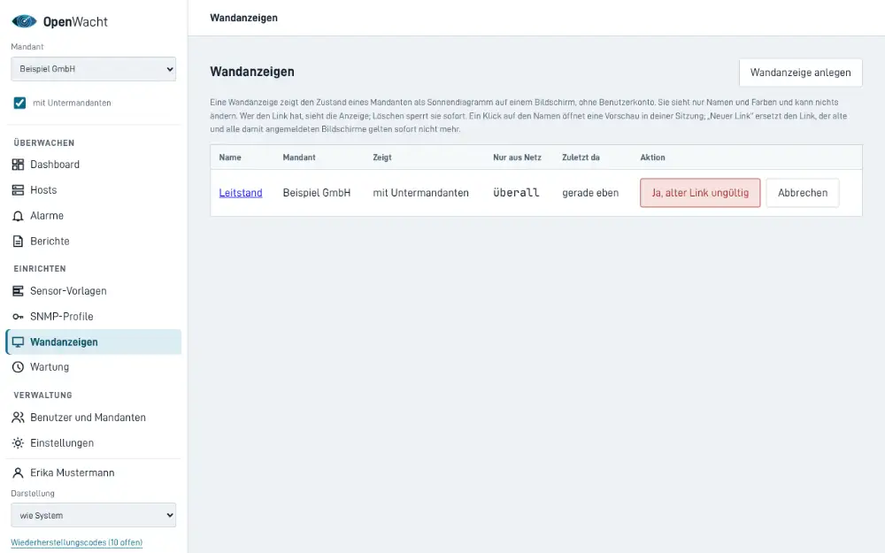

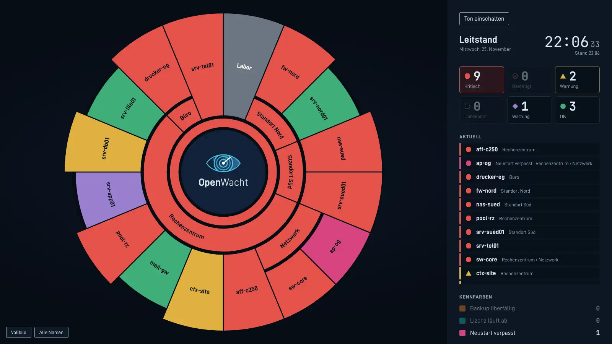

On the right next to it (below on a portrait screen):

- **Clock** with seconds, plus “Stand” (as of) of the last data. If the seconds stop, the page is frozen (browser hangs);
  if the connection to the central server is missing, a red notice appears, after two minutes the chart turns grey.
- **Numbers per state**; states without devices recede.
- **Aktuell** (current): the devices that are not OK, worst first, with tenant and group and, where applicable, the name
  of the identifier colour; at most twelve, the rest as a number.
- **Identifier colours:** all identifier colours the display knows, with the number of devices currently in this
  colour. As before, the display only shows names and colours, no sensors and no messages.

**Full screen and view “Namen”** (from 1.0.6), on the screen and in the preview:

- **Full screen** (button at the bottom left or key **F**) hides the browser bars; Esc ends it.
- **Alle Namen** (all names, key **N**) only shows the sunburst chart, as large as possible, with the display’s name and
  the clock above. Every device is labelled; with many devices the font gets smaller instead of names being dropped.
  Numbers, “Aktuell” and identifier colours only appear in the overview; “Übersicht” or N switches back.
- The view is in the address (`/anzeige?ansicht=namen`): a screen that starts with this address shows the names
  immediately. Nothing is stored in the browser.
- After three seconds without the mouse, pointer and buttons disappear.

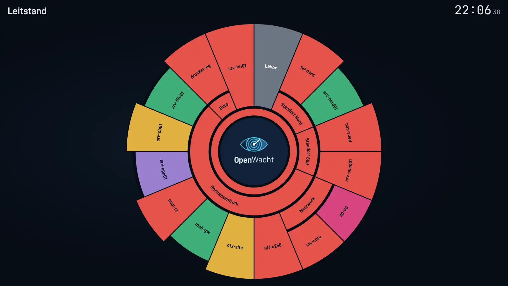
