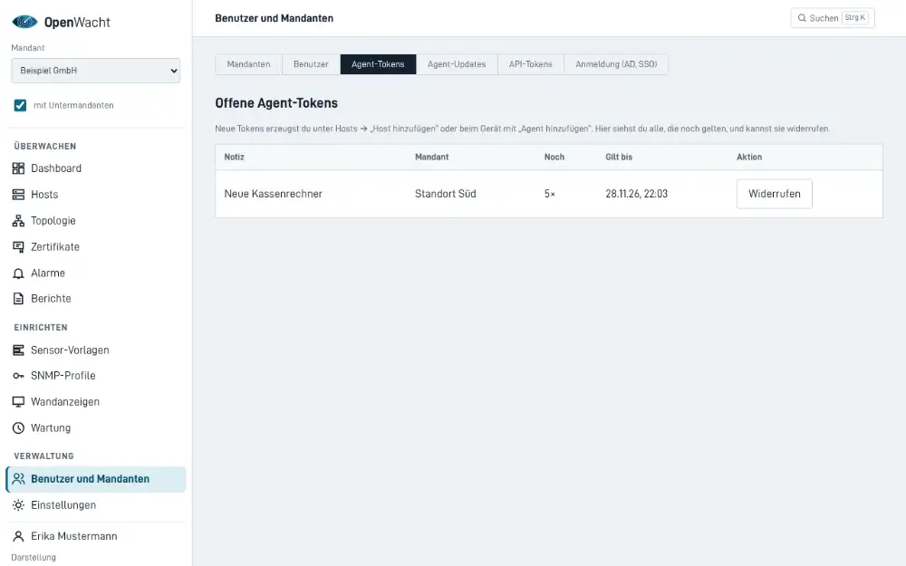
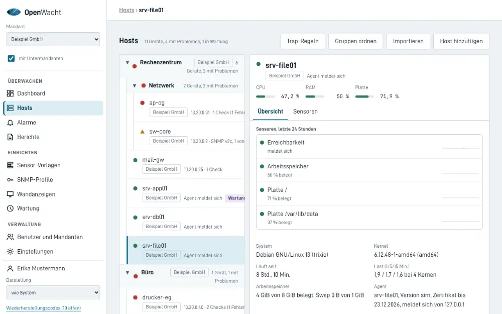

# 5. Agent for Linux and Windows

The agent collects CPU, memory, disks, uptime and allowed sensors and sends them via HTTPS with a client certificate
(TLS 1.3) to port 8444 of the central server. **It opens no port and accepts no commands.**

Supported (tested): Debian/Ubuntu, RHEL/Rocky/Alma, Windows 10/11 and Server 2016+, each amd64 and arm64. Built, without
warranty: macOS, FreeBSD, Linux armv7.

## Installing

In the interface: **Hosts → Host hinzufügen → Mit Agent → Anlegen und Token erzeugen** (Hosts → Add host → With agent →
Create and generate token). The interface shows a ready-made command per system and way; the token is only valid
briefly and only for this computer (for many computers: “Agents für mehrere Rechner …”, agents for several computers).
There are three ways:

| Way | Where the agent comes from | For |
| --- | --- | --- |
| **Package** (.deb, .rpm, MSI) | checked build (`dist/`, signed `SHA256SUMS`) | normal case, distribution via Ansible, GPO, Intune |
| **Program file** | checked build | systems without package management |
| **Download from the central server** | central server, only signed packages; the command checks the signature before installation | quickly for individual computers, when update key and package are entered |

### Package on Linux

The packages put the program into `/usr/bin/openwacht-agent` and the systemd units into `/usr/lib/systemd/system` (same
hardening as without package). After unpacking, `openwacht-agent paket-einrichten` sets up the system user and the
installation service for updates; with `OPENWACHT_ZENTRALE` and `OPENWACHT_TOKEN` in the environment it also registers
the computer straight away and starts the service. As root:

```bash
# Debian, Ubuntu
OPENWACHT_ZENTRALE=https://openwacht.beispiel.example:8444 OPENWACHT_TOKEN=owa1.… \
  apt install ./openwacht-agent_1.0.12_amd64.deb
# RHEL, Rocky, Alma, SUSE
OPENWACHT_ZENTRALE=https://openwacht.beispiel.example:8444 OPENWACHT_TOKEN=owa1.… \
  dnf install ./openwacht-agent-1.0.12-1.x86_64.rpm
```

Do not type the token on the command line if the shell history records it; read it in protected first and check it
briefly (a complete token has **92 characters** and starts with `owa1.`):

```bash
read -rs OPENWACHT_TOKEN
echo "${#OPENWACHT_TOKEN} ${OPENWACHT_TOKEN:0:5}"     # expected: 92 owa1.
OPENWACHT_ZENTRALE=https://openwacht.beispiel.example:8444 OPENWACHT_TOKEN="$OPENWACHT_TOKEN" \
  apt install ./openwacht-agent_1.0.12_amd64.deb
unset OPENWACHT_TOKEN
```

If the installation reports “Token beschädigt” (token damaged) or “unvollständig” (incomplete), it was cut off when
copying or picked up quotation marks; the package is then installed but not registered. Read the token in again and run
the same `apt install` once more.

Without the two variables it only installs; then register as below with `openwacht-agent registrieren`. An update is the
same `apt install` or `dnf install` with the new package: the registration remains, the service starts with the new
version, a token in the environment is then not used. Units of an earlier setup by hand (in `/etc/systemd/system`) are
moved by the package to `/etc/openwacht-agent/units-vor-paket` (not deleted). `apt remove` stops the service; the
registration in `/var/lib/openwacht-agent` remains even with `purge` (lock or delete the agent in the interface). The RPM
packages carry no RPM signature; checking is done via the signed `SHA256SUMS` (`rpm -K` reports the checksums as OK and
“not signed”; `dnf install ./…` installs local packages without GPG check).

For Ansible and similar tools: copy the package, install it with the two variables, done. The token for many computers
(for example 50 registrations, 24 hours) belongs in the tool’s vault, not in the playbook.

### MSI on Windows (double-click, GPO, Intune)

The MSI installs to `C:\Program Files\OpenWacht` and then calls `openwacht-agent paket-einrichten` as SYSTEM.

**By double-click (from 1.0.6)** an assistant leads through the setup, without a command line:

1. **Welcome:** what the agent does and what you need.
2. **Connection to the central server:** address of the agent port (for example `https://openwacht.firma.de:8444`),
   registration token (hidden input) and optionally the computer’s name. When updating a registered agent, address and
   token stay empty; the assistant rejects only one of the two.
3. **Allow sensors:** ticks for Windows services, all automatically starting services, processes, files and folders
   (with the folders), performance counters (with the objects) and Hyper-V, exactly like `openwacht-agent sensoren`.
   Without ticks the agent only reports CPU, memory, disks and network; the assistant does not accept files without
   folders.
4. **Collector for SNMP devices:** networks in which the agent may query SNMP devices (empty = no collector), like
   `openwacht-agent sammler -netze`.
5. **Ready:** “Installieren” asks for administrator rights; then “Fertig” or, on an error (token wrong or expired,
   central server unreachable), “Einrichtung fehlgeschlagen” (setup failed), and the computer remains unchanged.

**If an agent is already installed**, the MSI first asks what should happen:

- **Update:** registration and permissions remain, one click to “Installieren”. With the same version this sets up the
  files and the service again (repair).
- **Set up again:** choose a new central server or new token and the permissions again; the token replaces the existing
  registration.
- **Remove:** agent, service and scheduled task are removed. With the tick “Auch die Registrierung löschen” (also delete
  the registration), key, certificate and permissions in `C:\ProgramData\OpenWacht-Agent` disappear as well; without the
  tick a later installation continues without a new token. You delete the host in OpenWacht yourself. An older version
  than the MSI’s is removed under Settings › Apps (or updated first).

Permissions that are not ticked change nothing during an update; withdrawing still works with `openwacht-agent sensoren
-aus` or `sammler -aus`. Silently: `msiexec /x <file> OW_REG_LOESCHEN=1 /qn` removes including the registration.

**Silent installation:**

```powershell
msiexec /i openwacht-agent_1.0.12_amd64.msi /qn ZENTRALE=https://openwacht.beispiel.example:8444 TOKEN=owa1.…
```

- `TOKEN` is a hidden property: it does not appear in the installation log (`/l*v`), nor does the setup’s command line.
  `HOSTNAME=` optionally sets the displayed name.
- Permissions as in the assistant (from 1.0.6): `SENSOREN=dienst,prozess,datei ORDNER="D:\Export"`,
  `INDIKATOREN=SwyxServer` (for the kind `leistungsindikator`) and `NETZE=10.20.0.0/16` for the collector. An invalid
  permission does not abort the installation: the agent then runs without it, the cause is in the log.
- Without `ZENTRALE`/`TOKEN` the MSI only copies; then register by hand (below). If the registration fails (token
  expired), the installation aborts with error 1603 and rolls back: Intune shows this as failed. From 1.0.6 the cause is
  in the **Event Viewer** (Windows Logs › Application, source `openwacht-agent`), for example “keine Verbindung zur
  Zentrale” (no connection to the central server), “antwortet nicht auf TLS (richtiger Port für Agents?)” (does not
  answer TLS – right port for agents?) or “Zertifikat passt nicht zum Token” (certificate does not match the token). The
  agent first sets up the service, then registers: an error during setup thus costs no token, and if the service does
  not start immediately, the installation does not abort (Windows starts it later).
- **Intune** (Win32 app or “line-of-business app”): command line as above, detection via the MSI product code or the file
  `C:\Program Files\OpenWacht\openwacht-agent.exe`. The token for many computers is valid for at most 7 days; then update
  the app with a new token.
- **Group policy** (software installation) knows no properties on the command line: create a transform (`.mst`) with
  `ZENTRALE` and `TOKEN` (for example with Orca) or distribute the MSI without token and register via a startup script.
  Make the share with the MST readable only for domain computers.
- **Updates:** a new MSI of the same platform installs over the old one (the service is stopped, the registration
  remains). An older MSI refuses the installation (“neuere Version bereits installiert”, newer version already
  installed). Signed self-updates (chapter 12) only replace the program; the next MSI update writes it back to the
  package’s state.
- **Removing** (Apps or `msiexec /x`) stops the service and removes service, scheduled task and event source. The
  registration in `C:\ProgramData\OpenWacht-Agent` and the revocation list next to the program remain.
- **arm64:** separate MSI `…_arm64.msi`.
- **At least Windows 10 or Server 2016**: on older systems (Server 2012 R2) the MSI aborts with a clear message instead of
  setting up the agent halfway. The registry value `CurrentMajorVersionNumber` is checked, because Windows Installer
  reports version 6.3 even on Windows 10. Monitor such servers from outside (ping, SNMP, services via the central
  server).

### Program file

Linux (as root):

```bash
install -o root -g root -m 0755 openwacht-agent_linux_amd64 /usr/local/bin/openwacht-agent && \
  openwacht-agent registrieren -zentrale https://openwacht.beispiel.example:8444 -token owa1.… && \
  systemctl enable --now openwacht-agent
```

Windows (PowerShell as administrator):

```powershell
New-Item -ItemType Directory -Force 'C:\Program Files\OpenWacht' | Out-Null
Copy-Item .\openwacht-agent_windows_amd64.exe 'C:\Program Files\OpenWacht\openwacht-agent.exe' -Force
Unblock-File 'C:\Program Files\OpenWacht\openwacht-agent.exe'
& 'C:\Program Files\OpenWacht\openwacht-agent.exe' registrieren -zentrale https://openwacht.beispiel.example:8444 -token owa1.…
Start-Service openwacht-agent
```

### Download from the central server

The central server only delivers the agent at the agent port (`/agent/v1/download/…`) to whoever has a valid
registration token (it is not consumed by this), and only packages signed with the offline keys (chapter 12). The
command from the interface **checks the signature on the computer before it installs anything**:

- **Linux:** Ed25519 with `openssl pkeyutl` (OpenSSL 3, i.e. Debian 12/13, Ubuntu 22.04+, RHEL 9). The public keys are in
  the command itself.
- **Windows:** Authenticode with `Get-AuthenticodeSignature` against the fingerprints of OpenWacht’s certificates
  (`internal/update/authenticode.txt`, chapter 15). Needs Windows 11 or Server 2022 because the agent port only speaks
  TLS 1.3. Without an entered Authenticode certificate, the central server does not offer the Windows download.

The command also contains the central server’s agent CA (`--cacert`): the token only goes to exactly this central
server; a device in between does not get to see it. The central server displays the command. Whoever does not trust it
blindly compares the **key identifier** or the **fingerprint** in the command with the published value (chapters 12 and
15): a compromised central server could otherwise display a command with its own key. The central server could offer a
downgrade to an older signed version; the command names the version it expects. For customers with high protection
needs, the package from the checked build remains the recommended way.

The token contains the fingerprint of the agent CA: at first contact, the agent only trusts exactly this central server.
It creates its key itself and renews its certificate (30 days) automatically. For many computers at once: “Agents für
mehrere Rechner …” (token for several registrations). Open tokens are listed under **Benutzer und Mandanten →
Agent-Tokens** and can be revoked there.



On Linux the service runs as its own system user with systemd hardening, on Windows as the virtual service account
`NT SERVICE\openwacht-agent`. If the Windows agent is not signed (builds without Authenticode, chapter 15), Smart App
Control blocks it, SmartScreen may warn at the first start.

Via PowerShell remoting (`Invoke-Command`, `Enter-PSSession`), the agent’s output shows broken umlauts (“ü” instead of
“ü”): the agent writes UTF-8, the session reads in the old code page. Only the display is affected. Remedy in the session
before the call: `[Console]::OutputEncoding = [Text.Encoding]::UTF8`.



## Allowing sensors on the computer

Services, processes, file and folder age, Docker containers and Hyper-V VMs are only checked by the agent if they are
allowed **on the computer itself**. Without permission the sensor reports “am Rechner nicht freigegeben” (not allowed on
the computer).

```bash
openwacht-agent sensoren -arten "dienst,prozess,datei" -ordner /var/backups
openwacht-agent sensoren -docker http://127.0.0.1:2375      # only through a read-only socket proxy
openwacht-agent sensoren                                       # show
openwacht-agent sensoren -aus                                  # withdraw
```

On Windows additionally `-arten hyperv` (only name and state of the VMs) and `-arten autodienste` (all automatically
starting services, [chapter 7](07-sensoren-und-vorlagen.md#automatic-windows-services)). `-arten` replaces the list:
specify everything that was already allowed again.

### Windows performance counters

The Windows agent reads performance counters (as in `perfmon`), for example SwyxWare’s key figures or the state of the
IIS application pools. Permission is granted per **object**; the agent reads nothing from other objects:

```powershell
openwacht-agent sensoren -arten "dienst,leistungsindikator" -indikatoren "SwyxServer,SwyxWare Trunk,APP_POOL_WAS"
```

- The names are the **English** names from the vendor documentation; they also apply on German Windows. Which objects
  exist is shown by `typeperf -qx` (in the system’s language).
- Object and instance must not contain `\ ( ) * ?`; the counter may contain parentheses (Exchange: “Internal Aggregate
  Delivery Queue Length (All Internal Queues)”). The total instance is called `_Total`.
- With the instance `*`, the agent combines all instances into **one number** (sum, minimum, maximum or count). It never
  reports names of instances (for example lines or application pools); the total instance `_Total` is not counted.
- The setup (MSI or `registrieren`) adds the service account itself to the group “Performance Monitor Users”
  (S-1-5-32-558); removal takes it out again. If the sensor still reports “kein Zugriff” (no access), by hand:
  `Add-LocalGroupMember -SID S-1-5-32-558 -Member "NT SERVICE\openwacht-agent"`, then restart the service.
- Service sensors also find a Windows service via its **display name** (for example “SwyxServer”) if the service name is
  different.

### SNMP only on the computer itself (for example Ferrari OfficeMaster)

Some Windows software only provides its key figures through the Windows SNMP service, which only supports v1/v2c
(community in plain text). Then do not open the service to the network, but use the agent on the same computer as
collector:

1. Windows SNMP service: tab “Security” → community long and random, only **READ ONLY**; “Accept SNMP packets from these
   hosts” → only `localhost`. No trap targets.
2. Windows Firewall: do not allow 161/udp incoming (leave the rule “SNMP Service (UDP In)” disabled).
3. On the computer: `openwacht-agent sammler -netze 127.0.0.1/32`.
4. In the interface, set up SNMP on the device: address `127.0.0.1`, version v2c, “Abgefragt von” (polled by) = this
   computer’s agent.

The community thus never leaves the computer; the values go to the central server through the agent connection (TLS 1.3
with client certificate).

## Agent as collector

An agent can query SNMP devices in its network that the central server does not reach (branch office behind NAT):

```bash
openwacht-agent sammler -netze 10.20.0.0/16
```

Then choose this agent under SNMP “Abgefragt von” on the device. The collector only receives credentials for devices in
its allowed networks and only of its tenant. If it fails, there is an alert on the collector; the devices turn grey.

## Checking

`openwacht-agent pruefen` collects once and shows the values without sending. If an agent does not report for 3
minutes, there is the alert “meldet sich nicht” (not reporting).
