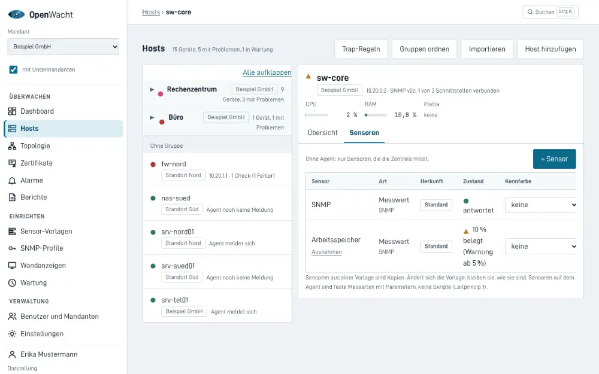
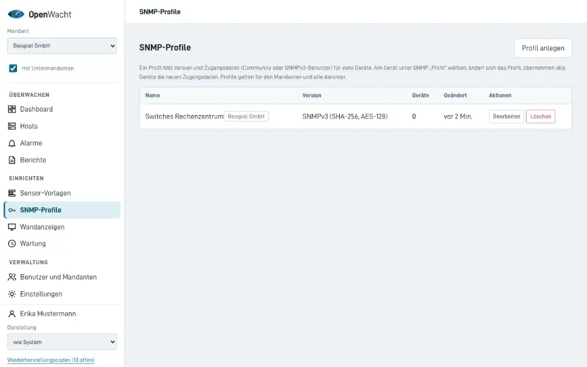
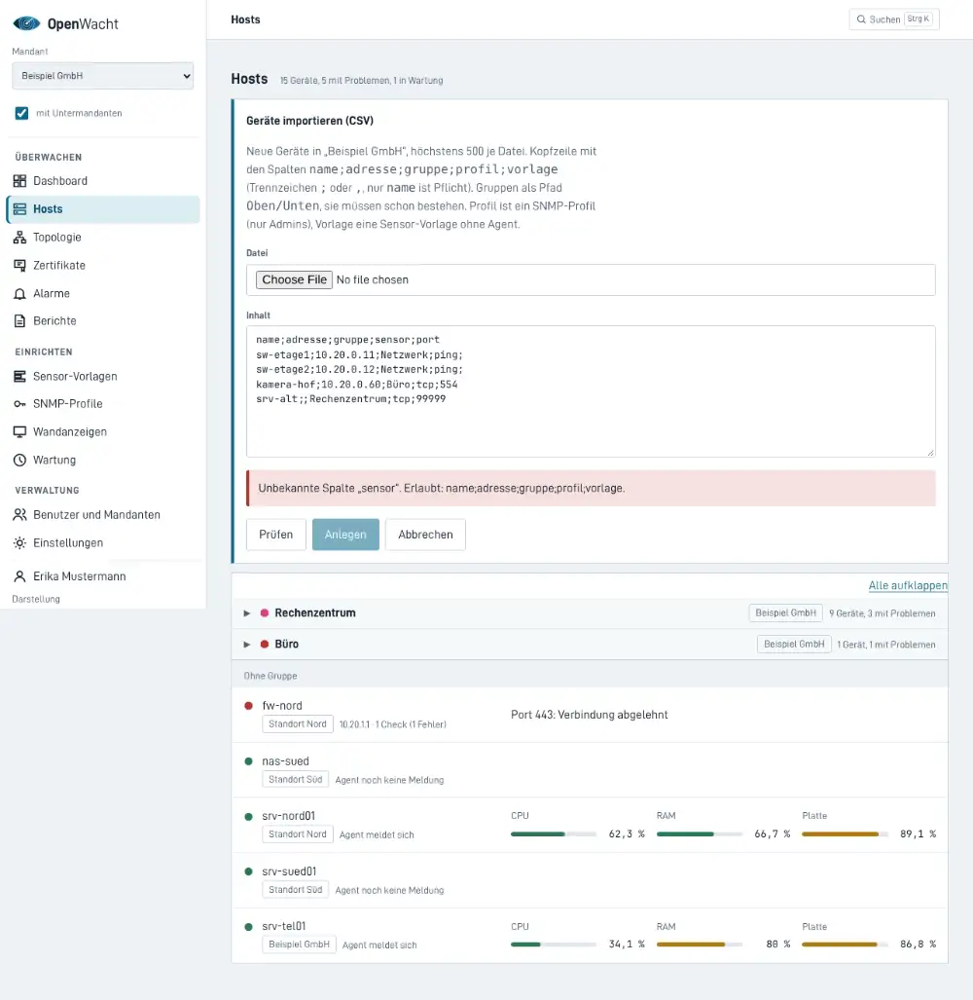

# 6. SNMP, access profiles and CSV import

## SNMP on a device

On the device, choose “SNMP einrichten” (set up SNMP) in the action menu (or under “Host hinzufügen” → “Per SNMP”):
address, port (161), interval, version and credentials or a **profile**.

- **v1/v2c:** community. It is transmitted in plain text; the interface marks this.
- **v3:** only **authPriv** with SHA-1/SHA-2 and AES-128/192/256. MD5 and DES are deliberately not supported.

Fixed values are read (no MIB files): name, uptime (restart), CPU, memory, disks, interfaces with traffic,
temperatures, toner, UPS and RAID on Synology. “Interface down” only alerts for ports marked as monitored. If a device
does not answer for three intervals, it becomes “antwortet nicht” (not responding).

**Port picture (from 1.0.10):** If a device has at least eight physical ports, a picture like the front panel appears
above the interface table: two rows, odd ports at the top, even ports at the bottom, uplinks set apart on the right.
The number counts the physical ports in the device’s order; the device’s own name for the port is in the details. Each
port shows its state as shape and colour: connected, not connected, not connected and monitored (red), administratively
down (dashed). A click on a port shows status, speed, traffic with history and new errors below, and the port can be
marked as monitored there.

**Modules and stacks (from 1.0.13):** If the ports are named like those of a chassis with modules (Aruba 5400R: “A1”
to “F24”) or like a stack (“1/1”, “2/1” …), the picture shows each module or member as a row of its own, with the
letter or number on the left and the number of connected ports. The number on the port then counts on the module; the
details give the port’s full name (“Port C7”). An empty slot between two populated ones appears as a blank “no module
reported”. PoE is mapped even with several PoE groups: group 1 is slot A or member 1, group 2 slot B or member 2 and
so on.

**PoE per port:** If the device reports the POWER-ETHERNET-MIB, the port shows “PoE” when it delivers power and “PoE!”
on a PoE fault. In the details, “PoE-Sensor für diesen Port anlegen” creates a sensor that turns critical as soon as the
port no longer delivers power, for example for access points or cameras. OpenWacht maps PoE port n to the interface
with index n; this is correct for common switches with one PoE group. With several groups (stack), PoE is left out of
the picture. If an agent queries the device as a collector, it needs version 1.0.10 for this.

**Neighbour per port (from 1.0.11):** If the device reports its neighbours via LLDP, the details of a port show under
“Nachbar (LLDP)” (neighbour) the neighbour's name and its port, for example “sw-keller, Port GigabitEthernet 1/24”; the
same text appears in the tooltip when the mouse rests on the port. Only these two values are read from the LLDP table,
at most 64 characters each, and only the current state without history. If the neighbour's port ID is a MAC address,
it is shown as such. Phones and PCs can report themselves via LLDP too: their device name then appears as well. If an
agent queries the device as a collector, it needs version 1.0.11 for this.

**Adding neighbours (from 1.0.12):** If a neighbour is already a device in OpenWacht, a click on its name opens that
device. If it is not yet, “+ Ins Monitoring aufnehmen” (add to monitoring) appears next to it (for operators and
admins). It opens a short form: the name from LLDP, the address from the management address the neighbour reports via
LLDP (if it reports one), plus two ticks, both on by default: “Hängt ab von <switch>” (depends on) and “Ping-Sensor
anlegen” (create ping sensor; only with an address). The device goes into the switch's tenant and group; it then opens,
and there you set up agent, SNMP or further sensors. If the address is not in the network release, OpenWacht still
creates the device and reports that the ping sensor is missing. The polling reads the management address from 1.0.12
(via a collector with agent 1.0.12).

**Speed and “since when” (from 1.0.11):** A port that is connected but negotiated less than 1 Gbit/s carries a triangle
instead of the circle in the picture. This is a hint, not an alert: printers and phones often manage only 100 Mbit/s; on
a PC or access point it points to a bad cable. The details also show since when the port has been in its state, if the
device reports the time of the last change.

**Restart:** The uptime comes from `hrSystemUptime` (uptime of the computer); only if a device does not provide it, from
`sysUpTime`. The latter only counts the SNMP service and also jumps back when only the service restarts. A restart
(15 minutes warning) is only reported if the device had been running for **at least 27 hours before**. Planned nightly
restarts, for example of Citrix workers or terminal servers, therefore stay silent; whether a planned restart was
missed is checked by the sensor “Neustart verpasst” (restart missed). The same limit applies to Proxmox, NetApp,
XenServer and FRITZ!Box.



Credentials are stored encrypted in the database and bound to device, address and port; if you change the address, you
have to enter them again (not with profiles, see below).

## Access profiles

**Einrichten → SNMP-Profile** (Set up → SNMP profiles; admins only): create version and credentials once, use them on
any number of devices.



- A profile applies to its tenant and everything below. Admins of a sub-tenant do not see their parents’ profiles
  (their device then shows “Profil eines übergeordneten Mandanten”, profile of a parent tenant).
- **Changing credentials:** edit the profile and enter the new data. All devices with the profile take it over
  immediately, in one transaction (including the trap service). Change the devices themselves first, otherwise they no
  longer answer.
- **Detaching a device:** “Eigene Zugangsdaten” (own credentials) in the SNMP form. **Deleting a profile:** the devices
  keep their copy.
- Note: profiles are not bound to an address (otherwise they would not be reusable). An admin can attach a profile to
  any device within the network allow-list.

## Importing devices from CSV

**Hosts → Importieren** (Hosts → Import; admins and operators), choose a file or paste text. From Excel, save as
“CSV UTF-8”.

```text
name;adresse;gruppe;profil;vorlage
switch-og1;10.20.0.21;Hauptsitz/Keller;Switche Hauptsitz;
nas-archiv;10.20.0.30;Hauptsitz;;std-ping
```

- Header line required, only `name` must be in it; separator `;` or `,`; at most 500 lines, 256 KiB.
- If Excel saved every line as **one** field in quotes (happens when finished CSV lines were pasted into column A), the
  import recognises this and reads the content of the fields. Simpler: copy the text directly into the field “Text
  einfügen” (paste text) or save the file as UTF-8 in an editor.
- `gruppe` (group) as a path `Hauptsitz/Keller`; the groups must already exist.
- `profil` (profile): name of an SNMP profile (admins only). The central server then polls via SNMP on port 161 every
  60 s.
- `vorlage` (template): name of a sensor template or ID of a built-in one (`std-ping`). No agent templates.
- **Prüfen** (check) shows OK or the error per line. **Anlegen** (create) only works when everything is error-free, and
  creates everything or nothing. Names that already exist in the tenant are rejected: a second import creates nothing
  twice.



## Traps

The trap service (separate process, port 162/udp) accepts v1/v2c traps and informs as well as v3 (authPriv). Assignment
is by the sender address of the SNMP source; unknown senders are discarded. **Trap rules** (Hosts → Trap-Regeln, admins
only) set a state per trap OID, cleared by a counter-trap, after a time or by hand. The trap log keeps 30 days. Traps
only work with polling switched on and not through a collector.
