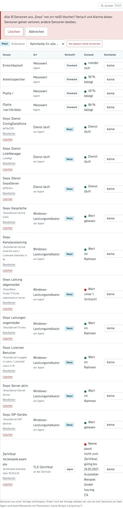
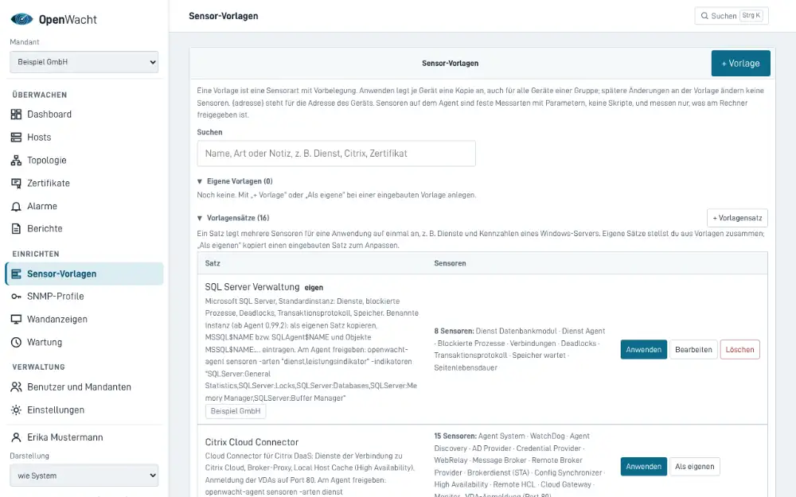
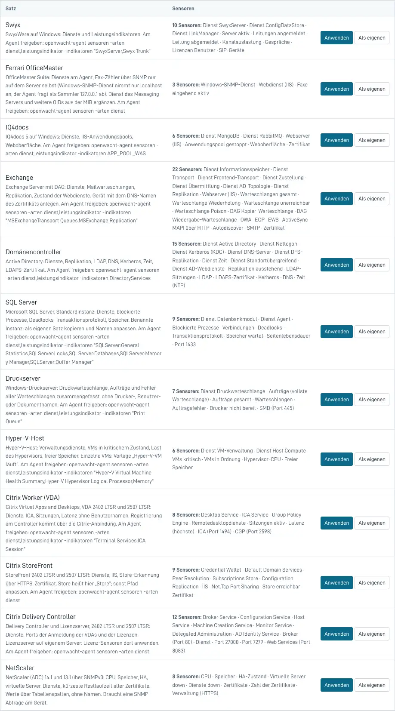
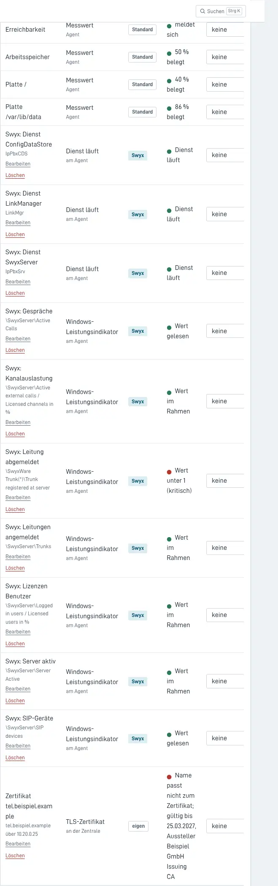
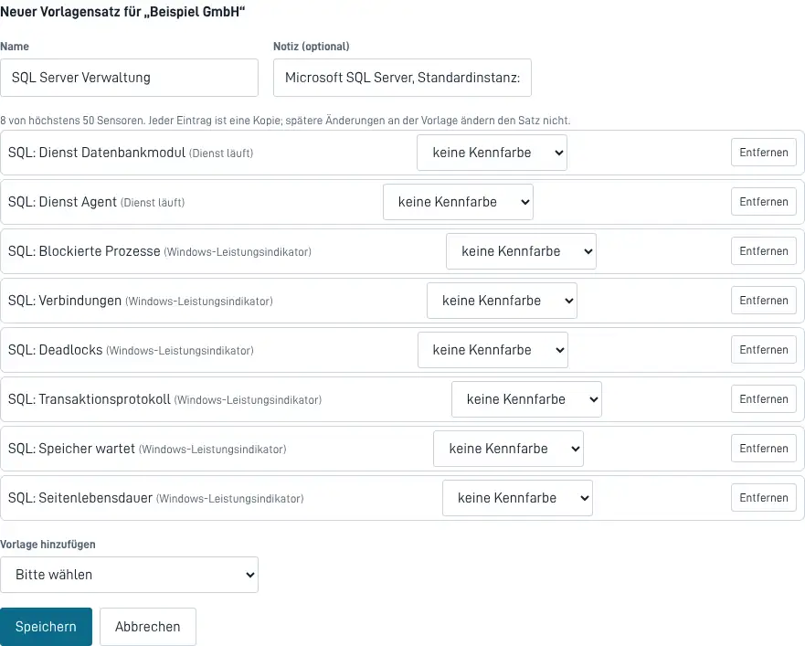
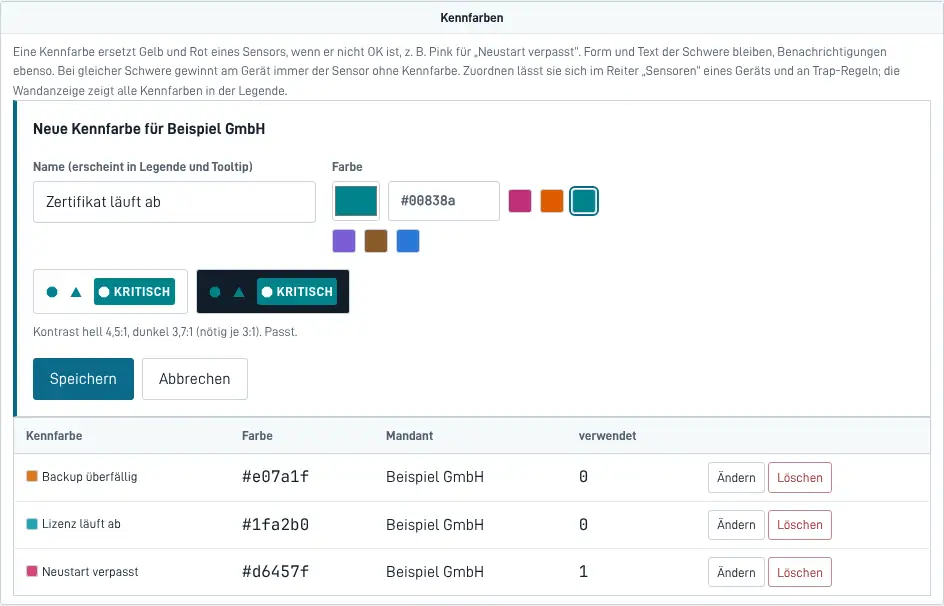

# 7. Sensors and templates

## Sensors

On the device, “Sensoren” (Sensors) → **+ Sensor** (or the action menu “Sensor hinzufügen”, add sensor). Without a name,
OpenWacht creates one from kind and target (“Ping”, “TCP 443”, “Zertifikat host”); names are unique per device.

| Kind | checks | where |
| --- | --- | --- |
| Ping | reachability, loss and response time (several packets) | central server |
| TCP | port open | central server |
| HTTP(S) | status code, optionally text in the response | central server |
| TLS certificate | remaining validity (warning/error in days) | central server |
| DNS | name resolves (central server’s resolver or an allowed server) | central server |
| HTTP JSON | number or text at a path in a JSON response, with thresholds | central server |
| TCP banner | first line of a service (for example SMTP 220), optionally with TLS | central server |
| NTP | time offset of a time server | central server |
| SNMP OID | own value via SNMP (number, counter as rate, text only as checksum) or a table column combined | central server/collector |
| Service, process | is a service or process running (names only) | agent, after permission |
| File/folder | age and size (for example last backup), never contents or file names | agent, after permission |
| Docker | state and health of a container through a read-only socket proxy | agent, after permission |
| Hyper-V | VM running (name and state) | Windows agent, after permission |
| Windows performance counter | number from `\Object(Instance)\Counter` with thresholds, optionally as a percentage of a second counter | Windows agent, after permission per object |
| Automatic Windows services | all services with start type “Automatic” are running, with exceptions; only reports the names of stopped services | Windows agent, after permission |

All targets of the central server must lie within the network permission ([chapter 2](02-erste-einrichtung.md#network-allow-list)).
Agent sensors run at most every minute; measurements from the agent arrive in batches.

Agent sensors are **fixed measurement kinds with parameters**, not scripts: the central server cannot execute anything
through them.

**Alert after:** a sensor only reports “kritisch” (critical) or “unbekannt” (unknown) after **3 failures in a row** (up to
1.0.5 after 2), so that a short dropout, such as a reboot or a lost ping packet, does not trigger an alert. On the sensor
this can be changed under “Alarm nach” (alert after): 1 (immediately) to 10 failures. With a 5-minute interval and 3
failures, an alert thus comes after about 10 to 15 minutes. Warnings (for example certificate expires soon) still go out
immediately. Own templates and own template sets carry the value and pass it on to the sensor when applied. Agents (“meldet
sich nicht”, not reporting) and SNMP devices (“antwortet nicht”, not answering) have their own rule: they only count as
silent after three missed reports or polls.

**Deleting** directly in the tab “Sensoren”: under the name “Löschen” (delete), with confirmation. Above the table, for
each template or template set from which sensors originate, there is “Von diesem Gerät entfernen” (remove from this
device): this deletes all sensors of this origin on the device at once (for example a set applied by mistake), other
sensors remain. History and alerts of the deleted sensors are lost; the audit log names set, number and names.

### Automatic Windows services

One sensor for all services instead of one per service: error as soon as a service with start type “Automatic” is
stopped. The message names the stopped services with their service name (“2 Dienste gestoppt: Spooler, W32Time”).

- **Not counted:** services with a trigger (“Automatic (Trigger Start)”; they stop on purpose), per-user services,
  delayed-start services in the first 15 minutes after system start.
- **Exceptions:** one service or display name per line, case-insensitive, with `*` at the end for all that start like
  this (`edgeupdate*`). The template “Automatische Dienste (Windows)” brings `gupdate`, `edgeupdate`, `sppsvc`,
  `MapsBroker` and `RemoteRegistry`; add services that are stopped on purpose on your servers there.
- Allow on the computer: `openwacht-agent sensoren -arten "dienst,autodienste"` (specify the complete list of kinds, see
  [chapter 5](05-agent.md#allowing-sensors-on-the-computer)). The agent only reads name, display name, start type and
  state, never service account or program path.
- **Unreadable services (from agent 1.0.6):** if the agent’s service account may not read the settings of a service (some
  antivirus and vendor services restrict this), its start type is unknown. The message then names their number (“; 2
  nicht lesbar”, 2 unreadable); if such a service is stopped, this is a **warning** with its name, because it might be
  meant to start automatically. If that is intended, enter the service as an exception.

### SNMP table columns

Many devices report states as a table, one row per certificate, virtual server or disk. Under “Abfrage” (query), an SNMP
OID sensor combines a **column**: smallest value, largest value, sum, number of rows, rows with value equal or not equal
to a comparison value. Enter the column without index as OID, for example `1.3.6.1.4.1.5951.4.1.1.56.1.1.5` (remaining
validity of the certificates on the NetScaler) with “kleinster Wert” (smallest value) and “Fehler unter 14” (error below
14). Example state: column `1.3.6.1.4.1.5951.4.1.3.1.1.5` (state of the virtual servers), “Zeilen mit Wert gleich” (rows
with value equal), comparison value 1 (down), “Fehler über 0” (error above 0).

### Number from text, factor and unit

Some devices deliver measurements as text with extras, for example LANCOM switches the fan as “1500RPM” and the CPU as
“100ms:52%, 1s:57%, 10s:50%”. From 1.0.8 an SNMP OID sensor reads a number from this, under **“Zahl aus Text”** (number
from text):

| Kind | reads | example |
| --- | --- | --- |
| first number in the text | the first number | “1500RPM” → 1500, “994 M” → 994 |
| n-th number in the text | the 1st to 16th number | “100ms:52%, 1s:57%, 10s:50%”, 6th number → 50 |
| number after a text | the first number after the given text | after “10s:” → 50 |

- A number is digits with at most one dot or comma (“41,5”); a minus directly before it counts as sign.
- The text before the number is compared exactly, including case and spaces.
- If there is no number at that position, the sensor becomes “unbekannt” (unknown) with the reason.
- **Only the number is stored.** The device’s text does not leave the query, not even as history.
- If an agent polls the device as **collector**, it needs version 1.0.8 for this; with an older one the sensor stays
  “unbekannt” (“Zahl aus Text noch nicht gelesen”, number from text not read yet).
- Does not work together with a table column, a rate or “Wert gleich Text” (value equals text).

**Show the device’s text (from 1.0.10):** some values are text and should be visible as text, such as the firmware
version. With the tick “Text des Geräts anzeigen” (show the device’s text) on the sensor, the central server stores the
last read text of this one OID (at most 50 characters, without control characters) and shows it as measurement.

- This is a deliberate exception: without the tick, it remains the case that only a check value of a text is stored.
  Only set the tick for values without personal reference, not for fields such as contact or logged-in users.
- Only the last text is stored, no history.
- Thresholds, factor, unit, rate, table column and “Zahl aus Text” do not work with it; “Wert gleich Text” still works and
  reports when the text differs (for example after a firmware update).
- If an agent polls the device as **collector**, it needs version 1.0.10 for this.

**Factor and unit** apply to all numbers of an SNMP OID sensor, including sum, minimum and maximum of a column: the value
is multiplied by the factor and shown with the unit (°C, %, W, V, A, RPM, MB, GB, s, ms, bit/s, dBm). Example: a switch
reports PoE power in tenths of a watt; with factor 0.1 and unit W it shows “81 W”. **Thresholds apply to the converted
value**, here in watts.

- Reading is read-only (GETNEXT/GETBULK), at most 2000 rows per column; with more, “nur die ersten 2000 Zeilen” (only the
  first 2000 rows) appears in the message.
- Only the key figures are reported and stored, **never the row indices** (they often contain names) and never texts.
- Counting by values only works for state columns with at most 32 different integers.

## Templates

**Einrichten → Sensor-Vorlagen** (Setup → Sensor templates): template sets (see below), 21 built-in templates (ping with
loss, HTTPS page, TLS certificate, SSH, SMB, RDP and IMAPS port, DNS, NTP, SMTP and SSH banner, services, automatic
Windows services, Docker, backup file, vzdump, Synology status and temperature, Hyper-V VM) and your own.

**Anwenden** (apply) creates a **copy** on selected devices or a whole group (optionally with subgroups, up to 300
devices). `{adresse}` stands for the device’s address. Skipped are devices without address or without agent, targets not
allowed and names already taken. Later changes to the template do not change existing sensors. “Als eigene” (as own)
turns a built-in template into your own for adjusting.

## Template sets

A **template set** creates several sensors for one application at once. Sixteen sets are built in: fourteen for Windows
servers, one for the NetScaler and one for LANCOM switches. Each sensor is called “Satz: …” and remembers the set as its
origin.

| Set | Sensors | Permission on the computer |
| --- | --- | --- |
| **Swyx** | services SwyxServer, ConfigDataStore, LinkManager; server active; trunks logged in; trunk logged out (one trunk is enough for critical); channel usage (warning 80 %, critical 95 %); calls; user licences in percent (warning 90 %, critical 98 %); SIP devices | `-arten "dienst,leistungsindikator" -indikatoren "SwyxServer,SwyxWare Trunk"` |
| **Ferrari OfficeMaster** | Windows SNMP service, web service (IIS), incoming faxes active (SNMP OID) | `-arten dienst`, plus SNMP only on the computer ([chapter 5](05-agent.md#snmp-only-on-the-computer-itself-for-example-ferrari-officemaster)) |
| **Exchange** | services Information Store, Transport, Frontend Transport, Mailbox Delivery, Mailbox Submission, AD Topology, Replication, IIS; queues internal and external (warning 500, critical 3000), retry internal, external and unreachable (50/100), poison (should be 0, critical from 5); DAG copy and replay queue (highest value of all copies); health of OWA, ECP, EWS, ActiveSync, MAPI and Autodiscover via `healthcheck.htm`; SMTP banner; certificate | `-arten "dienst,leistungsindikator" -indikatoren "MSExchangeTransport Queues,MSExchange Replication"` |
| **Domain controller** | services NTDS, Netlogon, KDC, DNS Server, DFS Replication, Time, Intersite Messaging, AD Web Services; pending replications (warning 10, critical 50); LDAP sessions; from the central server LDAP (389), LDAPS certificate (636), Kerberos (88), DNS (53), time offset (NTP) | `-arten "dienst,leistungsindikator" -indikatoren DirectoryServices` |
| **SQL Server** | services database engine and agent (default instance); blocked processes (5/20), connections, deadlocks per second (0.1/1), fullest transaction log (80 %/95 %), pending memory grants, page life expectancy (warning below 300 s); port 1433 | `-arten "dienst,leistungsindikator" -indikatoren "SQLServer:General Statistics,SQLServer:Locks,SQLServer:Databases,SQLServer:Memory Manager,SQLServer:Buffer Manager"` |
| **IQ4docs** | services `IQ4docsMongoDB`, `IQ4docsRabbitMQ`, Fleet Agent (`iq4dService`) and Watchdog (`iq4dWatchdog`), IIS; application pool stopped; web interface (HTTPS); certificate | `-arten "dienst,leistungsindikator" -indikatoren APP_POOL_WAS` |
| **Print server** | print spooler (Spooler); jobs in the fullest queue (warning 25, critical 100); jobs in total; number of queues (critical at 0); job errors and “not ready” since service start; SMB (445) | `-arten "dienst,leistungsindikator" -indikatoren "Print Queue"` |
| **Hyper-V host** | services VM management (vmms) and Host Compute; VMs in critical state (critical from 1); VMs OK; hypervisor load (80 %/95 %); free memory (warning below 4096 MB, critical below 1024 MB) | `-arten "dienst,leistungsindikator" -indikatoren "Hyper-V Virtual Machine Health Summary,Hyper-V Hypervisor Logical Processor,Memory"` |
| **Citrix worker (VDA, agent)** | Desktop Service, Group Policy Engine, Remote Desktop Services; active sessions; highest session latency (200/500 ms); reboot missed (uptime over 26 hours); ping; ICA (1494) and session reliability (2598) | `-arten "dienst,leistungsindikator" -indikatoren "Terminal Services,ICA Session,System"` |
| **Citrix worker (VDA, SNMP)** | without agent: CPU, memory, disks and reboot from the device’s SNMP query; reboot missed via `hrSystemUptime` (over 26 hours); ping; ICA (1494) and session reliability (2598). For workers from PVS/MCS: set up SNMP once in the master image | none; on the worker the Windows feature “SNMP Service”, community read-only, only allow the central server (only v1/v2c) |
| **Citrix StoreFront** | Credential Wallet, Default Domain Services, Peer Resolution, Subscriptions Store, Configuration Replication, IIS, Net.Tcp Port Sharing; store discovery `https://…/Citrix/Store/discovery`; certificate (30/14 days) | `-arten dienst` |
| **Citrix Delivery Controller** | Broker, Configuration, Host, Machine Creation, Monitor, Delegated Administration, AD Identity; port 80 (registration of the VDAs); licence server: service Citrix Licensing, ports 27000, 7279, 8083 | `-arten dienst` |
| **Citrix Cloud Connector** | services Agent System, WatchDog, Agent Discovery, AD Provider, Credential Provider, WebRelay, Message Broker, Remote Broker Provider (`XaXdCloudProxy`), STA, Config Synchronizer, High Availability (Local Host Cache), Remote HCL, Cloud Gateway, Monitor; VDA registration on port 80 | `-arten dienst` |
| **Citrix Provisioning** | services Stream Service, SOAP Server, API, TFTP, PXE, Two-Stage Boot; SOAP port 54321 | `-arten dienst` |
| **NetScaler** | via SNMP: CPU (80 %/95 %), memory (80 %/90 %), HA state, virtual servers down (critical from 1), services down (warning from 1), **shortest remaining validity of all certificates** (warning 30, critical 14 days), number of certificates; management certificate | none; SNMPv3 on the device ([chapter 6](06-snmp.md)) |
| **LANCOM 3000** (from 1.0.8) | via SNMP, for switches of the GS-3000 series with LCOS SX 4.x: temperature 1 (80/90 °C), temperatures 2 and 3 (60/70 °C), fan (critical below 300 RPM), CPU over 10 s (85 %/95 %), PoE power in W, PoE budget, PoE supply on, PoE ports in error (warning from 1), PoE ports with power, from 1.0.10 LLDP neighbours (warning when none is left; set the threshold to the usual number) and the firmware version as text. The temperature thresholds are a default: look at your own values first, then adjust | none; SNMPv3 on the device ([chapter 6](06-snmp.md)) |
| **Aruba 2530**, **Aruba 2930**, **Aruba 5400R** (from 1.0.13) | via SNMP, for switches with ArubaOS-Switch: CPU (85 %/95 %), free memory in MB, hardware faulty (fan, power supply, over-temperature; critical from 1) and with warning, PoE power and PoE budget across all modules or stack members, PoE supply faulty, PoE ports in error and with power, LLDP neighbours and the firmware version as text. 2930 and 5400R also the temperature (50/60 °C, default); the 2530 has no sensor. 5400R also power supplies delivering power (critical below 2; set to the number installed) and power supply failed. The OIDs come from HPE's documentation and have not yet been measured on every model | none; SNMP on the device ([chapter 6](06-snmp.md)) |

Notes:

- Names of services and counters come from the vendors’ documentation (as of 11/2026), Swyx’s from a real installation
  (`Get-Counter -ListSet SwyxServer`, `Get-Counter -ListSet "SwyxWare Trunk"`). If the trunk object is called “Swyx
  Trunk” in another version, adjust the sensor and allow the object under that name. Which names exist is shown by
  `Get-Counter -ListSet <object>` on the server; English names are in the registry under
  `HKLM:\SOFTWARE\Microsoft\Windows NT\CurrentVersion\Perflib\009` (value `Counter`).
- In PowerShell, put the list after `-arten` in quotation marks (`-arten "dienst,leistungsindikator"`): without them
  PowerShell passes two arguments, and the agent reports “unerwartetes Argument” (unexpected argument).
- For Ferrari, the documentation names neither the Messaging Server’s service nor the OID of the fax queue. Read both on
  the server (`Get-CimInstance Win32_Service | Where-Object PathName -like '*FFUMS*'` or the MIB under
  `C:\Program Files\FFUMS\snmp\MIB`) and add them as your own sensors. Ferrari’s Checkmk plugin queries with an
  administrator account; OpenWacht deliberately does not use that way.
- **Exchange:** create the device with the DNS name the Exchange certificate is issued for (for example
  `mail.beispiel.example`), otherwise the HTTPS sensors fail the name check; with your own CA, store it on the sensor.
  `healthcheck.htm` reports 200 as long as Exchange (Managed Availability) considers the service healthy, otherwise 404.
  The set is meant for servers in a DAG; with lagged copies, raise the thresholds of the replay queue. OpenWacht does not
  read names of mailboxes, databases and queues; the DAG values are the highest value of all copies on the server. The
  queue thresholds are starting values for small and medium environments.
- **Domain controller:** the sensors “DNS-Server” and “DNS (53)” only on DCs that are also DNS servers. The counter comes
  from the object “DirectoryServices” (instance NTDS, from Windows Server 2012 R2).
- **SQL Server:** the set applies to the **default instance**. With a named instance, service and objects have different
  names (`MSSQL$NAME`, `SQLAgent$NAME`, `MSSQL$NAME:General Statistics` …): copy the set with “Als eigenen” (as own),
  adjust the affected templates as your own templates and replace them in the set. SQL Server Express has no agent.
- “Anwendungspool gestoppt” (application pool stopped) checks **all** pools: remove pools stopped on purpose (for example
  DefaultAppPool) on the server or change the sensor to individual pools (instance = name of the pool).
- **Print server:** OpenWacht only adds up queues; it does not read names of printers, users and documents. The error
  counters count up since the service started and are therefore only for display; failures of a printer show in the
  number of jobs in the fullest queue.
- **Hyper-V host:** individual VMs are still checked by the template “Hyper-V-VM läuft” (Hyper-V VM running). Adjust the
  thresholds for free memory to the size of the host.
- **Citrix:** the sets apply to 2402 LTSR and 2507 LTSR; services with spaces in the name are display names, which the
  agent resolves itself. The registration of the VDAs and failed connections are only seen by the controller; a separate
  Citrix integration is coming for that. “Profile Management” is not in the set because it is not used everywhere.
  StoreFront: create the device with the name the certificate is issued for; if the store is not called “Store”, adjust
  the URL. If the licence server is on its own server, create the four licence sensors there and delete them on the
  controller.
- **NetScaler:** poll the device with SNMPv3 (authPriv); on the NetScaler create a read-only view (`add snmp view`), a
  group with `authPriv` and `-readViewName` and a user in this group, and enter the central server or the collector as
  SNMP manager. The certificate sensors see **all** certificates on the NetScaler, including those not bound to any
  virtual server, but only the shortest remaining validity, no names. Which certificate expires is shown by the NetScaler
  itself (Traffic Management → SSL → Certificates). Only keep the HA sensor for an HA pair.
- Printers behind IQ4docs continue to be monitored by OpenWacht via SNMP ([chapter 6](06-snmp.md)). OpenWacht does not
  read print jobs, user or document names.

## Own template sets

Under **Einrichten → Sensor-Vorlagen → Vorlagensätze** (Setup → Sensor templates → Template sets), “+ Vorlagensatz”
creates your own set for the selected tenant, for example “Standard-Windows-Server”. Entries come from your own templates,
built-in templates and the sensors of the built-in sets; “Als eigenen” copies a built-in set for adjusting. At most 50
sensors per set and 50 sets per tenant.

- Each entry is a **copy**: if you later change a template, the set remains unchanged, as do created sensors when you
  change or delete the set.
- Rights as with own templates: everyone with a role in the set’s tenant or above can see and apply them; operators and
  admins create, change and delete. Subtenants do not see their parents’ sets.
- To change an entry (for example a service name), adjust the template as your own template, remove the old entry from
  the set and add your own template.

## Marker colours

A **marker colour** (Kennfarbe) is a name with a freely chosen colour, for example “Neustart verpasst” (reboot missed) in
pink. If a sensor with a marker colour is not OK, it appears in this colour instead of yellow or red: in the sensor list,
under alerts, in the signal of device and group, in the dashboard and on the wall display.

- **Create** under Einrichten → Sensor-Vorlagen → Kennfarben (operators and admins, in the selected tenant). The colour is
  freely selectable but needs at least 3:1 contrast on both light and dark backgrounds; the preview shows both. The
  central server rejects very light tones (lemon yellow) and very dark ones (midnight blue).
- **Assign** in a device’s tab “Sensoren”, column “Kennfarbe”: for your own sensors and for the built-in measurements of
  agent and SNMP (reachability, memory, disks, interfaces …). On **trap rules** with effect warning or critical, the marker
  colour applies to all states and log entries of the rule.
- **For a whole origin:** in the tab “Sensoren” there is “Kennfarbe für alle …” (marker colour for all …) per template or
  template set. Then choose “Nur auf <Gerät>” (only on <device>) or “Auf allen Geräten” (on all devices, i.e. all devices
  whose sensors you may change). Sensors in tenants the marker colour does not fit remain unchanged; the message names
  their number.
- **In your own template set:** every entry can carry a marker colour (marker colour of the set’s tenant or a parent one).
  When applied, the new sensor gets it.
- **What remains:** shape and text of the severity (triangle = warning, octagon = critical) and the severity for
  notifications. OK, unknown, maintenance and paused never show a marker colour.
- **Red always wins:** if a device has several problems of the same severity, it shows the colour without marker colour.
  A worse severity wins despite a marker colour (a pink critical sensor ranks above a yellow warning). The same applies
  to groups and tenants.
- **Rights:** marker colours of a tenant are seen by everyone who sees it, a tenant below or above it; siblings do not.
  A marker colour can only be assigned in its own tenant or below. Deleting removes the colour from all sensors and rules;
  the sensors remain. Creating, changing, deleting and assigning are recorded in the audit log.

## Thresholds

Disk and memory: warning from 90 %, critical from 95 %; CPU (average over 15 minutes): 90 % and 98 %; all-clear 2
points below each. The thresholds can be changed for the whole installation (Einstellungen, settings), per tenant and per
device (action menu “Schwellen …”, thresholds).
