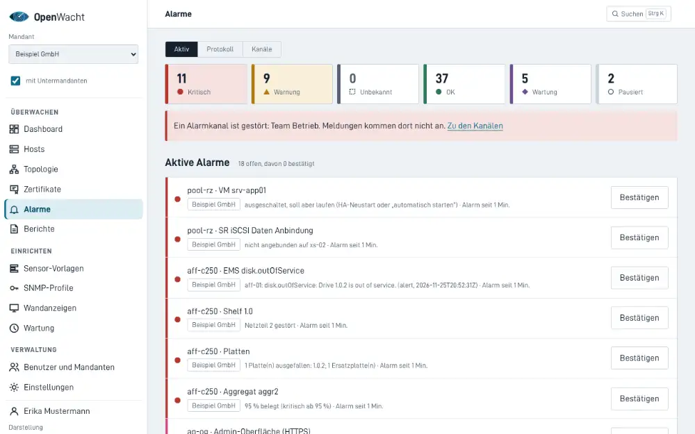
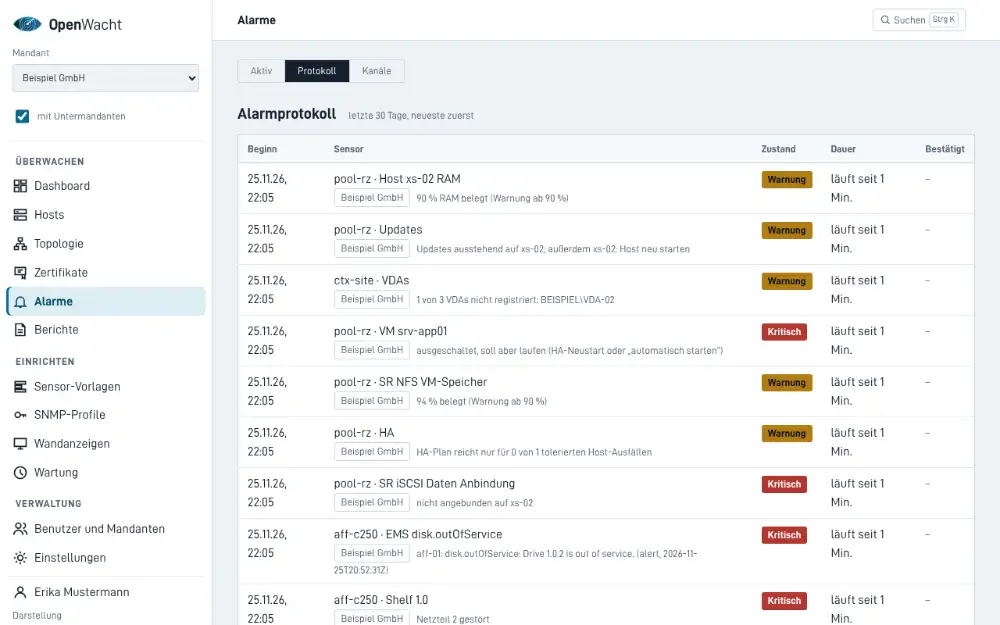
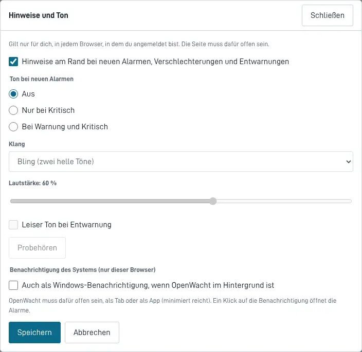
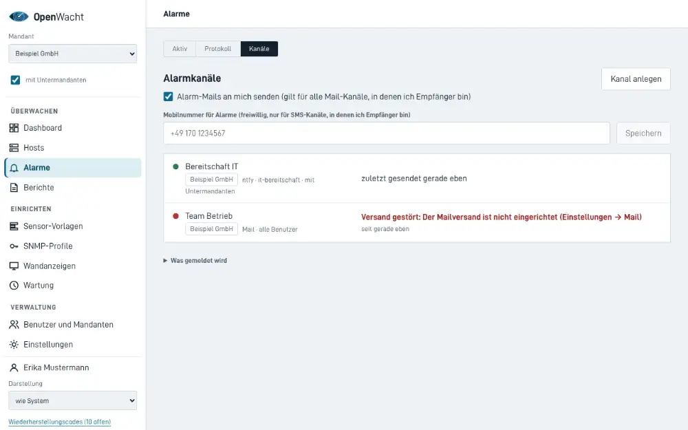
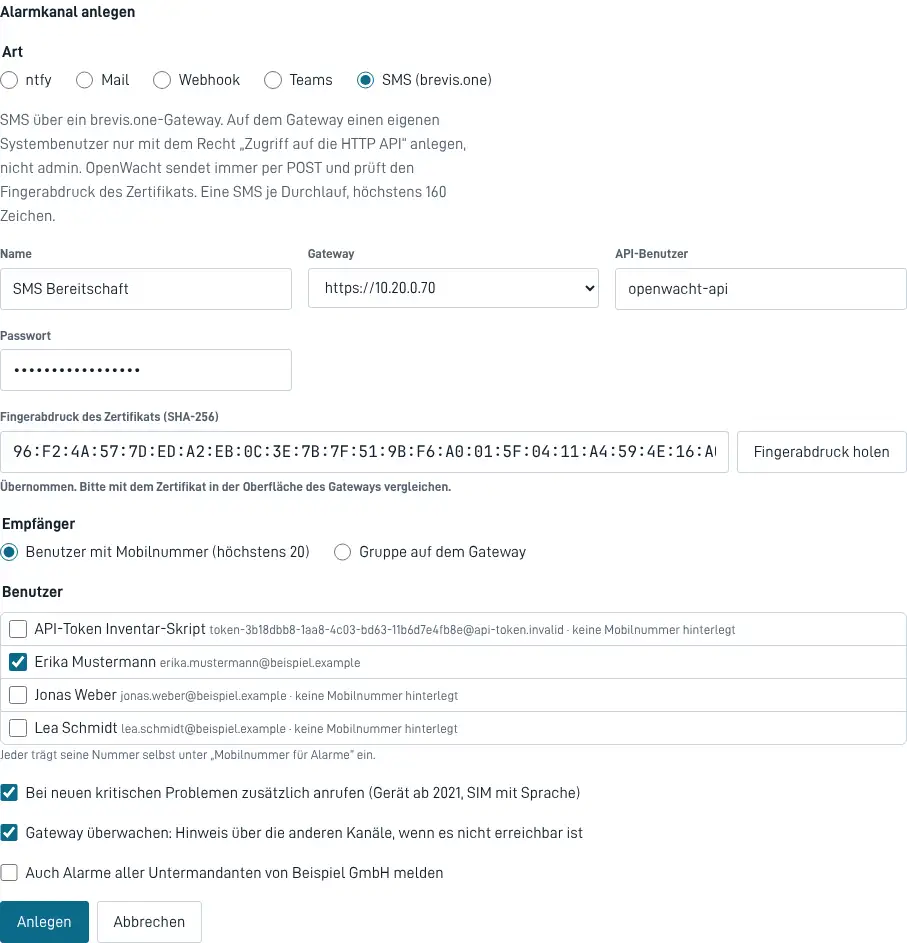
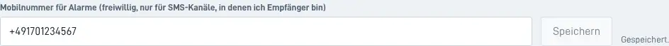
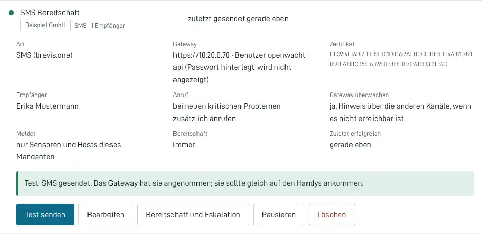
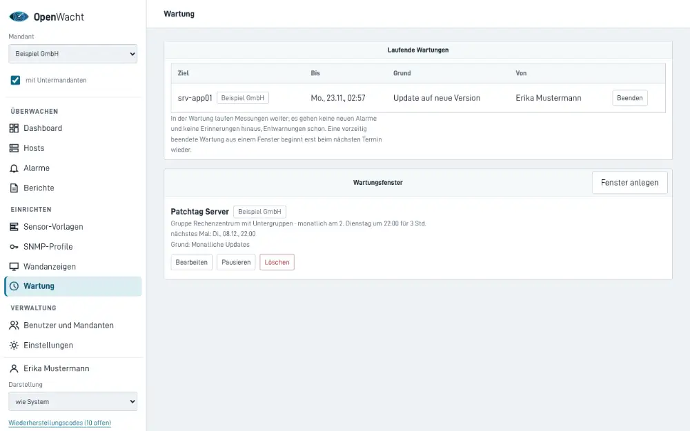

# 8. Alerts and maintenance

## Active alerts

**Alarme → Aktiv** (Alerts → Active) shows open alerts with “Bestätigen” (acknowledge; operators and admins, with an
optional comment) and all sensors that are not OK. Acknowledged alerts no longer send reminders but stay open until the
problem is gone.

**Alarme → Protokoll** (Alerts → Log): all alerts of the last 30 days with duration and who acknowledged.

## Notices above the alerts

Above “Aktiv” and “Protokoll” there are notices that are not a single sensor:

- **Alarme unterdrückt seit …** (alerts suppressed since …): devices that depend on a failed parent device (chapter 4)
  report no alerts of their own. The notice names the parent device, since when it has failed and which devices are
  resting. If this lasts **7 days**, a notice additionally goes to the alert channels of the resting devices’ tenant
  (“Alarme seit 8 Tagen unterdrückt”, alerts suppressed for 8 days), so that a forgotten dependency does not silently
  swallow all alerts. All-clear as soon as the parent device is reachable again or the dependency is removed.
- **Zentrale: …** (central server: …; operator only): messages of the central server about itself, see “Self-monitoring”
  below.

Notices know no acknowledging and no maintenance: one message when they occur, one on a change between warning and
error, and an all-clear.

## Side notices and sound

At the bottom of the sidebar, **Hinweise und Ton** (notices and sound) opens your own settings. They only apply to you, in
every browser in which you are signed in, and only while OpenWacht is open. Readers can set this for themselves too.

- **Side notices** (on by default): at the bottom right, a short notice appears for a new alert, when an alert gets worse
  (warning → critical) and on an all-clear. A click leads to the active alerts. Notices disappear after a few seconds
  (critical after 20), not while the mouse is over them. Acknowledged alerts do not notify. Traps with the effect warning
  or critical are alerts and appear in the same way.
- **Sound** (off by default): off, only on critical, or on warning and critical. Sound bling, gong or double tone, volume
  and, if desired, a quiet tone on all-clear. “Probehören” (preview) plays the sound. The browser generates the sounds
  itself; no files are loaded. Browsers only play sound after the page has been clicked once.

- **Windows notification** (1.0.3, per browser, off by default): if OpenWacht is in the background (another window in
  front, minimised), the browser additionally shows the same events as a system notification, on Windows at the bottom
  right in the notification area. From four events at once, a combined one comes. A click brings OpenWacht to the front
  and opens the alerts. When switching on, the browser asks once for permission; if it has blocked it, it can be allowed
  again via the lock on the left of the address bar → Permissions → Notifications. This only works via HTTPS, and
  OpenWacht must be open.

**Install as app:** in Edge and Chrome, OpenWacht can be installed as its own app with window and Start menu entry: the
icon “Install app” on the right of the address bar, or menu (⋯) → Apps → “Install OpenWacht”, or the button **Als App
installieren** (install as app) in the dialog, if the browser offers it. The app is the same interface with the same
sign-in; minimised, the Windows notifications keep coming. Removing: in the app menu → “Uninstall OpenWacht” or Windows
Settings → Apps.

### Desktop app for Windows (from 1.0.4)

`openwacht-desktop.exe` (from the build, `openwacht-desktop_windows_amd64.exe` or `_arm64`) shows OpenWacht in the
notification area next to the clock, **even without an open browser window**:

- The **icon** carries the worst open, unacknowledged alert, as shape and colour as in the interface (circle OK, triangle
  warning, octagon critical, dashed square unknown, empty ring: no connection). The tooltip names the numbers.
- **Windows notifications** for new alerts, deteriorations and all-clears (from four at once a combined one); a click
  opens the alerts in the browser.
- **Menu** (right-click on the icon): open OpenWacht (window), open in browser, alerts in browser, check now, start with
  Windows (with feedback), set up, exit.

**Placing it:** put `openwacht-desktop.exe` into its own folder that only your account may write to (for example
`%LOCALAPPDATA%\Programs\OpenWacht`), not into Downloads, and start it from there; “Mit Windows starten” (start with
Windows) remembers this location. As long as the file is not signed, compare the checksum with `SHA256SUMS` first. From
1.0.9 the app only loads Windows DLLs from the system folder; older versions load a file of the same name from their own
folder first.

#### Window like the web interface (from 1.0.6)

Starting the file (or left-clicking the icon) opens the window, **without a browser**; if the app starts with Windows, it
only stays in the notification area. Starting it a second time brings the open window to the front. The window is built
like the web interface so that nobody has to learn two interfaces: the same sidebar, the same pictograms, colours, fonts
(D-DIN, JetBrains Mono) and state shapes.

- **Sidebar on the left** as in the browser: wordmark, **tenant** with “mit Untermandanten” (with subtenants), below it
  Monitor, Setup and Administration. **All items** (Dashboard, Hosts, Topology, Certificates, Alerts, Reports, Sensor
  templates, SNMP profiles, Wall displays, Maintenance, Users and tenants) are pages of the app as on the web; “Im
  Browser öffnen” (open in browser) at the top right shows the same page for the same tenant in the browser. At the
  bottom: account or token and role, central server, connection with status, **appearance** (like system, light, dark)
  and **sign out**. The app remembers tenant, switch and appearance.
- **Header** with breadcrumbs (“Dashboard › web01”), the page’s buttons (“Host hinzufügen”, “Im Browser öffnen”) and the
  **search** (Ctrl+K or Ctrl+F; filters the sensors by device, sensor and message).
- **Dashboard** (from 1.0.7 as on the web): the same layout of your account in the same grid, with all widgets, your
  **pages** as tabs and **“An Fenster anpassen”** (fit to window; distributes the window’s height over the rows; applies
  per computer). What you adjust in the browser also appears in the app, and vice versa. **“Anpassen”** (customise)
  switches to editing: “+ Widget”, “+ Seite” (page), “Seite umbenennen” (rename page), “Seite löschen” (delete page),
  “Standard wiederherstellen” (restore default); on each widget, **“Ändern”** (change) opens a menu with settings
  (title, width, height, page, tenant, content), to front/back, wider/narrower, taller/shorter, duplicate and remove.
  Three differences from the web: you set the size via the menu, not by dragging the corner; lists in a widget do not
  scroll but name the rest (“… und 3 weitere”, and 3 more), a taller widget shows more; and with an **API token** there
  is no account layout, the app then shows the default layout without “Anpassen”. A click on a **device** (in the
  sunburst diagram or in a list) opens it as before: on the left the large **sun**, next to it its **sensors**; × or Esc
  closes again. In this view a click on a group shows it as a sun, a click in the middle goes back one level. **Marker
  colours** apply as on the wall display: a device with warning, critical or acknowledged appears in the marker colour of
  its sensor, acknowledged darkened; with equal severity, the state without marker colour wins (“red always wins”). In
  lists, the state shape carries the marker colour; the shape itself remains.
- **Hosts:** on the left the tree (tenant, subtenants, groups, devices) with the shape of the worst state and the numbers
  of critical, warning and unknown sensors, on the right the selection.
- **Alerts:** all sensors with warning, critical or unknown in the selected tenant, worst first.
- **Maintenance:** like the browser page “Laufende Wartungen” (running maintenance: target, until, reason, by) with
  **Beenden** (end) and below it the **maintenance windows** with target, repetition, next date or “läuft bis …” (runs
  until …) and the buttons **Pausieren** (pause) or **Fortsetzen** (resume) and **Löschen** (delete; with confirmation; a
  running maintenance from the window ends immediately). “Fenster anlegen” (create window) and “Bearbeiten” (edit) open
  the form in the browser. The search filters by target, name and reason; the page polls again every 30 s.
- **Certificates:** all “TLS-Zertifikat” sensors in scope, the first to expire at the top, with state, address, device,
  expiry date, remaining time and issuer or note; switch between all, due soon (14, 30, 60 or 90 days) and with problem.
  A click on the device opens it under Hosts.
- **Reports:** choose a month, key figures, availability per tenant and per device, alerts with the longest, capacity.
  **Als PDF** (as PDF) puts the report into the Downloads folder and opens it. Admins set the tenant’s SLA target here.
- **Topology:** the dependencies (“hängt ab von”, depends on) as trees per tenant as on the web: a card per device with
  shape and colour, the line on the left of a child in its state, dashed if it is resting, unknown or unchecked. A click
  opens the device under Hosts.
- **SNMP profiles** (admins only): list with version, devices and last change; create, edit (v3 with user, methods and
  both passwords, v1/v2c with community) and delete. Like the web, the app never shows the credentials again; left empty,
  they remain unchanged.
- **Wall displays:** list with scope, network and last retrieval; admins create (the link only appears once, “Link
  kopieren” puts it on the clipboard), generate a new link, set the sound and delete. A click on the name opens the
  preview in the browser.
- **Sensor templates:** own templates, template sets and (expandable) the built-in ones, grouped by “misst” (measures);
  the search at the top right filters by name, kind and note. Operators and admins create templates (type and fields as
  for the sensor, {adresse} for the device’s address), copy built-in ones, edit and delete their own, compose sets from
  templates and apply template or set to ticked devices or all devices of a group (with a list of those skipped). Below
  it the **marker colours** with create, change (contrast of 3:1 each on light and dark is checked) and delete. The
  marker colour of a new entry in a set is chosen in the browser.
- **Users and tenants** (only when signed in with an account) with the web’s tabs for the tenant selected on the left:
  **tenants** (create or request a subtenant, rename, recertification as PDF or CSV into the Downloads folder, delete;
  approve or reject requests), **users** (create with start password, change role, reset and copy password, deactivate,
  activate, delete), **agent tokens** (revoke), **agent updates** (automatic, release for ticked agents, as operator
  upload and delete packages), **API tokens** (create with code from the app, the token appears once for copying;
  revoke) and **sign-in (AD, SSO)** (connect and edit in two steps, test, delete; save and delete with code). The tenant
  is chosen at the top left.
- **Device or selection:** at the top name, address, group, agent and maintenance with badges per state (“nur ansehen
  (Rolle Leser)”, view only (role reader), where the role may only read), below it the commands “+ Sensor”, “Jetzt
  abfragen” (poll now), “Alarm bestätigen …” (acknowledge alert), “Wartung …” (maintenance), “Pausieren” (pause), on the
  right “Nur Probleme” (problems only) and “Mehr” (more; whatever does not fit in the row is there). The **sensor list**
  shows the worst first, a click on the heading sorts; if it is narrow, type, “seit” (since) and value are dropped.
  **Below it** the details of the selected sensor (message, type, target, interval, value, last and next poll,
  maintenance, alert) or of the device; the divider above it can be dragged.
- **Maintaining** via the commands, right-click or keys: add, edit (name, address, group) and delete a device; add a
  sensor (Ctrl+N), edit (double-click, F2), poll now, pause and resume, delete (Del); set and end maintenance for device
  or sensor; acknowledge an open alert with a comment; F5 polls immediately. The sensor dialog offers exactly the fields
  of the web interface per type; address or URL are prefilled with the device’s. Deleting always asks (“Sensor
  löschen?”); the app only deletes a device with content after its name is entered, as in the browser.
- The list also shows values of the agent and of the SNMP query (CPU, disks, interfaces …). What the sidebar does not
  contain stays in the browser (alert routes and channels, settings, own account with 2FA and passkeys), as do the limits
  of agent and SNMP values and the forms for maintenance windows and “hängt ab von”.

**Signing in (from 1.0.6 two ways):** at the first start, **“Bei OpenWacht anmelden”** (sign in to OpenWacht) opens with
the address of the central server (as in the browser, not port 8444) and the choice **“Anmelden mit”** (sign in with):

- **Account (as in the browser, default):** email and password, then the code from the authenticator app (or a recovery
  code). The app runs the same session as the browser and may therefore do **exactly what the account may do on the
  web**, including as admin; sensitive changes require a fresh code as on the web. The central server records everything
  under the account’s name in the audit log. The app stores neither password nor session: after restarting the app,
  after 30 minutes without a poll or at the latest after 12 hours (central server settings), you sign in again; the app
  then asks by itself (“Die Sitzung ist abgelaufen.”, the session has expired). Only the email address is stored. Passkey
  and SSO only work in the browser; an account that still has to set up two-factor sign-in sets it up in the browser
  first.
- **API token:** for a computer that only watches in the notification area and should keep reporting after restarts
  without signing in. The token is created under **Benutzer und Mandanten › API-Tokens** (Users and tenants › API
  tokens), role **operator** for maintaining or **reader** only for viewing ([chapter 11](11-api-tokens.md)); a token
  never gets admin rights. An operator token is as powerful as an operator account without a second factor: only on your
  own computer and with a short validity. It is kept in the **Windows Credential Manager** (entry “OpenWacht Desktop”),
  never in a file.

The app checks the sign-in immediately and names the cause if it does not work (password, code, token unknown or expired,
certificate, no connection). Address, kind of sign-in, email and appearance are stored in
`%APPDATA%\OpenWacht\desktop.json`. **Abmelden** (sign out, bottom of the sidebar) also ends the session on the central
server or forgets the token and opens the sign-in again; right-click on the icon → “Anmeldung ändern …” (change sign-in)
switches without signing out. `openwacht-desktop entfernen` deletes token, settings and autostart. The app is a single
file without installation, for example copy it to `%LOCALAPPDATA%\Programs\OpenWacht\` and start it.

**What the app may change is determined by the role** of the account or token per tenant: readers only view (the buttons
are then grey), operators devices, sensors, maintenance and alerts, admins additionally the administration. The central
server checks every change itself, records it in the audit log and reports errors in the dialog, for example “Intervall:
30 Sekunden bis 1 Tag.” (interval: 30 seconds to 1 day). Closing only hides the window; the app keeps running in the
notification area.

The app polls `GET /api/v1/alarme` every 30 seconds, with the window open additionally tenants, groups, devices, sensors
and checks, only via HTTPS and without following redirects. Windows must trust the central server’s certificate (for
example company CA). Like the Windows agent, it is not Authenticode-signed: SmartScreen warns at the first start, and an
antivirus may need an exception. From 1.0.6 the file carries a program description (Properties → Details: “OpenWacht
Desktop”, version, commit) and the pictorial mark as program icon. The fonts D-DIN and JetBrains Mono (SIL Open Font
License 1.1) are embedded unchanged and are only loaded for the app, not installed; `openwacht-desktop lizenzen` (or More
→ About) puts the licence texts under `%APPDATA%\OpenWacht\lizenzen`. Window and sign-in are tested under Wine against a
simulated central server, not yet on real Windows.

The interface polls the alerts every 15 seconds for this, with Windows notification also in the background. Admins set
the sound of a **wall display** in the list of wall displays under “Ton” (sound)
([chapter 4](04-hosts.md#dashboard-and-wall-display)).

## Alert channels

**Alarme → Kanäle** (Alerts → Channels; the tenant’s admins):

| Channel | Note |
| --- | --- |
| Mail | via the relay from the settings; recipients are user accounts (all or selected); everyone can unsubscribe for themselves |
| Webhook | signed (HMAC), to your own systems; the target must be allowed in the alert targets |
| ntfy | your own ntfy server; push to iPhones needs internet (Apple), Android works locally |
| Teams | workflow in Microsoft Teams; needs internet |
| SMS (brevis.one) | via your own SMS gateway in the network; needs no internet, only mobile network at the gateway; see below |

A channel can also report the alerts of all subtenants (switch per channel). The state is remembered per channel: if a
channel is disrupted, it catches up without others reporting twice.

**On-call and escalation** (per channel): weekdays and times at which the channel reports (time zone of the installation;
outside, events are collected and sent later); “unbestätigt nach N Minuten an Kanal X” (unacknowledged after N minutes to
channel X).

**Batching** (mail and SMS, per channel, on by default): the first event starts one minute; everything that comes in
during this minute (alerts, all-clears, reminders) then goes out as **one** mail or SMS, worst first. A single event
comes as a normal mail with graph. If a sensor is OK again within the minute, there is no message (it still appears in
the alert log). If sending fails, the channel tries again after one minute, not on every run; this spares relays with a
per-minute limit (Exchange: `421 4.4.2`). Switch off under “Zustellung” (delivery) on the channel; then every message goes
immediately, from ten events at once as a combined mail.

**Monthly report** on the mail channel: see [chapter 9](09-berichte.md).

**What an alert mail looks like:** the subject only names state, device and sensor, at most 90 characters, for example
`KRIT · drucker-empfang · TCP 9100`. The body repeats device and sensor at the top, below it the message in large type
(“Port 9100: keine Route zum Host”), then since when, forecast, further problems on the device, graph and the link. A
**combined mail** is called for example `KRIT · OpenWacht: 3 Probleme, 1 wieder OK` (worst state first) and lists
“Probleme” (problems) and “Wieder in Ordnung” (OK again) separately, one line per event.

### SMS via a brevis.one gateway

OpenWacht sends SMS via the HTTP API of a brevis.one gateway (for example RX2) in your own network. This also works
without internet as long as the gateway has mobile network; this makes it suitable as an alert route when mail or Teams
are not working at the moment.

**On the gateway** (as admin): under *Konfiguration → Systembenutzer* (configuration → system users) create a dedicated
user, for example `openwacht-api`, and give it via the pencil icon only the right **“Zugriff auf die HTTP API”** (access
to the HTTP API). OpenWacht rejects the user `admin`. For groups as recipients, the gateway needs the module
*Empfängergruppen* (recipient groups); the group ID is under *Konfiguration → Gruppen*.

**In OpenWacht:**

1. The operator allows the gateway under *Einstellungen → Alarmziele* (Settings → Alert targets), for example
   `https://10.20.0.70`. Without this permission no SMS channel can be created and nothing can be sent.
2. *Alarme → Kanäle → Kanal anlegen → SMS (brevis.one)*: choose the gateway, enter API user and password, **fetch
   fingerprint** (TLS connection without request and without credentials). Compare the fingerprint shown with the
   certificate in the gateway’s interface.
3. Choose recipients: **users** with a role in this tenant (at most 20) or a **group** on the gateway. Free text with
   phone numbers deliberately does not exist.
4. Optionally **“Bei neuen kritischen Problemen zusätzlich anrufen”** (additionally call on new critical problems;
   parameter `ring`; according to the vendor only devices from 2021 and only with a SIM card with voice) and **“Gateway
   überwachen”** (monitor gateway).
5. **Test senden** (send test) sends a test SMS to all recipients.

**Mobile number for alerts:** everyone enters their own number at the top of the page *Alarme → Kanäle* (voluntary,
international like `+49 170 1234567` or `0170 1234567`). Other users and admins only see *whether* a number is stored,
not which one; the audit only says “gesetzt” (set) or “entfernt” (removed). Whoever no longer wants SMS deletes their
number. Locked accounts get no SMS.

**What an SMS contains:** device, sensor, state, for a single event also the message, at most 160 characters from the
GSM-7 character set (umlauts work; OpenWacht replaces characters such as “…” so that it stays exactly one SMS). Several
events of one run come in one SMS: `OpenWacht: 3 Meldungen. KRIT nas-01 - Platte /; WARN …`.

**Security:**
- OpenWacht always sends via **POST** with a form, never via GET: the password is not in a URL and not in the gateway’s
  access logs.
- Instead of a CA, OpenWacht checks the certificate’s **fingerprint** before the request with the password goes out.
  After a new certificate on the gateway, the channel reports “Zertifikat … passt nicht” (certificate … does not match);
  then fetch the fingerprint again and re-enter the password.
- The password is stored encrypted in the database, bound to channel, tenant, gateway, user and fingerprint. If one of
  them changes, it must be entered again; it never goes to another gateway.
- Redirects are not followed, responses are read at most 4 KiB far. Text from the gateway does not appear in messages,
  only the status.

**Error messages on the channel** (according to the vendor documentation, errors come as HTTP status):

| Status | Meaning | Remedy |
| --- | --- | --- |
| 400 | group, contact or number unknown or invalid, or required field missing | check group ID or mobile numbers, gateway log |
| 401 | user or password wrong | re-enter the password on the channel |
| 403 | the user lacks the right “Zugriff auf die HTTP API” | grant the right on the gateway |
| 408 | timeout while sending | check mobile network at the gateway |

If an SMS only reaches part of the recipients, it counts as reported (otherwise the others would get it twice), and the
channel shows “1 von 3 Empfängern nicht erreicht …” (1 of 3 recipients not reached).

**Monitor gateway:** if the switch is on, the central server builds a TLS connection to the gateway every five minutes
(without request and credentials). If this fails twice in a row or the fingerprint does not match, the notice
“SMS-Gateway nicht erreichbar” (SMS gateway unreachable) goes to the tenant’s **other** alert channels, with an all-clear
as soon as it answers again. Therefore create at least a second channel besides SMS.

## Dead man’s switch

If the central server itself fails, it cannot alert. For this, after every successful run it pings an address (for
example healthchecks.io or your own service in the network) that alerts when the ping stops (Einstellungen →
Totmannschalter, Settings → Dead man’s switch). Without internet: your own Healthchecks service or a webhook in your own
network.

## Self-monitoring

The central server checks itself every five minutes and reports problems to the **alert channels of the main tenant**.
Without a channel in the main tenant they only appear on the Alerts page and in the journal; therefore create at least
one channel there.

| Notice | When |
| --- | --- |
| Backup failed / overdue | last run with error or last successful backup older than 26 hours (only once there are backups at all) |
| HTTPS certificate expires | in less than 21 days (error below 7); the own CA renews 30 days before, so the notice means: renewal did not work or an uploaded certificate is expiring |
| HTTPS root / agent CA expires | in less than one year (error below 90 days) |
| Central server disk almost full | from 90 % (error from 95 %) for `/`, `/var/lib/postgresql`, `/var/backups/openwacht`, `/var/log/openwacht` |
| Audit log tampered with or damaged | the daily check of the hash chain failed (chapter 13) |
| Audit export failed | for more than an hour |
| Program error caught | a parser or a query crashed and was caught; monitoring continues, details in the journal; please report |
| Trap service not reporting | it has run before and has been silent for more than 5 minutes |

`GET /api/v1/gesund` (without sign-in) returns `status`, `datenbank`, `planer` and `traps`, each only as a state (`ok`,
`aus`, `stumm`, `verzoegert`, `gestoert`), and answers with **503** if database or scheduler are disrupted. This is
suitable for a load balancer or an external monitor in addition to the dead man’s switch.

## Maintenance

**Maintenance for a host or sensor:** action menu “Wartung ändern …” (change maintenance), duration 30 minutes to 7 days,
optionally with a reason. Measurements continue, alerts and reminders stay off. If the problem persists after the end, an
alert comes immediately.

**Maintenance windows** (Einrichten → Wartung, Setup → Maintenance; operators and admins): once, weekly or monthly (for
example “zweiter Dienstag”, second Tuesday), for devices, sensors or groups with subgroups.

Availability in the report does not count maintenance times as downtime.
