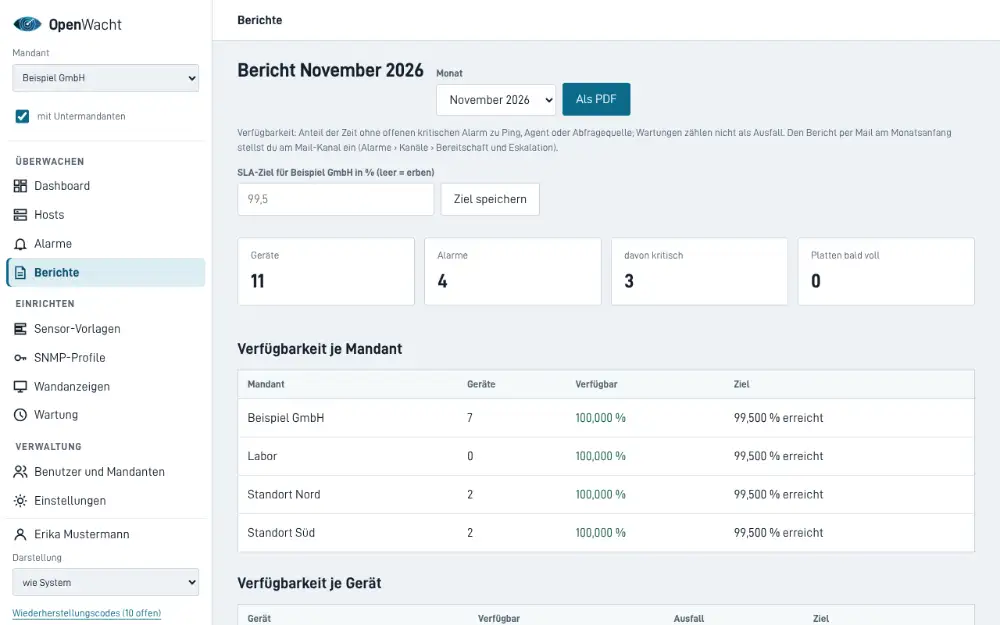

# 9. Reports

**Überwachen → Berichte** (Monitor → Reports): choose a month. The report shows per tenant and per device the
**availability** and the **SLA target**, the alerts (number, critical, warnings, acknowledged, the ten longest) and
disks that will be full within 90 days. “Als PDF” downloads the same report.

- **Outage** means: time with an open critical alert of a ping sensor, “agent not reporting” or “source not
  responding”. Maintenance windows open no alerts and therefore do not count as outage.
- A tenant’s value is the average of its devices.
- **SLA target** per tenant (admins): inherited from the nearest parent tenant, otherwise 99.5 %.
- **Monthly delivery:** tick “Monatsbericht” (monthly report) on the mail channel. In the first seven days of a month
  the previous month goes as PDF to every recipient, created with **their** permissions (everyone only sees what they
  also see in the interface).

The PDF font only supports Western European characters (WinAnsi); others appear as “?”.
