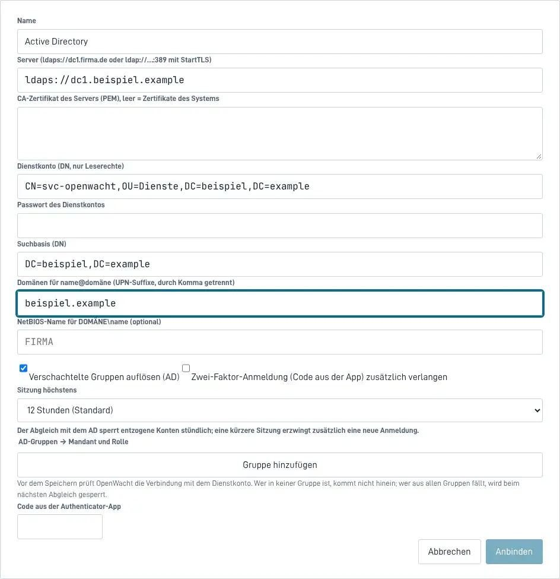

# 10. Sign-in via AD and SSO

Under **Benutzer und Mandanten → Anmeldung (AD, SSO)** (Users and tenants → Sign-in), the admin of a tenant connects a
directory. Sub-tenants without their own connection use the nearest one above. Local accounts remain alongside and take
precedence for the same address (emergency access if AD fails).

## Active Directory (LDAPS)

1. In AD, create a service account **with read rights only** (for example `svc-openwacht`) and groups for OpenWacht
   (for example `GG-OpenWacht-Admins`, `GG-OpenWacht-Operatoren`).
2. Add the domain controller to the network allow-list (Einstellungen → Netzfreigabe, for example `10.0.0.10/32`).
3. “AD anbinden” (connect AD): server `ldaps://dc1.firma.de` (or `ldap://…:389` with StartTLS), CA certificate of the
   company CA, service account as DN, password, search base, UPN domains (`firma.de`), NetBIOS name (`FIRMA`), groups →
   tenant and role. There is no plain-text LDAP; the certificate is always checked.
4. Sign in with `name@firma.de` or `FIRMA\name` and the AD password.

The account is created at the first sign-in. Rights follow the groups (also nested) at every sign-in and every hour. If
an account is disabled in AD, has disappeared or is in no group any more, OpenWacht locks it and ends its sessions. If
AD is unreachable, the synchronisation locks nothing.

The service account’s password is stored encrypted in the database and bound to server, service account and CA: whoever
changes the server must enter the password again (so nobody can redirect it to their own server).

## Company login via OIDC (Keycloak, ADFS, Entra ID)

1. Create a confidential client at the IdP: authorization code with PKCE, redirect address
   `https://<address>/api/v1/sitzung/sso/rueckkehr`, group claim in the ID token (Keycloak: mapper “Group Membership”,
   claim `groups`, without full path).
2. Add the IdP address to the network allow-list. **Without internet:** Keycloak or ADFS in your own network (Entra ID
   needs internet).
3. “SSO (OIDC) anbinden” (connect SSO): issuer, client ID, client secret, CA, domains, groups → tenant and role.
4. Users enter their address and click “Mit Firmen-Login anmelden (SSO)”. SSO only works via the configured main address
   of the central server.

**Checking the ID token:** OpenWacht fetches the ID token itself at the token endpoint over verified TLS and additionally
checks its **signature** against the IdP’s keys (`jwks_uri` from the discovery document). Only **RS256** (RSA from 2048
bits) and **ES256** (P-256) are allowed; tokens with `none`, HS256, PS256 or a key inside the token itself are rejected.
Keycloak, ADFS and Entra ID sign with RS256 by default; if another algorithm is set for the client in Keycloak (“ID Token
Signature Algorithm”), switch it to RS256 or ES256. The central server caches the keys for up to one hour. If the IdP
rotates its keys, it reloads the list at the first unknown `kid` (at most once per minute); if the key endpoint is
briefly unreachable, the cached keys remain valid until they expire. “Verbindung prüfen” (test connection) loads the
keys as well. Like the IdP, the key endpoint must be in the network allow-list (for Entra ID it is under
`login.microsoftonline.com`).

**Address of the account:** The address comes from exactly one claim, set per connection under “Adresse des Kontos aus
dem Claim”: `email` (default), `upn` or `preferred_username`. There is no fallback to other claims. If `email_verified`
is in the token and not `true`, OpenWacht rejects the sign-in. Only use `preferred_username` if the IdP fixes it and
users cannot change it themselves (in Keycloak, for example, “Edit username” off). The address must be in one of the
connection’s domains.

**Entra ID:** Set the claim to `upn` (Entra often does not provide `email`, or without verification). Emit groups in
the token as **object IDs** (in the app registration under “Token configuration”, add a group claim with the group ID)
and map the object IDs in OpenWacht, not the display names: display names are not unique, and whoever may create groups
could otherwise create a group with the same name. If a user has very many groups, Entra delivers only a reference
instead of the list (overage, according to Microsoft from 200 groups in the JWT); then restrict the claim to the groups
assigned to the application.

## Sign-in domains of sub-tenants

If the admin of a sub-tenant sets up the connection, its domains and NetBIOS name only apply once the operator approves
them under Einstellungen → Anmelde-Domänen. Until then the connection shows “(beantragt)” (requested), and sign-ins with
this domain do not go to the directory. Reason: whoever claims `name@beispiel.example` would otherwise receive other
users’ passwords at their server during LDAP sign-in. A domain is approved for one connection only; a second request
stays “requested” and does not disturb the first. New domains and a changed NetBIOS name each need a new approval;
unchanged ones keep it when editing.

## Session duration

Per connection, the maximum duration of a session can be lowered to 1, 2, 4 or 8 hours (default 12). Important above
all for SSO: OpenWacht only synchronises OIDC accounts at sign-in. Whoever is disabled in the identity provider or loses
a group stays signed in until the end of their session. AD accounts are additionally synchronised every hour.

## Two-factor for AD and SSO accounts

Per connection: “Zwei-Faktor-Anmeldung (Code aus der App) zusätzlich verlangen” (additionally require two-factor;
default off). Any account can set it up voluntarily. SSO accounts have no password in OpenWacht and therefore need
two-factor sign-in for changes that require confirmation.
