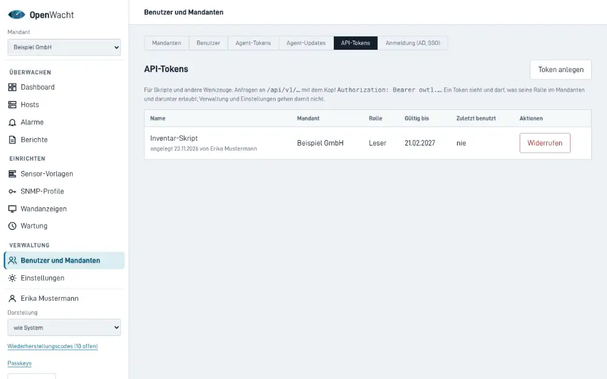

# 11. API tokens

For scripts and other tools (inventory, ticket system). **Benutzer und Mandanten → API-Tokens → Token anlegen** (Users
and tenants → API tokens → Create token; admins of the tenant, with confirmation): name, role **reader** (Leser) or
**operator**, 1–365 days.



The token (`owt1.…`) is shown exactly once; only its hash is stored. Call:

```bash
curl -H "Authorization: Bearer owt1.…" https://openwacht.beispiel.example/api/v1/mandanten
curl -H "Authorization: Bearer owt1.…" https://openwacht.beispiel.example/api/v1/geraete
```

- A token sees and may do what its role allows in the tenant and below, never admin rights.
- Not possible: sessions, two-factor, administration and settings.
- At most 300 requests per minute and token. Creating and revoking are recorded in the audit log. “Zuletzt benutzt”
  (last used) shows whether a token is still needed; “Widerrufen” (revoke) blocks it immediately.

## Description of the API (OpenAPI)

The reading endpoints that a token with the role **reader** may use are described in
[`docs/api/openapi.json`](../api/openapi.json) (OpenAPI 3.1). The file is also in the central server package under
`/usr/share/doc/openwacht-zentrale/openapi.json` and can be loaded into tools such as Swagger UI, Postman or a client
generator.

| Area | Endpoints |
| --- | --- |
| Tenants | `/api/v1/mandanten` |
| Devices | `/api/v1/geraete`, `/api/v1/gruppen`, `/api/v1/agents`, `/api/v1/snmp`, histories `…/{id}/verlauf`, `/api/v1/geraete/{id}/sparklines` |
| Sensors | `/api/v1/sensoren` (all sensors with state), `/api/v1/checks`, `/api/v1/kennfarben` |
| Alerts | `/api/v1/alarme`, `/api/v1/wartung`, `/api/v1/snmp/{id}/traps` |
| Reports | `/api/v1/berichte` (also `/pdf`), `/api/v1/prognose/platten`, `/api/v1/dashboard/kennzahlen`, `/api/v1/dashboard/verlauf` |
| Operation | `/api/v1/gesund` (without token) |

Examples:

```bash
T="Authorization: Bearer owt1.…"
Z=https://openwacht.beispiel.example
curl -H "$T" "$Z/api/v1/sensoren"                                   # all sensors with state
curl -H "$T" "$Z/api/v1/alarme?limit=50"                            # latest alerts
curl -H "$T" "$Z/api/v1/agents/<id>/verlauf?zeitraum=7t"            # history, 1h, 24h, 7t or 30t
curl -H "$T" -o bericht.pdf "$Z/api/v1/berichte/pdf?mandant=<id>&monat=2026-10"
```

- Errors come as JSON `{"fehler": "…"}` with status 400, 401, 403, 404 or 429 (then with `Retry-After`). Objects of other
  tenants answer like missing ones with 404.
- New fields may be added in later versions; scripts should skip unknown fields. A field is only removed or renamed
  with a note in the release notes.
- Further reading routes (administration, forms and personal settings of the interface) are deliberately not described
  and may change without notice.
- A test checks the file against the code on every run: every described endpoint answers a reader token with 200 and
  matches the schema, and every reading endpoint that a reader token reaches is described or deliberately excluded.
