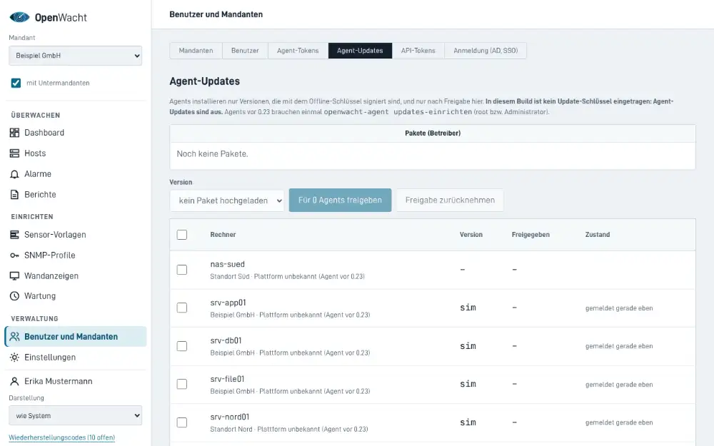

# 12. Agent updates

On request, agents update themselves, but **only with a binary signed with the offline key** (Ed25519). The key never
lies on the central server: a compromised central server cannot distribute a manipulated agent.

As long as no update key is entered in the build, agent updates are off (notice at the top of the page).

## Once: create keys (vendor, offline)

`internal/update/schluessel.pub` holds up to **three** keys, one per line `ed25519:<base64> <state>`:

| State | Meaning |
| --- | --- |
| `aktiv` (active) | signs new versions (at most one) |
| `reserve` | emergency key, kept separately; may revoke any other |
| `auslaufend` (expiring) | is being replaced; signatures still valid |
| `widerrufen` (revoked) | no longer valid |

1. On a computer without a connection to the central server, create two keys:
   `go run ./tools/signieren -neu -schluessel ~/openwacht-update.key` and
   `go run ./tools/signieren -neu -schluessel ~/openwacht-reserve.key`.
2. Enter the printed lines in `internal/update/schluessel.pub` (one with `aktiv`, one with `reserve`) and build a new
   version. Publish the **identifiers** (16 hex digits) separately, for example in this handbook and in the contract;
   customers use them to check the first installation (chapter 1).
3. Back up both key files offline and **separately** (for example two encrypted USB sticks in different places). If the
   active one is lost, the reserve continues to sign.

**Identifiers of the OpenWacht keys** (created on 24 Nov 2026):

| State | Identifier |
| --- | --- |
| active | `b7ba49cf02e0fb6d` |
| reserve | `dbeb1adf2c56942f` |

Whether a backup copy of a key is correct is shown by `signieren -zeigen -schluessel <file>`: it only prints the public
part and the identifier, never the private key.

Changes to `schluessel.pub` only in a separate pull request with “Update-Schlüssel” in the title and a signed commit;
whoever can swap this file can supply agents with their own updates.

## Per version

1. Sign the binaries offline:
   `go run ./tools/signieren -schluessel ~/openwacht-update.key -version 1.0.0 openwacht-agent_linux_amd64 openwacht-agent_windows_amd64.exe`
   (a `.sig` is created per file).
2. **Verwaltung → Agent-Updates** (Administration → Agent updates; operator): upload binary and `.sig`. The central
   server checks the signature. **From 1.0.14 this is not needed** for the agents that come with the central server:
   if the signed agents with their `.sig` are in the central server package (page “Downloads”), the central server
   stores them under “Agent-Updates” itself at start, checked as on upload (audit `agent_update.mitgeliefert`).
   Uploading by hand remains for interim versions.
3. Select agents, choose the version, “Für N Agents freigeben” (release for N agents; admins of the tenant).

At its next report, the agent downloads the package, checks signature, checksum, platform and version (no downgrade)
and stages it. The exchange is done by a **separate** installation service with root rights, which checks the signature
once more with the key of the installed agent (Linux immediately, Windows through a scheduled task within 15 minutes).
The agent service itself cannot change its program.

## Applying automatically (from 1.0.4)

Instead of releasing every version by hand, the agents of a tenant can take new versions themselves: **Verwaltung →
Agent-Updates → Automatisch übernehmen** (apply automatically; admins of the tenant or above, per tenant).

- **Pilot group** (a device group, with subgroups): its agents get a new version as soon as the package is uploaded.
- **Waiting time** (0 to 720 hours, default 24): only then are the other agents next, and only if **no pilot reports an
  error** during the update and, if there are pilots, **at least one already runs the new version**. Without a pilot
  group only the waiting time counts.
- **Time window:** weekdays and hours in the installation’s time zone; “von” (from) equal to “bis” (to) means the whole
  day, “von” greater than “bis” spans midnight (for example 22 to 5 o’clock).

When an agent is due, the central server enters the release at its next report (column “Freigegeben” with the addition
“automatisch”); after that everything runs as with a manual release, with the same signature check in the agent. A
**manual release takes precedence** and is not overwritten by the automation. There is no downgrade here either. Changes
to the rule are recorded in the audit log (`agent_update.automatik`).

As always, the prerequisite is a package signed with the offline key that the operator has uploaded.

## Changing or revoking keys

- **Planned change:** create a new key, set the previous one to `auslaufend` and the new one to `aktiv` in
  `schluessel.pub`, build the version and sign it with the previous (still valid) key. Remove the old entry from the
  version after next.
- **Key lost or leaked:** build a version in which the key is listed as `widerrufen`, and sign it with the **reserve**,
  explicitly revoking the key:
  `go run ./tools/signieren -schluessel ~/openwacht-reserve.key -version 1.0.4 -widerrufen <identifier> openwacht-agent_…`.
  Then create a new reserve key.

A revocation is part of the signature. When the operator uploads such a package, the central server no longer offers
anything signed with the revoked key and no longer accepts such packages (audit entry `update_schluessel.widerrufen`).
The installation service on the agent remembers the revocation next to the program (`openwacht-agent.widerrufen`, owned
by root or SYSTEM) and afterwards rejects signatures of this key, even before the new version with the changed
`schluessel.pub` is running. The active key may not revoke the reserve: whoever has only captured it cannot lock out the
emergency key.

Errors appear in the column “Zustand” (state), on Linux additionally in `journalctl -u openwacht-agent-update`.
