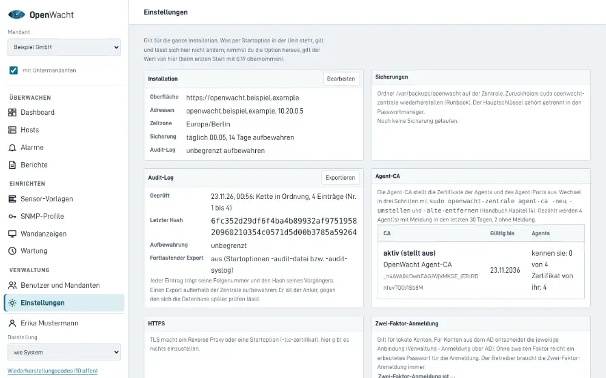
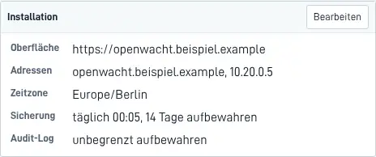

# 13. Backup and restore

## What has to be backed up

| What | Where | How |
| --- | --- | --- |
| Database | PostgreSQL `openwacht` | automatically, daily (`/var/backups/openwacht/openwacht-<time>.dump`) |
| Master key | `/etc/openwacht/schluessel` | back up **once, separately** (password manager, safe) |
| Update key (vendor) | offline | see [chapter 12](12-agent-updates.md) |

Without the master key, the encrypted secrets in the database (SNMP credentials, AD password, agent CA, certificates)
cannot be read; a backup alone is then not enough.

## Automatic backup

The timer `openwacht-sicherung.timer` checks every hour and backs up at the time from the settings (default 00:05), or
catches up if the last backup is older than 25 hours. Retention as configured (default 14 days); the newest always
remains. Files belong to `svc_openwacht_db` with permissions 0600.



The list of backups with size and state is under **Einstellungen → Sicherungen** (Settings → Backups; operator only).
Back up immediately:

```bash
sudo -u svc_openwacht_db env OPENWACHT_DB_EIGENTUEMER="host=/run/postgresql user=openwacht_owner dbname=openwacht" \
  openwacht-zentrale sichern -verzeichnis /var/backups/openwacht -jetzt
```

Before every update that changes the schema, the package additionally backs up by itself (entry “vor dem Update”,
before the update, in the list). This backup is the way back if the update fails: restore it and install the old
package.

Additionally copy the files to another system (for example with the VM backup or rsync). A second computer that
continuously restores and checks every backup and takes over in case of failure: cold standby, [chapter 16](16-betrieb-und-skalierung.md#failover-concept-cold-standby).

## Restore

```bash
sudo openwacht-zentrale wiederherstellen                       # newest backup, only into an empty installation
sudo openwacht-zentrale wiederherstellen -datei /var/backups/openwacht/openwacht-20261122T103338Z.dump -ersetzen
```

Sequence:

1. The backup is restored into a new database `openwacht_neu`.
2. The master key is checked against the backup (agent CA). If it does not match, `openwacht_neu` is discarded and
   **nothing** is changed.
3. Stop services, rename the running database to `openwacht_vor_<time>` (never deleted), `openwacht_neu` becomes
   `openwacht`.
4. Migrations, start services.

If the running database already has data, `-ersetzen` (replace) is required. Delete the old database `openwacht_vor_…`
by hand afterwards when everything is fine; `wiederherstellen` prints the command at the end
(`runuser -u postgres -- psql -c 'DROP DATABASE openwacht_vor_…'`).

**Moving to a new computer:** install there (chapter 1), put the master key into `/etc/openwacht/schluessel` (owner
`svc_openwacht`, permissions 0400, like the file created during installation), copy the backup to
`/var/backups/openwacht` and run `wiederherstellen -ersetzen`. Agents keep reaching the central server if name or
address stay the same.

## Changing the master key

Necessary if the master key may have leaked (for example a copy of `/etc/openwacht` in the wrong hands).
`schluessel-wechseln` re-encrypts **all** secrets of the database in one transaction: SNMP, Proxmox, vCenter and
FRITZ!Box credentials, access profiles, trap credentials, AD and SSO service accounts, alert channels, mail relay, dead
man’s switch address, two-factor secrets, HTTPS keys and the agent CA. If a single secret cannot be decrypted, the
command changes nothing and names it.

```bash
sudo systemctl stop openwacht-zentrale.socket openwacht-zentrale openwacht-traps.socket openwacht-traps
sudo sh -c 'umask 077; openwacht-zentrale schluessel > /etc/openwacht/schluessel.neu'
sudo env OPENWACHT_DB_EIGENTUEMER="host=/run/postgresql user=openwacht_owner dbname=openwacht" \
  openwacht-zentrale schluessel-wechseln -neu /etc/openwacht/schluessel.neu -nur-pruefen   # check only first
sudo env OPENWACHT_DB_EIGENTUEMER="host=/run/postgresql user=openwacht_owner dbname=openwacht" \
  openwacht-zentrale schluessel-wechseln -neu /etc/openwacht/schluessel.neu
sudo systemctl start openwacht-zentrale.socket openwacht-traps.socket
```

Afterwards:

- `/etc/openwacht/schluessel` is the new key (same permissions as before); the previous one lies next to it as
  `/etc/openwacht/schluessel.alt-<time>`. **Back up both separately**: backups from before the change can only be
  restored with the old key. The trap key (`/etc/openwacht-traps/schluessel`) is newly derived.
- All sessions have ended; locked sign-in sources are released.
- **Recovery codes expire** (they are only stored as HMAC with a derived key): users with two-factor create new codes
  in the sidebar.
- Create a new backup immediately (`sichern -jetzt`).

If the central server or the trap service is still running, the command aborts (they would write secrets with the old
key). A central server with the old key no longer starts afterwards (“Agent-CA lässt sich nicht entschlüsseln”, agent CA
cannot be decrypted). Ciphertexts carry an identifier of the key. For a backup with a different key, `wiederherstellen`
reports its identifier.

## Changing the agent CA

The agent CA (valid for 10 years) issues the certificates of the agents and of the agent port. Validity, state and how
many agents know a CA are shown under **Einstellungen → Agent-CA**. The change works without re-registration, in three
steps (each with `OPENWACHT_DB_EIGENTUEMER` as above, then `systemctl restart openwacht-zentrale`):

1. `openwacht-zentrale agent-ca -neu` – new CA next to the active one. The agents receive both with their next report.
2. `openwacht-zentrale agent-ca -umstellen` as soon as all agents know the new one (column “Agents kennen sie”). From now
   on the new one issues; agents fetch a new certificate by themselves. **Create registration tokens and one-liners
   again**; the old ones contain the fingerprint of the previous CA.
3. `openwacht-zentrale agent-ca -alte-entfernen` as soon as no agent has a certificate of the old one any more.

`openwacht-zentrale agent-ca` without an option shows the state. Agents that have not reported for 30 days do not count;
they have to be registered again after step 3. `-trotzdem` skips the checks (with the same consequence).

## Changing the address



Einstellungen → Installation → “Adresse ändern …” (operator, with confirmation). With your own root, a new root is
created, which you distribute again. Agents keep their registered address; if an old name disappears, they have to be
registered again.

## Audit log

Every change (sign-ins, rights, settings, devices, exports …) is recorded in the audit log. Every entry carries a
sequential number and the SHA-256 hash over its content and the predecessor’s hash (hash chain).

**Daily check:** The central server recomputes the chain once a day. If it is broken (entry changed, deleted or
inserted), it reports this to the operator and writes an entry `audit.kette_gebrochen`. By hand, as owner of the
database:

```sh
sudo -u svc_openwacht_db env OPENWACHT_DB_EIGENTUEMER="host=/run/postgresql user=openwacht_owner dbname=openwacht" \
  openwacht-zentrale audit-pruefen -datei /var/log/openwacht/audit.jsonl
```

Without `-datei` the command only checks the chain in the database. **Limit:** whoever has owner rights on the database
can recompute the chain completely; it is then consistent in itself. This only shows when comparing with an export that
was kept elsewhere beforehand. Therefore switch on the continuous export and store it outside the central server.

**Continuous export** (start options in `/etc/openwacht/zentrale.env`, not in the interface, so that a hijacked session
cannot switch it off):

| Option | Effect |
| --- | --- |
| `-audit-datei /var/log/openwacht/audit.jsonl` | one JSON line per entry (`seq`, `zeit`, `mandant`, `akteur`, `akteur_email`, `aktion`, `details`, `vorher`, `hash`); for Filebeat, NXLog or a syslog agent. Rotation with `copytruncate` works |
| `-audit-syslog siem.example.com:6514` | syslog over TLS (RFC 5425, facility “log audit”, message = JSON line); the certificate is checked, the target must be in the network allow-list |
| `-audit-syslog-ca /etc/openwacht/syslog-ca.pem` | own CA for the syslog server |

If a target is unreachable, the position is kept and everything is caught up later; after one hour a notice appears.

**Export for admins:** Einstellungen → Audit-Log → “Exportieren” or `GET /api/v1/audit/export?ab=<number>&anzahl=<up to 5000>&mandant=<ID>`
(JSON lines). Admins only get entries of their tenants and their sub-tenants, entries without a tenant only admins of the
main tenant. The header `X-OpenWacht-Letzte` names the last number for paging. Every export is itself recorded in the
audit log.

**Retention** (Einstellungen → Installation, operator): unlimited (default) or 1 to 10 years. Deletion happens after the
daily check, only at the start of the chain, never when the chain is broken and never what a configured export target
does not have yet. The central server remembers number and hash of the last deleted entry (anchor) and writes
`audit.gekuerzt` with this anchor into the chain; the check then starts at the anchor.
