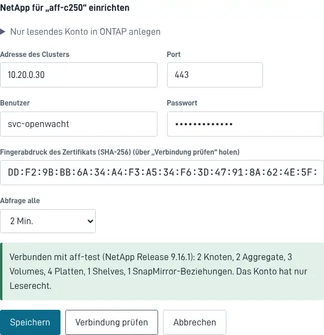
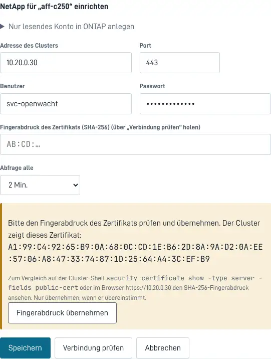
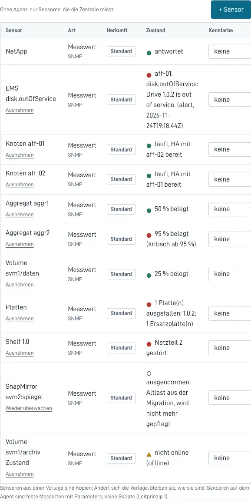
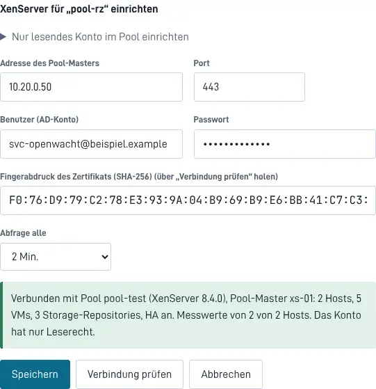
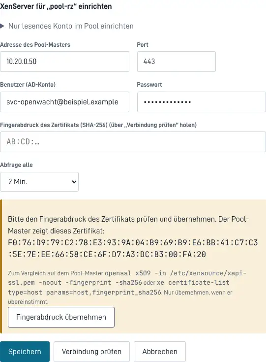
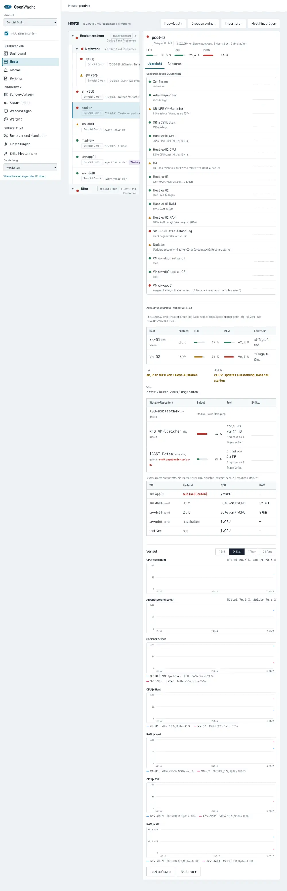
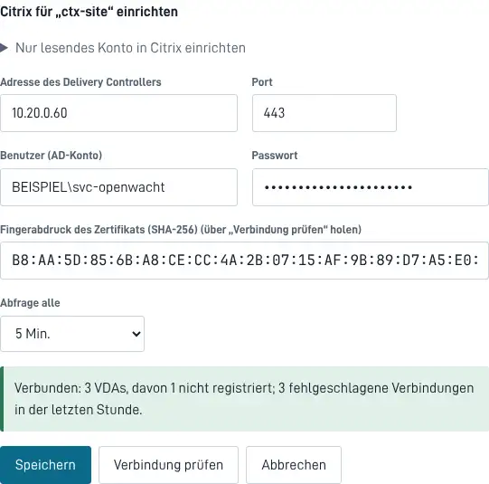
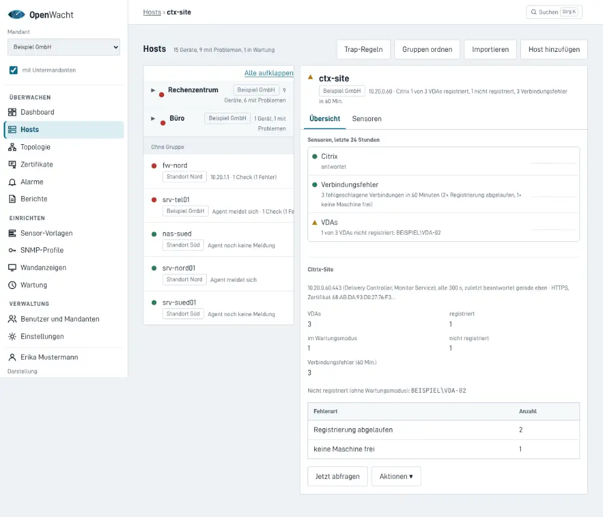

# 19. Integrations

What the central server queries besides agents, SNMP and external checks, and how to set it up. For each integration,
the way in the other system’s interface comes first, then the way in OpenWacht.

For all of them:

- **Read-only.** The central server changes nothing on the queried systems. Always create a dedicated account with the
  least rights for OpenWacht, never an admin account.
- **Network allow-list.** The address must lie within the central server’s allowed networks (setup assistant step 6,
  later under Einstellungen/Settings; [chapter 2](02-erste-einrichtung.md#network-allow-list)); otherwise the central
  server refuses the connection.
- **Credentials** are stored encrypted in the database, bound to address and port. If the address changes, they must be
  entered again.
- **Setting up** is for admins only: on the device via the action menu. There is one such query source per device; if an
  agent also runs on the same computer, these are two devices (for example `pve-01` with agent and `pve-01 (Proxmox)`).
- **Excluding individual values** (such as an old SnapMirror relationship) works for every source on the device in the
  tab “Sensoren” with “Ausnehmen” (exclude) and a reason (see NetApp below).

| Integration | Way | Account |
| --- | --- | --- |
| [Proxmox VE](#proxmox-ve-read-only) | API, port 8006 | API token with role PVEAuditor |
| [VMware vCenter](#vmware-vcenter-read-only) | REST API, port 443 | role “Read-only” |
| [NetApp ONTAP](#netapp-ontap-rest-api) | REST API, port 443 | read-only REST role (mandatory, is checked) |
| [XenServer / XCP-ng](#xenserver-and-xcp-ng-xapi) | XAPI, port 443 | AD account with role read-only (mandatory, is checked) |
| [Citrix](#citrix-monitor-service-odata) | OData v4, port 443, NTLM | AD account with role “Read Only Administrator” |
| [FRITZ!Box](#avm-routers-fritzbox-tr-064) | TR-064, port 49000/49443 | dedicated account with “FRITZ!Box Settings” |
| [Hyper-V](#hyper-v-via-the-windows-agent) | Windows agent | – |
| [Docker](#docker-via-the-agent) | agent and socket proxy | – |
| [Windows without agent](#windows-servers-without-agent-snmp-for-example-citrix-workers) | SNMP v2c | read-only community |
| Active Directory, SSO | [chapter 10](10-ad-und-sso.md) | read account or OIDC client |
| Mail, SMS, Teams, webhook, ntfy | [chapter 8](08-alarme-und-wartung.md#alert-channels) | – |

## Proxmox VE (read-only)

The central server queries a Proxmox node via its API. On the device: action menu → **Proxmox einrichten** (set up
Proxmox; admins only). Each node is its own device, also in a cluster.

On the Proxmox host as root (the same commands are in the form under “Token auf dem Proxmox-Host anlegen”, create token
on the Proxmox host):

```bash
pveum user add openwacht@pve --comment "OpenWacht, nur lesend"
pveum acl modify / --users openwacht@pve --roles PVEAuditor
pveum user token add openwacht@pve monitor --privsep 1
pveum acl modify / --tokens 'openwacht@pve!monitor' --roles PVEAuditor
cat /etc/pve/pve-root-ca.pem
```

- `token add` shows the secret (`value`) **only once**. Put it into the password manager straight away; lost means: delete
  the token and create it again.
- The field **API-Token** takes ID and secret together: `openwacht@pve!monitor=<value>`, without spaces.
- **Host CA:** the output of `cat /etc/pve/pve-root-ca.pem` of **this** host, entirely from `-----BEGIN` to
  `-----END CERTIFICATE-----`. Do not take it from another host: hosts that are not in the same cluster (or kept their CA
  before joining) have different CAs.
- In a cluster, user and token apply on all nodes; OpenWacht still queries each node as its own device.

**Without shell, in the Proxmox interface** (checked on a Proxmox VE 9):

1. Datacenter → Permissions → **Users** → Add: `openwacht`, realm “Proxmox VE authentication server”, without password.
2. Datacenter → Permissions → **API Tokens** → Add: user `openwacht@pve`, token ID `monitor`, “Privilege Separation”
   ticked. The secret only appears once.
3. Datacenter → **Permissions** → Add, twice: “User Permission” for `openwacht@pve` and “API Token Permission” for
   `openwacht@pve!monitor`, each path `/`, role **PVEAuditor**, “Propagate”. With privilege separation, the token needs
   both entries.
4. CA: node → System → **Certificates** → `pve-root-ca.pem` → “View Certificate”; or export the root of the chain as
   Base-64 in the browser. If the node has a certificate from the company CA, take its root.
- If “Verbindung prüfen” (check connection) reports `401`, ID and secret do not match; a certificate error almost always
  means: CA of another host entered.

**Values and alerts** (interval selectable, default 60 seconds):

| Sensor | Alert |
| --- | --- |
| Reachability | API does not answer: critical |
| VM / container | only guests with “start at boot”: not running: critical; paused: warning |
| Backup per guest | only guests in a backup job: last successful backup older than 26 h: warning, older than 50 h or none in 8 days: critical; a failed last attempt is in the message |
| Storage | enabled but not available: critical; usage with thresholds and forecast as for disks |
| Thin pool metadata | warning from 80 %, critical from 90 % |
| Reboot | the node has been running for less time than at the last poll and ran at least 27 h before |

The thresholds for backups and metadata are fixed. OpenWacht reads the backups from the node’s vzdump tasks; it does not
query a Proxmox Backup Server itself.

## VMware vCenter (read-only)

The central server queries a vCenter via its REST API: ESXi hosts, VMs and datastores. On the device for the vCenter:
action menu → **vCenter einrichten** (set up vCenter; admins only).

**Account in the vSphere Client:**

1. Menu → **Administration** → Single Sign-On → **Users and Groups** → domain `vsphere.local` (or an AD identity source)
   → Add user, for example `svc-openwacht`, with a long password.
2. In the inventory, choose the **top level** (the vCenter itself) → **Permissions** → Add: user
   `svc-openwacht@vsphere.local`, role **Read-only**, tick **Propagate to children**.
3. vCenter CA: the vCenter’s start page in the browser (`https://<vcenter>/`) → link **Download trusted root CA
   certificates**. The ZIP contains the VMCA root as a `.0` or `.crt` file; put its content (`-----BEGIN CERTIFICATE-----`
   to `-----END CERTIFICATE-----`) into the field “CA des vCenter” (vCenter CA). If the vCenter has a certificate from the
   company CA, take its root. Left empty, the central server’s system CAs apply.

**In OpenWacht:** address of the vCenter (name from the certificate), port 443, user, password, CA, poll every 30 seconds
to 1 hour (default 60 seconds). **Verbindung prüfen** signs in and counts hosts, VMs and datastores; then **Speichern**
(save).

**Read-only:** the central server signs in with `POST /api/session`, only reads `GET /api/vcenter/host`, `/api/vcenter/vm`
and `/api/vcenter/datastore`, and signs out at the end with `DELETE /api/session`. Redirects are not followed. Unlike
with NetApp and XenServer, OpenWacht does not check the account’s role itself: only give it “Read-only”.

**Values and alerts:**

| Sensor | Alert |
| --- | --- |
| Reachability | vCenter does not answer: critical |
| ESXi host | not answering the vCenter, disconnected, in standby or powered off: critical |
| VM | state is shown, without alert (vCenter does not say whether a VM should be running); for individual VMs create your own sensor, for example ping |
| Datastore | not accessible: critical; usage with thresholds and forecast as for disks |

**Data-minimal:** of VMs only name and state, no configuration, guest data or users.

**Limits:** at most 200 hosts, 2000 VMs, 200 datastores and 8 MiB per response. Tested against a mock following the
vSphere REST API, not yet against a real vCenter.

## NetApp ONTAP (REST API)

The central server queries NetApp clusters (for example AFF, FAS) via the ONTAP REST API. On the device: action menu →
“NetApp einrichten” (set up NetApp; admins only).



**Account in ONTAP:** a dedicated user with a read-only REST role, on the cluster shell for example:

```
security login rest-role create -role openwacht_lesen -api /api -access readonly
security login create -user-or-group-name svc-openwacht -application http -authentication-method password -role openwacht_lesen
```

**Without shell in System Manager:** Cluster → Settings → **Users and Roles**. Under **Roles** → Add: name
`openwacht_lesen`, API `/api`, access level **Read-only**. Under **Users** → Add: user, role `openwacht_lesen`,
application **HTTP**, authentication password, multifactor **Disabled**. The built-in role `readonly` is not enough:
with it, OpenWacht cannot read the account’s rights.

1. Enter the address of the **cluster management interface** (HTTPS, port 443), user and password. The address must lie
   within the network allow-list.
2. **Verbindung prüfen:** the first time, the central server only fetches the certificate’s fingerprint (SHA-256),
   without sign-in and without request. Compare with `security certificate show -type server` on the cluster shell or in
   the browser and accept it. After that, only this certificate applies; the password never goes to another server.
3. **Verbindung prüfen** once more: the central server signs in, checks the account’s rights and counts nodes,
   aggregates, volumes, disks, shelves and SnapMirror relationships. Then **Speichern**.



**Read-only:** the central server only sends GET requests to a fixed list of endpoints (`/api/cluster`,
`/api/cluster/nodes`, `/api/storage/aggregates`, `/api/storage/volumes`, `/api/storage/disks`, `/api/storage/shelves`,
`/api/snapmirror/relationships`, `/api/support/ems/events` and for the rights check `/api/security/…`). Before every
poll it reads the account’s rights (from ONTAP 9.19 via `whoami`, before that via the account and its role’s rights).
**An account with write rights is rejected** (for example the role “admin” or a role with `all`, `read_create`,
`read_modify` …), as is an account whose rights cannot be read. The only exceptions are the commands `set` and
`security login password`, which concern the own session.

**Values and alerts** (interval default 2 minutes):

| Sensor | Alert |
| --- | --- |
| Node | not “up”, taken over by the partner, takeover failed or not possible, failover off, over-temperature, fan or power supply failed |
| Aggregate / volume (usage) | thresholds and forecast “full in … days” as for disks; volumes only writable ones (rw), not mirror targets |
| Aggregate / volume (state) | aggregate not online: critical; volume offline or restricted: warning, broken: critical |
| Disks | failed: critical; being replaced (expected to fail), being reconstructed, removed: warning; plus the number of spare disks |
| Shelf | power supply, module or fan faulty, temperature above the shelf’s thresholds |
| SnapMirror | not healthy (with reason), broken off, lag from 26 h warning, from 50 h critical |
| EMS | events of severity “emergency” and “alert” of the last hour, one sensor per message (at most 20) |
| Reboot | a node has been running for less time than at the last poll and ran at least 27 h before |

Graphs: usage of aggregates and volumes, IOPS and latency per aggregate. If a part fails (for example 403 on the
shelves), the interface shows it as “nicht abfragbar” (not queryable), and its sensors keep their last state.

**Excluding individual values**, for example an old SnapMirror relationship that nobody maintains any more: on the device,
tab “Sensoren” → for the value “Ausnehmen” (exclude), enter a reason. The value continues to be polled but no longer
raises alerts, an open alert ends, and it appears grey as “ausgenommen” (excluded) with the reason. “Wieder überwachen”
(monitor again) reverses this. This works for every value from SNMP, Proxmox, NetApp, XenServer and other sources
(volumes, disks, interfaces …), not for reachability; for that there is “Abfrage ausschalten” (switch off polling).
Operators and admins may exclude and reverse; both are recorded in the audit log. Acknowledging is not enough for this:
an acknowledged alert stays open.

**Removing completely (from 1.0.10):** an excluded value still appears grey in the list. If it should disappear, tick
“Auch aus allen Listen entfernen” (also remove from all lists) when excluding, or choose “Entfernen” (remove) for a value
that is already excluded. It then no longer appears among the sensors, in the dashboard and on wall displays. Such a value
cannot be deleted: the device reports it again with every poll. Below the sensor table, “Entfernte Werte” (removed values)
therefore appears with reason and date; “Wieder überwachen” brings a value back from there. If the value disappears on
the device itself (the relationship is deleted on the NetApp), the entry remains until someone reverses it via “Wieder
überwachen”.



**Data-minimal:** the central server does not read serial numbers, accounts, shares, clients, files and volume contents.
Of EMS events it only stores name, severity, node, time and the shortened text.

**Limits:** at most 24 nodes, 200 aggregates, 1000 volumes (more: truncated), 2000 disks, 100 shelves, 1000 SnapMirror
relationships, 50 EMS events and 8 MiB per response. Redirects are not followed, no proxy, not via a collector. Besides
the REST API, SNMPv3 polling, your own OID sensors (NetApp MIB) and SNMPv3 traps continue to work ([chapter 6](06-snmp.md)).

## XenServer and XCP-ng (XAPI)

The central server queries XenServer pools (target XenServer 8, also XCP-ng) via XAPI. On the device: action menu →
“XenServer einrichten” (set up XenServer; admins only). One device stands for the whole pool.



**Account:** XenServer only assigns roles (RBAC) to accounts from Active Directory; without AD there is only `root`
(local superuser with all rights). **OpenWacht rejects root**, already when saving and without sending the password. So
the pool must be in the domain. Then on the pool master, for example:

```
xe subject-add subject-name=svc-openwacht
xe subject-list subject-name=svc-openwacht params=uuid
xe subject-role-add uuid=<UUID from the line before> role-name=read-only
```

In XenCenter the same is done under “Pool → Properties → Users”. The role can also come via an AD group; then no other
group of the account may grant more rights.

1. Enter the address of the **pool master** (HTTPS, port 443), user (`name@domain` or `DOMAIN\name`) and password. The
   address must lie within the network allow-list.
2. **Verbindung prüfen:** the first time, the central server only fetches the certificate’s fingerprint (SHA-256),
   without sign-in and without request. Compare on the pool master with
   `openssl x509 -in /etc/xensource/xapi-ssl.pem -noout -fingerprint -sha256` or
   `xe certificate-list type=host params=host,fingerprint_sha256` and accept it. After that, only this certificate
   applies; the password never goes to another server.
3. **Verbindung prüfen** once more: the central server signs in, checks the session’s rights, counts hosts, VMs and
   storage repositories and signs out again. Then **Speichern**.



**Read-only:** via JSON-RPC (`/jsonrpc`) the central server only calls methods from a fixed list:
`session.login_with_password`, `session.logout`, `session.get_is_local_superuser`, `session.get_rbac_permissions`,
`role.get_by_name_label`, `role.get_permissions_name_label`, `pool.get_all_records`, `host.get_all_records`,
`host_metrics.get_all_records`, `VM.get_all_records_where` (without templates, snapshots and dom0), `SR.get_all_records`,
`PBD.get_currently_attached` and `certificate.get_all_records_where`; plus `GET /rrd_updates` for CPU and RAM. After every
sign-in it checks the session’s rights against the pool’s fixed role “read-only”. **Rejected are:** root, every session
of the local superuser, every account with a role above “read-only” (vm-operator, vm-admin, pool-operator, pool-admin …)
or a single right beyond it, and an account whose rights cannot be read. The session is signed out at the end of every
poll.

**Pool master changed:** if the address answers with `HOST_IS_SLAVE`, the central server does **not** follow the new
master by itself (the credentials are bound to the address), but reports “Pool-Master gewechselt” (pool master changed)
with the new master’s address. Change the address, fetch the fingerprint again, re-enter the password. With HA, the
master changes by itself on a failure; then the device reports “antwortet nicht (XAPI)” (not answering) until the address
is adjusted. With a DNS name that always points to the master, the address stays the same; after a change, fingerprint
and password must still be entered again because the certificate is a different one.

**Measurements of the other hosts:** each host only delivers `/rrd_updates` for itself and its VMs. For the other hosts,
the central server connects to the address the pool reports, and only with the fingerprint the pool master reports for
their certificate. These addresses must also lie within the network allow-list; otherwise CPU and RAM are missing for
these hosts (“Messwerte nicht abrufbar”, measurements not retrievable), everything else remains.

**Values and alerts** (interval default 2 minutes):

| Sensor | Alert |
| --- | --- |
| Host | not reachable: critical; maintenance mode or disabled: warning; plus “läuft seit …” (running since …) |
| Host CPU / RAM | thresholds as for agents (average of the last 10 minutes), only from two hosts; with one host, the pool’s CPU and memory apply |
| CPU, memory | whole pool (average of the hosts or sum), thresholds as for agents |
| VM | only VMs that should be running (HA restart “restart” or “auto power on”): off: critical; paused or suspended: warning |
| SR (usage) | thresholds and forecast “full in … days” as for disks; ISO and removable media without usage |
| SR attachment | not attached on a host (PBD not connected): critical |
| HA | overcommitted: critical; plan is not sufficient for the configured number of failures: warning |
| Updates | updates pending or still to do after updates (for example restart host): warning; only XenServer 8 with update channel |
| Reboot | a host has been running for less time than at the last poll and ran at least 27 h before |

Graphs: CPU and RAM of the pool and per host, usage of the SRs, CPU and RAM of the 30 VMs with the highest CPU load. If a
part fails (for example the SRs), the interface shows it as “nicht abfragbar”, and its sensors keep their last state.



**Data-minimal:** of VMs only name, state, host and numbers (CPU, RAM, vCPUs), no configuration and no guest data. The
central server stores no accounts, subjects, licences and serial numbers. It does not read the storage device
configuration at all (`PBD.device_config`, which can contain passwords of CIFS or iSCSI storage).

**Limits:** at most 64 hosts, 2000 VMs (500 shown individually), 500 SRs, 2000 PBDs, 24 MiB per response and 8 MiB per
measurement response. Redirects are not followed, no proxy, not via a collector.

## Citrix (Monitor Service, OData)

From 1.0.6 the central server queries the **Monitor Service** of a Citrix site (Citrix Virtual Apps and Desktops,
on-prem) on a Delivery Controller. On the device: action menu → “Citrix einrichten” (set up Citrix; admins only). One
device stands for the site.



**Account in Citrix:** in Web Studio or Citrix Studio under **Administrators** → “Add administrator”, create an AD account
(for example `svc-openwacht`) with the role **Read Only Administrator** and the scope “All”. OpenWacht needs nothing more.

1. Enter the address of a **Delivery Controller**, **HTTPS** (port 443), user as `DOMAIN\name` or `name@domain` and
   password. The address must lie within the network allow-list. Sign-in uses Windows authentication (NTLM, as Citrix
   requires it for the on-prem Monitor Service); OpenWacht never sends Basic. It does not work without HTTPS on the
   controller: unencrypted, the NTLM responses would be exposed on the network.
2. **Verbindung prüfen** only fetches the certificate’s fingerprint (SHA-256) the first time. Compare on the controller:
   certificate management (`certlm.msc`) → Personal → certificate → Details shows SHA-1; SHA-256 in PowerShell with
   `[BitConverter]::ToString([Security.Cryptography.SHA256]::Create().ComputeHash((Get-Item Cert:\LocalMachine\My\<SHA-1>).RawData))`.
   Accept it, then check again and **Speichern**.

**Only read are** (GET, OData v4 under `/Citrix/Monitor/OData/v4/Data/`):

- `Machines` (active only): name, DNS name, registration, maintenance mode.
- `ConnectionFailureLogs` of the last hour: only the failure type (`ConnectionFailureEnumValue`), never users, sessions or
  clients.

Stored are numbers and the names of the **unregistered** VDAs (at most 50), no list of all machines.



**Alerts:**

| Item | Error when |
| --- | --- |
| VDAs | warning as soon as a VDA outside maintenance mode is unregistered (with name); critical when none is registered any more |
| Connection failures | warning from 5, critical from 25 failed connections in the last hour (numbers per failure type in the message) |

Put VDAs that are off on purpose (for example powered-off machines of a pool) into maintenance mode in Citrix, or
**exclude** the item “VDAs” on the device. The thresholds for connection failures are a first value; they will be reviewed
after the first weeks of operation. For CPU, RAM and reboots of individual workers see
[Windows servers without agent](#windows-servers-without-agent-snmp-for-example-citrix-workers).

## AVM routers (FRITZ!Box, TR-064)

On the device “FRITZ!Box einrichten” (set up FRITZ!Box; admins only): the central server reads the internet connection
(connected/disconnected with alert, duration, external IP), access type, DSL sync rate and line capacity, traffic as a
rate with graph, model, FRITZ!OS and uptime (reboot alert). It does not read serial number, event log, home network
devices and telephony.

1. In the FRITZ!Box under Home Network → Network → Network Settings, switch on “Allow access for applications” (TR-064,
   LAN only).
2. Under System → FRITZ!Box Users, create a dedicated account, right only “FRITZ!Box Settings”, no access from the
   internet.
3. The box’s address must lie within the network allow-list. Port 49000 (HTTP, digest sign-in) or 49443 (HTTPS): with
   HTTPS, “Verbindung prüfen” fetches the fingerprint of the self-signed certificate; accept it after comparing, after
   that only this one applies.

TR-064 knows no pure read right: without “FRITZ!Box Settings” the box delivers almost nothing (OpenWacht shows missing
parts as “nicht verfügbar”, not available). The account could change settings with it. The central server only calls a
fixed list of reading actions (`internal/tr064`), stores user, password and fingerprint encrypted and bound to address
and port; not via a collector.

## Hyper-V (via the Windows agent)

Hyper-V has no query source of its own: the Windows agent on the host reads name and state of the VMs (WMI class
`Msvm_ComputerSystem`, read-only), nothing more.

1. Install the agent on the Hyper-V host ([chapter 5](05-agent.md)).
2. Allow on the host (PowerShell as administrator):
   `openwacht-agent sensoren -arten "hyperv,dienst,leistungsindikator" -indikatoren "Hyper-V Virtual Machine Health Summary,Hyper-V Hypervisor Logical Processor,Memory"`
3. In OpenWacht apply the template set **Hyper-V-Host** (services, VMs in critical state, hypervisor load, free memory)
   and for every important VM the template **Hyper-V-VM läuft** (Hyper-V VM running) with the VM’s name.

So far only built and statically checked, not yet run on a real Hyper-V host.

## Docker (via the agent)

The agent never opens the Docker socket (whoever can open it is practically root). It queries a **read-only socket
proxy** on the same computer, for example `docker-socket-proxy` with `CONTAINERS=1` and everything else off, bound only to
`127.0.0.1`. Read are name, state and health of the containers, no environment variables, labels or logs.

1. Start the socket proxy on the computer, port local only (`127.0.0.1:2375`).
2. Allow: `openwacht-agent sensoren -arten docker -docker http://127.0.0.1:2375`.
3. In OpenWacht apply the template **Docker-Container läuft** (Docker container running; name of the container) per
   container.

Tested against a mock of the socket proxy.

## Windows servers without agent (SNMP), for example Citrix workers

For computers without agent, such as workers from PVS or MCS, the central server reads CPU, memory, disks and uptime via
the Windows SNMP service (HOST-RESOURCES-MIB). Windows can only do v1/v2c, the community goes over the network in plain
text; therefore read-only and only allow the central server.

On the server or in the master image:

1. **Server Manager** → Manage → Add Roles and Features → Features → **SNMP Service**.
2. **Services** (`services.msc`) → SNMP Service → Properties → tab **Security**: under “Accepted community names” a
   long, random community with the right **READ ONLY**; “Accept SNMP packets from these hosts” → only the address of the
   central server (or of the agent that polls as collector). No trap targets.
3. **Windows Defender Firewall** → Inbound Rules → enable “SNMP Service (UDP In)” and under “Scope” enter only the
   central server as remote address.

In OpenWacht:

1. Create an **SNMP profile** with version v2c and this community (Einrichten → SNMP-Profile, admins only;
   [chapter 6](06-snmp.md)).
2. Create devices, individually or via **CSV import** with column `profil` (Hosts → Importieren/Import).
3. For Citrix workers, apply the template set **Citrix Worker (VDA, SNMP)** to the group: reboot missed (uptime over
   26 h, adjust to the reboot schedule), ping, ICA (1494) and session reliability (2598).

With an agent there is the set **Citrix Worker (VDA, Agent)** with the Citrix services.

## Applications via template sets

Exchange (with DAG), domain controllers, SQL Server, print servers, Citrix (Delivery Controller, StoreFront, workers),
NetScaler, Swyx, Ferrari OfficeMaster and IQ4docs are not connected by a query way of their own, but by a **template
set**: agent sensors on the server plus external checks. Which sensors a set creates and what has to be allowed on the
computer is in [chapter 7](07-sensoren-und-vorlagen.md#template-sets).
