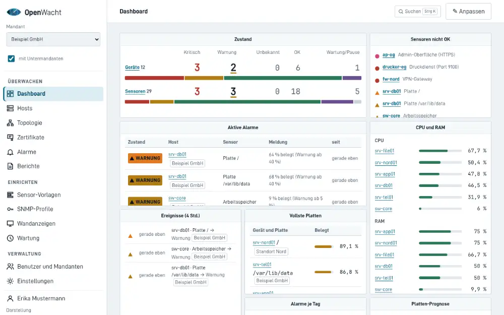

# OpenWacht handbook

OpenWacht monitors servers, network devices and services for several tenants (for example sites, departments or
customers) from one central server. It runs entirely in your own network, even without any internet access. This
handbook describes version 1.0.10. It is the English translation of the German handbook in `docs/handbuch/`; the
screenshots show the German interface, which is the only interface language in 1.0.

## Contents

1. [Installation](01-installation.md): package, offline package, requirements, update
2. [First setup](02-erste-einrichtung.md): assistant in the browser, sign-in, root certificate
3. [Tenants and roles](03-mandanten-und-rollen.md)
4. [Hosts, groups and dependencies](04-hosts.md)
5. [Agent for Linux and Windows](05-agent.md)
6. [SNMP, access profiles and CSV import](06-snmp.md)
7. [Sensors and templates](07-sensoren-und-vorlagen.md)
8. [Alerts and maintenance](08-alarme-und-wartung.md)
9. [Reports](09-berichte.md)
10. [Sign-in via AD and SSO](10-ad-und-sso.md)
11. [API tokens](11-api-tokens.md)
12. [Agent updates](12-agent-updates.md)
13. [Backup, restore and audit log](13-sicherung.md)
14. [Operation without internet](14-betrieb-ohne-internet.md): building the offline package, test result
15. [Signing the Windows agent and release](15-signieren-und-verteilen.md): Authenticode, order of signatures
16. [Operation and scaling](16-betrieb-und-skalierung.md): load test, sizes, retention, failover concept
17. [Hardening guide](17-haertung.md): ports, firewall, reverse proxy, sign-in, reporting channel (`security.txt`)
18. [Legal and evidence](18-recht-und-nachweise.md): data protection templates, BSI baseline protection, accessibility, recertification
19. [Integrations](19-anbindungen.md): Proxmox, vCenter, NetApp, XenServer, Citrix, FRITZ!Box, Hyper-V, Docker, Windows without agent

Changes per version: [release notes](../release-notizen.md) (German).

## Terms

| Term | Meaning |
| --- | --- |
| Central server | The server with interface, database (PostgreSQL) and all checks. Program `openwacht-zentrale`. |
| Agent | Small program on a monitored computer (`openwacht-agent`). It **only sends** measurements to the central server and accepts no commands. |
| Tenant | An area with its own devices, users and alert channels. Tenants form a tree (main tenant → sub-tenants). |
| Host / device | A monitored thing: server, switch, printer, NAS. It has sensors. |
| Sensor | A single check, for example ping, open port, disk, service. |
| Operator of the installation | The account that maintains the installation (settings). The first admin is the operator. |

German terms in the interface: Zentrale (central server), Mandant (tenant), Gerät (device), Betreiber (operator of the
installation), Wartung (maintenance), Alarm (alert).

## The most important rules

- **Agents only send.** The central server cannot execute anything on a monitored computer. Whoever takes over the
  central server does not thereby take over the computers.
- **Tenants are separated**, in the application and additionally in the database (row-level security). Whoever has a
  role in a tenant sees it and everything below, never siblings or parents.
- **Agent updates only signed**, with a key that never lies on the central server.
- **Data-minimising:** no user names, process lists or file contents.

Programs, paths, services and the database are consistently called `openwacht-…` or `openwacht`.
