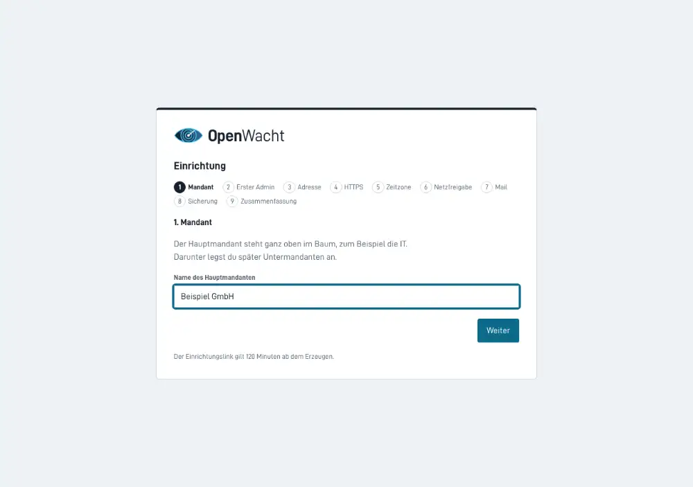
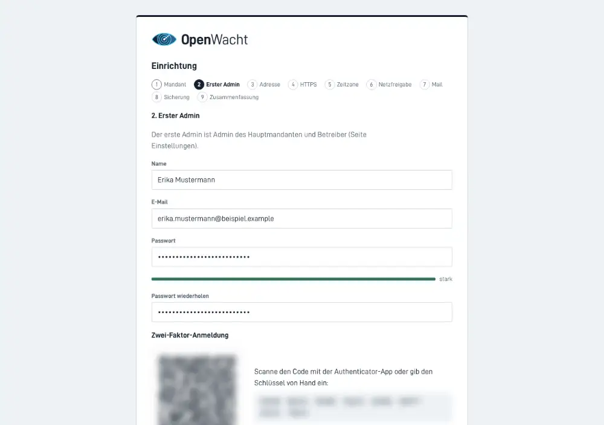
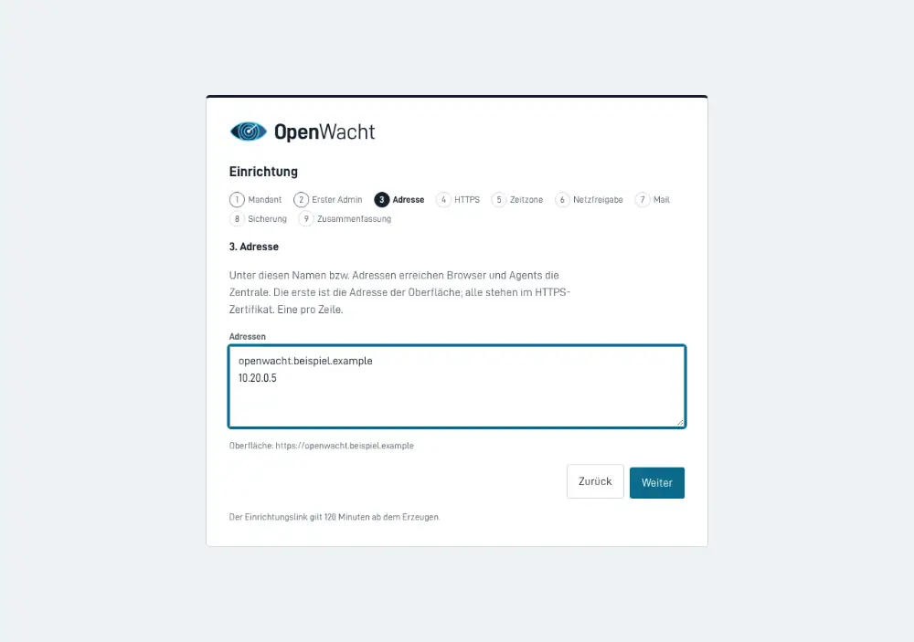
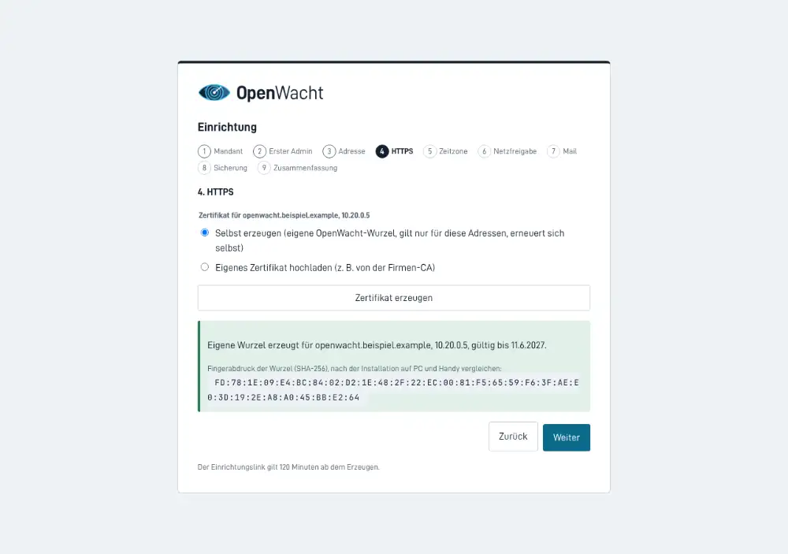
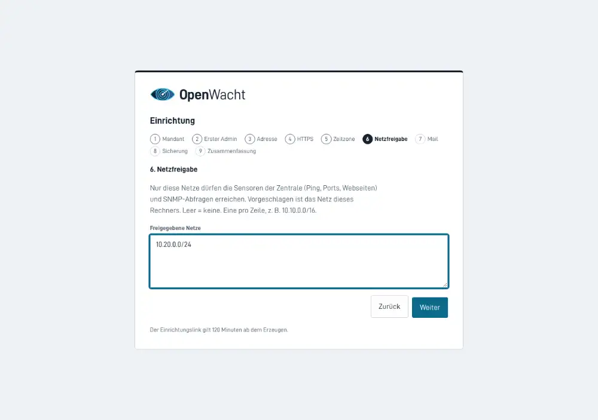
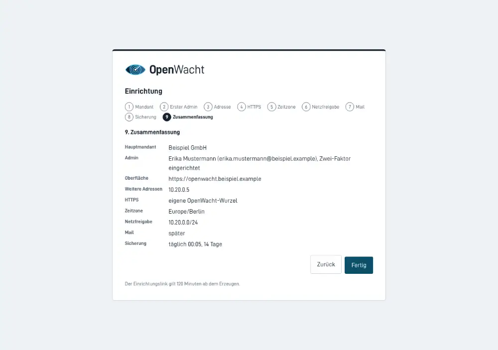
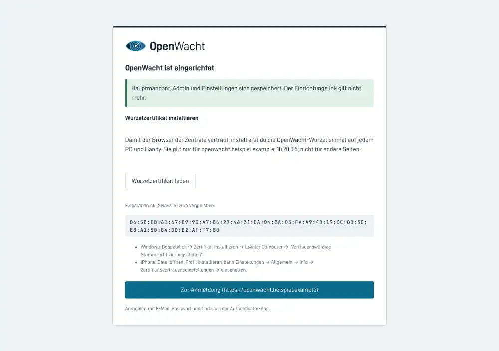
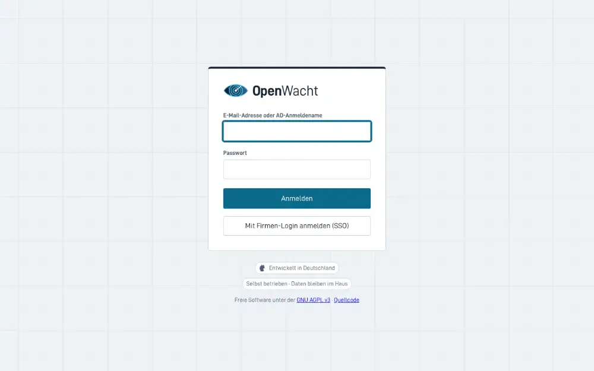
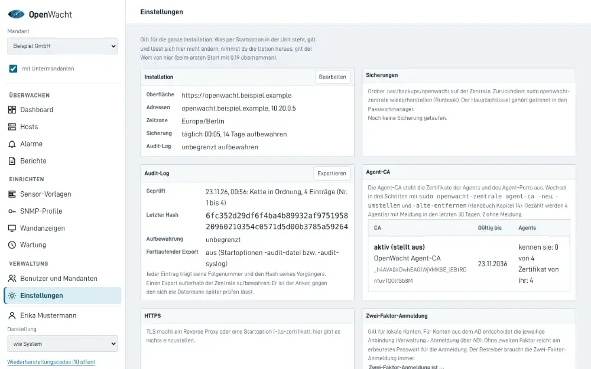
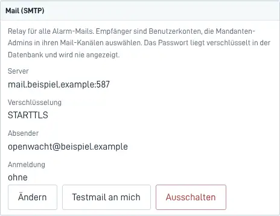

# 2. Erste Einrichtung

Den Einrichtungslink aus der Installation im Browser öffnen. Die Zentrale hat bis „Fertig“ nur ein vorläufiges,
selbstsigniertes Zertifikat; die Warnung des Browsers ist an dieser Stelle erwartet. Den Fingerabdruck, den
`installieren` ausgibt, kann man im Browser vergleichen.

Der Assistent hat neun Schritte. Alles lässt sich später unter **Einstellungen** ändern.

| Schritt | Inhalt |
| --- | --- |
| 1. Mandant | Name des Hauptmandanten, z. B. „Beispiel GmbH“ |
| 2. Erster Admin | Name, E-Mail, Passwort (mindestens 12 Zeichen), Zwei-Faktor-Anmeldung mit einer Authenticator-App |
| 3. Adresse | DNS-Namen und IP-Adressen, unter denen Browser und Agents die Zentrale erreichen; der erste ist die Hauptadresse. **Den vollen Namen** (z. B. `openwacht.firma.example`) zuerst eintragen – fehlt er, warnt der Browser später |
| 4. HTTPS | Zertifikat: eigene OpenWacht-Wurzel erzeugen oder eines der Firmen-CA hochladen |
| 5. Zeitzone | für Mails, Wartungsfenster und Sicherung |
| 6. Netzfreigabe | Netze, die Prüfungen und SNMP erreichen dürfen, z. B. `10.0.0.0/8` |
| 7. Mail | SMTP-Relay für Alarm-Mails (optional, geht auch später) |
| 8. Sicherung | Uhrzeit und Aufbewahrung der täglichen Sicherung |
| 9. Zusammenfassung | alles noch einmal, dann „Fertig“ |

Der erste Admin ist Admin des Hauptmandanten und **Betreiber** der Installation. Er braucht immer die
Zwei-Faktor-Anmeldung.

Vorgeschlagen sind der Name, unter dem der Assistent geöffnet wurde, der Hostname und die Adressen des Rechners. Ist kein
vollständiger Name dabei, zeigt der Assistent einen Hinweis. Alle Einträge landen im HTTPS-Zertifikat; was hier fehlt,
lässt sich später unter Einstellungen → Installation → „Adresse ändern …“ nachtragen (mit eigener Wurzel entsteht dabei
eine neue Wurzel, die man neu verteilt).

## HTTPS

„Selbst erzeugen“ legt eine eigene **OpenWacht-Wurzel** an. Sie ist technisch auf genau die eingetragenen Namen und
Adressen beschränkt (Name Constraints): Selbst wer die Zentrale übernimmt, kann mit ihr keine fremden Webseiten
fälschen. Das Serverzertifikat erneuert sich 30 Tage vor Ablauf selbst.

Wer eine Firmen-CA hat, lädt stattdessen Zertifikat und Schlüssel hoch.

## Netzfreigabe

Sensoren (Ping, Ports, HTTP, DNS …), SNMP-, Proxmox- und vCenter-Abfragen sowie AD und SSO verbinden sich nur mit
Adressen in diesen Netzen. Das Mail-Relay ist davon ausgenommen; es legt nur der Betreiber fest.
So kann niemand über einen Sensor das Netz der Zentrale abtasten. Loopback (`127.0.0.1`) muss man ausdrücklich
freigeben – nur, wenn Sensoren Dienste auf der Zentrale selbst prüfen sollen; in Installationen mit fremden Mandanten
besser nicht, weil dann jeder Sensor die lokalen Dienste der Zentrale erreicht. Mandanten können die Freigabe später weiter **einschränken**, nie erweitern.

## Abschluss

Nach „Fertig“ wechselt die Zentrale ohne Neustart in den Normalbetrieb. Der Einrichtungslink gilt nicht mehr.

**Wurzelzertifikat installieren:** Mit eigener Wurzel die Datei „Wurzelzertifikat laden“ einmal auf jedem PC und
Handy installieren, die die Oberfläche öffnen. Fingerabdruck vergleichen.

- Windows: Doppelklick → Zertifikat installieren → Lokaler Computer → „Vertrauenswürdige Stammzertifizierungsstellen“.
- iPhone: Datei öffnen, Profil installieren, dann Einstellungen → Allgemein → Info → Zertifikatsvertrauenseinstellungen.
- Per Gruppenrichtlinie verteilen geht ebenso (die Datei liegt öffentlich unter `/openwacht-wurzel.crt`).

## Anmelden

E-Mail, Passwort und den Code aus der Authenticator-App. Mit AD oder SSO angebundene Konten melden sich mit
`name@domäne` bzw. über „Mit Firmen-Login anmelden (SSO)“ an ([Kapitel 10](10-ad-und-sso.md)).

## Einstellungen

Unter **Einstellungen** (nur Betreiber) stehen Installation (Adresse, Zeitzone, Sicherung), Sicherungen, HTTPS,
Zwei-Faktor-Pflicht, Netzfreigabe, Alarmziele, Totmannschalter, Schwellen und Mail. Heikle Änderungen (Netze,
Alarmziele, HTTPS, Adresse, Mail, Totmann) bestätigt man mit einem frischen Code aus der App bzw. ohne eingerichtete
Zwei-Faktor-Anmeldung mit dem eigenen Passwort.

**Zwei-Faktor-Pflicht:** „Pflicht für Admins“ (Standard), „Pflicht für alle lokalen Konten“ oder „freiwillig“. Für AD-
und SSO-Konten entscheidet die jeweilige Anbindung. „freiwillig“ senkt die Sicherheit: Dann reicht ein erbeutetes
Passwort zur Anmeldung. Nur für rein interne Installationen wählen, nie für eine Zentrale, die aus dem Internet
erreichbar ist. Der Betreiber braucht die Zwei-Faktor-Anmeldung immer.

**Anmelde-Domänen:** Trägt ein Untermandant für seine AD- oder SSO-Anbindung eine Domäne (`name@firma.de`)
oder einen NetBIOS-Namen ein, steht sie hier als „beantragt“. Erst nach „Freigeben“ (mit Code) leitet die Zentrale
Anmeldungen mit dieser Domäne an das Verzeichnis des Untermandanten; vorher könnte ein Mandant sonst Anmeldungen samt
Passwort für fremde Domänen auf seinen eigenen Server leiten. Eine Domäne ist nur für eine Anbindung freigegeben.
Anbindungen des Hauptmandanten gelten sofort.

**Mail-Relay:** Server, Port, Verschlüsselung (STARTTLS, TLS; „keine“ nur auf Loopback), Absender, optional
Anmeldung und eine eigene CA für ein internes Relay. „Testmail an mich“ prüft die Verbindung.

