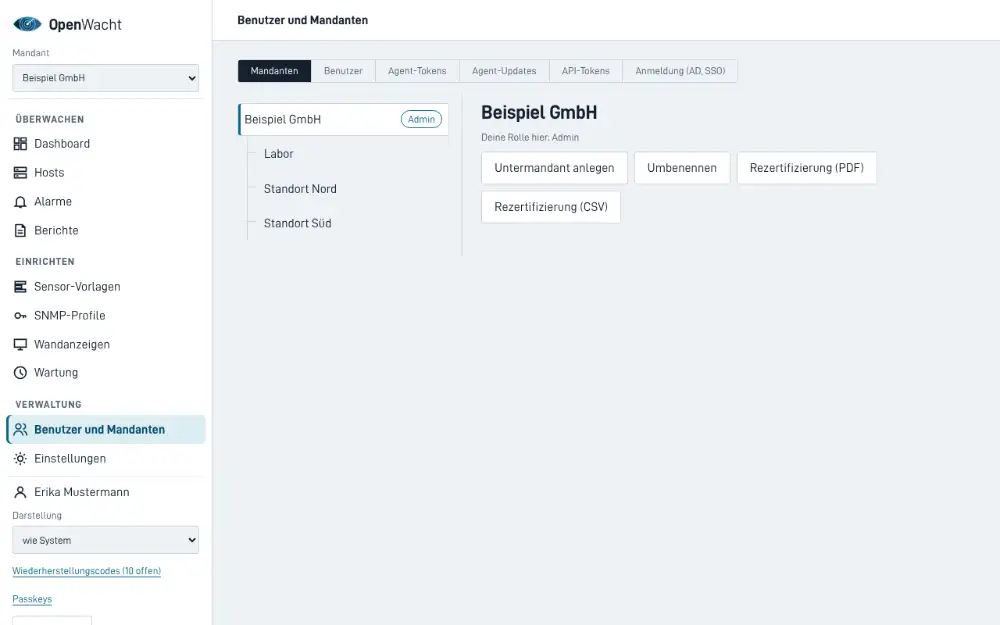
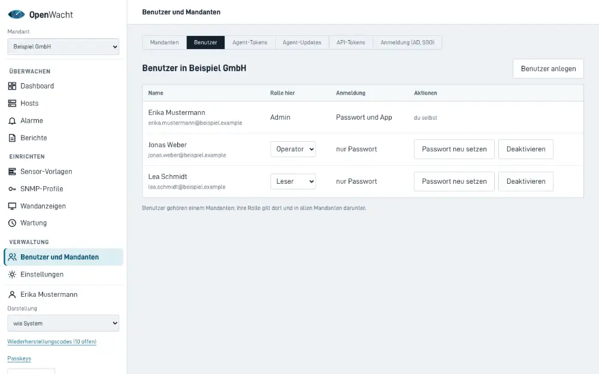

# 3. Mandanten und Rollen

## Mandantenbaum

Ganz oben steht der Hauptmandant (z. B. „Beispiel GmbH“), darunter Untermandanten (z. B. „Fertigung“, „Vertrieb“), die
wieder Untermandanten haben können. Eine Rolle gilt immer für einen Mandanten **und alles darunter**, nie für
Geschwister oder Eltern: Ein Admin der Fertigung verwaltet nur die Fertigung, der Hauptmandant sieht alles.



**Benutzer und Mandanten → Mandanten:** „Untermandant anlegen“ und „Umbenennen“. Links oben in der Seitenleiste wählt
man, welchen Mandanten man gerade ansieht; „mit Untermandanten“ blendet deren Geräte und Alarme mit ein.

## Rollen

| Rolle | darf |
| --- | --- |
| Leser | alles im eigenen Teilbaum ansehen |
| Operator | zusätzlich Geräte, Sensoren, Gruppen, Wartung pflegen, Alarme bestätigen, CSV-Import |
| Admin | zusätzlich Benutzer, Rollen, Alarmkanäle, SNMP-Profile, AD/SSO, API-Tokens, Untermandanten |
| Betreiber | Einstellungen der Installation (kein Mandantenrecht; sieht nur die Namen der Mandanten) |

Niemand kann Rechte vergeben, die er selbst nicht hat. Die Trennung prüft die Anwendung und zusätzlich die Datenbank
(Row-Level Security): Auch ein Fehler in der Anwendung zeigt keine fremden Daten.



**Benutzer und Mandanten → Benutzer:** „Benutzer anlegen“ (E-Mail, Name, Startpasswort), danach die Rolle je Mandant
setzen. Konten aus AD oder SSO entstehen von selbst beim ersten Anmelden ([Kapitel 10](10-ad-und-sso.md)).

Der Betreiber wird per Shell festgelegt (Eigentümer der Datenbank):

```bash
sudo -u svc_openwacht_db env OPENWACHT_DB_EIGENTUEMER="host=/run/postgresql user=openwacht_owner dbname=openwacht" \
  openwacht-zentrale betreiber -email erika.mustermann@beispiel.example
```

Er muss ein aktives Konto des Hauptmandanten mit Zwei-Faktor-Anmeldung sein. Vergabe und Entzug stehen im Audit.

## Wiederherstellungscodes und verlorenes Handy

Beim Einrichten der Zwei-Faktor-Anmeldung zeigt OpenWacht zehn Wiederherstellungscodes (Form `xxxxx-xxxxx`). Sie
erscheinen nur einmal; getrennt vom Handy aufbewahren (ausgedruckt oder im Passwort-Manager). Fehlt das Handy, bei der
Anmeldung „Gerät verloren? Wiederherstellungscode verwenden“ wählen. Jeder Code gilt einmal. Neue Codes (die alten
verfallen) gibt es unten in der Seitenleiste unter „Wiederherstellungscodes“ mit einem Code aus der App. Gespeichert
sind nur HMAC-Werte; wer die Datenbank liest, kann die Codes nicht ausprobieren.

Ohne App und ohne Code setzt der Betreiber die Zwei-Faktor-Anmeldung auf der Zentrale zurück (vorher die Identität der
Person prüfen). Alle Sitzungen des Kontos enden, bei der nächsten Anmeldung richtet es die App neu ein:

```bash
sudo -u svc_openwacht_db env OPENWACHT_DB_EIGENTUEMER="host=/run/postgresql user=openwacht_owner dbname=openwacht" \
  openwacht-zentrale zweifaktor-zuruecksetzen -email erika.mustermann@beispiel.example
```

In der Oberfläche kann niemand die Zwei-Faktor-Anmeldung eines anderen zurücksetzen: Wer ein Admin-Konto übernimmt,
soll damit nicht fremde Konten übernehmen können.

## Untermandanten beantragen

Neue Mandanten legen nur Admins des Hauptmandanten an. Admins eines Untermandanten **beantragen** einen neuen Mandanten
in ihrem Teil des Baums: Verwaltung → Mandanten → Mandant wählen → „Untermandant beantragen“, Name und eine kurze
Begründung. Der Antrag erscheint unter dem Mandanten in der Liste „Anträge auf Untermandanten“.

- Sehen dürfen ihn die Admins des Mandanten, unter dem er entstehen soll, und alle darüber; Geschwister und
  Untermandanten nicht.
- Admins des Hauptmandanten sehen alle offenen Anträge, geben frei (der Mandant wird sofort angelegt) oder lehnen ab,
  jeweils mit optionaler Notiz.
- Antrag, Freigabe und Ablehnung stehen im Audit-Log (`mandant.beantragt`, `mandant.antrag_freigegeben`,
  `mandant.antrag_abgelehnt`). Höchstens 20 offene Anträge je Mandant.

## Passkeys

Ein Passkey (Sicherheitsschlüssel, Windows Hello, Touch ID, Handy) ersetzt bei der Anmeldung den sechsstelligen Code.
Einrichten: Seitenleiste → „Passkeys“ → Name eingeben, Code aus der App, „Passkey hinzufügen“, dann bestätigt der Browser
bzw. das Gerät. Bei der nächsten Anmeldung erscheint nach dem Passwort „Mit Passkey anmelden“.

- Passkeys gibt es nur **zusätzlich** zur Authenticator-App. Die App bestätigt weiter heikle Änderungen und ist der Weg,
  wenn der Passkey fehlt. Wird die App zurückgesetzt (`zweifaktor-zuruecksetzen`), verfallen auch alle Passkeys.
- Voraussetzung: Die Oberfläche läuft unter einem **DNS-Namen** mit HTTPS (z. B. `openwacht.example.com`). Unter einer
  IP-Adresse erlauben Browser keine Passkeys.
- Höchstens zehn je Konto. Die Zentrale speichert nur öffentliche Schlüssel; Anmeldungen und Änderungen stehen im
  Audit-Log (`anmeldung.passkey`, `passkey.angelegt`, `passkey.geloescht`). Ein Zähler, der rückwärts läuft (Hinweis auf
  einen kopierten Schlüssel), lehnt die Anmeldung ab.

## Rezertifizierung

Admins eines Mandanten laden unter Verwaltung → Mandanten → „Rezertifizierung (PDF)“ bzw. „(CSV)“ eine Liste: je Rolle im
Mandanten und darunter das Konto, Herkunft (lokal, AD, SSO, API-Token), Heimatmandant, App und Passkeys, Sperre und
**letzte Anmeldung**. Konten, die seit über 90 Tagen nicht angemeldet waren, sind im PDF gelb markiert. Die CSV
(Semikolon, UTF-8) lässt sich in Excel öffnen; Zellen, die wie eine Formel beginnen, stehen mit vorangestelltem `'`.
Jeder Abruf steht im Audit-Log.

## Konten mit Rollen in anderen Mandanten

Ein Konto kann Rollen auf Mandanten außerhalb seines Heimatmandanten haben (z. B. Konto im Lager, zusätzlich
Operator in der IT). Passwort setzen, sperren, entsperren und umbenennen darf ein Admin dann nur, wenn er **alle**
Mandanten verwaltet, auf denen das Konto Rollen hat; sonst meldet OpenWacht „Dieses Konto hat Rollen auf Mandanten, die
du nicht verwaltest“. Im Beispiel kann das nur ein Admin der IT. So kann sich ein Admin eines Untermandanten nicht über
den Passwort-Reset fremde Rechte verschaffen. Setzt ein Admin das Passwort, enden alle Sitzungen des Kontos und eine
begonnene, noch nicht bestätigte Einrichtung der Zwei-Faktor-Anmeldung wird verworfen.

## Fehlversuche und Sperre

Nach fünf falschen Passwörtern oder Codes sperrt OpenWacht die **Quelle** (IPv4-Adresse bzw. IPv6-Netz /64) für dieses
Konto: erst 1 Minute, dann 2, 4, 8 … höchstens 60 Minuten. Das Konto selbst bleibt nutzbar: Von anderen Rechnern geht
die Anmeldung weiter, laufende Sitzungen bleiben bestehen. Damit kann niemand, der die Anmeldeseite erreicht, Admins
aussperren. Von Quellen, von denen sich das Konto in den letzten 90 Tagen nicht angemeldet hat, wartet die Zentrale nach
fünf Fehlversuchen vor jeder Prüfung (1, 2, 4 … höchstens 15 Sekunden), damit verteilte Angriffe langsam bleiben.
Fehlversuche bei der Bestätigung heikler Änderungen zählen mit. Die Meldung bleibt immer dieselbe („Anmeldung
fehlgeschlagen“), auch bei einer Sperre.

Gespeichert ist die Quelle nur als HMAC (die Zentrale kann vergleichen, aber keine Adresse auslesen); Einträge
verfallen nach 90 Tagen ohne Aktivität. Sperre vorzeitig aufheben (als Eigentümer der Datenbank, mit Audit-Eintrag):

```bash
sudo -u svc_openwacht_db env OPENWACHT_DB_EIGENTUEMER="host=/run/postgresql user=openwacht_owner dbname=openwacht" \
  openwacht-zentrale entsperren -email erika.mustermann@beispiel.example
```

**Passwort vergessen (ab 1.0.6):** Ein lokales Konto bekommt in der Oberfläche ein neues Passwort von einem Admin, der es
verwaltet (Benutzer und Mandanten → Benutzer → in der Zeile des Kontos „Passwort neu setzen“). Gibt es keinen solchen
Admin mehr, etwa weil das einzige Admin-Passwort verloren ist, setzt der Eigentümer der Datenbank es auf der Zentrale neu
(am Terminal verdeckt, zweimal):

```bash
sudo -u svc_openwacht_db env OPENWACHT_DB_EIGENTUEMER="host=/run/postgresql user=openwacht_owner dbname=openwacht" \
  openwacht-zentrale passwort-setzen -email erika.mustermann@beispiel.example
```

Alle Sitzungen des Kontos enden, Sperren nach Fehlversuchen sind aufgehoben, die Zwei-Faktor-Anmeldung bleibt (fehlt auch
das Handy: zusätzlich `zweifaktor-zuruecksetzen`). Im Audit-Log steht `passwort.gesetzt` mit Quelle `shell`. Für Konten
aus dem AD oder per SSO lehnt der Befehl ab: Deren Passwort ändert man dort.

Hinter einem Reverse Proxy zählt die Adresse aus `X-Forwarded-For` nur, wenn der Proxy mit `-proxy` als
vertrauenswürdig eingetragen ist; sonst teilen sich alle Benutzer die Adresse des Proxys und damit auch dessen Sperre.
