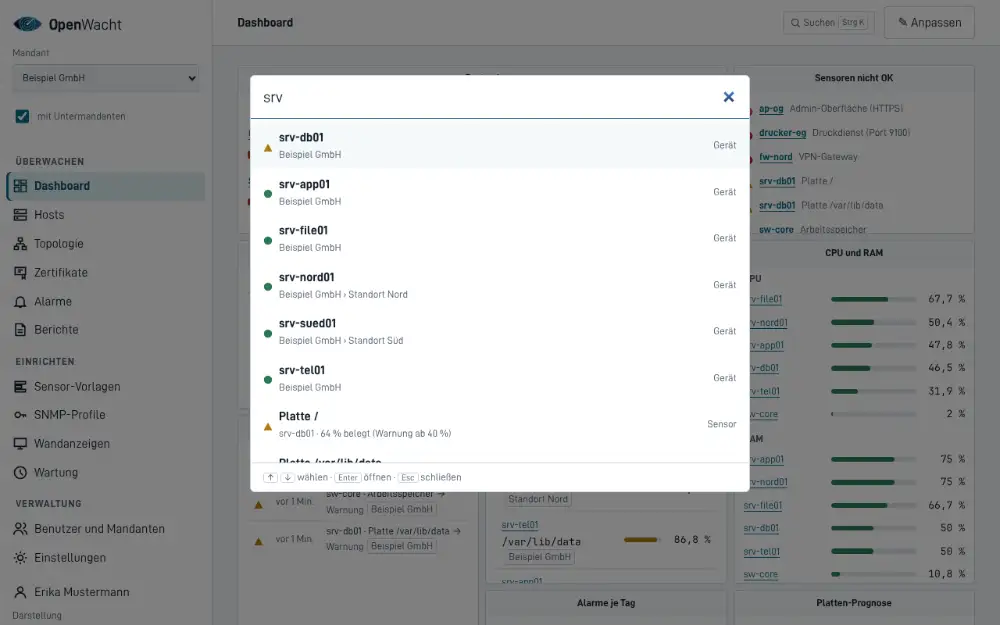
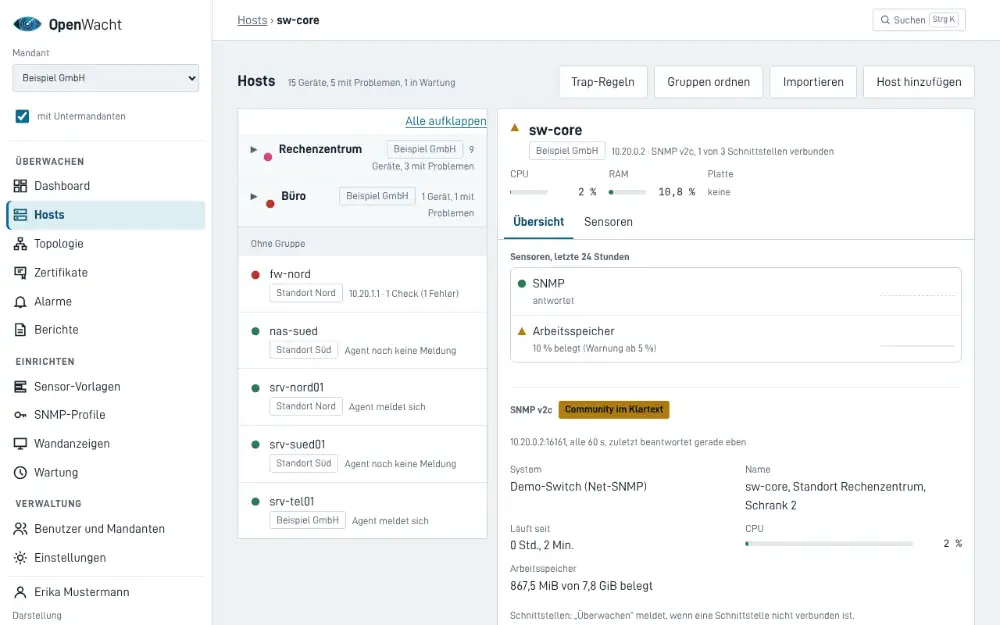
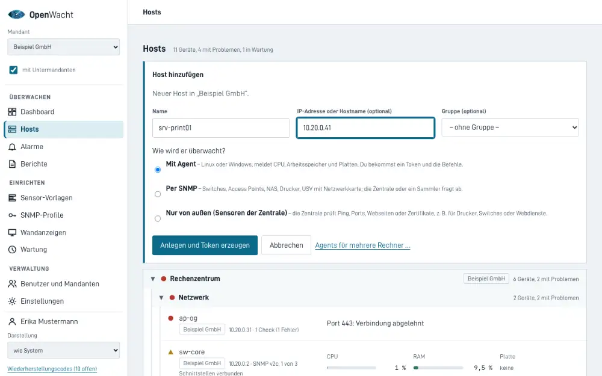
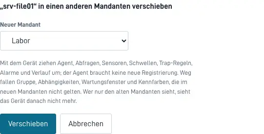
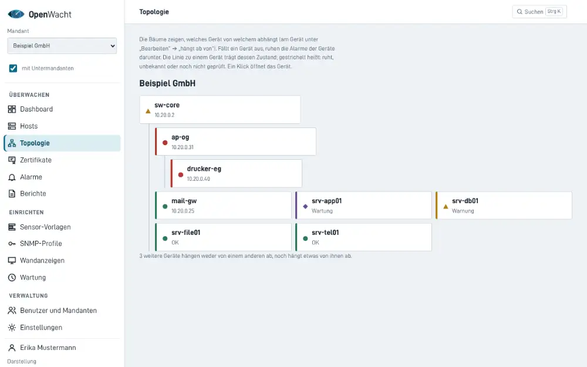
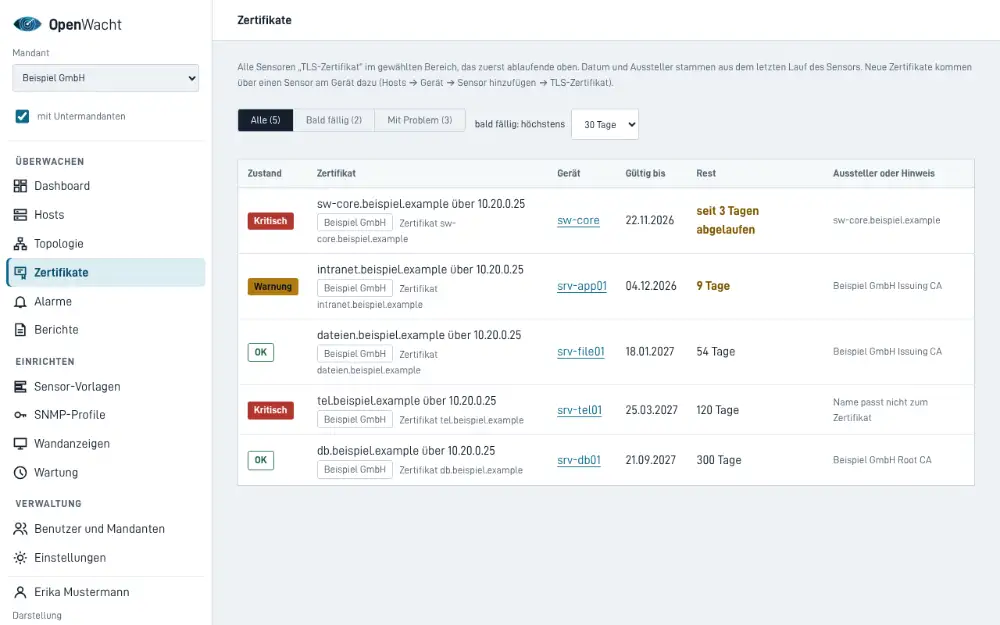
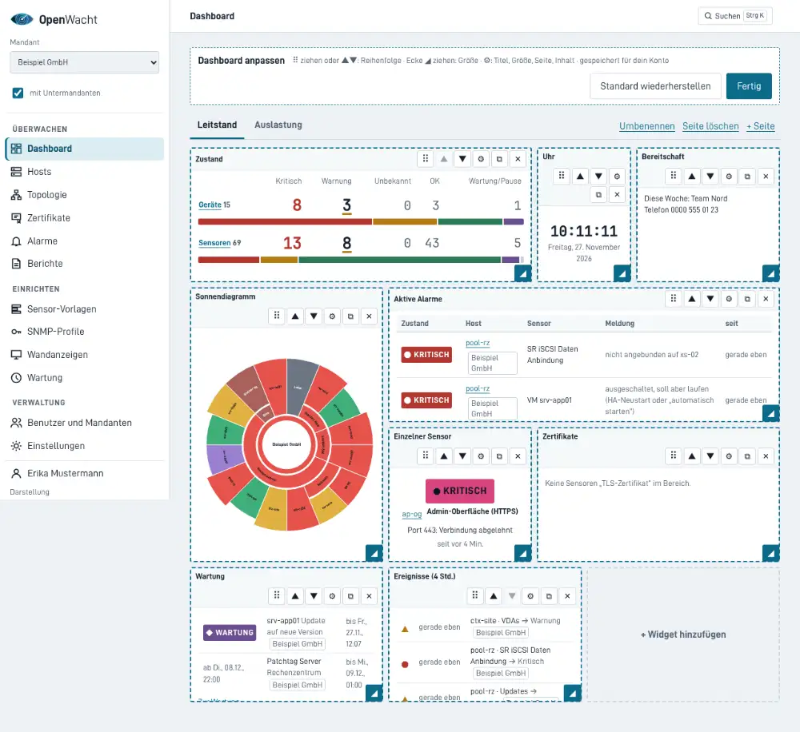
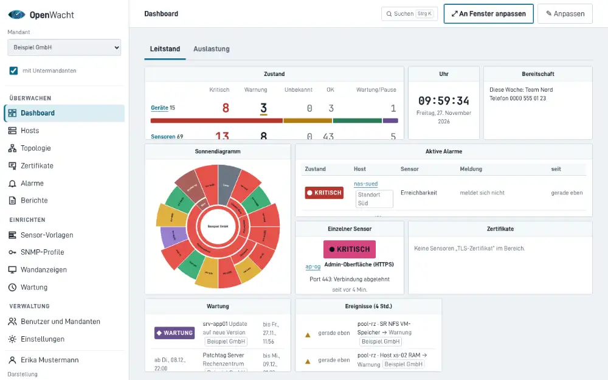
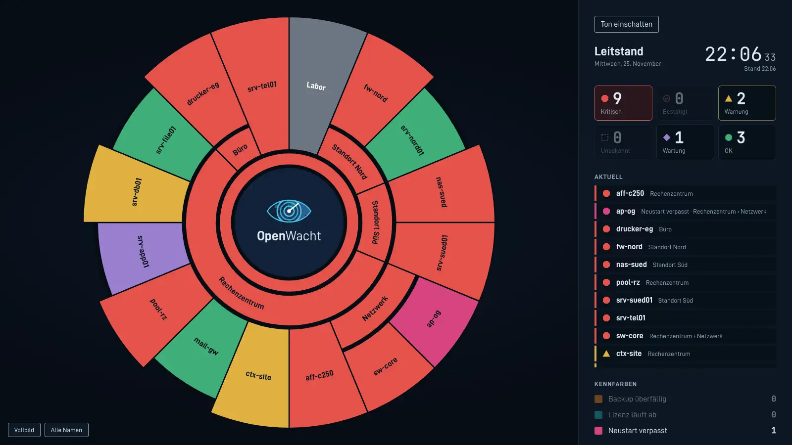
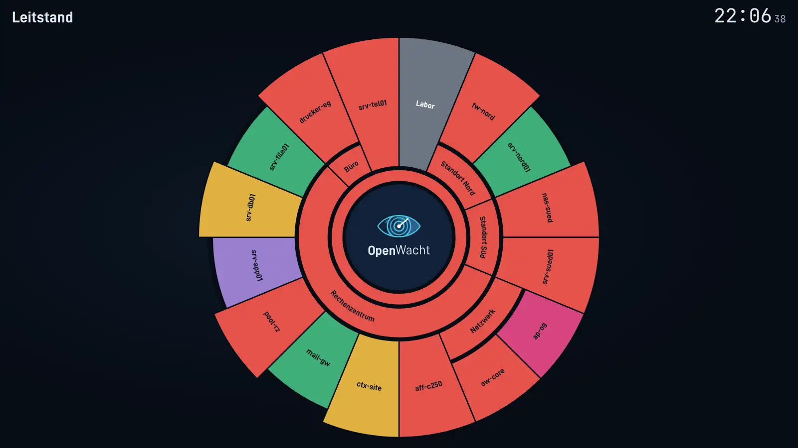

# 4. Hosts, Gruppen und Abhängigkeiten

Die Seite **Hosts** zeigt alle Geräte des gewählten Mandanten im Gruppenbaum, mit Zustand (Punkt), CPU, RAM und Platte.
Ein Klick öffnet das Gerät mit den Reitern „Übersicht“ (Werte, Verlauf, Graphen) und „Sensoren“.

**Schnellsuche** (ab 1.0.6): **Strg+K** (am Mac ⌘K) oder „Suchen“ oben rechts öffnet ein Suchfeld über alle Geräte,
Sensoren, Mandanten und Seiten, die du sehen darfst, unabhängig vom gewählten Mandanten. Mehrere Wörter grenzen ein
(„db platte“). Treffer am Anfang des Namens stehen vorn, bei gleicher Güte die schlimmsten Zustände. Pfeiltasten wählen,
Enter öffnet: ein Gerät mit seiner Übersicht, ein Sensor das Gerät mit dem Reiter „Sensoren“, ein Mandant wechselt den
Mandanten.

## Host hinzufügen

Name, optional Adresse und Gruppe, dann die Art der Überwachung:

- **Mit Agent:** Linux oder Windows; meldet CPU, Arbeitsspeicher, Platten und Sensoren auf dem Rechner
  ([Kapitel 5](05-agent.md)). Es entsteht ein Einmal-Token mit dem fertigen Befehl.
- **Per SNMP:** Switches, Access Points, NAS, Drucker, USV ([Kapitel 6](06-snmp.md)).
- **Nur von außen (Checks):** Die Zentrale prüft Ping, Ports, Webseiten, Zertifikate ([Kapitel 7](07-sensoren-und-vorlagen.md)).

Weitere Quellen im Aktionsmenü eines Geräts (nur Admins): **Proxmox**, **vCenter**, **NetApp ONTAP**,
**XenServer/XCP-ng** und für kleine Standorte ein **Router von AVM** (TR-064). Einrichtung, Rechte und Alarme jeder
Quelle stehen in [Kapitel 19](19-anbindungen.md). Je Gerät gibt es eine dieser Abfragequellen. Läuft auf einem Proxmox-Host auch
ein Agent, sind das zwei Geräte (z. B. `pve-01` mit Agent und `pve-01 (Proxmox)`).

## Gruppen

**Gruppen ordnen:** Gruppen je Mandant als Baum (bis 4 Ebenen), Reihenfolge von Hand, Geräte per Auswahl oder Ziehen
zuordnen. Wird eine Gruppe mit Inhalt gelöscht, rutschen Geräte und Untergruppen eine Ebene höher. Gruppen ordnen die
Übersicht und die Wandanzeige und sind Ziel für Wartungsfenster und Vorlagen. Unter Hosts sind Gruppen ab Werk **zugeklappt** (ab 1.0.6) und
zeigen trotzdem den schlimmsten Zustand und die Zahl der Geräte mit Problemen; „Alle aufklappen“ öffnet alle. Welche offen
sind, merkt sich der Browser.

## Abhängigkeiten

Unter „Gerät bearbeiten“ kann ein Gerät **von einem Elterngerät abhängen** (z. B. Drucker hinter einem Switch; gleicher
Mandant, keine Kreise). Ist das Elterngerät nicht erreichbar (Ping kritisch, Agent stumm oder Abfragequelle stumm),
gibt es für die Geräte darunter keine eigenen Alarme; Hosts zeigt „nicht erreichbar wegen …“. Entwarnungen gehen
weiter raus.

## In einen anderen Mandanten verschieben

Ab 1.0.6, im Menü des Geräts: **In anderen Mandanten verschieben …**, neuen Mandanten wählen, „Verschieben“. Das dürfen
nur Admins, die **beide** Mandanten verwalten (z. B. ein Admin des gemeinsamen übergeordneten Mandanten).

- **Zieht mit um:** Agent (ohne neue Registrierung: Das Zertifikat enthält nur die ID des Agents, den Mandanten kennt
  die Zentrale), Abfrage (SNMP, Proxmox, vCenter, FRITZ!Box, NetApp, XenServer; die Zugangsdaten werden für den neuen
  Mandanten neu verschlüsselt), Sensoren, Schwellen, Trap-Regeln des Geräts, Ausnahmen, offene und beendete Alarme,
  Verlauf und Messwerte.
- **Fällt weg:** Gruppe, Abhängigkeiten in beide Richtungen, Wartungen und Wartungsfenster des Geräts, Kennfarben, die im
  neuen Mandanten nicht gelten, Freigaben für Agent-Updates und unbenutzte Registrierungs-Tokens.
- **Abgelehnt** mit Hinweis, wenn die Abfrage über den Sammler eines anderen Geräts läuft oder der Agent des Geräts für
  andere Geräte sammelt, wenn ein SNMP-Profil im neuen Mandanten nicht gilt oder wenn eine Trap-Regel über „beendet“ mit
  einer Regel ohne dieses Gerät verbunden ist. Erst lösen, dann verschieben.
- Danach gelten die **Netze des neuen Mandanten**: Liegt ein Ziel dort nicht in den freigegebenen Netzen, schlagen die
  betroffenen Sensoren fehl. Im Audit-Log beider Mandanten steht `geraet.verschoben`.

## Topologie

**Topologie** in der Seitenleiste zeigt die Abhängigkeiten als Bäume, je Mandant: oben das Gerät, von dem andere
abhängen, darunter die abhängigen Geräte, mit eigenen Kindern auch über mehrere Ebenen. Jedes Gerät trägt seinen
Zustand (Form und Farbe); der farbige Rand links ist die Linie zu ihm in seinem Zustand, gestrichelt, wenn es ruht
(Elterngerät nicht erreichbar), unbekannt oder noch nicht geprüft ist. Ein Klick öffnet das Gerät. Geräte ohne
Abhängigkeit in beide Richtungen stehen nur als Zahl darunter. Die Seite zeigt nur, was du auch unter Hosts siehst.

**Netzbild (ab 1.0.11):** Über den Bäumen zeigt die Seite, welche Geräte miteinander verbunden sind. Das Bild entsteht
von selbst aus den Nachbarn, die Geräte mit SNMP-Abfrage per LLDP melden; einzurichten ist nichts, LLDP muss nur an
den Switches eingeschaltet sein.

- Jedes Gerät steht als Karte mit seinem Zustand; ein Klick öffnet es unter Hosts. Das Gerät mit den meisten
  Verbindungen steht oben, die anderen in Ebenen darunter.
- Jede Linie ist eine gemeldete Verbindung, an beiden Enden steht der Port. Eine dicke Linie steht für mehrere
  Verbindungen zwischen denselben Geräten (zum Beispiel ein Bündel).
- Ein Nachbar wird einem Gerät zugeordnet, wenn sein LLDP-Name zum Namen des Geräts in OpenWacht passt oder zu dem
  Namen, den das Gerät per SNMP von sich meldet. Groß- und Kleinschreibung und die Domäne zählen nicht
  („SW-Keller.intern.example“ passt zu „sw-keller“); bei mehreren Treffern wird nichts zugeordnet.
- Nachbarn ohne Gerät in OpenWacht (Access Points, Telefone, fremde Switches) stehen unter dem Bild je Gerät als graue
  Marken mit dem Port. Die Karte des Geräts nennt ihre Zahl. Ab 1.0.12 öffnet ein Klick auf eine Marke (mit „+“) das
  Formular „Ins Monitoring aufnehmen“ wie im Bild der Ports ([Kapitel 6](06-snmp.md)); Leser sehen die Marken ohne
  Klick.
- Das Netzbild ersetzt die Abhängigkeiten nicht: Welche Alarme ruhen, wenn ein Gerät ausfällt, bestimmt weiter
  „hängt ab von“.

## Zertifikate

**Zertifikate** in der Seitenleiste listet alle Sensoren „TLS-Zertifikat“ im gewählten Bereich: Adresse, Gerät,
Ablaufdatum, Resttage und Aussteller (bei einem Problem wie falschem Namen stattdessen der Hinweis), das zuerst
ablaufende oben. „Bald fällig“ zeigt nur Zertifikate, die in den nächsten 14, 30, 60 oder 90 Tagen ablaufen, „Mit
Problem“ nur Warnung, Kritisch und Unbekannt. Ein Klick auf das Gerät öffnet es. Datum und Aussteller stammen aus dem
letzten Lauf des Sensors; neue Zertifikate kommen über einen Sensor am Gerät dazu. Die Seite zeigt nur, was du auch
unter Hosts siehst.

## Darstellung

Unten links „Darstellung“: wie System, hell oder dunkel. Die Wahl gilt je Browser.

Auf dem Handy klappt die Seitenleiste ein:

## Dashboard und Wandanzeige

Das **Dashboard** besteht aus Widgets (Zustand, Sensoren nicht OK, aktive Alarme, CPU und RAM, vollste Platten,
Alarme je Tag, Platten-Prognose, Verfügbarkeit, Graph, Sonnendiagramm, Ereignisse). Jeder Benutzer stellt es sich
selbst zusammen; das Layout liegt bei seinem Konto und folgt ihm auf jedes Gerät.

Ab 1.0.7 ist es frei anpassbar. „✎ Anpassen“ schaltet in den Bearbeiten-Modus:

- **Größe:** Jedes Widget ist 2 bis 12 Spalten breit und 1 bis 6 Reihen hoch. Die Ecke ◢ unten rechts ziehen, oder
  über ⚙ Breite und Höhe wählen (so geht es auch mit der Tastatur).
- **Reihenfolge:** am ⠿ ziehen oder ▲▼. Lücken füllt das Raster von selbst mit den nächsten passenden Widgets.
- **⚙ Einstellungen:** eigener Titel, Größe, Seite, fester Mandant und der Inhalt (Graph: Wert, Zeitraum, Gerät).
- **⧉ verdoppeln, ✕ entfernen, „+ Widget hinzufügen“:** Jede Art gibt es beliebig oft, zum Beispiel „Zustand“ einmal
  je Standort mit festem Mandanten. Höchstens 60 Widgets.
- **Seiten:** bis zu acht benannte Seiten (z. B. „Leitstand“, „Auslastung“) als Reiter über dem Raster; „+ Seite“,
  „Umbenennen“ und „Seite löschen“ stehen im Bearbeiten-Modus rechts neben den Reitern.
- **Standard wiederherstellen** verwirft alle Seiten und Widgets.

Neue Widgets ab 1.0.7:

| Widget | zeigt |
| --- | --- |
| Zertifikate | die TLS-Zertifikate im Bereich, das zuerst ablaufende oben |
| Wartung | laufende Wartungen und die nächsten Wartungsfenster |
| Einzelner Sensor | einen gewählten Sensor groß mit Zustand, Meldung und „seit“ |
| Uhr | Uhrzeit und Datum, für den Leitstand |
| Notiz | eigenen Text, höchstens 500 Zeichen, etwa die Nummer der Bereitschaft |

**Fenstergröße:** Das Raster richtet sich nach dem Platz, den es hat. Ab etwa 780 px Breite stehen 12 Spalten
nebeneinander, darunter sechs (Widgets halb oder ganz breit), am Handy eine. Der Knopf **„⤢ An Fenster anpassen“**
teilt zusätzlich die Höhe des Fensters unter den Reihen auf, sodass das ganze Dashboard ohne Rollen auf den Bildschirm
passt, auch im Vollbild auf einem großen Leitstand-Bildschirm. Werden die Reihen dabei zu niedrig (unter etwa
110 px), bleibt es beim Rollen. Die Wahl merkt sich der Browser, nicht das Konto, weil ein Wandbildschirm etwas anderes
braucht als ein Notebook.

„Zustand“ zeigt ab 1.0.6 je Zeile Geräte und Sensoren die Zahlen je Zustand, Kritisch, Warnung und Unbekannt groß vorn.
Der Balken darunter gibt die Verteilung wieder; jedes Problem ist darin mindestens so breit, dass es zu sehen bleibt, auch
unter Tausenden OK-Sensoren (dann nicht maßstabsgetreu). Ein Klick auf „Geräte“ öffnet die Hosts, auf „Sensoren“ die
Alarme.

Die **Wandanzeige** (Einrichten → Wandanzeigen) zeigt ein Sonnendiagramm Mandant → Gruppen → Geräte ohne Anmeldung
über einen geheimen Link (nur einmal angezeigt, mit QR-Code). Löschen sperrt die Anzeige sofort.

In der Liste der Wandanzeigen (nur Admins des Mandanten):

- **Klick auf den Namen** öffnet eine **Vorschau** in einem neuen Tab, in deiner Sitzung und ohne Link. Sie zeigt genau
  den Ausschnitt des Bildschirms (mit oder ohne Untermandanten), auch wenn du selbst mehr siehst. Die Netzfreigabe der
  Anzeige gilt für die Vorschau nicht.
- **Neuer Link** ersetzt den Link nach Rückfrage: Der alte Link und alle damit angemeldeten Bildschirme gelten sofort
  nicht mehr, der neue erscheint einmal mit QR-Code. Gespeichert ist weiter nur sein Hash; das steht im Audit-Log.
- **Ton** (1.0.2): ab Werk nur bei Kritisch mit Bling; wahlweise aus oder bei Warnung und Kritisch, mit Klang,
  Lautstärke und leisem Ton bei Entwarnung. Der Ton klingt, wenn ein Gerät neu in Warnung oder Kritisch geht. Am
  Bildschirm muss einmal **Ton einschalten** angeklickt werden (rechts oben in der Seitenleiste), sonst spielen Browser
  keinen Ton ab; nach einem Neuladen der Seite erneut. Das steht im Audit-Log.

Rechts daneben (bei hochkant gestelltem Bildschirm darunter):

- **Uhr** mit Sekunden, dazu „Stand“ der letzten Daten. Bleiben die Sekunden stehen, ist die Seite eingefroren
  (Browser hängt); fehlt die Verbindung zur Zentrale, erscheint ein roter Hinweis, nach zwei Minuten wird das
  Diagramm grau.
- **Zahlen je Zustand**, Zustände ohne Gerät treten zurück.
- **Aktuell:** die Geräte, die nicht OK sind, schlimmste zuerst, mit Mandant und Gruppe und gegebenenfalls dem Namen der
  Kennfarbe; höchstens zwölf, der Rest als Zahl.
- **Kennfarben:** alle Kennfarben, die die Anzeige kennt, mit der Zahl der Geräte, die gerade in dieser Farbe stehen.
  Die Anzeige zeigt weiter nur Namen und Farben, keine Sensoren und keine Meldungen.

**Vollbild und Ansicht „Namen“** (ab 1.0.6), am Bildschirm und in der Vorschau:

- **Vollbild** (Knopf unten links oder Taste **F**) blendet die Leisten des Browsers aus; Esc beendet es.
- **Alle Namen** (Taste **N**) zeigt nur das Sonnendiagramm, so groß es geht, mit dem Namen der Anzeige und der Uhr
  darüber. Jedes Gerät ist beschriftet, die Schrift wird dafür bei vielen Geräten kleiner statt wegzufallen. Zahlen,
  „Aktuell“ und Kennfarben stehen nur in der Übersicht; „Übersicht“ bzw. N schaltet zurück.
- Die Ansicht steht in der Adresse (`/anzeige?ansicht=namen`): Ein Bildschirm, der mit dieser Adresse startet, zeigt
  gleich die Namen. Gespeichert wird im Browser nichts.
- Nach drei Sekunden ohne Maus verschwinden Mauszeiger und Knöpfe.

