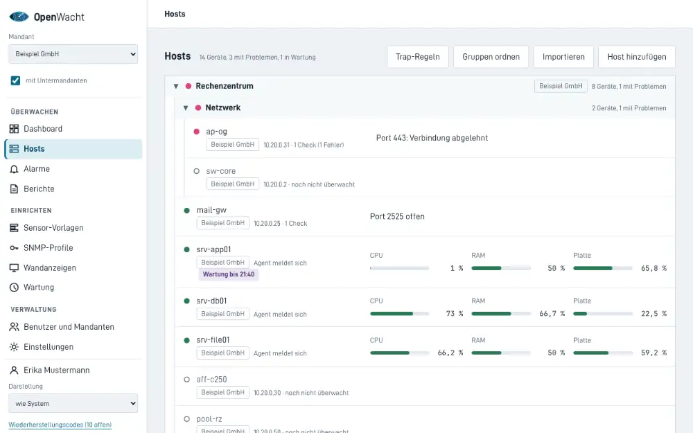
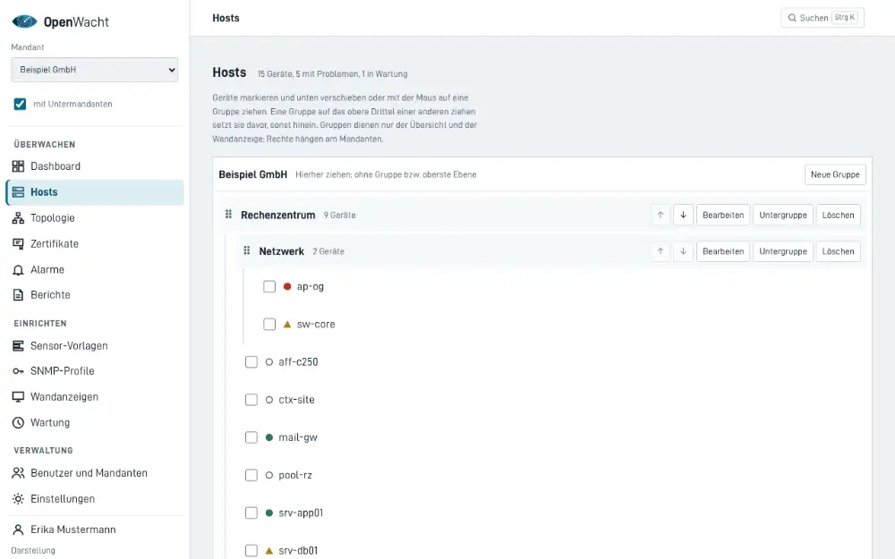
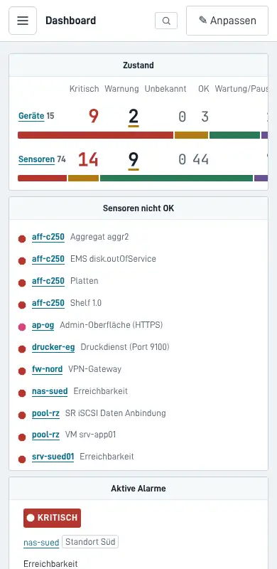
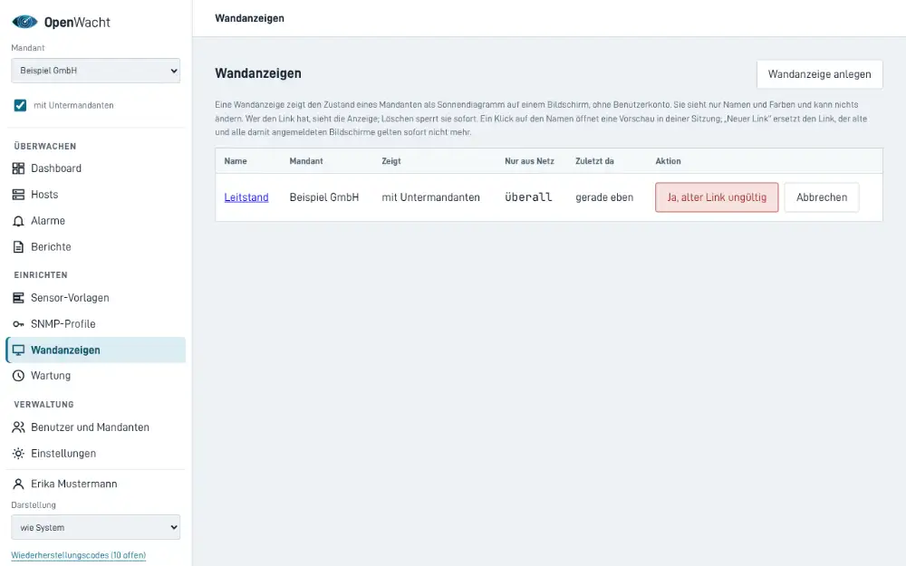

# 4. Hosts, Gruppen und Abhängigkeiten

Die Seite **Hosts** zeigt alle Geräte des gewählten Mandanten im Gruppenbaum, mit Zustand (Punkt), CPU, RAM und Platte.
Ein Klick öffnet das Gerät mit den Reitern „Übersicht“ (Werte, Verlauf, Graphen) und „Sensoren“.

## Host hinzufügen

Name, optional Adresse und Gruppe, dann die Art der Überwachung:

- **Mit Agent:** Linux oder Windows; meldet CPU, Arbeitsspeicher, Platten und Sensoren auf dem Rechner
  ([Kapitel 5](05-agent.md)). Es entsteht ein Einmal-Token mit dem fertigen Befehl.
- **Per SNMP:** Switches, Access Points, NAS, Drucker, USV ([Kapitel 6](06-snmp.md)).
- **Nur von außen (Checks):** Die Zentrale prüft Ping, Ports, Webseiten, Zertifikate ([Kapitel 7](07-sensoren-und-vorlagen.md)).

Weitere Quellen im Aktionsmenü eines Geräts (nur Admins): **Proxmox**, **vCenter**, **NetApp ONTAP**,
**XenServer/XCP-ng** und für kleine Standorte ein **Router von AVM** (TR-064). Einrichtung, Rechte und Alarme jeder
Quelle stehen in [Kapitel 19](19-anbindungen.md). Je Gerät gibt es eine dieser Abfragequellen. Läuft auf einem Proxmox-Host auch
ein Agent, sind das zwei Geräte (z. B. `pve-01` mit Agent und `pve-01 (Proxmox)`).

## Gruppen

**Gruppen ordnen:** Gruppen je Mandant als Baum (bis 4 Ebenen), Reihenfolge von Hand, Geräte per Auswahl oder Ziehen
zuordnen. Wird eine Gruppe mit Inhalt gelöscht, rutschen Geräte und Untergruppen eine Ebene höher. Gruppen ordnen die
Übersicht und die Wandanzeige und sind Ziel für Wartungsfenster und Vorlagen.

## Abhängigkeiten

Unter „Gerät bearbeiten“ kann ein Gerät **von einem Elterngerät abhängen** (z. B. Drucker hinter einem Switch; gleicher
Mandant, keine Kreise). Ist das Elterngerät nicht erreichbar (Ping kritisch, Agent stumm oder Abfragequelle stumm),
gibt es für die Geräte darunter keine eigenen Alarme; Hosts zeigt „nicht erreichbar wegen …“. Entwarnungen gehen
weiter raus.

## Topologie

**Topologie** in der Seitenleiste zeigt die Abhängigkeiten als Bäume, je Mandant: oben das Gerät, von dem andere
abhängen, darunter die abhängigen Geräte, mit eigenen Kindern auch über mehrere Ebenen. Jedes Gerät trägt seinen
Zustand (Form und Farbe); der farbige Rand links ist die Linie zu ihm in seinem Zustand, gestrichelt, wenn es ruht
(Elterngerät nicht erreichbar), unbekannt oder noch nicht geprüft ist. Ein Klick öffnet das Gerät. Geräte ohne
Abhängigkeit in beide Richtungen stehen nur als Zahl darunter. Die Seite zeigt nur, was du auch unter Hosts siehst.

## Darstellung

Unten links „Darstellung“: wie System, hell oder dunkel. Die Wahl gilt je Browser.

Auf dem Handy klappt die Seitenleiste ein:

## Dashboard und Wandanzeige

Das **Dashboard** besteht aus Widgets (Zustand, Sensoren nicht OK, aktive Alarme, CPU und RAM, vollste Platten,
Alarme je Tag, Platten-Prognose, Verfügbarkeit). „Anpassen“ ordnet sie je Benutzer.

Die **Wandanzeige** (Einrichten → Wandanzeigen) zeigt ein Sonnendiagramm Mandant → Gruppen → Geräte ohne Anmeldung
über einen geheimen Link (nur einmal angezeigt, mit QR-Code). Löschen sperrt die Anzeige sofort.

In der Liste der Wandanzeigen (nur Admins des Mandanten):

- **Klick auf den Namen** öffnet eine **Vorschau** in einem neuen Tab, in deiner Sitzung und ohne Link. Sie zeigt genau
  den Ausschnitt des Bildschirms (mit oder ohne Untermandanten), auch wenn du selbst mehr siehst. Die Netzfreigabe der
  Anzeige gilt für die Vorschau nicht.
- **Neuer Link** ersetzt den Link nach Rückfrage: Der alte Link und alle damit angemeldeten Bildschirme gelten sofort
  nicht mehr, der neue erscheint einmal mit QR-Code. Gespeichert ist weiter nur sein Hash; das steht im Audit-Log.
- **Ton** (1.0.2): ab Werk nur bei Kritisch mit Bling; wahlweise aus oder bei Warnung und Kritisch, mit Klang,
  Lautstärke und leisem Ton bei Entwarnung. Der Ton klingt, wenn ein Gerät neu in Warnung oder Kritisch geht. Am
  Bildschirm muss einmal **Ton einschalten** angeklickt werden (rechts oben in der Seitenleiste), sonst spielen Browser
  keinen Ton ab; nach einem Neuladen der Seite erneut. Das steht im Audit-Log.

Rechts daneben (bei hochkant gestelltem Bildschirm darunter):

- **Uhr** mit Sekunden, dazu „Stand“ der letzten Daten. Bleiben die Sekunden stehen, ist die Seite eingefroren
  (Browser hängt); fehlt die Verbindung zur Zentrale, erscheint ein roter Hinweis, nach zwei Minuten wird das
  Diagramm grau.
- **Zahlen je Zustand**, Zustände ohne Gerät treten zurück.
- **Aktuell:** die Geräte, die nicht OK sind, schlimmste zuerst, mit Mandant und Gruppe und gegebenenfalls dem Namen der
  Kennfarbe; höchstens zwölf, der Rest als Zahl.
- **Kennfarben:** alle Kennfarben, die die Anzeige kennt, mit der Zahl der Geräte, die gerade in dieser Farbe stehen.
  Die Anzeige zeigt weiter nur Namen und Farben, keine Sensoren und keine Meldungen.
