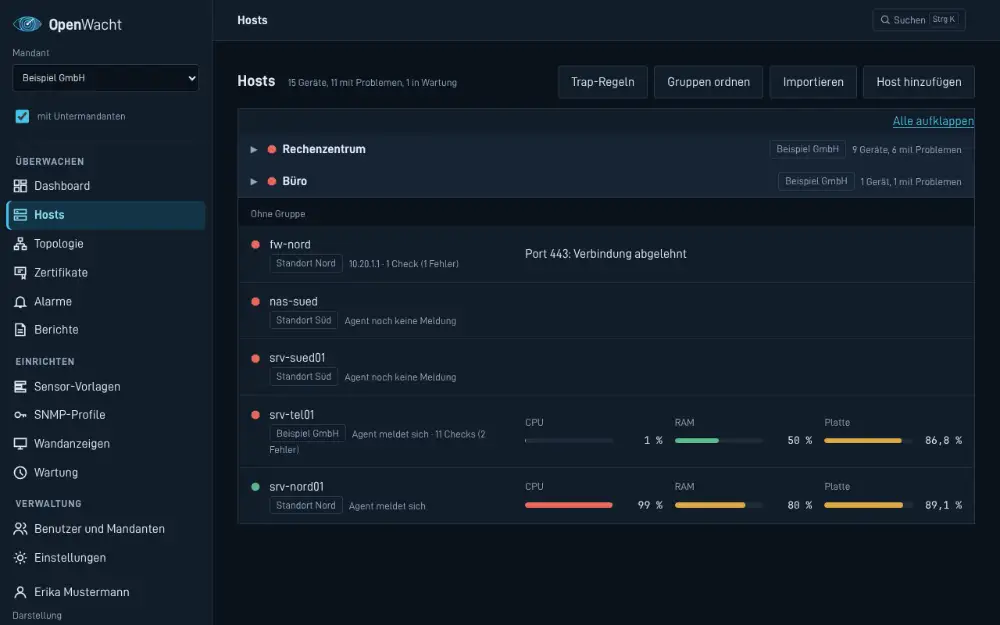
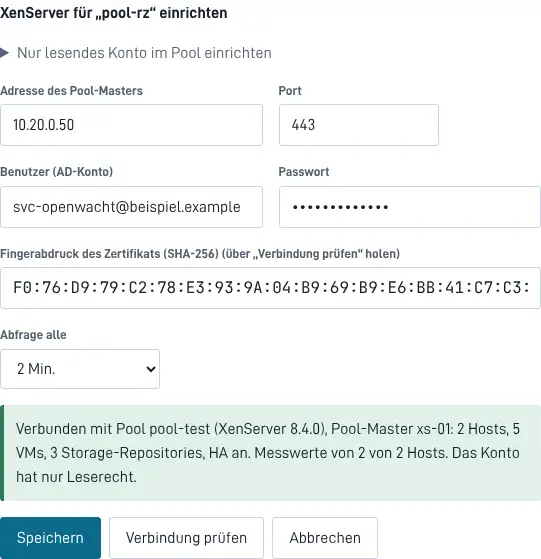

# 4. Hosts, Gruppen und Abhängigkeiten


Die Seite **Hosts** zeigt alle Geräte des gewählten Mandanten im Gruppenbaum, mit Zustand (Punkt), CPU, RAM und Platte.
Ein Klick öffnet das Gerät mit den Reitern „Übersicht“ (Werte, Verlauf, Graphen) und „Sensoren“.


## Host hinzufügen


Name, optional Adresse und Gruppe, dann die Art der Überwachung:

- **Mit Agent:** Linux oder Windows; meldet CPU, Arbeitsspeicher, Platten und Sensoren auf dem Rechner
  ([Kapitel 5](05-agent.md)). Es entsteht ein Einmal-Token mit dem fertigen Befehl.
- **Per SNMP:** Switches, Access Points, NAS, Drucker, USV ([Kapitel 6](06-snmp.md)).
- **Nur von außen (Checks):** Die Zentrale prüft Ping, Ports, Webseiten, Zertifikate ([Kapitel 7](07-sensoren-und-vorlagen.md)).

Weitere Quellen im Aktionsmenü eines Geräts: **Proxmox** (Gäste, Backup-Alter, Speicher; nur lesendes API-Token),
**vCenter** (ESXi-Hosts, Datastores, VMs; Konto mit Rolle „Read-only“), für kleine Standorte auch ein Router von
AVM über TR-064 (am Ende des Kapitels). Je Gerät gibt es eine dieser Abfragequellen. Läuft auf einem Proxmox-Host auch
ein Agent, sind das zwei Geräte (z. B. `pve-01` mit Agent und `pve-01 (Proxmox)`).

### Proxmox (nur lesend)

Auf dem Proxmox-Host als root (dieselben Befehle stehen im Formular unter „Token auf dem Proxmox-Host anlegen“):

```bash
pveum user add openwacht@pve --comment "OpenWacht, nur lesend"
pveum acl modify / --users openwacht@pve --roles PVEAuditor
pveum user token add openwacht@pve monitor --privsep 1
pveum acl modify / --tokens 'openwacht@pve!monitor' --roles PVEAuditor
cat /etc/pve/pve-root-ca.pem
```

- `token add` zeigt das Geheimnis (`value`) **nur einmal**. Gleich in den Passwortmanager legen; verloren heißt: Token
  löschen und neu anlegen.
- Ins Feld **API-Token** kommt ID und Geheimnis zusammen: `openwacht@pve!monitor=<value>`, ohne Leerzeichen.
- **CA des Hosts:** die Ausgabe von `cat /etc/pve/pve-root-ca.pem` **dieses** Hosts, ganz von `-----BEGIN` bis
  `-----END CERTIFICATE-----`. Nicht von einem anderen Host übernehmen: Hosts, die nicht im selben Cluster sind (oder vor
  dem Beitritt ihre CA behalten haben), haben verschiedene CAs.
- Im Cluster gelten Benutzer und Token auf allen Knoten; trotzdem fragt OpenWacht jeden Knoten als eigenes Gerät ab.

**Ohne Shell, in der Proxmox-Oberfläche** (geprüft an einem Proxmox VE 9):

1. Rechenzentrum → Berechtigungen → **Benutzer** → Hinzufügen: `openwacht`, Realm „Proxmox VE authentication server“,
   ohne Passwort.
2. Rechenzentrum → Berechtigungen → **API-Token** → Hinzufügen: Benutzer `openwacht@pve`, Token-ID `monitor`,
   „Privilegientrennung“ angehakt. Das Geheimnis erscheint nur einmal.
3. Rechenzentrum → **Berechtigungen** → Hinzufügen, zweimal: „Benutzerberechtigung“ für `openwacht@pve` und
   „API-Token-Berechtigung“ für `openwacht@pve!monitor`, jeweils Pfad `/`, Rolle **PVEAuditor**, „Weitergeben“. Mit
   Privilegientrennung braucht das Token beide Einträge.
4. CA: Knoten → System → **Zertifikate** → `pve-root-ca.pem` → „Zertifikat anzeigen“; oder im Browser die Root der
   Kette als Base-64 exportieren. Hat der Knoten ein Zertifikat der Firmen-CA, deren Root nehmen.
- Meldet „Verbindung prüfen“ `401`, passen ID und Geheimnis nicht zusammen; ein Zertifikatsfehler heißt fast immer: CA
  eines anderen Hosts eingetragen.

## Gruppen


**Gruppen ordnen:** Gruppen je Mandant als Baum (bis 4 Ebenen), Reihenfolge von Hand, Geräte per Auswahl oder Ziehen
zuordnen. Wird eine Gruppe mit Inhalt gelöscht, rutschen Geräte und Untergruppen eine Ebene höher. Gruppen ordnen die
Übersicht und die Wandanzeige und sind Ziel für Wartungsfenster und Vorlagen.

## Abhängigkeiten

Unter „Gerät bearbeiten“ kann ein Gerät **von einem Elterngerät abhängen** (z. B. Drucker hinter einem Switch; gleicher
Mandant, keine Kreise). Ist das Elterngerät nicht erreichbar (Ping kritisch, Agent stumm oder Abfragequelle stumm),
gibt es für die Geräte darunter keine eigenen Alarme; Hosts zeigt „nicht erreichbar wegen …“. Entwarnungen gehen
weiter raus.

## Darstellung

Unten links „Darstellung“: wie System, hell oder dunkel. Die Wahl gilt je Browser.



Auf dem Handy klappt die Seitenleiste ein:


## NetApp ONTAP (REST-API)

Die Zentrale fragt NetApp-Cluster (z. B. AFF, FAS) über die ONTAP-REST-API ab. Am Gerät:
Aktionsmenü → „NetApp einrichten“ (nur Admins).


**Konto in ONTAP:** ein eigener Benutzer mit nur lesender REST-Rolle, auf der Cluster-Shell zum Beispiel:

```
security login rest-role create -role openwacht_lesen -api /api -access readonly
security login create -user-or-group-name svc-openwacht -application http -authentication-method password -role openwacht_lesen
```

**Ohne Shell im System Manager:** Cluster → Settings → **Users and Roles**. Unter **Roles** → Add: Name
`openwacht_lesen`, API `/api`, Access level **Read-only**. Unter **Users** → Add: Benutzer, Rolle `openwacht_lesen`,
Application **HTTP**, Authentication Password, Multifactor **Disabled**. Die eingebaute Rolle `readonly` reicht nicht:
OpenWacht kann damit die Rechte des Kontos nicht lesen.

1. Adresse der **Cluster-Management-Schnittstelle** eintragen (HTTPS, Port 443), Benutzer und Passwort.
   Die Adresse muss in der Netzfreigabe liegen.
2. **Verbindung prüfen:** Beim ersten Mal holt die Zentrale nur den Fingerabdruck (SHA-256) des Zertifikats, ohne
   Anmeldung und ohne Anfrage. Mit `security certificate show -type server` auf der Cluster-Shell oder im Browser
   vergleichen und übernehmen. Danach gilt nur dieses Zertifikat; das Passwort geht nie an einen anderen Server.
3. Noch einmal **Verbindung prüfen**: Die Zentrale meldet sich an, prüft die Rechte des Kontos und zählt Knoten,
   Aggregate, Volumes, Platten, Shelves und SnapMirror-Beziehungen. Dann **Speichern**.


**Nur lesend:** Die Zentrale sendet nur GET-Anfragen an eine feste Liste von Endpunkten (`/api/cluster`,
`/api/cluster/nodes`, `/api/storage/aggregates`, `/api/storage/volumes`, `/api/storage/disks`, `/api/storage/shelves`,
`/api/snapmirror/relationships`, `/api/support/ems/events` und zur Rechteprüfung `/api/security/…`). Vor jeder Abfrage
liest sie die Rechte des Kontos (ab ONTAP 9.19 über `whoami`, davor über das Konto und die Rechte seiner Rolle).
**Ein Konto mit Schreibrecht wird abgelehnt** (zum Beispiel die Rolle „admin“ oder eine Rolle mit `all`,
`read_create`, `read_modify` …), ebenso ein Konto, dessen Rechte sich nicht lesen lassen. Ausgenommen sind nur die
Befehle `set` und `security login password`, die die eigene Sitzung betreffen.

**Werte und Alarme** (Intervall Standard 2 Minuten):

| Sensor | Alarm |
| --- | --- |
| Knoten | nicht „up“, vom Partner übernommen, Übernahme fehlgeschlagen oder nicht möglich, Failover aus, Übertemperatur, Lüfter oder Netzteil ausgefallen |
| Aggregat / Volume (Belegung) | Schwellen und Prognose „voll in … Tagen“ wie bei Platten; Volumes nur beschreibbare (rw), Spiegelziele nicht |
| Aggregat / Volume (Zustand) | Aggregat nicht online: kritisch; Volume offline oder eingeschränkt: Warnung, gestört: kritisch |
| Platten | ausgefallen: kritisch; wird ersetzt (fällt voraussichtlich aus), wird neu aufgebaut, entfernt: Warnung; dazu die Zahl der Ersatzplatten |
| Shelf | Netzteil, Modul oder Lüfter gestört, Temperatur über den Schwellen des Shelfs |
| SnapMirror | nicht gesund (mit Grund), getrennt, Verzögerung ab 26 Std. Warnung, ab 50 Std. kritisch |
| EMS | Ereignisse der Schwere „emergency“ und „alert“ der letzten Stunde, je Meldung ein Sensor (höchstens 20) |
| Neustart | ein Knoten läuft kürzer als bei der letzten Abfrage |

Graphen: Belegung der Aggregate und Volumes, IOPS und Latenz je Aggregat. Scheitert ein Teil (zum Beispiel 403 auf
die Shelves), zeigt die Oberfläche ihn als „nicht abfragbar“, und dessen Sensoren behalten ihren letzten Zustand.

**Einzelne Werte ausnehmen**, z. B. eine alte SnapMirror-Beziehung, die niemand mehr pflegt: am Gerät
Reiter „Sensoren“ → beim Wert „Ausnehmen“, Begründung eintragen. Der Wert wird weiter abgefragt, meldet aber keine
Alarme mehr, ein offener Alarm endet, und er steht grau als „ausgenommen“ mit Begründung da. „Wieder überwachen“ hebt
das auf. Das geht für jeden Wert von SNMP, Proxmox, NetApp, XenServer und anderen Quellen (Volumes, Platten,
Schnittstellen …), nicht für die Erreichbarkeit; dafür gibt es „Abfrage ausschalten“. Ausnehmen und Aufheben dürfen
Operatoren und Admins, beides steht im Audit-Log. Bestätigen reicht dafür nicht: Ein bestätigter Alarm bleibt offen.


**Datensparsam:** Seriennummern, Konten, Freigaben, Clients, Dateien und Inhalte von Volumes liest die Zentrale nicht.
Von EMS-Ereignissen speichert sie nur Name, Schwere, Knoten, Zeit und den gekürzten Text.

**Grenzen:** höchstens 24 Knoten, 200 Aggregate, 1000 Volumes (mehr: gekürzt), 2000 Platten, 100 Shelves,
1000 SnapMirror-Beziehungen, 50 EMS-Ereignisse und 8 MiB je Antwort. Weiterleitungen werden nicht verfolgt, kein Proxy,
nicht über einen Sammler. Neben der REST-API gehen weiterhin SNMPv3-Abfragen, eigene OID-Sensoren (NetApp-MIB) und
SNMPv3-Traps ([Kapitel 6](06-snmp.md)).

## XenServer und XCP-ng (XAPI)

Die Zentrale fragt XenServer-Pools (Ziel XenServer 8, auch XCP-ng) über XAPI ab. Am Gerät:
Aktionsmenü → „XenServer einrichten“ (nur Admins). Ein Gerät steht für den ganzen Pool.



**Konto:** XenServer vergibt Rollen (RBAC) nur an Konten aus dem Active Directory; ohne AD gibt es nur `root`
(lokaler Superuser mit allen Rechten). **OpenWacht lehnt root ab**, schon beim Speichern und ohne das Passwort zu
senden. Der Pool muss also in der Domäne sein. Dann auf dem Pool-Master zum Beispiel:

```
xe subject-add subject-name=svc-openwacht
xe subject-list subject-name=svc-openwacht params=uuid
xe subject-role-add uuid=<UUID aus der Zeile davor> role-name=read-only
```

In XenCenter geht dasselbe unter „Pool → Eigenschaften → Benutzer“. Die Rolle kann auch über eine AD-Gruppe kommen;
dann darf keine andere Gruppe des Kontos mehr Rechte geben.

1. Adresse des **Pool-Masters** eintragen (HTTPS, Port 443), Benutzer (`name@domäne` oder `DOMÄNE\name`) und Passwort.
   Die Adresse muss in der Netzfreigabe liegen.
2. **Verbindung prüfen:** Beim ersten Mal holt die Zentrale nur den Fingerabdruck (SHA-256) des Zertifikats, ohne
   Anmeldung und ohne Anfrage. Auf dem Pool-Master mit
   `openssl x509 -in /etc/xensource/xapi-ssl.pem -noout -fingerprint -sha256` oder
   `xe certificate-list type=host params=host,fingerprint_sha256` vergleichen und übernehmen. Danach gilt nur dieses
   Zertifikat; das Passwort geht nie an einen anderen Server.
3. Noch einmal **Verbindung prüfen**: Die Zentrale meldet sich an, prüft die Rechte der Sitzung, zählt Hosts, VMs und
   Storage-Repositories und meldet sich wieder ab. Dann **Speichern**.


**Nur lesend:** Die Zentrale ruft per JSON-RPC (`/jsonrpc`) nur Methoden aus einer festen Liste auf:
`session.login_with_password`, `session.logout`, `session.get_is_local_superuser`, `session.get_rbac_permissions`,
`role.get_by_name_label`, `role.get_permissions_name_label`, `pool.get_all_records`, `host.get_all_records`,
`host_metrics.get_all_records`, `VM.get_all_records_where` (ohne Vorlagen, Snapshots und dom0), `SR.get_all_records`,
`PBD.get_currently_attached` und `certificate.get_all_records_where`; dazu `GET /rrd_updates` für CPU und RAM. Nach jeder
Anmeldung prüft sie die Rechte der Sitzung gegen die feste Rolle „read-only“ des Pools. **Abgelehnt werden:** root, jede
Sitzung des lokalen Superusers, jedes Konto mit einer Rolle über „read-only“ (vm-operator, vm-admin, pool-operator,
pool-admin …) oder einem einzelnen Recht darüber hinaus, und ein Konto, dessen Rechte sich nicht lesen lassen. Die
Sitzung wird am Ende jeder Abfrage abgemeldet.

**Pool-Master gewechselt:** Antwortet die Adresse mit `HOST_IS_SLAVE`, folgt die Zentrale dem neuen Master **nicht** von
selbst (die Zugangsdaten sind an die Adresse gebunden), sondern meldet „Pool-Master gewechselt“ mit der Adresse des neuen
Masters. Adresse ändern, Fingerabdruck neu holen, Passwort neu eingeben. Mit HA wechselt der Master bei einem Ausfall
von selbst; dann meldet das Gerät „antwortet nicht (XAPI)“, bis die Adresse angepasst ist. Mit einem DNS-Namen,
der immer auf den Master zeigt, bleibt die Adresse gleich; nach einem Wechsel sind trotzdem Fingerabdruck und Passwort
neu einzugeben, weil das Zertifikat ein anderes ist.

**Messwerte der übrigen Hosts:** `/rrd_updates` liefert jeder Host nur für sich und seine VMs. Für die übrigen Hosts
verbindet sich die Zentrale mit der Adresse, die der Pool meldet, und nur mit dem Fingerabdruck, den der Pool-Master
für deren Zertifikat meldet. Diese Adressen müssen ebenfalls in der Netzfreigabe liegen; sonst fehlen für diese Hosts
CPU und RAM („Messwerte nicht abrufbar“), alles andere bleibt.

**Werte und Alarme** (Intervall Standard 2 Minuten):

| Sensor | Alarm |
| --- | --- |
| Host | nicht erreichbar: kritisch; Wartungsmodus oder deaktiviert: Warnung; dazu „läuft seit …“ |
| Host CPU / RAM | Schwellen wie bei Agents (Mittel der letzten 10 Minuten), erst ab zwei Hosts; bei einem Host gelten CPU und Speicher des Pools |
| CPU, Speicher | ganzer Pool (Mittel der Hosts bzw. Summe), Schwellen wie bei Agents |
| VM | nur VMs, die laufen sollen (HA-Neustart „restart“ oder „automatisch starten“): aus: kritisch; angehalten oder ausgesetzt: Warnung |
| SR (Belegung) | Schwellen und Prognose „voll in … Tagen“ wie bei Platten; ISO- und Wechselmedien ohne Belegung |
| SR Anbindung | auf einem Host nicht angebunden (PBD nicht verbunden): kritisch |
| HA | überbucht: kritisch; Plan reicht nicht für die eingestellte Zahl an Ausfällen: Warnung |
| Updates | Updates ausstehend oder nach Updates noch zu tun (z. B. Host neu starten): Warnung; nur XenServer 8 mit Update-Kanal |
| Neustart | ein Host läuft kürzer als bei der letzten Abfrage |

Graphen: CPU und RAM des Pools und je Host, Belegung der SRs, CPU und RAM der 30 VMs mit der höchsten CPU-Last.
Scheitert ein Teil (zum Beispiel die SRs), zeigt die Oberfläche ihn als „nicht abfragbar“, und dessen Sensoren behalten
ihren letzten Zustand.


**Datensparsam:** Von VMs nur Name, Zustand, Host und Zahlen (CPU, RAM, vCPUs), keine Konfiguration und keine Gastdaten.
Konten, Subjekte, Lizenzen und Seriennummern speichert die Zentrale nicht. Die Gerätekonfiguration der Speicher
(`PBD.device_config`, kann Passwörter von CIFS- oder iSCSI-Speichern enthalten) liest sie gar nicht.

**Grenzen:** höchstens 64 Hosts, 2000 VMs (500 einzeln gezeigt), 500 SRs, 2000 PBDs, 24 MiB je Antwort und 8 MiB je
Messwertantwort. Weiterleitungen werden nicht verfolgt, kein Proxy, nicht über einen Sammler.

## Dashboard und Wandanzeige

Das **Dashboard** besteht aus Widgets (Zustand, Sensoren nicht OK, aktive Alarme, CPU und RAM, vollste Platten,
Alarme je Tag, Platten-Prognose, Verfügbarkeit). „Anpassen“ ordnet sie je Benutzer.

Die **Wandanzeige** (Einrichten → Wandanzeigen) zeigt ein Sonnendiagramm Mandant → Gruppen → Geräte ohne Anmeldung
über einen geheimen Link (nur einmal angezeigt, mit QR-Code). Löschen sperrt die Anzeige sofort.

In der Liste der Wandanzeigen (nur Admins des Mandanten):

- **Klick auf den Namen** öffnet eine **Vorschau** in einem neuen Tab, in deiner Sitzung und ohne Link. Sie zeigt genau
  den Ausschnitt des Bildschirms (mit oder ohne Untermandanten), auch wenn du selbst mehr siehst. Die Netzfreigabe der
  Anzeige gilt für die Vorschau nicht.
- **Neuer Link** ersetzt den Link nach Rückfrage: Der alte Link und alle damit angemeldeten Bildschirme gelten sofort
  nicht mehr, der neue erscheint einmal mit QR-Code. Gespeichert ist weiter nur sein Hash; das steht im Audit-Log.
- **Ton** (1.0.2): ab Werk nur bei Kritisch mit Bling; wahlweise aus oder bei Warnung und Kritisch, mit Klang,
  Lautstärke und leisem Ton bei Entwarnung. Der Ton klingt, wenn ein Gerät neu in Warnung oder Kritisch geht. Am
  Bildschirm muss einmal **Ton einschalten** angeklickt werden (rechts oben in der Seitenleiste), sonst spielen Browser
  keinen Ton ab; nach einem Neuladen der Seite erneut. Das steht im Audit-Log.


Rechts daneben (bei hochkant gestelltem Bildschirm darunter):

- **Uhr** mit Sekunden, dazu „Stand“ der letzten Daten. Bleiben die Sekunden stehen, ist die Seite eingefroren
  (Browser hängt); fehlt die Verbindung zur Zentrale, erscheint ein roter Hinweis, nach zwei Minuten wird das
  Diagramm grau.
- **Zahlen je Zustand**, Zustände ohne Gerät treten zurück.
- **Aktuell:** die Geräte, die nicht OK sind, schlimmste zuerst, mit Mandant und Gruppe und gegebenenfalls dem Namen der
  Kennfarbe; höchstens zwölf, der Rest als Zahl.
- **Kennfarben:** alle Kennfarben, die die Anzeige kennt, mit der Zahl der Geräte, die gerade in dieser Farbe stehen.
  Die Anzeige zeigt weiter nur Namen und Farben, keine Sensoren und keine Meldungen.

## Router von AVM (TR-064)

Am Gerät „FRITZ!Box einrichten“ (nur Admins): Die Zentrale liest Internetverbindung (verbunden/getrennt mit Alarm, Dauer, externe IP),
Zugangsart, DSL-Synchronrate und Leitungskapazität, Verkehr als Rate mit Graph, Modell, FRITZ!OS und Laufzeit (Neustart-Alarm). Seriennummer,
Ereignisprotokoll, Heimnetzgeräte und Telefonie liest sie nicht.

1. In der FRITZ!Box unter Heimnetz → Netzwerk → Netzwerkeinstellungen „Zugriff für Anwendungen zulassen“ einschalten (TR-064, nur LAN).
2. Unter System → FRITZ!Box-Benutzer ein eigenes Konto anlegen, Recht nur „FRITZ!Box Einstellungen“, kein Zugang aus dem Internet.
3. Die Adresse der Box muss in `-check-netze` liegen. Port 49000 (HTTP, Digest-Anmeldung) oder 49443 (HTTPS): Bei HTTPS holt
   „Verbindung prüfen“ den Fingerabdruck des selbstsignierten Zertifikats; nach dem Vergleich übernehmen, danach gilt nur dieser.

TR-064 kennt kein reines Leserecht: Ohne „FRITZ!Box Einstellungen“ liefert die Box fast nichts (fehlende Teile zeigt OpenWacht als „nicht
verfügbar“). Das Konto könnte damit Einstellungen ändern. Die Zentrale ruft nur eine feste Liste lesender Aktionen auf
(`internal/tr064`), speichert Benutzer, Passwort und Fingerabdruck verschlüsselt und gebunden an Adresse und Port; nicht über einen Sammler.
