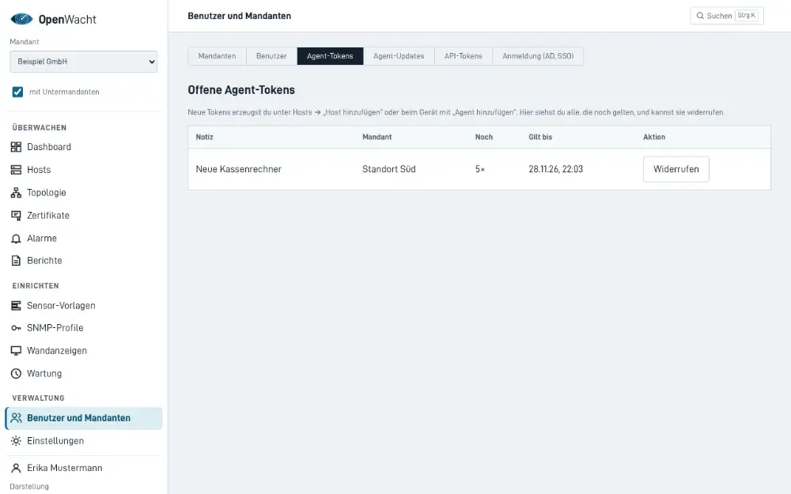
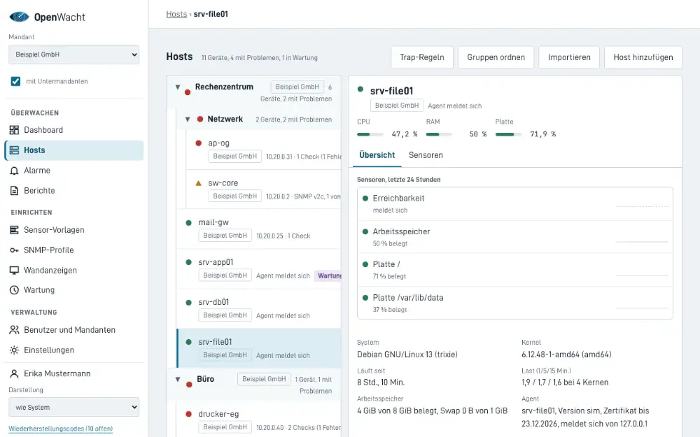

# 5. Agent für Linux und Windows

Der Agent sammelt CPU, Arbeitsspeicher, Platten, Laufzeit und freigegebene Sensoren und schickt sie per HTTPS mit
Client-Zertifikat (TLS 1.3) an Port 8444 der Zentrale. **Er öffnet keinen Port und nimmt keine Befehle an.**

Unterstützt (getestet): Debian/Ubuntu, RHEL/Rocky/Alma, Windows 10/11 und Server 2016+, jeweils amd64 und arm64.
Gebaut, ohne Gewähr: macOS, FreeBSD, Linux armv7.

## Installieren

In der Oberfläche: **Hosts → Host hinzufügen → Mit Agent → Anlegen und Token erzeugen**. Die Oberfläche zeigt je
System und Weg einen fertigen Befehl; das Token gilt nur kurz und nur für diesen Rechner (für viele Rechner: „Agents
für mehrere Rechner …“). Es gibt drei Wege:

| Weg | Woher kommt der Agent | Wofür |
| --- | --- | --- |
| **Paket** (.deb, .rpm, MSI) | geprüfter Build (`dist/`, signierte `SHA256SUMS`) | Normalfall, Verteilung per Ansible, GPO, Intune |
| **Programmdatei** | geprüfter Build | Systeme ohne Paketverwaltung |
| **Von der Zentrale laden** | Zentrale, nur signierte Pakete; der Befehl prüft die Signatur vor der Installation | schnell einzelne Rechner, wenn Update-Schlüssel und Paket eingetragen sind |

### Paket unter Linux

Die Pakete legen das Programm nach `/usr/bin/openwacht-agent` und die systemd-Units nach `/usr/lib/systemd/system`
(gleiche Härtung wie ohne Paket). Nach dem Auspacken richtet `openwacht-agent paket-einrichten` Systembenutzer und
Installationsdienst für Updates ein; mit `OPENWACHT_ZENTRALE` und `OPENWACHT_TOKEN` in der Umgebung registriert es den
Rechner auch gleich und startet den Dienst. Als root:

```bash
# Debian, Ubuntu
OPENWACHT_ZENTRALE=https://openwacht.beispiel.example:8444 OPENWACHT_TOKEN=owa1.… \
  apt install ./openwacht-agent_1.0.4_amd64.deb
# RHEL, Rocky, Alma, SUSE
OPENWACHT_ZENTRALE=https://openwacht.beispiel.example:8444 OPENWACHT_TOKEN=owa1.… \
  dnf install ./openwacht-agent-1.0.4-1.x86_64.rpm
```

Das Token nicht in die Befehlszeile tippen, wenn die Shell-Historie mitschreibt, sondern vorher geschützt einlesen und
kurz prüfen (ein vollständiges Token hat **92 Zeichen** und beginnt mit `owa1.`):

```bash
read -rs OPENWACHT_TOKEN
echo "${#OPENWACHT_TOKEN} ${OPENWACHT_TOKEN:0:5}"     # erwartet: 92 owa1.
OPENWACHT_ZENTRALE=https://openwacht.beispiel.example:8444 OPENWACHT_TOKEN="$OPENWACHT_TOKEN" \
  apt install ./openwacht-agent_1.0.4_amd64.deb
unset OPENWACHT_TOKEN
```

Meldet die Installation „Token beschädigt“ oder „unvollständig“, wurde es beim Kopieren abgeschnitten oder hat
Anführungszeichen mitbekommen; das Paket ist dann installiert, aber nicht registriert. Token neu einlesen und dasselbe
`apt install` noch einmal ausführen.

Ohne die beiden Variablen bleibt es beim Installieren; registrieren dann wie unten mit `openwacht-agent registrieren`.
Ein Update ist dasselbe `apt install` bzw. `dnf install` mit dem neuen Paket: Die Registrierung bleibt, der Dienst
startet mit der neuen Version, ein Token in der Umgebung wird dann nicht benutzt. Units einer früheren Einrichtung von
Hand (in `/etc/systemd/system`) legt das Paket nach `/etc/openwacht-agent/units-vor-paket` (nicht gelöscht).
`apt remove` hält den Dienst an; die Registrierung in `/var/lib/openwacht-agent` bleibt auch bei `purge` (den Agent in
der Oberfläche sperren oder löschen). Die RPM-Pakete tragen keine RPM-Signatur; geprüft wird über die signierte
`SHA256SUMS` (`rpm -K` meldet die Prüfsummen als OK und „nicht signiert“; `dnf install ./…` installiert lokale Pakete
ohne GPG-Prüfung).

Für Ansible und ähnliche Werkzeuge: Paket kopieren, mit den beiden Variablen installieren, fertig. Das Token für viele
Rechner (z. B. 50 Registrierungen, 24 Stunden) gehört in den Tresor des Werkzeugs, nicht in das Playbook.

### MSI unter Windows (Doppelklick, GPO, Intune)

Das MSI installiert nach `C:\Program Files\OpenWacht` und ruft danach als SYSTEM `openwacht-agent paket-einrichten`
auf.

**Per Doppelklick (ab 1.0.6)** führt ein Assistent durch die Einrichtung, ohne Kommandozeile:

1. **Willkommen:** was der Agent tut und was man braucht.
2. **Verbindung zur Zentrale:** Adresse des Agent-Ports (z. B. `https://openwacht.firma.de:8444`),
   Registrierungs-Token (Eingabe verdeckt) und optional der Name des Rechners. Bei einem Update eines registrierten
   Agents bleiben Adresse und Token leer; nur eines von beiden lehnt der Assistent ab.
3. **Sensoren freigeben:** Häkchen für Windows-Dienste, alle automatisch startenden Dienste, Prozesse, Dateien und
   Ordner (mit den Ordnern), Leistungsindikatoren (mit den Objekten) und Hyper-V, genau wie `openwacht-agent sensoren`.
   Ohne Häkchen meldet der Agent nur CPU, Speicher, Platten und Netz; Dateien ohne Ordner nimmt der Assistent nicht an.
4. **Sammler für SNMP-Geräte:** Netze, in denen der Agent SNMP-Geräte abfragen darf (leer = kein Sammler), wie
   `openwacht-agent sammler -netze`.
5. **Bereit:** „Installieren“ fragt nach Administratorrechten; danach „Fertig“ bzw. bei einem Fehler (Token falsch oder
   abgelaufen, Zentrale nicht erreichbar) „Einrichtung fehlgeschlagen“, und der Rechner bleibt unverändert.

**Ist schon ein Agent installiert**, fragt das MSI zuerst, was geschehen soll:

- **Aktualisieren:** Registrierung und Freigaben bleiben, ein Klick bis „Installieren“. Bei derselben Version richtet
  das die Dateien und den Dienst neu ein (Reparatur).
- **Neu einrichten:** neue Zentrale bzw. neues Token und die Freigaben neu wählen; das Token ersetzt die bestehende
  Registrierung.
- **Entfernen:** Agent, Dienst und geplante Aufgabe kommen weg. Mit dem Häkchen „Auch die Registrierung löschen“
  verschwinden auch Schlüssel, Zertifikat und Freigaben in `C:\ProgramData\OpenWacht-Agent`; ohne Häkchen läuft eine
  spätere Installation ohne neues Token weiter. Den Host in OpenWacht löscht man dort selbst. Eine ältere Version als
  die des MSI entfernt man unter Einstellungen › Apps (oder aktualisiert sie erst).

Nicht angehakte Freigaben ändern bei einem Update nichts; zurücknehmen geht weiter mit `openwacht-agent sensoren -aus`
bzw. `sammler -aus`. Still: `msiexec /x <Datei> OW_REG_LOESCHEN=1 /qn` entfernt samt Registrierung.

**Stille Installation:**

```powershell
msiexec /i openwacht-agent_1.0.4_amd64.msi /qn ZENTRALE=https://openwacht.beispiel.example:8444 TOKEN=owa1.…
```

- `TOKEN` ist eine versteckte Eigenschaft: Sie erscheint nicht im Installationsprotokoll (`/l*v`), die Befehlszeile der
  Einrichtung ebenfalls nicht. `HOSTNAME=` setzt optional den angezeigten Namen.
- Freigaben wie im Assistenten (ab 1.0.6): `SENSOREN=dienst,prozess,datei ORDNER="D:\Export"`,
  `INDIKATOREN=SwyxServer` (zur Art `leistungsindikator`) und `NETZE=10.20.0.0/16` für den Sammler. Eine ungültige
  Freigabe bricht die Installation nicht ab: Der Agent läuft dann ohne sie, die Ursache steht im Protokoll.
- Ohne `ZENTRALE`/`TOKEN` kopiert das MSI nur; registrieren dann von Hand (unten). Scheitert die Registrierung (Token
  abgelaufen), bricht die Installation mit Fehler 1603 ab und rollt zurück: Intune zeigt das als fehlgeschlagen. Die
  Ursache steht ab 1.0.6 in der **Ereignisanzeige** (Windows-Protokolle › Anwendung, Quelle `openwacht-agent`), z. B.
  „keine Verbindung zur Zentrale“, „antwortet nicht auf TLS (richtiger Port für Agents?)“ oder „Zertifikat passt nicht
  zum Token“. Der Agent richtet erst den Dienst ein, dann registriert er sich: Ein Fehler beim Einrichten kostet so kein
  Token, und startet der Dienst nicht sofort, bricht die Installation nicht ab (Windows startet ihn später).
- **Intune** (Win32-App oder „Branchenspezifische App“): Befehlszeile wie oben, Erkennung über den MSI-Produktcode
  oder die Datei `C:\Program Files\OpenWacht\openwacht-agent.exe`. Das Token für viele Rechner gilt höchstens 7 Tage;
  danach die App mit neuem Token aktualisieren.
- **Gruppenrichtlinie** (Softwareinstallation) kennt keine Eigenschaften auf der Befehlszeile: eine Transformation
  (`.mst`) mit `ZENTRALE` und `TOKEN` anlegen (z. B. mit Orca) oder das MSI ohne Token verteilen und per
  Startskript registrieren. Die Freigabe mit dem MST nur für Domänencomputer lesbar machen.
- **Updates:** neues MSI derselben Plattform installiert über das alte (Dienst wird angehalten, Registrierung bleibt).
  Ein älteres MSI lehnt die Installation ab („neuere Version bereits installiert“). Signierte Selbst-Updates (Kapitel 12)
  ersetzen nur das Programm; das nächste MSI-Update schreibt es wieder in den Zustand des Pakets.
- **Entfernen** (Apps oder `msiexec /x`) hält den Dienst an und entfernt Dienst, geplante Aufgabe und Ereignisquelle.
  Die Registrierung in `C:\ProgramData\OpenWacht-Agent` und die Widerrufsliste neben dem Programm bleiben.
- **arm64:** eigenes MSI `…_arm64.msi`.
- **Mindestens Windows 10 bzw. Server 2016**: Auf älteren Systemen (Server 2012 R2) bricht das MSI mit
  einer klaren Meldung ab, statt den Agent halb einzurichten. Geprüft wird der Registry-Wert
  `CurrentMajorVersionNumber`, weil Windows Installer auch auf Windows 10 die Version 6.3 meldet. Solche Server von
  außen überwachen (Ping, SNMP, Dienste über die Zentrale).

### Programmdatei

Linux (als root):

```bash
install -o root -g root -m 0755 openwacht-agent_linux_amd64 /usr/local/bin/openwacht-agent && \
  openwacht-agent registrieren -zentrale https://openwacht.beispiel.example:8444 -token owa1.… && \
  systemctl enable --now openwacht-agent
```

Windows (PowerShell als Administrator):

```powershell
New-Item -ItemType Directory -Force 'C:\Program Files\OpenWacht' | Out-Null
Copy-Item .\openwacht-agent_windows_amd64.exe 'C:\Program Files\OpenWacht\openwacht-agent.exe' -Force
Unblock-File 'C:\Program Files\OpenWacht\openwacht-agent.exe'
& 'C:\Program Files\OpenWacht\openwacht-agent.exe' registrieren -zentrale https://openwacht.beispiel.example:8444 -token owa1.…
Start-Service openwacht-agent
```

### Von der Zentrale laden

Die Zentrale liefert den Agent am Agent-Port (`/agent/v1/download/…`) nur an, wer ein gültiges Registrierungs-Token
hat (es wird dabei nicht verbraucht), und nur Pakete, die mit den Offline-Schlüsseln signiert sind (Kapitel 12). Der
Befehl aus der Oberfläche **prüft die Signatur auf dem Rechner, bevor er etwas installiert**:

- **Linux:** Ed25519 mit `openssl pkeyutl` (OpenSSL 3, also Debian 12/13, Ubuntu 22.04+, RHEL 9). Die öffentlichen
  Schlüssel stehen im Befehl selbst.
- **Windows:** Authenticode mit `Get-AuthenticodeSignature` gegen die Fingerabdrücke der Zertifikate von OpenWacht
  (`internal/update/authenticode.txt`, Kapitel 15). Braucht Windows 11 oder Server 2022, weil der Agent-Port nur TLS 1.3
  spricht. Ohne eingetragenes Authenticode-Zertifikat bietet die Zentrale den Windows-Download nicht an.

Der Befehl enthält außerdem die Agent-CA der Zentrale (`--cacert`): Das Token geht nur an genau diese Zentrale, ein
Gerät dazwischen bekommt es nicht zu sehen. Den Befehl zeigt die Zentrale an. Wer ihr nicht blind traut, vergleicht die **Schlüssel-Kennung** bzw. den
**Fingerabdruck** im Befehl mit dem veröffentlichten Wert (Kapitel 12 und 15): Eine übernommene Zentrale könnte sonst
einen Befehl mit eigenem Schlüssel anzeigen. Eine Rückstufung auf eine ältere signierte Version kann die Zentrale
anbieten; der Befehl nennt die Version, die er erwartet. Für Kunden mit hohem Schutzbedarf bleibt das Paket aus dem
geprüften Build der empfohlene Weg.

Das Token enthält den Fingerabdruck der Agent-CA: Der Agent vertraut beim ersten Kontakt nur genau dieser Zentrale.
Er erzeugt seinen Schlüssel selbst und erneuert sein Zertifikat (30 Tage) automatisch. Für viele Rechner auf einmal:
„Agents für mehrere Rechner …“ (Token für mehrere Registrierungen). Offene Tokens stehen unter
**Benutzer und Mandanten → Agent-Tokens** und lassen sich dort widerrufen.



Unter Linux läuft der Dienst als eigener Systembenutzer mit systemd-Härtung, unter Windows als virtuelles Dienstkonto
`NT SERVICE\openwacht-agent`. Ist der Windows-Agent nicht signiert (Builds ohne Authenticode, Kapitel 15), blockiert
Smart App Control ihn, SmartScreen kann beim ersten Start warnen.

Über PowerShell-Remoting (`Invoke-Command`, `Enter-PSSession`) zeigt die Ausgabe des Agents kaputte Umlaute
(„ü“ statt „ü“): Der Agent schreibt UTF-8, die Sitzung liest in der alten Codepage. Nur die Anzeige ist betroffen.
Abhilfe in der Sitzung vor dem Aufruf: `[Console]::OutputEncoding = [Text.Encoding]::UTF8`.



## Sensoren auf dem Rechner freigeben

Dienste, Prozesse, Datei- und Ordneralter, Docker-Container und Hyper-V-VMs prüft der Agent nur, wenn sie **auf dem
Rechner selbst** freigegeben sind. Ohne Freigabe meldet der Sensor „am Rechner nicht freigegeben“.

```bash
openwacht-agent sensoren -arten "dienst,prozess,datei" -ordner /var/backups
openwacht-agent sensoren -docker http://127.0.0.1:2375      # nur über einen nur-lesenden Socket-Proxy
openwacht-agent sensoren                                       # anzeigen
openwacht-agent sensoren -aus                                  # zurücknehmen
```

Unter Windows zusätzlich `-arten hyperv` (nur Name und Zustand der VMs) und `-arten autodienste` (alle automatisch
startenden Dienste, [Kapitel 7](07-sensoren-und-vorlagen.md#automatische-windows-dienste)). `-arten` ersetzt die
Liste: Alles, was schon freigegeben war, wieder mit angeben.

### Windows-Leistungsindikatoren

Der Windows-Agent liest Leistungsindikatoren (wie in `perfmon`), z. B. die Kennzahlen von SwyxWare oder den Zustand
der IIS-Anwendungspools. Freigegeben wird je **Objekt**; aus anderen Objekten liest der Agent nichts:

```powershell
openwacht-agent sensoren -arten "dienst,leistungsindikator" -indikatoren "SwyxServer,SwyxWare Trunk,APP_POOL_WAS"
```

- Die Namen sind die **englischen** Namen aus der Herstellerdoku; sie gelten auch auf deutschem Windows.
  Welche Objekte es gibt, zeigt `typeperf -qx` (in der Sprache des Systems).
- Objekt und Instanz dürfen keine `\ ( ) * ?` enthalten, der Indikator darf Klammern enthalten (Exchange:
  „Internal Aggregate Delivery Queue Length (All Internal Queues)“). Die Sammelinstanz heißt `_Total`.
- Mit der Instanz `*` fasst der Agent alle Instanzen zu **einer Zahl** zusammen (Summe, Minimum, Maximum oder Anzahl).
  Namen von Instanzen (etwa Leitungen oder Anwendungspools) meldet er nie; die Sammelinstanz `_Total` zählt nicht mit.
- Die Einrichtung (MSI bzw. `registrieren`) nimmt das Dienstkonto selbst in die Gruppe
  „Leistungsüberwachungsbenutzer“ (S-1-5-32-558) auf; Entfernen nimmt es wieder heraus. Meldet der Sensor trotzdem
  „kein Zugriff“, von Hand: `Add-LocalGroupMember -SID S-1-5-32-558 -Member "NT SERVICE\openwacht-agent"`,
  danach den Dienst neu starten.
- Dienst-Sensoren finden einen Windows-Dienst auch über den **Anzeigenamen** (z. B. „SwyxServer“), wenn der
  Dienstname anders lautet.

### SNMP nur auf dem Rechner selbst (z. B. Ferrari OfficeMaster)

Manche Windows-Software liefert ihre Kennzahlen nur über den Windows-SNMP-Dienst, der nur v1/v2c kann (Community im
Klartext). Dann den Dienst nicht ins Netz öffnen, sondern den Agent auf demselben Rechner als Sammler nutzen:

1. Windows-SNMP-Dienst: Reiter „Sicherheit“ → Community lang und zufällig, nur **SCHREIBGESCHÜTZT**; „Pakete von diesen
   Hosts annehmen“ → nur `localhost`. Keine Trap-Ziele.
2. Windows-Firewall: 161/udp eingehend nicht freigeben (die Regel „SNMP-Dienst (UDP eingehend)“ deaktiviert lassen).
3. Am Rechner: `openwacht-agent sammler -netze 127.0.0.1/32`.
4. In der Oberfläche am Gerät SNMP einrichten: Adresse `127.0.0.1`, Version v2c, „Abgefragt von“ = Agent dieses Rechners.

Die Community verlässt den Rechner so nie; zur Zentrale gehen die Werte über die Agent-Verbindung (TLS 1.3 mit
Client-Zertifikat).

## Agent als Sammler

Ein Agent kann SNMP-Geräte in seinem Netz abfragen, die die Zentrale nicht erreicht (Außenstelle hinter NAT):

```bash
openwacht-agent sammler -netze 10.20.0.0/16
```

Danach am Gerät unter SNMP „Abgefragt von“ diesen Agent wählen. Der Sammler bekommt Zugangsdaten nur für Geräte in
seinen freigegebenen Netzen und nur seines Mandanten. Fällt er aus, gibt es einen Alarm am Sammler, die Geräte werden
grau.

## Prüfen

`openwacht-agent pruefen` sammelt einmal und zeigt die Werte, ohne zu senden. Meldet sich ein Agent 3 Minuten nicht,
gibt es den Alarm „meldet sich nicht“.
