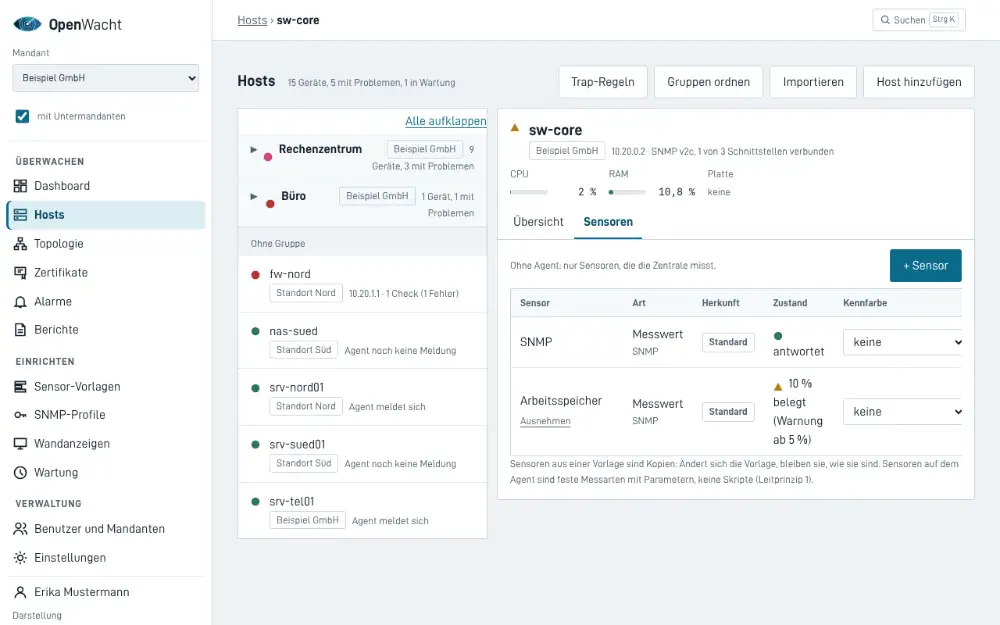
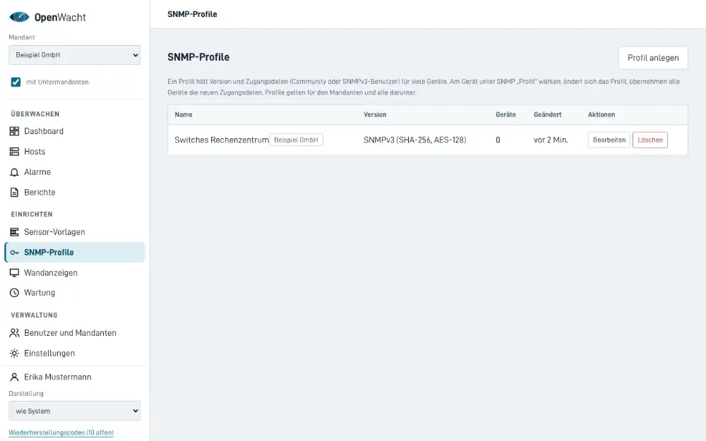
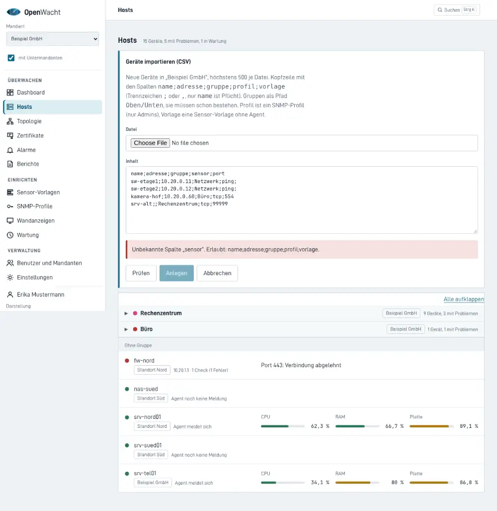

# 6. SNMP, Zugangsprofile und CSV-Import

## SNMP an einem Gerät

Am Gerät im Aktionsmenü „SNMP einrichten“ (oder bei „Host hinzufügen“ → „Per SNMP“): Adresse, Port (161), Takt,
Version und Zugangsdaten bzw. ein **Profil**.

- **v1/v2c:** Community. Sie wird im Klartext übertragen; die Oberfläche kennzeichnet das.
- **v3:** nur **authPriv** mit SHA-1/SHA-2 und AES-128/192/256. MD5 und DES gehen bewusst nicht.

Gelesen werden feste Werte (keine MIB-Dateien): Name, Laufzeit (Neustart), CPU, Arbeitsspeicher, Platten,
Schnittstellen mit Verkehr, Temperaturen, Toner, USV und RAID bei Synology. „Schnittstelle down“ alarmiert nur
für Ports, die man als überwacht markiert. Antwortet ein Gerät drei Intervalle nicht, gibt es „antwortet nicht“.

**Bild der Ports (ab 1.0.10):** Hat ein Gerät mindestens acht physische Ports, steht über der Tabelle der
Schnittstellen ein Bild wie die Frontplatte: zwei Reihen, ungerade Ports oben, gerade unten, Uplinks rechts abgesetzt.
Die Nummer zählt die physischen Ports in der Reihenfolge des Geräts; der Name des Geräts für den Port steht in den
Einzelheiten. Jeder Port zeigt seinen Zustand als Form und Farbe: verbunden, nicht verbunden, nicht verbunden und
überwacht (rot), abgeschaltet (gestrichelt). Ein Klick auf einen Port zeigt darunter Status, Geschwindigkeit, Verkehr
mit Verlauf und neue Fehler, und dort lässt sich der Port als überwacht markieren.

**PoE je Port:** Meldet das Gerät die POWER-ETHERNET-MIB, steht am Port „PoE“, wenn er Strom liefert, und „PoE!“ bei
einem PoE-Fehler. In den Einzelheiten legt „PoE-Sensor für diesen Port anlegen“ einen Sensor an, der kritisch wird,
sobald der Port keinen Strom mehr liefert, etwa für Access Points oder Kameras. OpenWacht ordnet den PoE-Port n der
Schnittstelle mit dem Index n zu; das stimmt bei üblichen Switchen mit einer PoE-Gruppe. Bei mehreren Gruppen (Stack)
bleibt PoE im Bild weg. Fragt ein Agent als Sammler das Gerät ab, braucht er dafür die Version 1.0.10.

**Nachbar je Port (ab 1.0.11):** Meldet das Gerät seine Nachbarn per LLDP, stehen in den Einzelheiten eines Ports unter
„Nachbar (LLDP)“ der Name des Nachbarn und dessen Port, etwa „sw-keller, Port GigabitEthernet 1/24“; derselbe Text
steht im Hinweis, wenn die Maus auf dem Port ruht. Gelesen werden aus der LLDP-Tabelle nur diese beiden Angaben,
je höchstens 64 Zeichen, und nur der aktuelle Stand ohne Verlauf. Ist die Portkennung des Nachbarn eine
MAC-Adresse, steht sie als solche da. Auch Telefone und PCs können sich per LLDP melden: Ihr Gerätename erscheint
dann ebenfalls. Fragt ein Agent als Sammler das Gerät ab, braucht er dafür die Version 1.0.11.

**Neustart:** Die Laufzeit kommt aus `hrSystemUptime` (Laufzeit des Rechners); nur wenn ein Gerät sie nicht liefert,
aus `sysUpTime`. Diese zählt nur den SNMP-Dienst und springt auch zurück, wenn nur er neu startet. Gemeldet wird ein
Neustart (15 Minuten Warnung) nur, wenn das Gerät **davor mindestens 27 Stunden** lief. Geplante nächtliche Neustarts,
etwa von Citrix-Workern oder Terminalservern, bleiben so still; ob ein geplanter Neustart ausgeblieben ist, prüft der
Sensor „Neustart verpasst“. Dieselbe Grenze gilt für Proxmox, NetApp, XenServer und FRITZ!Box.



Zugangsdaten liegen verschlüsselt in der Datenbank und sind an Gerät, Adresse und Port gebunden; ändert man die
Adresse, muss man sie neu eingeben (bei Profilen nicht, siehe unten).

## Zugangsprofile

**Einrichten → SNMP-Profile** (nur Admins): Version und Zugangsdaten einmal anlegen, an beliebig vielen Geräten nutzen.



- Ein Profil gilt für seinen Mandanten und alle darunter. Admins eines Untermandanten sehen Profile der Eltern nicht
  (an ihrem Gerät steht dann „Profil eines übergeordneten Mandanten“).
- **Zugangsdaten wechseln:** Profil bearbeiten und die neuen Daten eingeben. Alle Geräte mit dem Profil übernehmen sie
  sofort, in einer Transaktion (auch der Trap-Dienst). Die Geräte selbst vorher umstellen, sonst antworten sie nicht mehr.
- **Gerät lösen:** im SNMP-Formular „Eigene Zugangsdaten“. **Profil löschen:** Die Geräte behalten ihre Kopie.
- Hinweis: Profile sind nicht an eine Adresse gebunden (sonst wären sie nicht wiederverwendbar). Ein Admin kann ein
  Profil an jedes Gerät innerhalb der Netzfreigabe hängen.

## Geräte aus CSV importieren

**Hosts → Importieren** (Admins und Operatoren), Datei wählen oder Text einfügen. Aus Excel als „CSV UTF-8“ speichern.

```text
name;adresse;gruppe;profil;vorlage
switch-og1;10.20.0.21;Hauptsitz/Keller;Switche Hauptsitz;
nas-archiv;10.20.0.30;Hauptsitz;;std-ping
```

- Kopfzeile Pflicht, nur `name` muss darin stehen; Trennzeichen `;` oder `,`; höchstens 500 Zeilen, 256 KiB.
- Hat Excel jede Zeile als **ein** Feld in Anführungszeichen gespeichert (passiert, wenn fertige CSV-Zeilen in
  Spalte A eingefügt wurden), erkennt der Import das und liest den Inhalt der Felder. Einfacher: Text direkt ins
  Feld „Text einfügen“ kopieren oder die Datei im Editor als UTF-8 speichern.
- `gruppe` als Pfad `Hauptsitz/Keller`; die Gruppen müssen schon bestehen.
- `profil`: Name eines SNMP-Profils (nur Admins). Dann fragt die Zentrale per SNMP auf Port 161 alle 60 s ab.
- `vorlage`: Name einer Sensor-Vorlage oder ID einer eingebauten (`std-ping`). Keine Agent-Vorlagen.
- **Prüfen** zeigt je Zeile OK oder den Fehler. **Anlegen** geht erst, wenn alles fehlerfrei ist, und legt alles oder
  nichts an. Namen, die es im Mandanten schon gibt, werden abgelehnt: Ein zweiter Import legt nichts doppelt an.



## Traps

Der Trap-Dienst (eigener Prozess, Port 162/udp) nimmt v1/v2c-Traps und -Informs sowie v3 (authPriv) an. Zuordnung über
die Absenderadresse der SNMP-Quelle; unbekannte Absender werden verworfen. **Trap-Regeln** (Hosts → Trap-Regeln, nur
Admins) setzen je Trap-OID einen Zustand, Entwarnung per Gegen-Trap, nach Zeit oder von Hand. Das Trap-Protokoll hält
30 Tage. Traps gehen nur bei eingeschalteter Abfrage und nicht über einen Sammler.
