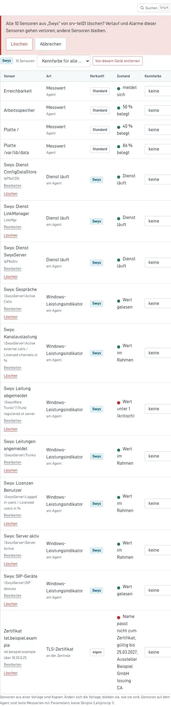
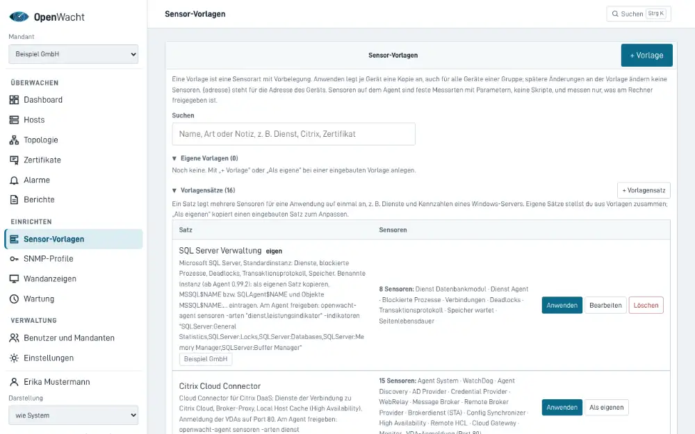
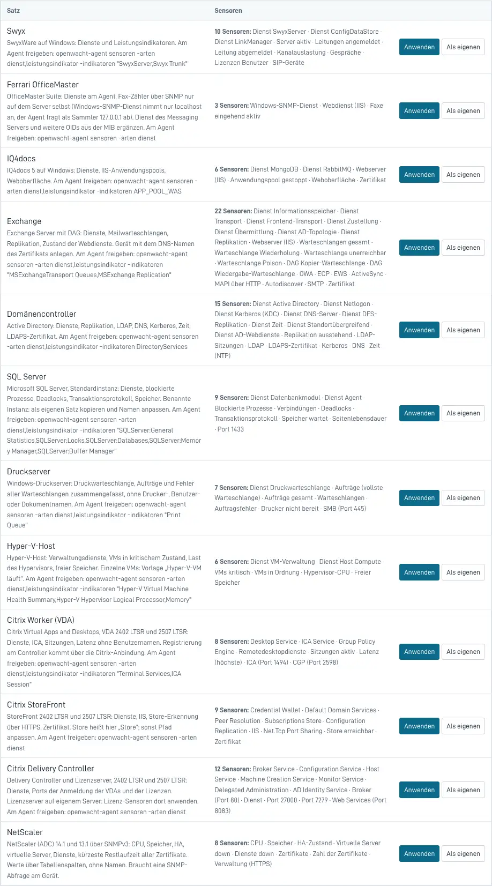
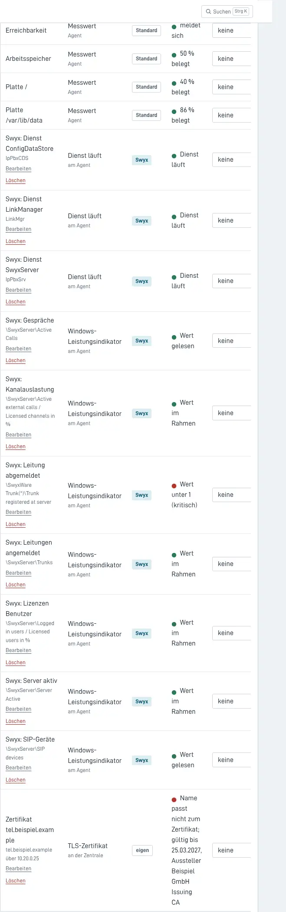
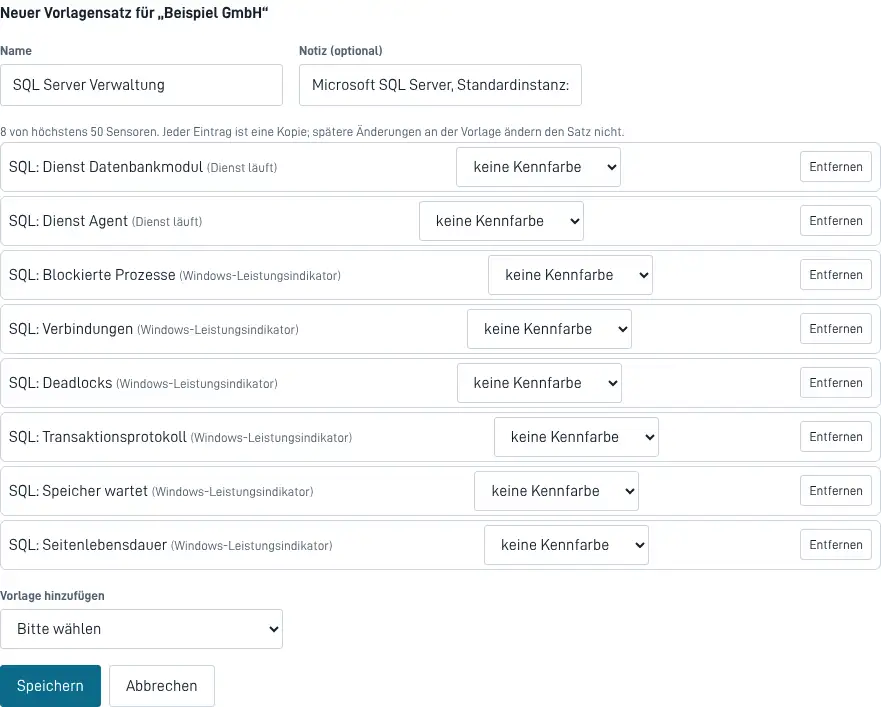
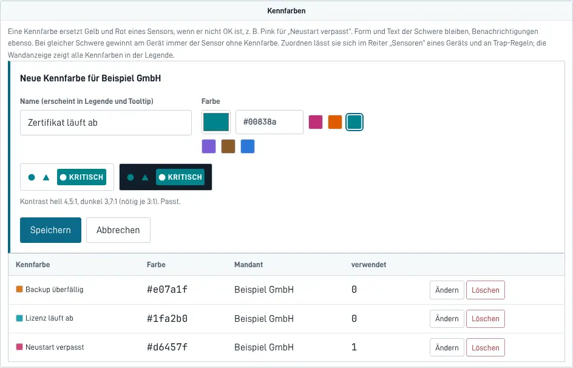

# 7. Sensoren und Vorlagen

## Sensoren

Am Gerät „Sensoren“ → **+ Sensor** (oder Aktionsmenü „Sensor hinzufügen“). Ohne Namen erzeugt OpenWacht einen aus Art
und Ziel („Ping“, „TCP 443“, „Zertifikat host“); Namen sind je Gerät eindeutig.

| Art | prüft | wo |
| --- | --- | --- |
| Ping | Erreichbarkeit, Verlust und Antwortzeit (mehrere Pakete) | Zentrale |
| TCP | Port offen | Zentrale |
| HTTP(S) | Statuscode, optional Text in der Antwort | Zentrale |
| TLS-Zertifikat | Restlaufzeit (Warnung/Fehler in Tagen) | Zentrale |
| DNS | Name löst auf (Resolver der Zentrale oder freigegebener Server) | Zentrale |
| HTTP-JSON | Zahl oder Text an einem Pfad in einer JSON-Antwort, mit Schwellen | Zentrale |
| TCP-Banner | erste Zeile eines Dienstes (z. B. SMTP 220), optional mit TLS | Zentrale |
| NTP | Zeitabweichung eines Zeitservers | Zentrale |
| SNMP-OID | eigener Wert per SNMP (Zahl, Zähler als Rate, Text nur als Prüfsumme) oder eine Tabellenspalte zusammengefasst | Zentrale/Sammler |
| Dienst, Prozess | läuft ein Dienst bzw. Prozess (nur Namen) | Agent, nach Freigabe |
| Datei/Ordner | Alter und Größe (z. B. letzte Sicherung), nie Inhalte oder Dateinamen | Agent, nach Freigabe |
| Docker | Zustand und Health eines Containers über einen nur-lesenden Socket-Proxy | Agent, nach Freigabe |
| Hyper-V | VM läuft (Name und Zustand) | Windows-Agent, nach Freigabe |
| Windows-Leistungsindikator | Zahl aus `\Objekt(Instanz)\Indikator` mit Schwellen, optional in Prozent eines zweiten Indikators | Windows-Agent, nach Freigabe je Objekt |

Alle Ziele der Zentrale müssen in der Netzfreigabe liegen ([Kapitel 2](02-erste-einrichtung.md#netzfreigabe)).
Agent-Sensoren laufen höchstens jede Minute; Messwerte vom Agent kommen gesammelt.

Agent-Sensoren sind **feste Messarten mit Parametern**, keine Skripte: Die Zentrale kann darüber nichts ausführen.

**Löschen** direkt im Reiter „Sensoren“: unter dem Namen „Löschen“, mit Bestätigung. Über der Tabelle
steht je Vorlage bzw. Vorlagensatz, aus dem Sensoren stammen, „Von diesem Gerät entfernen“: Das löscht alle Sensoren
dieser Herkunft am Gerät auf einmal (z. B. einen versehentlich angewandten Satz), andere Sensoren bleiben. Verlauf und
Alarme der gelöschten Sensoren gehen verloren; das Audit-Log nennt Satz, Zahl und Namen.

### SNMP-Tabellenspalten

Viele Geräte melden Zustände als Tabelle, je Zeile ein Zertifikat, ein virtueller Server oder eine Platte. Unter
„Abfrage“ fasst ein SNMP-OID-Sensor eine **Spalte** zusammen: kleinster Wert, größter Wert, Summe, Zahl der Zeilen,
Zeilen mit Wert gleich bzw. ungleich einem Vergleichswert. Als OID die Spalte ohne Index eintragen, z. B.
`1.3.6.1.4.1.5951.4.1.1.56.1.1.5` (Restlaufzeit der Zertifikate am NetScaler) mit „kleinster Wert“ und „Fehler unter
14“. Beispiel Zustand: Spalte `1.3.6.1.4.1.5951.4.1.3.1.1.5` (Zustand der virtuellen Server), „Zeilen mit Wert gleich“,
Vergleichswert 1 (down), „Fehler über 0“.

- Gelesen wird nur lesend (GETNEXT/GETBULK), höchstens 2000 Zeilen je Spalte; bei mehr steht „nur die ersten 2000
  Zeilen“ in der Meldung.
- Gemeldet und gespeichert werden nur die Kennzahlen, **nie die Indizes der Zeilen** (darin stehen oft Namen) und nie
  Texte.
- Zählen nach Werten geht nur bei Zustandsspalten mit höchstens 32 verschiedenen ganzen Zahlen.

## Vorlagen

**Einrichten → Sensor-Vorlagen**: Vorlagensätze (siehe unten), 20 eingebaute Vorlagen (Ping mit Verlust, HTTPS-Seite, TLS-Zertifikat, SSH-, SMB-, RDP- und
IMAPS-Port, DNS, NTP, SMTP- und SSH-Banner, Dienste, Docker, Backup-Datei, vzdump, Synology-Status und -Temperatur,
Hyper-V-VM) und eigene.

**Anwenden** legt auf ausgewählten Geräten oder einer ganzen Gruppe (optional mit Untergruppen, bis 300 Geräte) eine
**Kopie** an. `{adresse}` steht für die Adresse des Geräts. Übersprungen werden Geräte ohne Adresse bzw. ohne Agent,
nicht freigegebene Ziele und schon vergebene Namen. Spätere Änderungen an der Vorlage ändern bestehende Sensoren
nicht. „Als eigene“ macht aus einer eingebauten Vorlage eine eigene zum Anpassen.

## Vorlagensätze

Ein **Vorlagensatz** legt mehrere Sensoren für eine Anwendung auf einmal an. Eingebaut sind fünfzehn Sätze, vierzehn für
Windows-Server und einer für den NetScaler; jeder Sensor heißt „Satz: …“ und merkt sich den Satz als Herkunft.

| Satz | Sensoren | Freigabe am Rechner |
| --- | --- | --- |
| **Swyx** | Dienste SwyxServer, ConfigDataStore, LinkManager; Server aktiv; Leitungen angemeldet; Leitung abgemeldet (eine Leitung reicht für kritisch); Kanalauslastung (Warnung 80 %, kritisch 95 %); Gespräche; Benutzerlizenzen in Prozent (Warnung 90 %, kritisch 98 %); SIP-Geräte | `-arten "dienst,leistungsindikator" -indikatoren "SwyxServer,SwyxWare Trunk"` |
| **Ferrari OfficeMaster** | Windows-SNMP-Dienst, Webdienst (IIS), Faxe eingehend aktiv (SNMP-OID) | `-arten dienst`, dazu SNMP nur auf dem Rechner ([Kapitel 5](05-agent.md#snmp-nur-auf-dem-rechner-selbst-z-b-ferrari-officemaster)) |
| **Exchange** | Dienste Informationsspeicher, Transport, Frontend-Transport, Zustellung, Übermittlung, AD-Topologie, Replikation, IIS; Warteschlangen intern und extern (Warnung 500, kritisch 3000), Wiederholung intern, extern und unerreichbar (50/100), Poison (soll 0 sein, ab 5 kritisch); DAG Kopier- und Wiedergabe-Warteschlange (höchster Wert aller Kopien); Zustand von OWA, ECP, EWS, ActiveSync, MAPI und Autodiscover über `healthcheck.htm`; SMTP-Banner; Zertifikat | `-arten "dienst,leistungsindikator" -indikatoren "MSExchangeTransport Queues,MSExchange Replication"` |
| **Domänencontroller** | Dienste NTDS, Netlogon, KDC, DNS-Server, DFS-Replikation, Zeit, Intersite Messaging, AD-Webdienste; ausstehende Replikationen (Warnung 10, kritisch 50); LDAP-Sitzungen; von der Zentrale LDAP (389), LDAPS-Zertifikat (636), Kerberos (88), DNS (53), Zeitabweichung (NTP) | `-arten "dienst,leistungsindikator" -indikatoren DirectoryServices` |
| **SQL Server** | Dienste Datenbankmodul und Agent (Standardinstanz); blockierte Prozesse (5/20), Verbindungen, Deadlocks je Sekunde (0,1/1), vollstes Transaktionsprotokoll (80 %/95 %), wartende Speicheranforderungen, Seitenlebensdauer (Warnung unter 300 s); Port 1433 | `-arten "dienst,leistungsindikator" -indikatoren "SQLServer:General Statistics,SQLServer:Locks,SQLServer:Databases,SQLServer:Memory Manager,SQLServer:Buffer Manager"` |
| **IQ4docs** | Dienste `IQ4docsMongoDB`, `IQ4docsRabbitMQ`, Fleet Agent (`iq4dService`) und Watchdog (`iq4dWatchdog`), IIS; Anwendungspool gestoppt; Weboberfläche (HTTPS); Zertifikat | `-arten "dienst,leistungsindikator" -indikatoren APP_POOL_WAS` |
| **Druckserver** | Druckwarteschlange (Spooler); Aufträge in der vollsten Warteschlange (Warnung 25, kritisch 100); Aufträge gesamt; Zahl der Warteschlangen (kritisch bei 0); Auftragsfehler und „nicht bereit“ seit Dienststart; SMB (445) | `-arten "dienst,leistungsindikator" -indikatoren "Print Queue"` |
| **Hyper-V-Host** | Dienste VM-Verwaltung (vmms) und Host Compute; VMs in kritischem Zustand (ab 1 kritisch); VMs in Ordnung; Auslastung des Hypervisors (80 %/95 %); freier Arbeitsspeicher (Warnung unter 4096 MB, kritisch unter 1024 MB) | `-arten "dienst,leistungsindikator" -indikatoren "Hyper-V Virtual Machine Health Summary,Hyper-V Hypervisor Logical Processor,Memory"` |
| **Citrix Worker (VDA, Agent)** | Desktop Service, Group Policy Engine, Remotedesktopdienste; aktive Sitzungen; höchste Sitzungslatenz (200/500 ms); Neustart verpasst (Laufzeit über 26 Stunden); Ping; ICA (1494) und Sitzungszuverlässigkeit (2598) | `-arten "dienst,leistungsindikator" -indikatoren "Terminal Services,ICA Session,System"` |
| **Citrix Worker (VDA, SNMP)** | ohne Agent: CPU, Arbeitsspeicher, Platten und Neustart aus der SNMP-Abfrage des Geräts; Neustart verpasst über `hrSystemUptime` (über 26 Stunden); Ping; ICA (1494) und Sitzungszuverlässigkeit (2598). Für Worker aus PVS/MCS: SNMP einmal im Master-Image einrichten | keine; am Worker Windows-Feature „SNMP-Dienst“, Community nur lesen, nur die Zentrale zulassen (nur v1/v2c) |
| **Citrix StoreFront** | Credential Wallet, Default Domain Services, Peer Resolution, Subscriptions Store, Configuration Replication, IIS, Net.Tcp Port Sharing; Store-Erkennung `https://…/Citrix/Store/discovery`; Zertifikat (30/14 Tage) | `-arten dienst` |
| **Citrix Delivery Controller** | Broker, Configuration, Host, Machine Creation, Monitor, Delegated Administration, AD Identity; Port 80 (Anmeldung der VDAs); Lizenzserver: Dienst Citrix Licensing, Ports 27000, 7279, 8083 | `-arten dienst` |
| **Citrix Cloud Connector** | Dienste Agent System, WatchDog, Agent Discovery, AD Provider, Credential Provider, WebRelay, Message Broker, Remote Broker Provider (`XaXdCloudProxy`), STA, Config Synchronizer, High Availability (Local Host Cache), Remote HCL, Cloud Gateway, Monitor; VDA-Anmeldung auf Port 80 | `-arten dienst` |
| **Citrix Provisioning** | Dienste Stream Service, SOAP Server, API, TFTP, PXE, Two-Stage Boot; SOAP-Port 54321 | `-arten dienst` |
| **NetScaler** | über SNMP: CPU (80 %/95 %), Speicher (80 %/90 %), HA-Zustand, virtuelle Server down (ab 1 kritisch), Dienste down (Warnung ab 1), **kürzeste Restlaufzeit aller Zertifikate** (Warnung 30, kritisch 14 Tage), Zahl der Zertifikate; Zertifikat der Verwaltung | keine; SNMPv3 am Gerät ([Kapitel 6](06-snmp.md)) |

Hinweise:

- Namen von Diensten und Indikatoren stammen aus der Doku der Hersteller (Stand 11/2026), die von Swyx aus
  einer echten Installation (`Get-Counter -ListSet SwyxServer`, `Get-Counter -ListSet "SwyxWare Trunk"`). Heißt das
  Objekt der Leitungen bei einer anderen Version „Swyx Trunk“, den Sensor anpassen und das Objekt so freigeben.
  Welche Namen es gibt, zeigt `Get-Counter -ListSet <Objekt>` auf dem Server; englische Namen stehen in der Registry
  unter `HKLM:\SOFTWARE\Microsoft\Windows NT\CurrentVersion\Perflib\009` (Wert `Counter`).
- In PowerShell die Liste hinter `-arten` in Anführungszeichen setzen (`-arten "dienst,leistungsindikator"`): Ohne sie
  übergibt PowerShell zwei Argumente, und der Agent meldet „unerwartetes Argument“.
- Für Ferrari nennt die Doku den Dienst des Messaging Servers und die OID der Fax-Warteschlange nicht. Beides am Server
  ablesen (`Get-CimInstance Win32_Service | Where-Object PathName -like '*FFUMS*'` bzw. MIB unter
  `C:\Program Files\FFUMS\snmp\MIB`) und als eigene Sensoren ergänzen. Das Checkmk-Plugin von Ferrari fragt mit einem
  Administratorkonto ab; diesen Weg nutzt OpenWacht bewusst nicht.
- **Exchange:** Das Gerät mit dem DNS-Namen anlegen, auf den das Exchange-Zertifikat lautet (z. B. `mail.beispiel.example`),
  sonst schlagen die HTTPS-Sensoren an der Namensprüfung fehl; bei einer eigenen CA diese am Sensor hinterlegen.
  `healthcheck.htm` meldet 200, solange Exchange (Managed Availability) den Dienst für gesund hält, sonst 404. Der Satz
  ist für Server in einer DAG gedacht; bei verzögerten Kopien (Lag) die Schwellen der Wiedergabe-Warteschlange anheben.
  Namen von Postfächern, Datenbanken und Warteschlangen liest OpenWacht nicht; die DAG-Werte sind der höchste Wert aller
  Kopien auf dem Server. Die Schwellen der Warteschlangen sind Startwerte für kleine und mittlere Umgebungen.
- **Domänencontroller:** Die Sensoren „DNS-Server“ und „DNS (53)“ nur auf DCs, die auch DNS-Server sind. Der Indikator
  stammt aus dem Objekt „DirectoryServices“ (Instanz NTDS, ab Windows Server 2012 R2).
- **SQL Server:** Der Satz gilt für die **Standardinstanz**. Bei einer benannten Instanz heißen Dienst und Objekte anders
  (`MSSQL$NAME`, `SQLAgent$NAME`, `MSSQL$NAME:General Statistics` …): den Satz mit „Als eigenen“ kopieren, die betroffenen
  Vorlagen als eigene Vorlagen anpassen und im Satz austauschen. SQL Server Express hat keinen Agent.
- „Anwendungspool gestoppt“ prüft **alle** Pools: Absichtlich gestoppte Pools (z. B. DefaultAppPool) am Server entfernen
  oder den Sensor auf einzelne Pools (Instanz = Name des Pools) ändern.
- **Druckserver:** Warteschlangen zählt OpenWacht nur zusammen; Namen von Druckern, Benutzern und Dokumenten liest es
  nicht. Die Fehlerzähler laufen seit dem Start des Dienstes hoch und sind deshalb nur Anzeige; Ausfälle eines Druckers
  zeigt die Zahl der Aufträge in der vollsten Warteschlange.
- **Hyper-V-Host:** Einzelne VMs prüft weiter die Vorlage „Hyper-V-VM läuft“. Die Schwellen für freien Speicher an die
  Größe des Hosts anpassen.
- **Citrix:** Die Sätze gelten für 2402 LTSR und 2507 LTSR; Dienste mit Leerzeichen im Namen sind Anzeigenamen, die
  der Agent selbst auflöst. Die Registrierung der VDAs und fehlgeschlagene Verbindungen sieht nur der Controller, dafür
  kommt eine eigene Citrix-Anbindung. „Profile Management“ ist nicht im Satz, weil es nicht überall eingesetzt wird.
  StoreFront: Das Gerät mit dem Namen anlegen, auf den das Zertifikat lautet; heißt der Store nicht „Store“, die URL
  anpassen. Liegt der Lizenzserver auf einem eigenen Server, die vier Lizenz-Sensoren dort anlegen und am Controller
  löschen.
- **NetScaler:** Das Gerät mit SNMPv3 (authPriv) abfragen; am NetScaler eine Ansicht nur zum Lesen
  (`add snmp view`), eine Gruppe mit `authPriv` und `-readViewName` und einen Benutzer in dieser Gruppe anlegen, dazu
  die Zentrale bzw. den Sammler als SNMP-Manager eintragen. Die Zertifikats-Sensoren sehen **alle** Zertifikate auf dem
  NetScaler, auch solche, die an keinen virtuellen Server gebunden sind, aber nur die kürzeste Restlaufzeit, keine
  Namen. Welches Zertifikat abläuft, zeigt der NetScaler selbst (Traffic Management → SSL → Zertifikate). Den
  HA-Sensor nur bei einem HA-Paar behalten.
- Drucker hinter IQ4docs überwacht OpenWacht weiter über SNMP ([Kapitel 6](06-snmp.md)). Druckaufträge, Benutzer- und
  Dokumentnamen liest OpenWacht nicht.

## Eigene Vorlagensätze

Unter **Einrichten → Sensor-Vorlagen → Vorlagensätze** legt „+ Vorlagensatz“ einen eigenen Satz für den gewählten
Mandanten an, z. B. „Standard-Windows-Server“. Einträge kommen aus eigenen Vorlagen, eingebauten Vorlagen und den
Sensoren der eingebauten Sätze; „Als eigenen“ kopiert einen eingebauten Satz zum Anpassen. Höchstens 50 Sensoren je Satz
und 50 Sätze je Mandant.

- Jeder Eintrag ist eine **Kopie**: Ändert man später eine Vorlage, bleibt der Satz unverändert, ebenso angelegte
  Sensoren, wenn man den Satz ändert oder löscht.
- Rechte wie bei eigenen Vorlagen: Sehen und anwenden können alle mit Rolle im Mandanten des Satzes oder darüber;
  anlegen, ändern und löschen Operatoren und Admins. Untermandanten sehen die Sätze ihrer Eltern nicht.
- Um einen Eintrag zu ändern (z. B. einen Dienstnamen), die Vorlage als eigene Vorlage anpassen, den alten Eintrag im
  Satz entfernen und die eigene Vorlage hinzufügen.

## Kennfarben

Eine **Kennfarbe** ist ein Name mit einer frei gewählten Farbe, z. B. „Neustart verpasst“ in Pink. Ist ein Sensor mit
Kennfarbe nicht OK, erscheint er in dieser Farbe statt in Gelb bzw. Rot: in der Sensorliste, unter Alarme, im Signal von
Gerät und Gruppe, im Dashboard und auf der Wandanzeige.

- **Anlegen** unter Einrichten → Sensor-Vorlagen → Kennfarben (Operatoren und Admins, im gewählten Mandanten). Die
  Farbe ist frei wählbar, braucht aber auf hellem und dunklem Grund je mindestens 3:1 Kontrast; die Vorschau zeigt beide.
  Sehr helle Töne (Zitronengelb) und sehr dunkle (Nachtblau) lehnt die Zentrale ab.
- **Zuordnen** im Reiter „Sensoren“ eines Geräts, Spalte „Kennfarbe“: für eigene Sensoren und für die eingebauten
  Messwerte von Agent und SNMP (Erreichbarkeit, Speicher, Platten, Schnittstellen …). An **Trap-Regeln** mit Wirkung
  Warnung oder Kritisch gilt die Kennfarbe für alle Zustände und Protokolleinträge der Regel.
- **Für eine ganze Herkunft:** Im Reiter „Sensoren“ steht je Vorlage bzw. Vorlagensatz „Kennfarbe für alle …“. Danach
  wählt man „Nur auf <Gerät>“ oder „Auf allen Geräten“ (alle Geräte, deren Sensoren man ändern darf). Sensoren in
  Mandanten, zu denen die Kennfarbe nicht passt, bleiben unverändert; die Meldung nennt ihre Zahl.
- **Im eigenen Vorlagensatz:** Jeder Eintrag kann eine Kennfarbe tragen (Kennfarbe des Mandanten des Satzes oder eines
  übergeordneten). Beim Anwenden bekommt der neue Sensor sie mit.
- **Was bleibt:** Form und Text der Schwere (Dreieck = Warnung, Achteck = kritisch) und die Schwere für
  Benachrichtigungen. OK, Unbekannt, Wartung und Pausiert zeigen nie eine Kennfarbe.
- **Rot gewinnt immer:** Hat ein Gerät mehrere Probleme gleicher Schwere, zeigt es die Farbe ohne Kennfarbe. Eine
  schlimmere Schwere gewinnt trotz Kennfarbe (ein pinker kritischer Sensor steht über einer gelben Warnung). Dasselbe
  gilt für Gruppen und Mandanten.
- **Rechte:** Kennfarben eines Mandanten sehen alle, die ihn, einen Mandanten darunter oder darüber sehen;
  Geschwister nicht. Zuordnen lässt sich eine Kennfarbe nur im eigenen Mandanten oder darunter. Löschen nimmt die
  Farbe von allen Sensoren und Regeln, die Sensoren bleiben. Anlegen, Ändern, Löschen und Zuordnen stehen im Audit-Log.

## Schwellen

Platte und Arbeitsspeicher: Warnung ab 90 %, kritisch ab 95 %; CPU (Mittel über 15 Minuten): 90 % und 98 %;
Entwarnung jeweils 2 Punkte darunter. Ändern lassen sich die Schwellen für die ganze Installation (Einstellungen), je
Mandant und je Gerät (Aktionsmenü „Schwellen …“).
