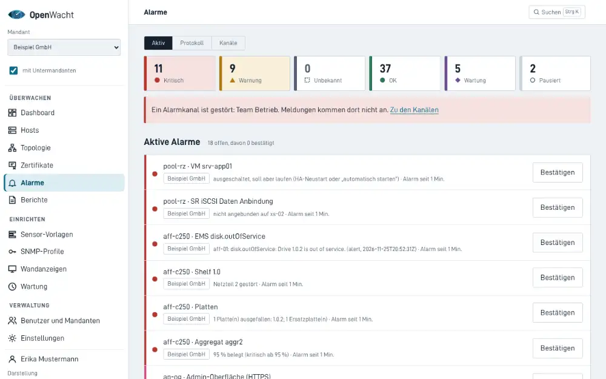
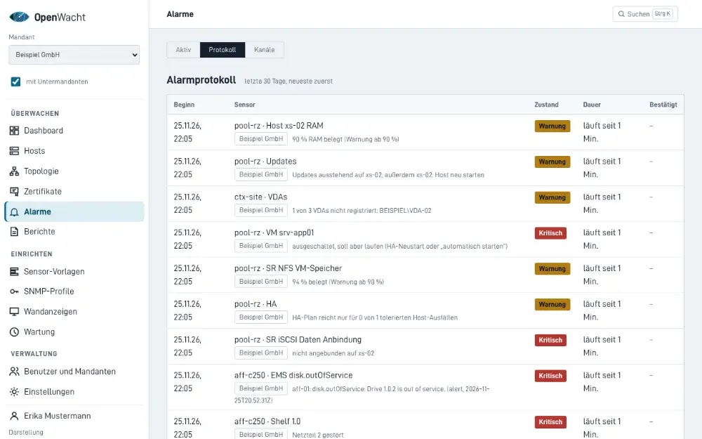
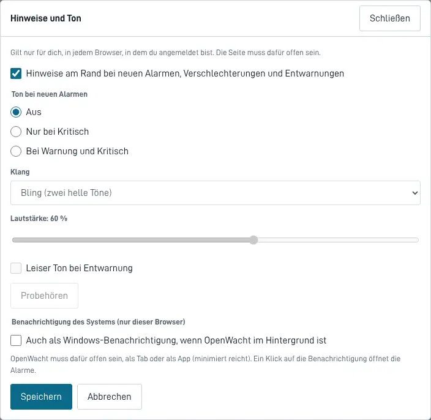
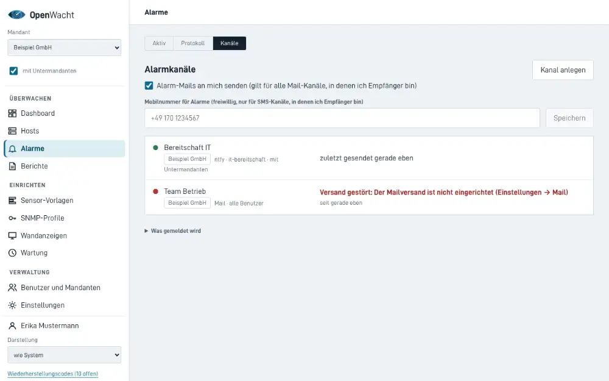
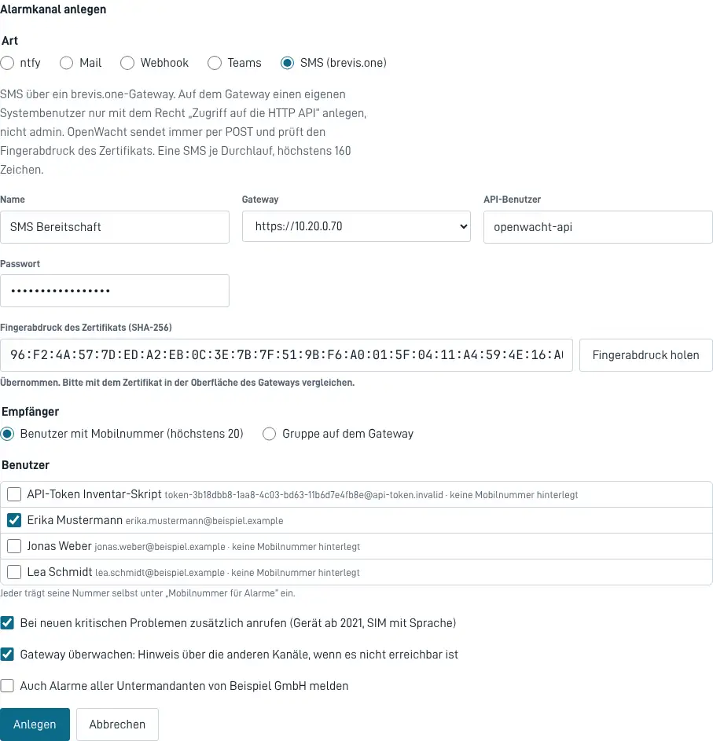
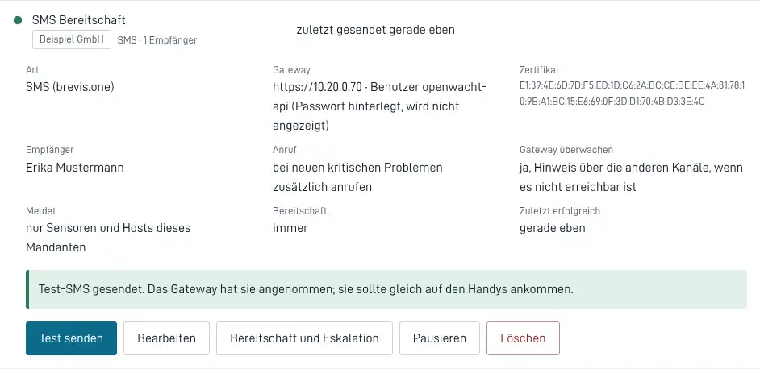
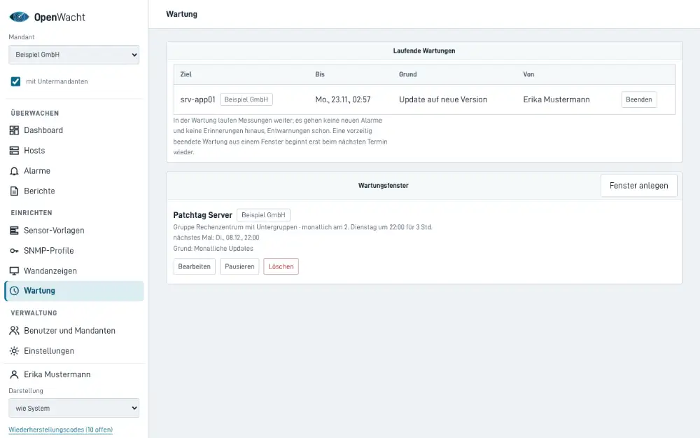

# 8. Alarme und Wartung

## Aktive Alarme

**Alarme → Aktiv** zeigt offene Alarme mit „Bestätigen“ (Operatoren und Admins, mit optionalem Kommentar) und alle
Sensoren, die nicht OK sind. Bestätigte Alarme erinnern nicht mehr, bleiben aber offen, bis das Problem weg ist.

**Alarme → Protokoll:** alle Alarme der letzten 30 Tage mit Dauer und wer bestätigt hat.

## Hinweise über den Alarmen

Über „Aktiv“ und „Protokoll“ stehen Hinweise, die kein einzelner Sensor ist:

- **Alarme unterdrückt seit …:** Geräte, die von einem ausgefallenen Elterngerät abhängen (Kapitel 4), melden keine
  eigenen Alarme. Der Hinweis nennt das Elterngerät, seit wann es ausgefallen ist und welche Geräte ruhen. Hält das
  **7 Tage** an, geht zusätzlich ein Hinweis an die Alarmkanäle des Mandanten der ruhenden Geräte („Alarme seit 8 Tagen
  unterdrückt“), damit eine vergessene Abhängigkeit nicht still alle Alarme schluckt. Entwarnung, sobald das Elterngerät
  wieder erreichbar ist oder die Abhängigkeit entfernt wird.
- **Zentrale: …** (nur für den Betreiber): Meldungen der Zentrale über sich selbst, siehe „Selbstüberwachung“ unten.

Hinweise kennen kein Bestätigen und keine Wartung: eine Meldung beim Auftreten, eine bei einem Wechsel zwischen Warnung
und Fehler und eine Entwarnung.

## Hinweise am Rand und Ton

Unten in der Leiste öffnet **Hinweise und Ton** die eigenen Einstellungen. Sie gelten nur für dich, in jedem Browser, in
dem du angemeldet bist, und nur, solange OpenWacht offen ist. Auch Leser stellen das für sich ein.

- **Hinweise am Rand** (ab Werk an): Unten rechts erscheint ein kurzer Hinweis bei einem neuen Alarm, wenn ein Alarm
  schlimmer wird (Warnung → Kritisch) und bei einer Entwarnung. Ein Klick führt zu den aktiven Alarmen. Hinweise
  verschwinden nach einigen Sekunden (Kritisch nach 20), nicht, solange die Maus darauf liegt. Bestätigte Alarme melden
  sich nicht. Traps mit der Wirkung Warnung oder Kritisch sind Alarme und erscheinen ebenso.
- **Ton** (ab Werk aus): aus, nur bei Kritisch oder bei Warnung und Kritisch. Klang Bling, Gong oder Doppelton,
  Lautstärke und auf Wunsch ein leiser Ton bei Entwarnung. „Probehören“ spielt den Klang. Die Klänge erzeugt der Browser
  selbst; Dateien werden nicht geladen. Browser spielen Ton erst, nachdem die Seite einmal angeklickt wurde.

- **Windows-Benachrichtigung** (1.0.3, je Browser, ab Werk aus): Ist OpenWacht im Hintergrund (anderes Fenster vorn,
  minimiert), zeigt der Browser dieselben Ereignisse zusätzlich als Benachrichtigung des Systems, unter Windows unten
  rechts im Infobereich. Ab vier Ereignissen auf einmal kommt eine zusammengefasste. Ein Klick holt OpenWacht nach vorn
  und öffnet die Alarme. Beim Einschalten fragt der Browser einmal nach der Erlaubnis; hat er sie gesperrt, lässt sie
  sich über das Schloss links in der Adressleiste → Berechtigungen → Benachrichtigungen wieder erlauben. Das geht nur
  über HTTPS, und OpenWacht muss offen sein.

**Als App installieren:** In Edge und Chrome lässt sich OpenWacht als eigene App mit Fenster und Eintrag im Startmenü
installieren: Symbol „App installieren“ rechts in der Adressleiste, bzw. Menü (⋯) → Apps → „OpenWacht installieren“,
oder der Knopf **Als App installieren** im Dialog, wenn der Browser es anbietet. Die App ist dieselbe Oberfläche mit
derselben Anmeldung; minimiert kommen die Windows-Benachrichtigungen weiter. Entfernen: in der App Menü → „OpenWacht
deinstallieren“ bzw. Windows-Einstellungen → Apps.

### Desktop-App für Windows (ab 1.0.4)

`openwacht-desktop.exe` (aus dem Build, `openwacht-desktop_windows_amd64.exe` bzw. `_arm64`) zeigt OpenWacht im
Infobereich neben der Uhr, **auch ohne offenes Browserfenster**:

- Das **Symbol** trägt den schlimmsten offenen, nicht bestätigten Alarm, als Form und Farbe wie in der Oberfläche (Kreis
  OK, Dreieck Warnung, Achteck kritisch, gestricheltes Quadrat unbekannt, leerer Ring: keine Verbindung). Der Tooltip
  nennt die Zahlen.
- **Benachrichtigungen von Windows** bei neuen Alarmen, Verschlechterungen und Entwarnungen (ab vier auf einmal eine
  zusammengefasste); ein Klick öffnet die Alarme im Browser.
- **Menü** (Rechtsklick aufs Symbol): OpenWacht öffnen (Fenster), im Browser öffnen, Alarme im Browser, jetzt prüfen,
  mit Windows starten (mit Rückmeldung), einrichten, beenden.

#### Fenster wie die Weboberfläche (ab 1.0.6)

Ein Start der Datei (oder Linksklick aufs Symbol) öffnet das Fenster, **ohne Browser**; startet die App mit Windows,
bleibt sie nur im Infobereich. Startet man sie ein zweites Mal, kommt das offene Fenster nach vorn. Das Fenster ist
aufgebaut wie die Weboberfläche, damit niemand zwei Oberflächen lernen muss: gleiche Seitenleiste, gleiche Piktogramme,
Farben, Schriften (D-DIN, JetBrains Mono) und Zustandsformen.

- **Seitenleiste links** wie im Browser: Wortmarke, **Mandant** mit „mit Untermandanten“, darunter Überwachen,
  Einrichten und Verwaltung. **Dashboard, Hosts, Topologie, Zertifikate, Alarme, Berichte und Wartung**
  sind Seiten der App; Sensor-Vorlagen, SNMP-Profile, Wandanzeigen sowie Benutzer und Mandanten tragen einen Pfeil
  und öffnen die Seite für denselben Mandanten im Browser. Unten: Konto bzw. Token und Rolle, Zentrale, Verbindung mit Stand, **Darstellung**
  (wie System, Hell, Dunkel) und **Abmelden**. Mandant, Schalter und Darstellung merkt sich die App.
- **Kopf** mit Brotkrumen („Dashboard › web01“), Knöpfen der Seite („Host hinzufügen“, „Im Browser öffnen“) und der
  **Suche** (Strg+K oder Strg+F; filtert die Sensoren nach Gerät, Sensor und Meldung).
- **Dashboard:** links das **Sonnendiagramm** wie das Widget im Web, dauerhaft sichtbar: innen der Mandant, nach außen
  Untermandanten, Gruppen und Geräte, jedes Gerät gleich breit, mit Problem tritt es hervor, Namen entlang des Bogens
  bzw. des Strahls. Rechts daneben die **Übersicht** wie bei der Wandanzeige: Geräte je Zustand als Kacheln und
  „Aktuell“ mit den Geräten, die ein Problem haben. Ein Klick auf ein **Gerät** (in der Sonne oder unter „Aktuell“)
  öffnet daneben seine **Sensoren**; die Sonne bleibt stehen, × oder Esc schließt wieder. Ein Klick auf eine Gruppe
  zeigt sie als Sonne, ein Klick in die Mitte geht eine Ebene zurück. **Kennfarben** gelten wie in der Wandanzeige:
  Ein Gerät mit Warnung, Kritisch oder Bestätigt steht in der Kennfarbe seines Sensors, bestätigt abgedunkelt; bei
  gleicher Schwere gewinnt der Zustand ohne Kennfarbe („Rot gewinnt immer“). Unter „Aktuell“ steht der Name der
  Kennfarbe vor dem Pfad, in der Sensorliste trägt die Zustandsform die Kennfarbe; die Form selbst bleibt.
- **Hosts:** links der Baum (Mandant, Untermandanten, Gruppen, Geräte) mit der Form des schlimmsten Zustands und den
  Zahlen der kritischen, gewarnten und unbekannten Sensoren, rechts das Gewählte.
- **Alarme:** alle Sensoren mit Warnung, Kritisch oder Unbekannt im gewählten Mandanten, schlimmste zuerst.
- **Wartung:** wie die Seite im Browser „Laufende Wartungen“ (Ziel, bis, Grund, von) mit **Beenden** und darunter die
  **Wartungsfenster** mit Ziel, Wiederholung, nächstem Termin bzw. „läuft bis …“ und den Knöpfen **Pausieren** bzw.
  **Fortsetzen** und **Löschen** (mit Rückfrage; eine laufende Wartung aus dem Fenster endet sofort). „Fenster anlegen“
  und „Bearbeiten“ öffnen das Formular im Browser. Die Suche filtert nach Ziel, Name und Grund; die Seite fragt alle
  30 s neu ab.
- **Zertifikate:** alle Sensoren „TLS-Zertifikat“ im Bereich, das zuerst ablaufende oben, mit Zustand, Adresse, Gerät,
  Ablaufdatum, Rest und Aussteller bzw. Hinweis; umschalten zwischen Alle, Bald fällig (14, 30, 60 oder 90 Tage) und
  Mit Problem. Ein Klick aufs Gerät öffnet es unter Hosts.
- **Berichte:** Monat wählen, Kennzahlen, Verfügbarkeit je Mandant und je Gerät, Alarme mit den längsten, Kapazität.
  **Als PDF** legt den Bericht in den Ordner Downloads und öffnet ihn. Admins setzen hier das SLA-Ziel des Mandanten.
- **Topologie:** die Abhängigkeiten („hängt ab von“) als Bäume je Mandant wie im Web: Karte je Gerät mit Form und
  Farbe, die Linie links an einem Kind in seinem Zustand, gestrichelt, wenn es ruht, unbekannt oder ungeprüft ist. Ein
  Klick öffnet das Gerät unter Hosts.
- **Gerät bzw. Auswahl:** oben Name, Adresse, Gruppe, Agent und Wartung mit Marken je Zustand („nur ansehen (Rolle
  Leser)“, wo die Rolle nur lesen darf), darunter die Befehle „+ Sensor“, „Jetzt abfragen“, „Alarm bestätigen …“,
  „Wartung …“, „Pausieren“, rechts „Nur Probleme“ und „Mehr“ (was nicht in die Zeile passt, steht dort). Die
  **Sensorliste** zeigt das Schlimmste zuerst, ein Klick auf die Überschrift sortiert; ist sie schmal, entfallen Typ,
  „seit“ und Wert. **Darunter** die Einzelheiten des gewählten Sensors (Meldung, Typ, Ziel, Intervall, Wert, letzte
  und nächste Abfrage, Wartung, Alarm) bzw. des Geräts; der Teiler darüber lässt sich ziehen.
- **Pflegen** über die Befehle, Rechtsklick oder Tasten: Gerät hinzufügen, bearbeiten (Name, Adresse, Gruppe) und
  löschen; Sensor hinzufügen (Strg+N), bearbeiten (Doppelklick, F2), jetzt abfragen, pausieren und fortsetzen, löschen
  (Entf); Wartung für Gerät oder Sensor setzen und beenden; offenen Alarm mit Kommentar bestätigen; F5 fragt sofort ab.
  Der Sensor-Dialog bietet je Typ genau die Felder der Weboberfläche, Adresse bzw. URL sind mit der des Geräts vorbelegt.
  Löschen fragt immer nach („Sensor löschen?“); ein Gerät mit Inhalt löscht die App nur nach Eingabe seines Namens, wie im
  Browser.
- Werte des Agents und der SNMP-Abfrage (CPU, Platten, Schnittstellen …) zeigt die Liste mit; ihre Grenzen und Vorlagen,
  Benutzer, Alarmwege und alle Einstellungen bleiben in der Weboberfläche.

**Anmelden (ab 1.0.6 zwei Wege):** Beim ersten Start öffnet sich **„Bei OpenWacht anmelden“** mit der Adresse der
Zentrale (wie im Browser, nicht Port 8444) und der Wahl **„Anmelden mit“**:

- **Konto (wie im Browser, ab Werk):** E-Mail und Passwort, danach der Code aus der Authenticator-App (oder ein
  Wiederherstellungscode). Die App führt dieselbe Sitzung wie der Browser und darf damit **genau, was das Konto im Web
  darf**, auch als Admin; heikle Änderungen verlangen wie im Web einen frischen Code. Die Zentrale schreibt alles unter
  dem Namen des Kontos ins Audit-Log. Passwort und Sitzung speichert die App nicht: Nach einem Neustart der App, nach
  30 Minuten ohne Abfrage oder spätestens nach 12 Stunden (Einstellungen der Zentrale) meldet man sich neu an; die App
  fragt dann von selbst („Die Sitzung ist abgelaufen.“). Gespeichert wird nur die E-Mail-Adresse. Passkey und SSO gehen
  nur im Browser; ein Konto, das die Zwei-Faktor-Anmeldung erst einrichten muss, richtet sie zuerst im Browser ein.
- **API-Token:** für einen Rechner, der nur im Infobereich wacht und auch nach Neustarts ohne Anmeldung melden soll. Das
  Token legt man unter **Benutzer und Mandanten › API-Tokens** an, Rolle **Operator** zum Pflegen oder **Leser** nur zum
  Ansehen ([Kapitel 11](11-api-tokens.md)); Admin-Rechte bekommt ein Token nie. Ein Operator-Token ist so mächtig wie
  ein Operator-Konto ohne zweiten Faktor: nur auf dem eigenen Rechner und mit kurzer Laufzeit. Es liegt in der
  **Windows-Anmeldeinformationsverwaltung** (Eintrag „OpenWacht Desktop“), nie in einer Datei.

Die App prüft die Anmeldung sofort und nennt die Ursache, wenn es nicht klappt (Passwort, Code, Token unbekannt oder
abgelaufen, Zertifikat, keine Verbindung). Adresse, Art der Anmeldung, E-Mail und Darstellung stehen in
`%APPDATA%\OpenWacht\desktop.json`. **Abmelden** (Seitenleiste unten) beendet die Sitzung auch auf der Zentrale bzw.
vergisst das Token und öffnet die Anmeldung wieder; Rechtsklick aufs Symbol → „Anmeldung ändern …“ wechselt ohne
Abmelden. `openwacht-desktop entfernen` löscht Token, Einstellungen und Autostart. Die App ist eine einzelne Datei ohne
Installation, z. B. nach `%LOCALAPPDATA%\Programs\OpenWacht\` kopieren und starten.

**Was die App ändern darf, bestimmt die Rolle** des Kontos bzw. des Tokens je Mandant: Leser nur ansehen (die Knöpfe
sind dann grau), Operator Geräte, Sensoren, Wartung und Alarme, Admin dazu die Verwaltung. Die Zentrale prüft jede
Änderung selbst, schreibt sie ins Audit-Log und meldet Fehler im Dialog, z. B. „Intervall: 30 Sekunden bis 1 Tag.“
Schließen versteckt das Fenster nur; die App läuft im Infobereich weiter.

Die App fragt alle 30 Sekunden `GET /api/v1/alarme` ab, bei offenem Fenster zusätzlich Mandanten, Gruppen, Geräte,
Sensoren und Checks, nur über HTTPS und ohne Weiterleitungen zu folgen. Das Zertifikat der Zentrale muss Windows vertrauen
(z. B. Firmen-CA). Sie ist wie der Windows-Agent nicht Authenticode-signiert: SmartScreen warnt beim ersten Start, und ein
Virenschutz braucht ggf. eine Ausnahme. Ab 1.0.6 trägt die Datei eine Programmbeschreibung (Eigenschaften → Details:
„OpenWacht Desktop“, Version, Commit) und das Bildzeichen als Programmsymbol. Die Schriften D-DIN und JetBrains Mono
(SIL Open Font License 1.1) sind unverändert eingebettet und werden nur für die App geladen, nicht installiert;
`openwacht-desktop lizenzen` (oder Mehr → Über) legt die Lizenztexte unter `%APPDATA%\OpenWacht\lizenzen` ab. Das
Fenster und Anmeldung sind unter Wine gegen eine nachgebaute Zentrale getestet, auf echtem Windows noch nicht.

Die Oberfläche fragt dafür alle 15 Sekunden die Alarme ab, mit Windows-Benachrichtigung auch im Hintergrund. Den Ton einer
**Wandanzeige** stellen Admins in der Liste der Wandanzeigen unter „Ton“ ein
([Kapitel 4](04-hosts.md#dashboard-und-wandanzeige)).

## Alarmkanäle

**Alarme → Kanäle** (Admins des Mandanten):

| Kanal | Hinweis |
| --- | --- |
| Mail | über das Relay aus den Einstellungen; Empfänger sind Benutzerkonten (alle oder ausgewählte); jeder kann für sich abbestellen |
| Webhook | signiert (HMAC), an eigene Systeme; das Ziel muss in den Alarmzielen freigegeben sein |
| ntfy | eigener ntfy-Server; Push auf iPhones braucht Internet (Apple), Android geht lokal |
| Teams | Workflow in Microsoft Teams; braucht Internet |
| SMS (brevis.one) | über ein eigenes SMS-Gateway im Netz; braucht kein Internet, nur Mobilfunk am Gateway; siehe unten |

Ein Kanal kann auch die Alarme aller Untermandanten melden (Schalter je Kanal). Der Zustand wird je Kanal gemerkt: Ist
ein Kanal gestört, holt er nach, ohne dass andere doppelt melden.

**Bereitschaft und Eskalation** (je Kanal): Wochentage und Uhrzeit, zu denen der Kanal meldet (Zeitzone der
Installation; außerhalb wird gesammelt und nachgeholt); „unbestätigt nach N Minuten an Kanal X“.

**Sammeln** (Mail und SMS, je Kanal, ab Werk an): Das erste Ereignis startet eine Minute; alles, was in dieser Minute
dazukommt (Alarme, Entwarnungen, Erinnerungen), geht danach als **eine** Mail bzw. SMS hinaus, schlimmste zuerst. Ein
einzelnes Ereignis kommt als normale Mail mit Graph. Ist ein Sensor innerhalb der Minute wieder OK, gibt es keine
Meldung (im Alarmprotokoll steht er trotzdem). Scheitert der Versand, versucht der Kanal es nach einer Minute erneut,
nicht bei jedem Durchlauf; das schont Relays mit einer Grenze je Minute (Exchange: `421 4.4.2`). Abschalten unter
„Zustellung“ am Kanal; dann geht jede Meldung sofort, ab zehn Ereignissen auf einmal als Sammelmail.

**Monatsbericht** am Mail-Kanal: siehe [Kapitel 9](09-berichte.md).

**So sieht eine Alarm-Mail aus:** Der Betreff nennt nur Zustand, Gerät und Sensor, höchstens 90 Zeichen, z. B.
`KRIT · drucker-empfang · TCP 9100`. Im Text steht oben noch einmal Gerät und Sensor, darunter groß die Meldung
(„Port 9100: keine Route zum Host“), dann seit wann, Prognose, weitere Probleme am Gerät, Graph und der Link. Eine
**Sammelmail** heißt z. B. `KRIT · OpenWacht: 3 Probleme, 1 wieder OK` (schlimmster Zustand vorn) und listet getrennt
„Probleme“ und „Wieder in Ordnung“, je Ereignis eine Zeile.

### SMS über ein brevis.one-Gateway

OpenWacht schickt SMS über die HTTP API eines brevis.one-Gateways (z. B. RX2) im eigenen Netz. Das geht auch ohne
Internet, solange das Gateway Mobilfunk hat; damit eignet es sich als Alarmweg, wenn Mail oder Teams gerade nicht gehen.

**Auf dem Gateway** (als admin): unter *Konfiguration → Systembenutzer* einen eigenen Benutzer anlegen, z. B.
`openwacht-api`, und ihm über das Stift-Symbol nur das Recht **„Zugriff auf die HTTP API“** geben. Den Benutzer `admin`
lehnt OpenWacht ab. Für Gruppen als Empfänger braucht das Gateway das Modul *Empfängergruppen*; die Gruppen-ID steht
unter *Konfiguration → Gruppen*.

**In OpenWacht:**

1. Der Betreiber gibt das Gateway unter *Einstellungen → Alarmziele* frei, z. B. `https://10.20.0.70`. Ohne diese
   Freigabe lässt sich kein SMS-Kanal anlegen und nichts senden.
2. *Alarme → Kanäle → Kanal anlegen → SMS (brevis.one)*: Gateway wählen, API-Benutzer und Passwort eintragen,
   **Fingerabdruck holen** (TLS-Verbindung ohne Anfrage und ohne Zugangsdaten). Den angezeigten Fingerabdruck mit dem
   Zertifikat in der Oberfläche des Gateways vergleichen.
3. Empfänger wählen: **Benutzer** mit Rolle in diesem Mandanten (höchstens 20) oder eine **Gruppe** auf dem Gateway.
   Freitext mit Telefonnummern gibt es bewusst nicht.
4. Optional **„Bei neuen kritischen Problemen zusätzlich anrufen“** (Parameter `ring`; laut Hersteller nur Geräte ab
   2021 und nur mit einer SIM-Karte mit Sprache) und **„Gateway überwachen“**.
5. **Test senden** schickt eine Test-SMS an alle Empfänger.

**Mobilnummer für Alarme:** Jeder trägt seine Nummer selbst oben auf der Seite *Alarme → Kanäle* ein (freiwillig,
international wie `+49 170 1234567` oder `0170 1234567`). Andere Benutzer und Admins sehen nur, *ob* eine Nummer
hinterlegt ist, nicht welche; im Audit steht nur „gesetzt“ oder „entfernt“. Wer keine SMS mehr will, löscht seine
Nummer. Gesperrte Konten bekommen keine SMS.

**Was eine SMS enthält:** Gerät, Sensor, Zustand, bei einem Ereignis auch die Meldung, höchstens 160 Zeichen aus dem
GSM-7-Zeichensatz (Umlaute gehen; Zeichen wie „…“ ersetzt OpenWacht, damit es genau eine SMS bleibt). Mehrere
Ereignisse eines Durchlaufs kommen in einer SMS: `OpenWacht: 3 Meldungen. KRIT nas-01 - Platte /; WARN …`.

**Sicherheit:**
- OpenWacht sendet immer per **POST** mit Formular, nie per GET: Das Passwort steht nicht in einer URL und nicht in den
  Zugriffsprotokollen des Gateways.
- Statt einer CA prüft OpenWacht den **Fingerabdruck** des Zertifikats, bevor die Anfrage mit dem Passwort hinausgeht.
  Nach einem neuen Zertifikat auf dem Gateway meldet der Kanal „Zertifikat … passt nicht“; dann den Fingerabdruck neu
  holen und das Passwort neu eingeben.
- Das Passwort liegt verschlüsselt in der Datenbank, gebunden an Kanal, Mandant, Gateway, Benutzer und Fingerabdruck.
  Ändert sich einer davon, muss es neu eingegeben werden; es geht nie an ein anderes Gateway.
- Weiterleitungen werden nicht verfolgt, Antworten höchstens 4 KiB weit gelesen. Text vom Gateway erscheint nicht in
  Meldungen, nur der Status.

**Fehlermeldungen am Kanal** (laut Hersteller-Doku kommen Fehler als HTTP-Status):

| Status | Bedeutung | Abhilfe |
| --- | --- | --- |
| 400 | Gruppe, Kontakt oder Nummer unbekannt bzw. ungültig, oder Pflichtangabe fehlt | Gruppen-ID bzw. Mobilnummern prüfen, Protokoll des Gateways |
| 401 | Benutzer oder Passwort falsch | Passwort am Kanal neu eingeben |
| 403 | Der Benutzer hat nicht das Recht „Zugriff auf die HTTP API“ | Recht auf dem Gateway vergeben |
| 408 | Zeitüberschreitung beim Versand | Mobilfunk am Gateway prüfen |

Erreicht eine SMS nur einen Teil der Empfänger, gilt sie als gemeldet (sonst bekämen die anderen sie doppelt), und der
Kanal zeigt „1 von 3 Empfängern nicht erreicht …“.

**Gateway überwachen:** Ist der Schalter an, baut die Zentrale alle fünf Minuten eine TLS-Verbindung zum Gateway auf
(ohne Anfrage und Zugangsdaten). Klappt das zweimal hintereinander nicht oder passt der Fingerabdruck nicht, geht der
Hinweis „SMS-Gateway nicht erreichbar“ an die **anderen** Alarmkanäle des Mandanten, mit Entwarnung, sobald es wieder
antwortet. Deshalb neben SMS mindestens einen zweiten Kanal anlegen.

## Totmannschalter

Fällt die Zentrale selbst aus, kann sie nicht alarmieren. Dafür pingt sie nach jedem erfolgreichen Durchlauf eine
Adresse (z. B. healthchecks.io oder ein eigener Dienst im Netz), die alarmiert, wenn der Ping ausbleibt
(Einstellungen → Totmannschalter). Ohne Internet: eigener Healthchecks-Dienst oder Webhook im eigenen Netz.

## Selbstüberwachung

Die Zentrale prüft sich alle fünf Minuten selbst und meldet Probleme an die **Alarmkanäle des Hauptmandanten**. Ohne
Kanal im Hauptmandanten stehen sie nur auf der Seite Alarme und im Journal; deshalb dort mindestens einen Kanal anlegen.

| Hinweis | Wann |
| --- | --- |
| Sicherung fehlgeschlagen / überfällig | letzter Lauf mit Fehler oder letzte erfolgreiche Sicherung älter als 26 Stunden (erst, wenn es überhaupt Sicherungen gibt) |
| HTTPS-Zertifikat läuft ab | in weniger als 21 Tagen (Fehler unter 7); die eigene CA erneuert 30 Tage vorher, der Hinweis heißt also: Erneuerung hat nicht geklappt oder ein hochgeladenes Zertifikat läuft ab |
| HTTPS-Wurzel / Agent-CA läuft ab | in weniger als einem Jahr (Fehler unter 90 Tagen) |
| Platte der Zentrale fast voll | ab 90 % (Fehler ab 95 %) für `/`, `/var/lib/postgresql`, `/var/backups/openwacht`, `/var/log/openwacht` |
| Audit-Log manipuliert oder beschädigt | die tägliche Prüfung der Hash-Kette ist fehlgeschlagen (Kapitel 13) |
| Audit-Export fehlgeschlagen | seit mehr als einer Stunde |
| Programmfehler abgefangen | ein Parser oder eine Abfrage ist abgestürzt und wurde abgefangen; die Überwachung läuft weiter, Details im Journal; bitte melden |
| Trap-Dienst meldet sich nicht | er lief schon einmal und schweigt seit mehr als 5 Minuten |

`GET /api/v1/gesund` (ohne Anmeldung) liefert `status`, `datenbank`, `planer` und `traps`, je nur als Zustand
(`ok`, `aus`, `stumm`, `verzoegert`, `gestoert`), und antwortet mit **503**, wenn Datenbank oder Planer gestört sind.
Das eignet sich für einen Load Balancer oder einen externen Monitor zusätzlich zum Totmannschalter.

## Wartung

**Wartung für einen Host oder Sensor:** Aktionsmenü „Wartung ändern …“, Dauer 30 Minuten bis 7 Tage, optional mit
Grund. Messungen laufen weiter, Alarme und Erinnerungen bleiben aus. Besteht das Problem nach dem Ende, kommt sofort
ein Alarm.

**Wartungsfenster** (Einrichten → Wartung, Operatoren und Admins): einmalig, wöchentlich oder monatlich (z. B. „zweiter
Dienstag“), für Geräte, Sensoren oder Gruppen mit Untergruppen.

Verfügbarkeit im Bericht zählt Wartungszeiten nicht als Ausfall.
