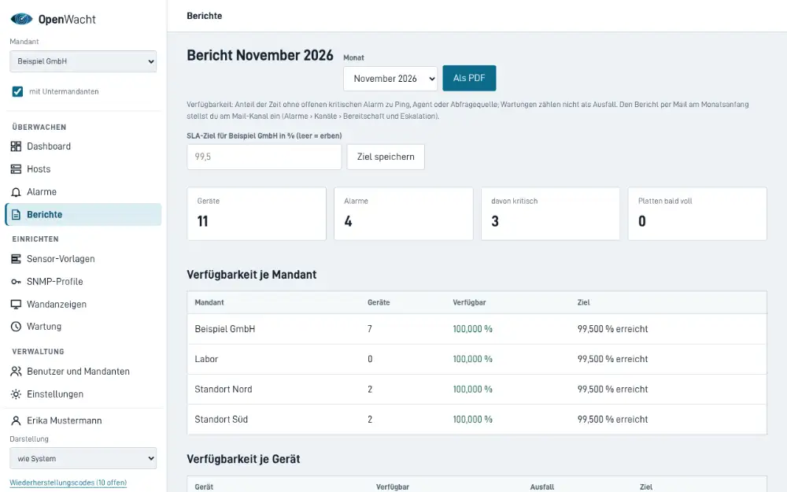

# 9. Berichte

**Überwachen → Berichte:** Monat wählen. Der Bericht zeigt je Mandant und je Gerät die **Verfügbarkeit** und das
**SLA-Ziel**, die Alarme (Anzahl, kritisch, Warnungen, bestätigt, die zehn längsten) und Platten, die in 90 Tagen voll
sind. „Als PDF“ lädt denselben Bericht.

- **Ausfall** heißt: Zeit mit offenem kritischem Alarm eines Ping-Sensors, „Agent meldet sich nicht“ oder „Quelle
  antwortet nicht“. Wartungen öffnen keine Alarme und zählen daher nicht als Ausfall.
- Der Wert eines Mandanten ist das Mittel seiner Geräte.
- **SLA-Ziel** je Mandant (Admins): erbt vom nächsten übergeordneten Mandanten, sonst 99,5 %.
- **Monatlicher Versand:** am Mail-Kanal „Monatsbericht“ anhaken. In den ersten sieben Tagen eines Monats geht der
  Vormonat als PDF an jeden Empfänger, erstellt mit **dessen** Rechten (jeder sieht nur, was er auch in der Oberfläche
  sieht).

Die PDF-Schrift kann nur Zeichen aus Westeuropa (WinAnsi); andere erscheinen als „?“.
