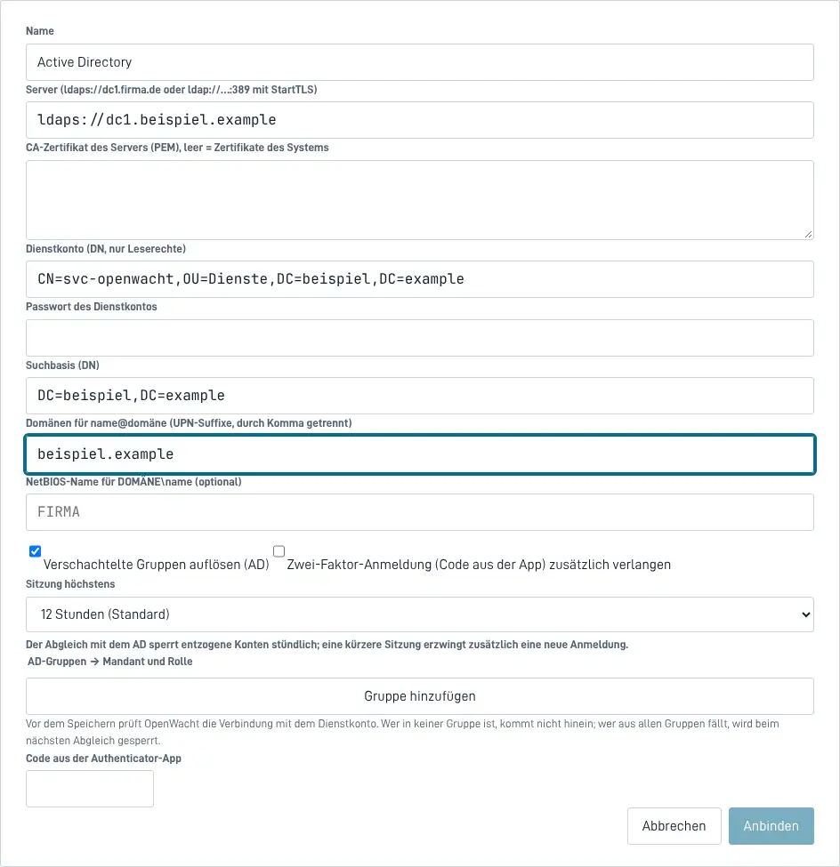

# 10. Anmeldung über AD und SSO

Unter **Benutzer und Mandanten → Anmeldung (AD, SSO)** bindet der Admin eines Mandanten ein Verzeichnis an.
Untermandanten ohne eigene Anbindung nutzen die nächste darüber. Lokale Konten bleiben daneben bestehen und gehen bei
gleicher Adresse vor (Notfallzugang, falls das AD ausfällt).

## Active Directory (LDAPS)

1. Im AD ein Dienstkonto **nur mit Leserechten** anlegen (z. B. `svc-openwacht`) und Gruppen für OpenWacht
   (z. B. `GG-OpenWacht-Admins`, `GG-OpenWacht-Operatoren`).
2. Den Domänencontroller in die Netzfreigabe aufnehmen (Einstellungen → Netzfreigabe, z. B. `10.0.0.10/32`).
3. „AD anbinden“: Server `ldaps://dc1.firma.de` (oder `ldap://…:389` mit StartTLS), CA-Zertifikat der Firmen-CA,
   Dienstkonto als DN, Passwort, Suchbasis, UPN-Domänen (`firma.de`), NetBIOS-Name (`FIRMA`), Gruppen → Mandant und
   Rolle. Klartext-LDAP gibt es nicht; das Zertifikat wird immer geprüft.
4. Anmelden mit `name@firma.de` oder `FIRMA\name` und dem AD-Passwort.

Das Konto entsteht beim ersten Anmelden. Rechte folgen bei jeder Anmeldung und stündlich den Gruppen (auch
verschachtelt). Ist ein Konto im AD gesperrt, verschwunden oder in keiner Gruppe mehr, sperrt OpenWacht es und beendet
seine Sitzungen. Ist das AD nicht erreichbar, sperrt der Abgleich nichts.

Das Passwort des Dienstkontos liegt verschlüsselt in der Datenbank und ist an Server, Dienstkonto und CA gebunden: Wer
den Server ändert, muss das Passwort neu eingeben (so kann niemand es an einen eigenen Server umleiten).

## Firmen-Login per OIDC (Keycloak, ADFS, Entra ID)

1. Beim IdP einen vertraulichen Client anlegen: Authorization Code mit PKCE, Weiterleitungsadresse
   `https://<adresse>/api/v1/sitzung/sso/rueckkehr`, Gruppen-Claim im ID-Token (Keycloak: Mapper „Group Membership“,
   Claim `groups`, ohne vollen Pfad).
2. IdP-Adresse in die Netzfreigabe. **Ohne Internet:** Keycloak oder ADFS im eigenen Netz (Entra ID braucht Internet).
3. „SSO (OIDC) anbinden“: Issuer, Client-ID, Client-Secret, CA, Domänen, Gruppen → Mandant und Rolle.
4. Benutzer geben ihre Adresse ein und klicken „Mit Firmen-Login anmelden (SSO)“. SSO geht nur über die eingestellte
   Hauptadresse der Zentrale.

**Adresse des Kontos:** Die Adresse kommt aus genau einem Claim, eingestellt je Anbindung unter „Adresse
des Kontos aus dem Claim“: `email` (Standard), `upn` oder `preferred_username`. Einen Rückfall auf andere Claims gibt
es nicht. Steht `email_verified` im Token und ist nicht `true`, lehnt OpenWacht die Anmeldung ab. Nimm
`preferred_username` nur, wenn der IdP ihn festlegt und Benutzer ihn nicht selbst ändern können (in Keycloak z. B.
„Edit username“ aus). Die Adresse muss in einer der Domänen der Anbindung liegen.

**Entra ID:** Als Claim `upn` einstellen (Entra liefert `email` oft nicht oder ohne Bestätigung). Gruppen im Token
als **Objekt-IDs** ausgeben (in der App-Registrierung unter „Token-Konfiguration“ einen Gruppen-Claim mit der
Gruppen-ID hinzufügen) und in OpenWacht die Objekt-IDs zuordnen, nicht die Anzeigenamen: Anzeigenamen sind nicht eindeutig, und wer Gruppen
anlegen darf, könnte sonst eine Gruppe mit gleichem Namen anlegen. Hat ein Benutzer sehr viele Gruppen, liefert Entra
statt der Liste nur einen Verweis (Überschreitung, laut Microsoft ab 200 Gruppen im JWT); dann den Claim auf die der
Anwendung zugewiesenen Gruppen beschränken.

## Anmelde-Domänen von Untermandanten

Richtet der Admin eines Untermandanten die Anbindung ein, gelten deren Domänen und NetBIOS-Name erst, wenn der Betreiber
sie unter Einstellungen → Anmelde-Domänen freigibt. Bis dahin steht in der Anbindung „(beantragt)“, und Anmeldungen mit
dieser Domäne gehen nicht an das Verzeichnis. Grund: Wer `name@beispiel.example` beansprucht, bekäme sonst bei der
LDAP-Anmeldung das Passwort fremder Benutzer an seinen Server geschickt. Eine Domäne ist nur für eine Anbindung
freigegeben; ein zweiter Antrag bleibt „beantragt“ und stört die erste nicht. Neue Domänen und ein geänderter
NetBIOS-Name brauchen jeweils eine neue Freigabe, unveränderte behalten sie beim Bearbeiten.

## Sitzungsdauer

Je Anbindung lässt sich die Höchstdauer einer Sitzung auf 1, 2, 4 oder 8 Stunden senken (Standard 12). Wichtig vor allem
für SSO: OpenWacht gleicht OIDC-Konten nur bei der Anmeldung ab. Wer im Identity Provider gesperrt wird oder eine Gruppe
verliert, bleibt bis zum Ende seiner Sitzung angemeldet. AD-Konten gleicht der stündliche Abgleich zusätzlich ab.

## Zwei-Faktor für AD- und SSO-Konten

Je Anbindung: „Zwei-Faktor-Anmeldung (Code aus der App) zusätzlich verlangen“ (Standard aus). Freiwillig kann jedes
Konto sie einrichten. SSO-Konten haben kein Passwort in OpenWacht und brauchen für bestätigungspflichtige Änderungen
deshalb die Zwei-Faktor-Anmeldung.
