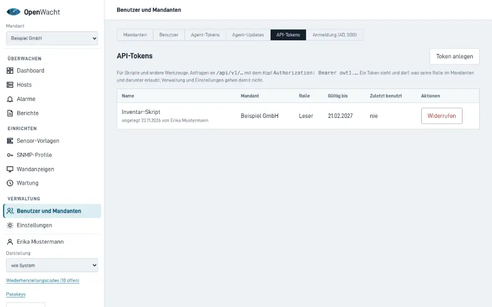

# 11. API-Tokens

Für Skripte und andere Werkzeuge (Inventar, Ticketsystem). **Benutzer und Mandanten → API-Tokens → Token anlegen**
(Admins des Mandanten, mit Bestätigung): Name, Rolle **Leser** oder **Operator**, 1–365 Tage.



Das Token (`owt1.…`) wird genau einmal angezeigt; gespeichert ist nur sein Hash. Aufruf:

```bash
curl -H "Authorization: Bearer owt1.…" https://openwacht.beispiel.example/api/v1/mandanten
curl -H "Authorization: Bearer owt1.…" https://openwacht.beispiel.example/api/v1/geraete
```

- Ein Token sieht und darf, was seine Rolle im Mandanten und darunter erlaubt, nie Admin-Rechte.
- Nicht möglich: Sitzungen, Zwei-Faktor, Verwaltung und Einstellungen.
- Höchstens 300 Anfragen je Minute und Token. Anlegen und Widerrufen stehen im Audit. „Zuletzt benutzt“ zeigt, ob ein
  Token noch gebraucht wird; „Widerrufen“ sperrt es sofort.
