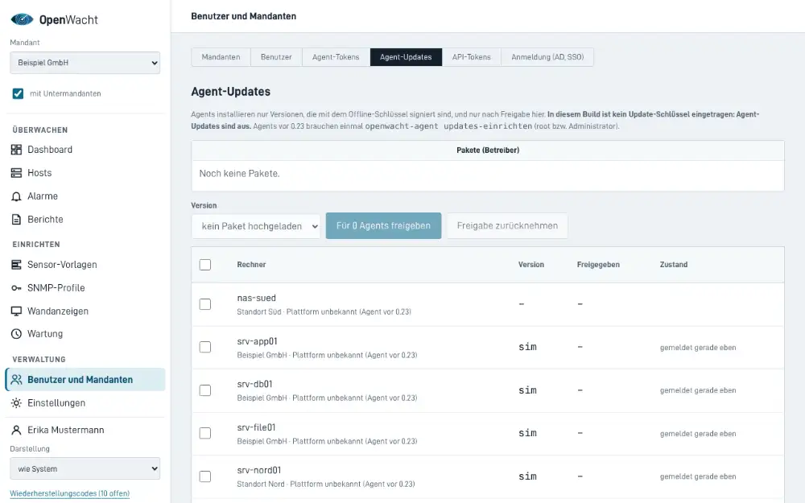

# 12. Agent-Updates

Agents aktualisieren sich auf Wunsch selbst, aber **nur mit einem Binary, das mit dem Offline-Schlüssel signiert ist**
(Ed25519). Der Schlüssel liegt nie auf der Zentrale: Eine übernommene Zentrale kann keinen präparierten Agent verteilen.

Solange im Build kein Update-Schlüssel eingetragen ist, sind Agent-Updates aus (Hinweis oben auf der Seite).

## Einmalig: Schlüssel anlegen (Hersteller, offline)

In `internal/update/schluessel.pub` stehen bis zu **drei** Schlüssel, je Zeile `ed25519:<base64> <zustand>`:

| Zustand | Bedeutung |
| --- | --- |
| `aktiv` | signiert neue Versionen (höchstens einer) |
| `reserve` | Notfallschlüssel, getrennt aufbewahrt; darf jeden anderen widerrufen |
| `auslaufend` | wird ersetzt; Signaturen gelten noch |
| `widerrufen` | gilt nicht mehr |

1. Auf einem Rechner ohne Verbindung zur Zentrale zwei Schlüssel erzeugen:
   `go run ./tools/signieren -neu -schluessel ~/openwacht-update.key` und
   `go run ./tools/signieren -neu -schluessel ~/openwacht-reserve.key`.
2. Die ausgegebenen Zeilen in `internal/update/schluessel.pub` eintragen (eine mit `aktiv`, eine mit `reserve`) und
   eine neue Version bauen. Die **Kennungen** (16 Hexziffern) getrennt veröffentlichen, z. B. in diesem Handbuch und
   im Vertrag; Kunden prüfen damit die erste Installation (Kapitel 1).
3. Beide Schlüsseldateien offline und **getrennt** sichern (z. B. zwei verschlüsselte USB-Sticks an verschiedenen
   Orten). Ist der aktive verloren, signiert die Reserve weiter.

**Kennungen der Schlüssel von OpenWacht** (erzeugt am 24.11.2026):

| Zustand | Kennung |
| --- | --- |
| aktiv | `b7ba49cf02e0fb6d` |
| reserve | `dbeb1adf2c56942f` |

Ob eine Sicherungskopie eines Schlüssels stimmt, zeigt `signieren -zeigen -schluessel <Datei>`: Es gibt nur den
öffentlichen Teil und die Kennung aus, nie den privaten Schlüssel.

Änderungen an `schluessel.pub` nur in einem eigenen Pull Request mit „Update-Schlüssel“ im Titel und signiertem
Commit; wer diese Datei tauschen kann, kann Agents mit eigenen Updates versorgen.

## Je Version

1. Binaries offline signieren:
   `go run ./tools/signieren -schluessel ~/openwacht-update.key -version 1.0.0 openwacht-agent_linux_amd64 openwacht-agent_windows_amd64.exe`
   (es entsteht je Datei eine `.sig`).
2. **Verwaltung → Agent-Updates** (Betreiber): Binary und `.sig` hochladen. Die Zentrale prüft die Signatur.
3. Agents auswählen, Version wählen, „Für N Agents freigeben“ (Admins des Mandanten).

Beim nächsten Melden lädt der Agent das Paket, prüft Signatur, Prüfsumme, Plattform und Version (keine Rückstufung)
und legt es bereit. Den Austausch macht ein **getrennter** Installationsdienst mit Root-Rechten, der die Signatur mit
dem Schlüssel des installierten Agents noch einmal prüft (Linux sofort, Windows über eine geplante Aufgabe binnen
15 Minuten). Der Agent-Dienst selbst kann sein Programm nicht ändern.

## Automatisch übernehmen (ab 1.0.4)

Statt jede Version von Hand freizugeben, übernehmen die Agents eines Mandanten neue Versionen auf Wunsch selbst:
**Verwaltung → Agent-Updates → Automatisch übernehmen** (Admins des Mandanten oder darüber, je Mandant).

- **Pilotgruppe** (eine Gerätegruppe, mit Untergruppen): Ihre Agents bekommen eine neue Version, sobald das Paket
  hochgeladen ist.
- **Wartezeit** (0 bis 720 Stunden, Standard 24): Erst danach sind die übrigen Agents dran, und nur, wenn **kein Pilot
  einen Fehler** beim Update meldet und, falls es Piloten gibt, **mindestens einer die neue Version schon fährt**. Ohne
  Pilotgruppe zählt nur die Wartezeit.
- **Zeitfenster:** Wochentage und Stunden in der Zeitzone der Installation; „von“ gleich „bis“ heißt ganzer Tag, „von“
  größer als „bis“ reicht über Mitternacht (z. B. 22 bis 5 Uhr).

Ist ein Agent dran, trägt die Zentrale bei seiner nächsten Meldung die Freigabe ein (Spalte „Freigegeben“ mit dem
Zusatz „automatisch“); danach läuft alles wie bei einer Freigabe von Hand, mit derselben Prüfung der Signatur im Agent.
Eine **Freigabe von Hand geht vor** und wird von der Automatik nicht überschrieben. Eine Rückstufung gibt es auch hier
nicht. Änderungen an der Regel stehen im Audit-Log (`agent_update.automatik`).

Voraussetzung ist wie immer ein mit dem Offline-Schlüssel signiertes Paket, das der Betreiber hochgeladen hat.

## Schlüssel wechseln oder widerrufen

- **Geplanter Wechsel:** neuen Schlüssel erzeugen, in `schluessel.pub` den bisherigen auf `auslaufend` und den neuen
  auf `aktiv` setzen, Version bauen und mit dem bisherigen (noch gültigen) Schlüssel signieren. Ab der übernächsten
  Version den alten Eintrag entfernen.
- **Schlüssel verloren oder abgeflossen:** Version bauen, in der der Schlüssel als `widerrufen` steht, und mit der
  **Reserve** signieren, dabei den Schlüssel ausdrücklich widerrufen:
  `go run ./tools/signieren -schluessel ~/openwacht-reserve.key -version 1.0.4 -widerrufen <kennung> openwacht-agent_…`.
  Danach einen neuen Reserve-Schlüssel anlegen.

Ein Widerruf ist mitsigniert. Lädt der Betreiber ein solches Paket hoch, bietet die Zentrale nichts mehr an, was mit
dem widerrufenen Schlüssel signiert ist, und nimmt keine solchen Pakete mehr an (Audit-Eintrag
`update_schluessel.widerrufen`). Der Installationsdienst auf dem Agent merkt sich den Widerruf neben dem Programm
(`openwacht-agent.widerrufen`, gehört root bzw. SYSTEM) und lehnt danach Signaturen dieses Schlüssels ab, auch bevor
die neue Version mit geänderter `schluessel.pub` läuft. Der aktive Schlüssel darf die Reserve nicht widerrufen: Wer
nur ihn erbeutet hat, kann den Notfallschlüssel nicht aussperren.

Fehler stehen in der Spalte „Zustand“, unter Linux zusätzlich in `journalctl -u openwacht-agent-update`.
