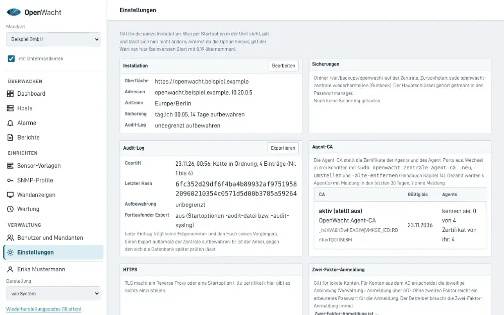
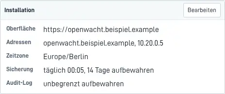

# 13. Sicherung und Rücksicherung

## Was gesichert werden muss

| Was | Wo | Wie |
| --- | --- | --- |
| Datenbank | PostgreSQL `openwacht` | automatisch, täglich (`/var/backups/openwacht/openwacht-<zeit>.dump`) |
| Hauptschlüssel | `/etc/openwacht/schluessel` | **einmal getrennt** sichern (Passwortmanager, Tresor) |
| Update-Schlüssel (Hersteller) | offline | siehe [Kapitel 12](12-agent-updates.md) |

Ohne den Hauptschlüssel sind die verschlüsselten Geheimnisse in der Datenbank (SNMP-Zugangsdaten, AD-Passwort,
Agent-CA, Zertifikate) nicht lesbar; eine Sicherung allein reicht dann nicht.

## Automatische Sicherung

Der Timer `openwacht-sicherung.timer` prüft stündlich und sichert zur Uhrzeit aus den Einstellungen (Standard 00:05)
oder nach, wenn die letzte Sicherung älter als 25 Stunden ist. Aufbewahrung nach Einstellung (Standard 14 Tage), die
neueste bleibt immer. Dateien gehören `svc_openwacht_db` mit Rechten 0600.



Die Liste der Sicherungen mit Größe und Zustand steht unter **Einstellungen → Sicherungen** (nur Betreiber). Sofort
sichern:

```bash
sudo -u svc_openwacht_db env OPENWACHT_DB_EIGENTUEMER="host=/run/postgresql user=openwacht_owner dbname=openwacht" \
  openwacht-zentrale sichern -verzeichnis /var/backups/openwacht -jetzt
```

Vor jedem Update, das das Schema ändert, sichert das Paket zusätzlich selbst (Eintrag „vor dem Update“ in
der Liste). Diese Sicherung ist der Rückweg, falls das Update scheitert: einspielen und das alte Paket installieren.

Die Dateien zusätzlich auf ein anderes System kopieren (z. B. mit der VM-Sicherung oder rsync).

## Rücksicherung

```bash
sudo openwacht-zentrale wiederherstellen                       # neueste Sicherung, nur in eine leere Installation
sudo openwacht-zentrale wiederherstellen -datei /var/backups/openwacht/openwacht-20261122T103338Z.dump -ersetzen
```

Ablauf:

1. Die Sicherung wird in eine neue Datenbank `openwacht_neu` eingespielt.
2. Der Hauptschlüssel wird gegen die Sicherung geprüft (Agent-CA). Passt er nicht, wird `openwacht_neu` verworfen und
   **nichts** geändert.
3. Dienste anhalten, die laufende Datenbank in `openwacht_vor_<zeit>` umbenennen (nie gelöscht), `openwacht_neu` wird
   `openwacht`.
4. Migrationen, Dienste starten.

Hat die laufende Datenbank schon Daten, ist `-ersetzen` nötig. Die alte Datenbank `openwacht_vor_…` danach von Hand
löschen, wenn alles passt; den Befehl gibt `wiederherstellen` am Ende aus
(`runuser -u postgres -- psql -c 'DROP DATABASE openwacht_vor_…'`).

**Umzug auf einen neuen Rechner:** dort installieren (Kapitel 1), den Hauptschlüssel nach `/etc/openwacht/schluessel`
legen (Eigentümer `svc_openwacht`, Rechte 0400, wie die bei der Installation erzeugte Datei), die Sicherung nach
`/var/backups/openwacht` kopieren und `wiederherstellen -ersetzen` ausführen. Agents erreichen die Zentrale weiter,
wenn Name bzw. Adresse gleich bleiben.

## Hauptschlüssel wechseln

Nötig, wenn der Hauptschlüssel abgeflossen sein könnte (z. B. eine Kopie von `/etc/openwacht` in falschen Händen).
`schluessel-wechseln` verschlüsselt **alle** Geheimnisse der Datenbank in einer Transaktion neu: SNMP-, Proxmox-,
vCenter- und FRITZ!Box-Zugangsdaten, Zugangsprofile, Trap-Zugangsdaten, AD- und SSO-Dienstkonten, Alarmkanäle,
Mail-Relay, Totmann-Adresse, Zwei-Faktor-Geheimnisse, HTTPS-Schlüssel und die Agent-CA. Geht ein einziges Geheimnis
nicht auf, ändert der Befehl nichts und nennt es.

```bash
sudo systemctl stop openwacht-zentrale.socket openwacht-zentrale openwacht-traps.socket openwacht-traps
sudo sh -c 'umask 077; openwacht-zentrale schluessel > /etc/openwacht/schluessel.neu'
sudo env OPENWACHT_DB_EIGENTUEMER="host=/run/postgresql user=openwacht_owner dbname=openwacht" \
  openwacht-zentrale schluessel-wechseln -neu /etc/openwacht/schluessel.neu -nur-pruefen   # erst nur prüfen
sudo env OPENWACHT_DB_EIGENTUEMER="host=/run/postgresql user=openwacht_owner dbname=openwacht" \
  openwacht-zentrale schluessel-wechseln -neu /etc/openwacht/schluessel.neu
sudo systemctl start openwacht-zentrale.socket openwacht-traps.socket
```

Danach:

- `/etc/openwacht/schluessel` ist der neue Schlüssel (gleiche Rechte wie vorher), der bisherige liegt als
  `/etc/openwacht/schluessel.alt-<zeit>` daneben. **Beide getrennt sichern**: Sicherungen von vor dem Wechsel lassen
  sich nur mit dem alten Schlüssel zurückholen. Der Trap-Schlüssel (`/etc/openwacht-traps/schluessel`) ist neu
  abgeleitet.
- Alle Sitzungen sind beendet; gesperrte Anmeldequellen sind freigegeben.
- **Wiederherstellungscodes verfallen** (sie liegen nur als HMAC mit einem abgeleiteten Schlüssel vor): Wer
  Zwei-Faktor nutzt, erzeugt in der Seitenleiste neue Codes.
- Sofort eine neue Sicherung anlegen (`sichern -jetzt`).

Läuft die Zentrale oder der Trap-Dienst noch, bricht der Befehl ab (sie würden Geheimnisse mit dem alten Schlüssel
schreiben). Eine Zentrale mit dem alten Schlüssel startet danach nicht mehr („Agent-CA lässt sich nicht
entschlüsseln“). Geheimtexte tragen ein Kennzeichen des Schlüssels. `wiederherstellen` meldet bei einer Sicherung mit anderem Schlüssel dessen
Kennzeichen.

## Agent-CA wechseln

Die Agent-CA (10 Jahre gültig) stellt die Zertifikate der Agents und des Agent-Ports aus. Laufzeit, Zustand und wie
viele Agents eine CA kennen stehen unter **Einstellungen → Agent-CA**. Der Wechsel geht ohne Neuregistrierung, in drei
Schritten (jeweils mit `OPENWACHT_DB_EIGENTUEMER` wie oben, danach `systemctl restart openwacht-zentrale`):

1. `openwacht-zentrale agent-ca -neu` – neue CA neben der aktiven. Die Agents bekommen beide mit der nächsten Meldung.
2. `openwacht-zentrale agent-ca -umstellen`, sobald alle Agents die neue kennen (Spalte „Agents kennen sie“). Die neue
   stellt ab jetzt aus; Agents holen sich von selbst ein neues Zertifikat. **Registrierungs-Token und Einzeiler neu
   erzeugen**, die alten enthalten den Fingerabdruck der bisherigen CA.
3. `openwacht-zentrale agent-ca -alte-entfernen`, sobald kein Agent mehr ein Zertifikat der alten hat.

`openwacht-zentrale agent-ca` ohne Option zeigt den Stand. Agents, die sich 30 Tage nicht gemeldet haben, zählen nicht;
sie müssen nach Schritt 3 neu registriert werden. `-trotzdem` überspringt die Prüfungen (dann ebenso).

## Adresse ändern



Einstellungen → Installation → „Adresse ändern …“ (Betreiber, mit Bestätigung). Mit eigener Wurzel entsteht eine neue
Wurzel, die man neu verteilt. Agents behalten ihre registrierte Adresse; fällt ein alter Name weg, müssen sie neu
registriert werden.

## Audit-Log

Jede Änderung (Anmeldungen, Rechte, Einstellungen, Geräte, Exporte …) steht im Audit-Log. Jeder Eintrag trägt eine
fortlaufende Nummer und den SHA-256-Hash über seinen Inhalt und den Hash des Vorgängers (Hash-Kette).

**Tägliche Prüfung:** Die Zentrale rechnet die Kette einmal am Tag nach. Ist sie gebrochen (Eintrag geändert, gelöscht
oder eingeschoben), meldet sie das an den Betreiber und schreibt einen Eintrag `audit.kette_gebrochen`. Von Hand, als
Eigentümer der Datenbank:

```sh
sudo -u svc_openwacht_db env OPENWACHT_DB_EIGENTUEMER="host=/run/postgresql user=openwacht_owner dbname=openwacht" \
  openwacht-zentrale audit-pruefen -datei /var/log/openwacht/audit.jsonl
```

Ohne `-datei` prüft der Befehl nur die Kette in der Datenbank. **Grenze:** Wer Eigentümer-Rechte an der Datenbank hat,
kann die Kette vollständig neu berechnen; sie ist dann in sich heil. Das fällt nur beim Vergleich mit einem Export auf,
der vorher woanders aufbewahrt wurde. Deshalb den fortlaufenden Export einschalten und außerhalb der Zentrale ablegen.

**Fortlaufender Export** (Startoptionen in `/etc/openwacht/zentrale.env`, nicht in der Oberfläche, damit eine gekaperte
Sitzung ihn nicht abschalten kann):

| Option | Wirkung |
| --- | --- |
| `-audit-datei /var/log/openwacht/audit.jsonl` | eine JSON-Zeile je Eintrag (`seq`, `zeit`, `mandant`, `akteur`, `akteur_email`, `aktion`, `details`, `vorher`, `hash`); für Filebeat, NXLog oder einen Syslog-Agenten. Rotation mit `copytruncate` geht |
| `-audit-syslog siem.example.com:6514` | Syslog über TLS (RFC 5425, Facility „log audit“, Nachricht = JSON-Zeile); Zertifikat wird geprüft, das Ziel muss in der Netzfreigabe liegen |
| `-audit-syslog-ca /etc/openwacht/syslog-ca.pem` | eigene CA für den Syslog-Server |

Ist ein Ziel nicht erreichbar, bleibt der Stand stehen und alles wird nachgeholt; nach einer Stunde kommt ein Hinweis.

**Export für Admins:** Einstellungen → Audit-Log → „Exportieren“ bzw. `GET /api/v1/audit/export?ab=<Nummer>&anzahl=<bis 5000>&mandant=<ID>`
(JSON-Zeilen). Admins bekommen nur Einträge ihrer Mandanten und deren Untermandanten, Einträge ohne Mandant nur Admins
des Hauptmandanten. Der Kopf `X-OpenWacht-Letzte` nennt die letzte Nummer zum Weiterblättern. Jeder Export steht selbst
im Audit-Log.

**Aufbewahrung** (Einstellungen → Installation, Betreiber): unbegrenzt (Standard) oder 1 bis 10 Jahre. Gelöscht wird nach
der täglichen Prüfung, nur am Anfang der Kette, nie wenn die Kette gebrochen ist und nie, was ein eingestelltes
Exportziel noch nicht hat. Die Zentrale merkt sich Nummer und Hash des letzten gelöschten Eintrags (Anker) und schreibt
`audit.gekuerzt` mit diesem Anker in die Kette; die Prüfung beginnt danach am Anker.
