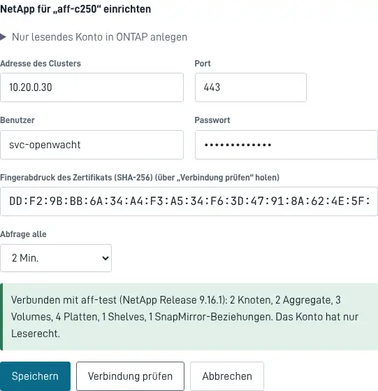
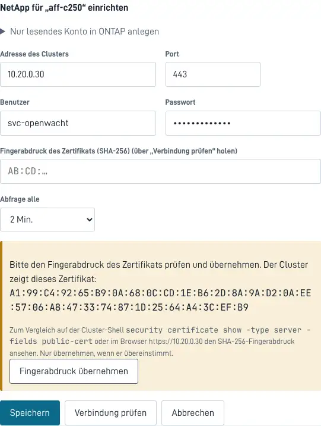
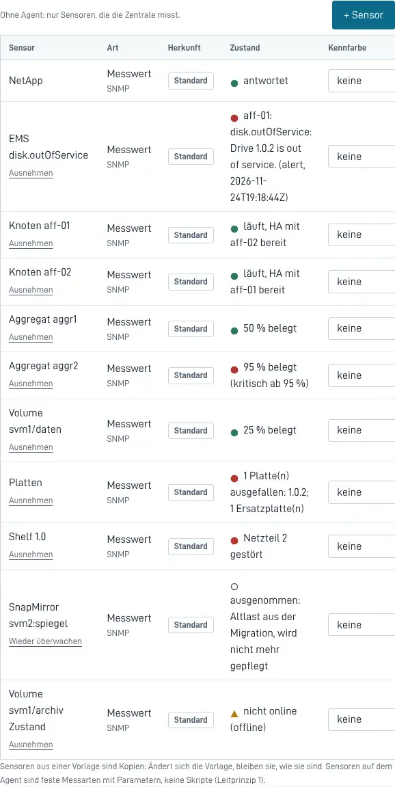
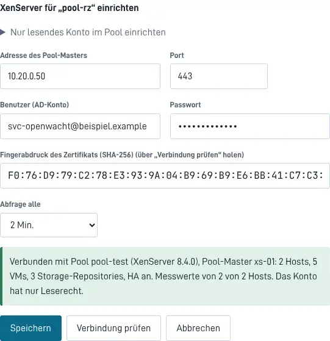
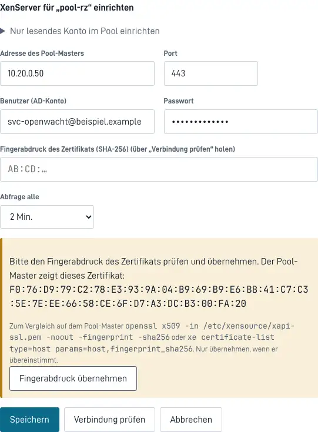
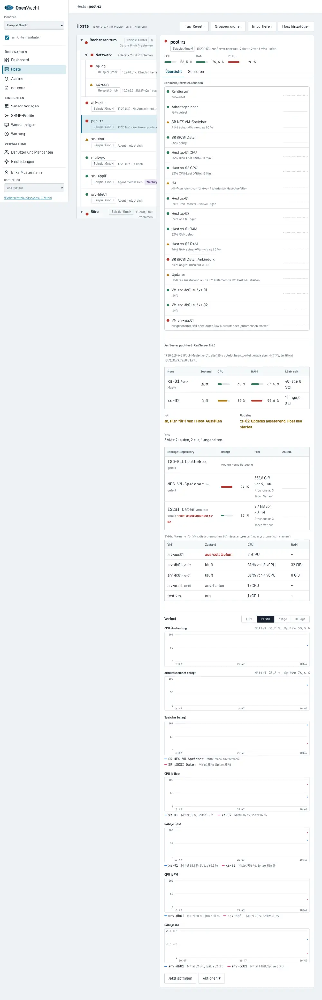

# 19. Anbindungen

Was die Zentrale außer Agents, SNMP und Prüfungen von außen abfragt, und wie du es einrichtest. Für jede Anbindung
steht zuerst der Weg in der Oberfläche des anderen Systems, dann der in OpenWacht.

Für alle gilt:

- **Nur lesend.** Die Zentrale ändert an den abgefragten Systemen nichts. Lege für OpenWacht immer ein eigenes Konto mit
  den kleinsten Rechten an, nie ein Admin-Konto.
- **Netzfreigabe.** Die Adresse muss in den freigegebenen Netzen der Zentrale liegen (Einrichtungsassistent Schritt 6,
  später unter Einstellungen; [Kapitel 2](02-erste-einrichtung.md#netzfreigabe)); sonst lehnt die Zentrale die
  Verbindung ab.
- **Zugangsdaten** liegen verschlüsselt in der Datenbank, gebunden an Adresse und Port. Ändert sich die Adresse, sind sie
  neu einzugeben.
- **Einrichten** dürfen nur Admins: am Gerät über das Aktionsmenü. Je Gerät gibt es eine solche Abfragequelle; läuft
  auf demselben Rechner auch ein Agent, sind das zwei Geräte (z. B. `pve-01` mit Agent und `pve-01 (Proxmox)`).
- **Einzelne Werte ausnehmen** (etwa eine alte SnapMirror-Beziehung) geht bei jeder Quelle am Gerät im Reiter
  „Sensoren“ mit „Ausnehmen“ und Begründung (siehe NetApp unten).

| Anbindung | Weg | Konto |
| --- | --- | --- |
| [Proxmox VE](#proxmox-ve-nur-lesend) | API, Port 8006 | API-Token mit Rolle PVEAuditor |
| [VMware vCenter](#vmware-vcenter-nur-lesend) | REST-API, Port 443 | Rolle „Nur Lesen“ |
| [NetApp ONTAP](#netapp-ontap-rest-api) | REST-API, Port 443 | REST-Rolle nur lesend (Pflicht, wird geprüft) |
| [XenServer / XCP-ng](#xenserver-und-xcp-ng-xapi) | XAPI, Port 443 | AD-Konto mit Rolle read-only (Pflicht, wird geprüft) |
| [FRITZ!Box](#router-von-avm-fritzbox-tr-064) | TR-064, Port 49000/49443 | eigenes Konto mit „FRITZ!Box Einstellungen“ |
| [Hyper-V](#hyper-v-über-den-windows-agent) | Windows-Agent | – |
| [Docker](#docker-über-den-agent) | Agent und Socket-Proxy | – |
| [Windows ohne Agent](#windows-server-ohne-agent-snmp-z-b-citrix-worker) | SNMP v2c | Community nur lesen |
| Active Directory, SSO | [Kapitel 10](10-ad-und-sso.md) | Lesekonto bzw. OIDC-Client |
| Mail, SMS, Teams, Webhook, ntfy | [Kapitel 8](08-alarme-und-wartung.md#alarmkanäle) | – |

## Proxmox VE (nur lesend)

Die Zentrale fragt einen Proxmox-Knoten über seine API ab. Am Gerät: Aktionsmenü → **Proxmox einrichten** (nur
Admins). Jeder Knoten ist ein eigenes Gerät, auch im Cluster.


Auf dem Proxmox-Host als root (dieselben Befehle stehen im Formular unter „Token auf dem Proxmox-Host anlegen“):

```bash
pveum user add openwacht@pve --comment "OpenWacht, nur lesend"
pveum acl modify / --users openwacht@pve --roles PVEAuditor
pveum user token add openwacht@pve monitor --privsep 1
pveum acl modify / --tokens 'openwacht@pve!monitor' --roles PVEAuditor
cat /etc/pve/pve-root-ca.pem
```

- `token add` zeigt das Geheimnis (`value`) **nur einmal**. Gleich in den Passwortmanager legen; verloren heißt: Token
  löschen und neu anlegen.
- Ins Feld **API-Token** kommt ID und Geheimnis zusammen: `openwacht@pve!monitor=<value>`, ohne Leerzeichen.
- **CA des Hosts:** die Ausgabe von `cat /etc/pve/pve-root-ca.pem` **dieses** Hosts, ganz von `-----BEGIN` bis
  `-----END CERTIFICATE-----`. Nicht von einem anderen Host übernehmen: Hosts, die nicht im selben Cluster sind (oder vor
  dem Beitritt ihre CA behalten haben), haben verschiedene CAs.
- Im Cluster gelten Benutzer und Token auf allen Knoten; trotzdem fragt OpenWacht jeden Knoten als eigenes Gerät ab.

**Ohne Shell, in der Proxmox-Oberfläche** (geprüft an einem Proxmox VE 9):

1. Rechenzentrum → Berechtigungen → **Benutzer** → Hinzufügen: `openwacht`, Realm „Proxmox VE authentication server“,
   ohne Passwort.
2. Rechenzentrum → Berechtigungen → **API-Token** → Hinzufügen: Benutzer `openwacht@pve`, Token-ID `monitor`,
   „Privilegientrennung“ angehakt. Das Geheimnis erscheint nur einmal.
3. Rechenzentrum → **Berechtigungen** → Hinzufügen, zweimal: „Benutzerberechtigung“ für `openwacht@pve` und
   „API-Token-Berechtigung“ für `openwacht@pve!monitor`, jeweils Pfad `/`, Rolle **PVEAuditor**, „Weitergeben“. Mit
   Privilegientrennung braucht das Token beide Einträge.
4. CA: Knoten → System → **Zertifikate** → `pve-root-ca.pem` → „Zertifikat anzeigen“; oder im Browser die Root der
   Kette als Base-64 exportieren. Hat der Knoten ein Zertifikat der Firmen-CA, deren Root nehmen.
- Meldet „Verbindung prüfen“ `401`, passen ID und Geheimnis nicht zusammen; ein Zertifikatsfehler heißt fast immer: CA
  eines anderen Hosts eingetragen.

**Werte und Alarme** (Intervall wählbar, Standard 60 Sekunden):

| Sensor | Alarm |
| --- | --- |
| Erreichbarkeit | API antwortet nicht: kritisch |
| VM / Container | nur Gäste mit „beim Booten starten“: läuft nicht: kritisch; angehalten: Warnung |
| Backup je Gast | nur Gäste in einem Backup-Job: letztes erfolgreiches Backup älter als 26 Std.: Warnung, älter als 50 Std. oder keins in 8 Tagen: kritisch; ein fehlgeschlagener letzter Versuch steht in der Meldung |
| Speicher | eingeschaltet, aber nicht verfügbar: kritisch; Belegung mit Schwellen und Prognose wie bei Platten |
| Thin-Pool Metadaten | ab 80 % Warnung, ab 90 % kritisch |
| Neustart | der Knoten läuft kürzer als bei der letzten Abfrage |

Die Schwellen für Backups und Metadaten sind fest. Die Backups liest OpenWacht aus den vzdump-Aufgaben des Knotens;
einen Proxmox Backup Server fragt es nicht selbst ab.

## VMware vCenter (nur lesend)

Die Zentrale fragt ein vCenter über dessen REST-API ab: ESXi-Hosts, VMs und Datastores. Am Gerät für das vCenter:
Aktionsmenü → **vCenter einrichten** (nur Admins).

**Konto im vSphere Client:**

1. Menü → **Verwaltung** → Single Sign-On → **Benutzer und Gruppen** → Domäne `vsphere.local` (oder eine
   AD-Identitätsquelle) → Benutzer hinzufügen, z. B. `svc-openwacht`, mit langem Passwort.
2. Im Bestand die **oberste Ebene** (das vCenter selbst) wählen → **Berechtigungen** → Hinzufügen: Benutzer
   `svc-openwacht@vsphere.local`, Rolle **Nur Lesen** („Read-only“), **An untergeordnete Objekte weitergeben**
   anhaken.
3. CA des vCenter: Startseite des vCenter im Browser (`https://<vcenter>/`) → Link **Download trusted root CA
   certificates** (deutsch „Vertrauenswürdige Stamm-CA-Zertifikate herunterladen“). Im ZIP liegt die Wurzel der VMCA als `.0`- bzw. `.crt`-Datei; ihren
   Inhalt (`-----BEGIN CERTIFICATE-----` bis `-----END CERTIFICATE-----`) ins Feld „CA des vCenter“. Hat das vCenter ein
   Zertifikat der Firmen-CA, deren Wurzel nehmen. Leer gelassen gelten die System-CAs der Zentrale.

**In OpenWacht:** Adresse des vCenter (Name aus dem Zertifikat), Port 443, Benutzer, Passwort, CA, Abfrage alle
30 Sekunden bis 1 Stunde (Standard 60 Sekunden). **Verbindung prüfen** meldet sich an und zählt Hosts, VMs und
Datastores; dann **Speichern**.

**Nur lesend:** Die Zentrale meldet sich mit `POST /api/session` an, liest nur `GET /api/vcenter/host`,
`/api/vcenter/vm` und `/api/vcenter/datastore` und meldet sich am Ende mit `DELETE /api/session` ab. Weiterleitungen
werden nicht verfolgt. Anders als bei NetApp und XenServer prüft OpenWacht die Rolle des Kontos nicht selbst: Gib ihm
nur „Nur Lesen“.

**Werte und Alarme:**

| Sensor | Alarm |
| --- | --- |
| Erreichbarkeit | vCenter antwortet nicht: kritisch |
| ESXi-Host | antwortet dem vCenter nicht, getrennt, im Standby oder ausgeschaltet: kritisch |
| VM | Zustand wird angezeigt, ohne Alarm (vCenter sagt nicht, ob eine VM laufen soll); für einzelne VMs einen eigenen Sensor anlegen, z. B. Ping |
| Datastore | nicht erreichbar: kritisch; Belegung mit Schwellen und Prognose wie bei Platten |

**Datensparsam:** von VMs nur Name und Zustand, keine Konfiguration, Gastdaten oder Benutzer.

**Grenzen:** höchstens 200 Hosts, 2000 VMs, 200 Datastores und 8 MiB je Antwort. Getestet gegen eine Attrappe nach der
vSphere-REST-API, noch nicht gegen ein echtes vCenter.

## NetApp ONTAP (REST-API)

Die Zentrale fragt NetApp-Cluster (z. B. AFF, FAS) über die ONTAP-REST-API ab. Am Gerät:
Aktionsmenü → „NetApp einrichten“ (nur Admins).



**Konto in ONTAP:** ein eigener Benutzer mit nur lesender REST-Rolle, auf der Cluster-Shell zum Beispiel:

```
security login rest-role create -role openwacht_lesen -api /api -access readonly
security login create -user-or-group-name svc-openwacht -application http -authentication-method password -role openwacht_lesen
```

**Ohne Shell im System Manager:** Cluster → Settings → **Users and Roles**. Unter **Roles** → Add: Name
`openwacht_lesen`, API `/api`, Access level **Read-only**. Unter **Users** → Add: Benutzer, Rolle `openwacht_lesen`,
Application **HTTP**, Authentication Password, Multifactor **Disabled**. Die eingebaute Rolle `readonly` reicht nicht:
OpenWacht kann damit die Rechte des Kontos nicht lesen.

1. Adresse der **Cluster-Management-Schnittstelle** eintragen (HTTPS, Port 443), Benutzer und Passwort.
   Die Adresse muss in der Netzfreigabe liegen.
2. **Verbindung prüfen:** Beim ersten Mal holt die Zentrale nur den Fingerabdruck (SHA-256) des Zertifikats, ohne
   Anmeldung und ohne Anfrage. Mit `security certificate show -type server` auf der Cluster-Shell oder im Browser
   vergleichen und übernehmen. Danach gilt nur dieses Zertifikat; das Passwort geht nie an einen anderen Server.
3. Noch einmal **Verbindung prüfen**: Die Zentrale meldet sich an, prüft die Rechte des Kontos und zählt Knoten,
   Aggregate, Volumes, Platten, Shelves und SnapMirror-Beziehungen. Dann **Speichern**.



**Nur lesend:** Die Zentrale sendet nur GET-Anfragen an eine feste Liste von Endpunkten (`/api/cluster`,
`/api/cluster/nodes`, `/api/storage/aggregates`, `/api/storage/volumes`, `/api/storage/disks`, `/api/storage/shelves`,
`/api/snapmirror/relationships`, `/api/support/ems/events` und zur Rechteprüfung `/api/security/…`). Vor jeder Abfrage
liest sie die Rechte des Kontos (ab ONTAP 9.19 über `whoami`, davor über das Konto und die Rechte seiner Rolle).
**Ein Konto mit Schreibrecht wird abgelehnt** (zum Beispiel die Rolle „admin“ oder eine Rolle mit `all`,
`read_create`, `read_modify` …), ebenso ein Konto, dessen Rechte sich nicht lesen lassen. Ausgenommen sind nur die
Befehle `set` und `security login password`, die die eigene Sitzung betreffen.

**Werte und Alarme** (Intervall Standard 2 Minuten):

| Sensor | Alarm |
| --- | --- |
| Knoten | nicht „up“, vom Partner übernommen, Übernahme fehlgeschlagen oder nicht möglich, Failover aus, Übertemperatur, Lüfter oder Netzteil ausgefallen |
| Aggregat / Volume (Belegung) | Schwellen und Prognose „voll in … Tagen“ wie bei Platten; Volumes nur beschreibbare (rw), Spiegelziele nicht |
| Aggregat / Volume (Zustand) | Aggregat nicht online: kritisch; Volume offline oder eingeschränkt: Warnung, gestört: kritisch |
| Platten | ausgefallen: kritisch; wird ersetzt (fällt voraussichtlich aus), wird neu aufgebaut, entfernt: Warnung; dazu die Zahl der Ersatzplatten |
| Shelf | Netzteil, Modul oder Lüfter gestört, Temperatur über den Schwellen des Shelfs |
| SnapMirror | nicht gesund (mit Grund), getrennt, Verzögerung ab 26 Std. Warnung, ab 50 Std. kritisch |
| EMS | Ereignisse der Schwere „emergency“ und „alert“ der letzten Stunde, je Meldung ein Sensor (höchstens 20) |
| Neustart | ein Knoten läuft kürzer als bei der letzten Abfrage |

Graphen: Belegung der Aggregate und Volumes, IOPS und Latenz je Aggregat. Scheitert ein Teil (zum Beispiel 403 auf
die Shelves), zeigt die Oberfläche ihn als „nicht abfragbar“, und dessen Sensoren behalten ihren letzten Zustand.

**Einzelne Werte ausnehmen**, z. B. eine alte SnapMirror-Beziehung, die niemand mehr pflegt: am Gerät
Reiter „Sensoren“ → beim Wert „Ausnehmen“, Begründung eintragen. Der Wert wird weiter abgefragt, meldet aber keine
Alarme mehr, ein offener Alarm endet, und er steht grau als „ausgenommen“ mit Begründung da. „Wieder überwachen“ hebt
das auf. Das geht für jeden Wert von SNMP, Proxmox, NetApp, XenServer und anderen Quellen (Volumes, Platten,
Schnittstellen …), nicht für die Erreichbarkeit; dafür gibt es „Abfrage ausschalten“. Ausnehmen und Aufheben dürfen
Operatoren und Admins, beides steht im Audit-Log. Bestätigen reicht dafür nicht: Ein bestätigter Alarm bleibt offen.



**Datensparsam:** Seriennummern, Konten, Freigaben, Clients, Dateien und Inhalte von Volumes liest die Zentrale nicht.
Von EMS-Ereignissen speichert sie nur Name, Schwere, Knoten, Zeit und den gekürzten Text.

**Grenzen:** höchstens 24 Knoten, 200 Aggregate, 1000 Volumes (mehr: gekürzt), 2000 Platten, 100 Shelves,
1000 SnapMirror-Beziehungen, 50 EMS-Ereignisse und 8 MiB je Antwort. Weiterleitungen werden nicht verfolgt, kein Proxy,
nicht über einen Sammler. Neben der REST-API gehen weiterhin SNMPv3-Abfragen, eigene OID-Sensoren (NetApp-MIB) und
SNMPv3-Traps ([Kapitel 6](06-snmp.md)).

## XenServer und XCP-ng (XAPI)

Die Zentrale fragt XenServer-Pools (Ziel XenServer 8, auch XCP-ng) über XAPI ab. Am Gerät:
Aktionsmenü → „XenServer einrichten“ (nur Admins). Ein Gerät steht für den ganzen Pool.



**Konto:** XenServer vergibt Rollen (RBAC) nur an Konten aus dem Active Directory; ohne AD gibt es nur `root`
(lokaler Superuser mit allen Rechten). **OpenWacht lehnt root ab**, schon beim Speichern und ohne das Passwort zu
senden. Der Pool muss also in der Domäne sein. Dann auf dem Pool-Master zum Beispiel:

```
xe subject-add subject-name=svc-openwacht
xe subject-list subject-name=svc-openwacht params=uuid
xe subject-role-add uuid=<UUID aus der Zeile davor> role-name=read-only
```

In XenCenter geht dasselbe unter „Pool → Eigenschaften → Benutzer“. Die Rolle kann auch über eine AD-Gruppe kommen;
dann darf keine andere Gruppe des Kontos mehr Rechte geben.

1. Adresse des **Pool-Masters** eintragen (HTTPS, Port 443), Benutzer (`name@domäne` oder `DOMÄNE\name`) und Passwort.
   Die Adresse muss in der Netzfreigabe liegen.
2. **Verbindung prüfen:** Beim ersten Mal holt die Zentrale nur den Fingerabdruck (SHA-256) des Zertifikats, ohne
   Anmeldung und ohne Anfrage. Auf dem Pool-Master mit
   `openssl x509 -in /etc/xensource/xapi-ssl.pem -noout -fingerprint -sha256` oder
   `xe certificate-list type=host params=host,fingerprint_sha256` vergleichen und übernehmen. Danach gilt nur dieses
   Zertifikat; das Passwort geht nie an einen anderen Server.
3. Noch einmal **Verbindung prüfen**: Die Zentrale meldet sich an, prüft die Rechte der Sitzung, zählt Hosts, VMs und
   Storage-Repositories und meldet sich wieder ab. Dann **Speichern**.



**Nur lesend:** Die Zentrale ruft per JSON-RPC (`/jsonrpc`) nur Methoden aus einer festen Liste auf:
`session.login_with_password`, `session.logout`, `session.get_is_local_superuser`, `session.get_rbac_permissions`,
`role.get_by_name_label`, `role.get_permissions_name_label`, `pool.get_all_records`, `host.get_all_records`,
`host_metrics.get_all_records`, `VM.get_all_records_where` (ohne Vorlagen, Snapshots und dom0), `SR.get_all_records`,
`PBD.get_currently_attached` und `certificate.get_all_records_where`; dazu `GET /rrd_updates` für CPU und RAM. Nach jeder
Anmeldung prüft sie die Rechte der Sitzung gegen die feste Rolle „read-only“ des Pools. **Abgelehnt werden:** root, jede
Sitzung des lokalen Superusers, jedes Konto mit einer Rolle über „read-only“ (vm-operator, vm-admin, pool-operator,
pool-admin …) oder einem einzelnen Recht darüber hinaus, und ein Konto, dessen Rechte sich nicht lesen lassen. Die
Sitzung wird am Ende jeder Abfrage abgemeldet.

**Pool-Master gewechselt:** Antwortet die Adresse mit `HOST_IS_SLAVE`, folgt die Zentrale dem neuen Master **nicht** von
selbst (die Zugangsdaten sind an die Adresse gebunden), sondern meldet „Pool-Master gewechselt“ mit der Adresse des neuen
Masters. Adresse ändern, Fingerabdruck neu holen, Passwort neu eingeben. Mit HA wechselt der Master bei einem Ausfall
von selbst; dann meldet das Gerät „antwortet nicht (XAPI)“, bis die Adresse angepasst ist. Mit einem DNS-Namen,
der immer auf den Master zeigt, bleibt die Adresse gleich; nach einem Wechsel sind trotzdem Fingerabdruck und Passwort
neu einzugeben, weil das Zertifikat ein anderes ist.

**Messwerte der übrigen Hosts:** `/rrd_updates` liefert jeder Host nur für sich und seine VMs. Für die übrigen Hosts
verbindet sich die Zentrale mit der Adresse, die der Pool meldet, und nur mit dem Fingerabdruck, den der Pool-Master
für deren Zertifikat meldet. Diese Adressen müssen ebenfalls in der Netzfreigabe liegen; sonst fehlen für diese Hosts
CPU und RAM („Messwerte nicht abrufbar“), alles andere bleibt.

**Werte und Alarme** (Intervall Standard 2 Minuten):

| Sensor | Alarm |
| --- | --- |
| Host | nicht erreichbar: kritisch; Wartungsmodus oder deaktiviert: Warnung; dazu „läuft seit …“ |
| Host CPU / RAM | Schwellen wie bei Agents (Mittel der letzten 10 Minuten), erst ab zwei Hosts; bei einem Host gelten CPU und Speicher des Pools |
| CPU, Speicher | ganzer Pool (Mittel der Hosts bzw. Summe), Schwellen wie bei Agents |
| VM | nur VMs, die laufen sollen (HA-Neustart „restart“ oder „automatisch starten“): aus: kritisch; angehalten oder ausgesetzt: Warnung |
| SR (Belegung) | Schwellen und Prognose „voll in … Tagen“ wie bei Platten; ISO- und Wechselmedien ohne Belegung |
| SR Anbindung | auf einem Host nicht angebunden (PBD nicht verbunden): kritisch |
| HA | überbucht: kritisch; Plan reicht nicht für die eingestellte Zahl an Ausfällen: Warnung |
| Updates | Updates ausstehend oder nach Updates noch zu tun (z. B. Host neu starten): Warnung; nur XenServer 8 mit Update-Kanal |
| Neustart | ein Host läuft kürzer als bei der letzten Abfrage |

Graphen: CPU und RAM des Pools und je Host, Belegung der SRs, CPU und RAM der 30 VMs mit der höchsten CPU-Last.
Scheitert ein Teil (zum Beispiel die SRs), zeigt die Oberfläche ihn als „nicht abfragbar“, und dessen Sensoren behalten
ihren letzten Zustand.



**Datensparsam:** Von VMs nur Name, Zustand, Host und Zahlen (CPU, RAM, vCPUs), keine Konfiguration und keine Gastdaten.
Konten, Subjekte, Lizenzen und Seriennummern speichert die Zentrale nicht. Die Gerätekonfiguration der Speicher
(`PBD.device_config`, kann Passwörter von CIFS- oder iSCSI-Speichern enthalten) liest sie gar nicht.

**Grenzen:** höchstens 64 Hosts, 2000 VMs (500 einzeln gezeigt), 500 SRs, 2000 PBDs, 24 MiB je Antwort und 8 MiB je
Messwertantwort. Weiterleitungen werden nicht verfolgt, kein Proxy, nicht über einen Sammler.

## Router von AVM (FRITZ!Box, TR-064)

Am Gerät „FRITZ!Box einrichten“ (nur Admins): Die Zentrale liest Internetverbindung (verbunden/getrennt mit Alarm, Dauer, externe IP),
Zugangsart, DSL-Synchronrate und Leitungskapazität, Verkehr als Rate mit Graph, Modell, FRITZ!OS und Laufzeit (Neustart-Alarm). Seriennummer,
Ereignisprotokoll, Heimnetzgeräte und Telefonie liest sie nicht.

1. In der FRITZ!Box unter Heimnetz → Netzwerk → Netzwerkeinstellungen „Zugriff für Anwendungen zulassen“ einschalten (TR-064, nur LAN).
2. Unter System → FRITZ!Box-Benutzer ein eigenes Konto anlegen, Recht nur „FRITZ!Box Einstellungen“, kein Zugang aus dem Internet.
3. Die Adresse der Box muss in der Netzfreigabe liegen. Port 49000 (HTTP, Digest-Anmeldung) oder 49443 (HTTPS): Bei HTTPS holt
   „Verbindung prüfen“ den Fingerabdruck des selbstsignierten Zertifikats; nach dem Vergleich übernehmen, danach gilt nur dieser.

TR-064 kennt kein reines Leserecht: Ohne „FRITZ!Box Einstellungen“ liefert die Box fast nichts (fehlende Teile zeigt OpenWacht als „nicht
verfügbar“). Das Konto könnte damit Einstellungen ändern. Die Zentrale ruft nur eine feste Liste lesender Aktionen auf
(`internal/tr064`), speichert Benutzer, Passwort und Fingerabdruck verschlüsselt und gebunden an Adresse und Port; nicht über einen Sammler.

## Hyper-V (über den Windows-Agent)

Hyper-V hat keine eigene Abfragequelle: Der Windows-Agent auf dem Host liest Name und Zustand der VMs (WMI-Klasse
`Msvm_ComputerSystem`, nur lesend), mehr nicht.

1. Agent auf dem Hyper-V-Host installieren ([Kapitel 5](05-agent.md)).
2. Auf dem Host freigeben (PowerShell als Administrator):
   `openwacht-agent sensoren -arten "hyperv,dienst,leistungsindikator" -indikatoren "Hyper-V Virtual Machine Health Summary,Hyper-V Hypervisor Logical Processor,Memory"`
3. In OpenWacht den Vorlagensatz **Hyper-V-Host** anwenden (Dienste, VMs in kritischem Zustand, Auslastung des
   Hypervisors, freier Arbeitsspeicher) und für jede wichtige VM die Vorlage **Hyper-V-VM läuft** mit dem Namen der VM.

Bisher nur gebaut und statisch geprüft, noch nicht auf einem echten Hyper-V-Host ausgeführt.

## Docker (über den Agent)

Der Agent öffnet den Docker-Socket nie (wer ihn öffnen kann, ist praktisch root). Er fragt einen **nur lesenden
Socket-Proxy** auf demselben Rechner, z. B. `docker-socket-proxy` mit `CONTAINERS=1` und sonst allem aus, nur an
`127.0.0.1` gebunden. Gelesen werden Name, Zustand und Health der Container, keine Umgebungsvariablen, Labels oder
Logs.

1. Socket-Proxy auf dem Rechner starten, Port nur lokal (`127.0.0.1:2375`).
2. Freigeben: `openwacht-agent sensoren -arten docker -docker http://127.0.0.1:2375`.
3. In OpenWacht je Container die Vorlage **Docker-Container läuft** (Name des Containers) anwenden.

Getestet gegen eine Attrappe des Socket-Proxys.

## Windows-Server ohne Agent (SNMP), z. B. Citrix-Worker

Für Rechner ohne Agent, etwa Worker aus PVS oder MCS, liest die Zentrale CPU, Arbeitsspeicher, Platten und Laufzeit
über den Windows-SNMP-Dienst (HOST-RESOURCES-MIB). Windows kann nur v1/v2c, die Community geht im Klartext übers
Netz; deshalb nur lesen und nur die Zentrale zulassen.

Auf dem Server bzw. im Master-Image:

1. **Server-Manager** → Verwalten → Rollen und Features hinzufügen → Features → **SNMP-Dienst**.
2. **Dienste** (`services.msc`) → SNMP-Dienst → Eigenschaften → Reiter **Sicherheit**: unter „Akzeptierte
   Communitynamen“ eine lange, zufällige Community mit Recht **SCHREIBGESCHÜTZT**; „Pakete von diesen Hosts annehmen“ →
   nur die Adresse der Zentrale (bzw. des Agents, der als Sammler abfragt). Keine Trap-Ziele.
3. **Windows Defender Firewall** → Eingehende Regeln → „SNMP-Dienst (UDP eingehend)“ aktivieren und unter
   „Bereich“ als Remoteadresse nur die Zentrale eintragen.

In OpenWacht:

1. Ein **SNMP-Profil** mit Version v2c und dieser Community anlegen (Einrichten → SNMP-Profile, nur Admins;
   [Kapitel 6](06-snmp.md)).
2. Geräte anlegen, einzeln oder per **CSV-Import** mit Spalte `profil` (Hosts → Importieren).
3. Für Citrix-Worker den Vorlagensatz **Citrix Worker (VDA, SNMP)** auf die Gruppe anwenden: Neustart verpasst
   (Laufzeit über 26 Std., an den Neustartplan anpassen), Ping, ICA (1494) und Sitzungszuverlässigkeit (2598).

Mit Agent gibt es dafür den Satz **Citrix Worker (VDA, Agent)** mit den Citrix-Diensten.

## Anwendungen über Vorlagensätze

Exchange (mit DAG), Domänencontroller, SQL Server, Druckserver, Citrix (Delivery Controller, StoreFront, Worker),
NetScaler, Swyx, Ferrari OfficeMaster und IQ4docs bindet kein eigener Abfrageweg an, sondern ein **Vorlagensatz**:
Agent-Sensoren auf dem Server plus Prüfungen von außen. Welche Sensoren ein Satz anlegt und was am Rechner freizugeben
ist, steht in [Kapitel 7](07-sensoren-und-vorlagen.md#vorlagensätze).
