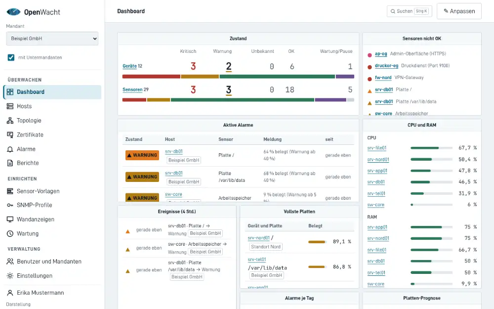

# Handbuch OpenWacht

OpenWacht überwacht Server, Netzwerkgeräte und Dienste für mehrere Mandanten (z. B. Standorte, Abteilungen oder Kunden) von einer
Zentrale aus. Es läuft vollständig im eigenen Netz, auch ganz ohne Internet. Dieses Handbuch beschreibt Version 1.0.4.

## Inhalt

1. [Installation](01-installation.md): Paket, Offline-Paket, Voraussetzungen, Update
2. [Erste Einrichtung](02-erste-einrichtung.md): Assistent im Browser, Anmeldung, Wurzelzertifikat
3. [Mandanten und Rollen](03-mandanten-und-rollen.md)
4. [Hosts, Gruppen und Abhängigkeiten](04-hosts.md)
5. [Agent für Linux und Windows](05-agent.md)
6. [SNMP, Zugangsprofile und CSV-Import](06-snmp.md)
7. [Sensoren und Vorlagen](07-sensoren-und-vorlagen.md)
8. [Alarme und Wartung](08-alarme-und-wartung.md)
9. [Berichte](09-berichte.md)
10. [Anmeldung über AD und SSO](10-ad-und-sso.md)
11. [API-Tokens](11-api-tokens.md)
12. [Agent-Updates](12-agent-updates.md)
13. [Sicherung, Rücksicherung und Audit-Log](13-sicherung.md)
14. [Betrieb ohne Internet](14-betrieb-ohne-internet.md): Offline-Paket bauen, Testergebnis
15. [Windows-Agent signieren und Release](15-signieren-und-verteilen.md): Authenticode, Reihenfolge der Signaturen
16. [Betrieb und Skalierung](16-betrieb-und-skalierung.md): Lasttest, Größen, Aufbewahrung, Ausfallkonzept
17. [Härtungsleitfaden](17-haertung.md): Ports, Firewall, Reverse Proxy, Anmeldung, Meldeweg (`security.txt`)
18. [Recht und Nachweise](18-recht-und-nachweise.md): Datenschutz-Vorlagen, BSI-Grundschutz, Barrierefreiheit, Rezertifizierung
19. [Anbindungen](19-anbindungen.md): Proxmox, vCenter, NetApp, XenServer, Citrix, FRITZ!Box, Hyper-V, Docker, Windows ohne Agent

Änderungen je Version: [Release-Notizen](../release-notizen.md).

## Begriffe

| Begriff | Bedeutung |
| --- | --- |
| Zentrale | Der Server mit Oberfläche, Datenbank (PostgreSQL) und allen Prüfungen. Programm `openwacht-zentrale`. |
| Agent | Kleines Programm auf einem überwachten Rechner (`openwacht-agent`). Es **sendet nur** Messwerte an die Zentrale und nimmt keine Befehle an. |
| Mandant | Ein Bereich mit eigenen Geräten, Benutzern und Alarmwegen. Mandanten bilden einen Baum (Hauptmandant → Untermandanten). |
| Host / Gerät | Ein überwachtes Ding: Server, Switch, Drucker, NAS. Es hat Sensoren. |
| Sensor | Eine einzelne Prüfung, z. B. Ping, offener Port, Platte, Dienst. |
| Betreiber | Das Konto, das die Installation pflegt (Einstellungen). Der erste Admin ist Betreiber. |

## Die wichtigsten Regeln

- **Agents senden nur.** Die Zentrale kann auf keinem überwachten Rechner etwas ausführen. Wer die Zentrale übernimmt,
  übernimmt damit nicht die Rechner.
- **Mandanten sind getrennt**, in der Anwendung und zusätzlich in der Datenbank (Row-Level Security). Wer in einem
  Mandanten eine Rolle hat, sieht diesen und alle darunter, nie Geschwister oder Eltern.
- **Updates für Agents nur signiert**, mit einem Schlüssel, der nie auf der Zentrale liegt.
- **Datensparsam:** keine Benutzernamen, Prozesslisten oder Inhalte von Dateien.

Programme, Pfade, Dienste und die Datenbank heißen durchgehend `openwacht-…` bzw. `openwacht`.
